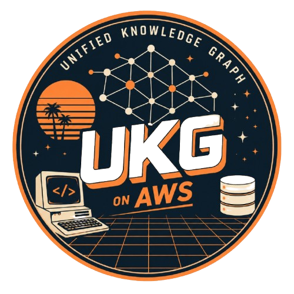
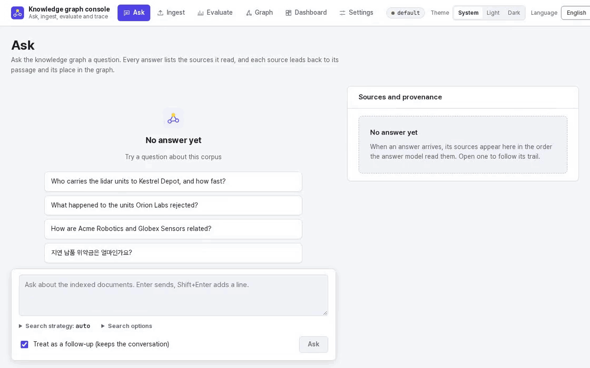

# Unified Knowledge Graph RAG on AWS

[](./LICENSE)
[](https://www.python.org/downloads/)
[](https://github.com/awslabs/unified-kg-rag-on-aws/actions/workflows/quality.yml)

🇬🇧 **[English README](./README.md)** · 🤝 **[기여 가이드](./CONTRIBUTING.md)**(영문)



Unified Knowledge Graph RAG on AWS는 대규모 다국어 문서를 Amazon Neptune과 Amazon OpenSearch Service 위의 지식 그래프로 만들고 Amazon Bedrock으로 질문에 답하며, 답변 근거의 문서와 페이지를 `[n]` 인용으로 보여 줍니다(`global`과 `drift`는 기본값으로 인용 없이 답합니다). 공개된 네 가지 방법인 Microsoft GraphRAG, LightRAG, HippoRAG 2, 그리고 선택 사항인 RAPTOR를 하나의 인덱스에서 실행해 질문마다 고르게 하고, 쓰는 방법의 인덱스만 만듭니다. 원 논문에 더한 기능은 [이 프레임워크를 쓰는 이유](#이-프레임워크를-쓰는-이유)에 있습니다. AWS 계정 없이 로컬에서 실행해 볼 수 있으며([빠른 시작](#빠른-시작)), 약 6 GB의 모델을 내려받은 뒤 5분 정도 걸립니다.

**이런 팀에 맞습니다.** 자기 AWS 계정에서 그래프 RAG(지식 그래프를 검색하는 검색 증강 생성)를 운영하면서 방법을 고르고, 성능을 측정하고, 문서가 바뀔 때마다 인덱스를 최신으로 유지해야 하는 팀.



## 이 프레임워크를 쓰는 이유

- **하나의 인덱스에서 네 가지 방법.** GraphRAG(커뮤니티 요약), LightRAG(이중 레벨 키워드), HippoRAG 2(엔티티와 패시지에 대한 개인화 PageRank), RAPTOR(요약 트리, 선택 사항)가 수집, 인덱싱, 캐싱, 검색을 함께 쓰고 검색 알고리즘만 다릅니다. `indexing.methodologies`는 고른 방법이 읽는 것만 만들고([방법론 프로필](./docs/concepts/overview.ko.md#방법론-프로필)), 답변은 각 번호 뒤의 문서와 PDF 페이지를 가리키는 `[n]` 표시로 근거를 인용합니다. 기본값으로 `global`과 `drift`를 뺀 모든 전략이 인용합니다([인용](./docs/guides/query.ko.md#인용)).
- **하이브리드 검색.** BM25, 벡터 검색, Neptune 그래프 순회 결과를 RRF(Reciprocal Rank Fusion)로 합치고 Bedrock 재순위화 모델로 다시 정렬합니다. `simple`과 `naive`는 그래프를 읽지 않고, `global`은 그 대신 커뮤니티 리포트를 map 단계로 읽습니다([검색](./docs/concepts/retrieval.ko.md)).
- **증분 인덱싱.** 문서 상태 레지스트리를 켜면 새 문서와 바뀐 문서만 다시 인덱싱해 운영 중인 그래프에 병합하고, 문서를 지우면 다른 문서가 기술하지 않는 내용만 제거합니다([증분 인덱싱](./docs/guides/incremental.ko.md)).
- **보유한 지식 그래프 연결(BYOKG).** 시드 그래프(JSONL, CSV, RDF 인스턴스 데이터)로 이미 가진 그래프를 가상 문서로 추출 그래프에 합칩니다. 문서가 기준으로 남고, 시드는 설명, 속성, IRI, 에지를 더합니다([Seed graphs](./docs/guides/seed-graphs.md)(영문)).
- **다국어.** 인덱싱과 질의 시점의 선택적 번역, 언어별 분석기(한국어는 `nori`), 다국어 키워드 추출을 지원합니다([다국어 코퍼스](./docs/guides/multilingual.ko.md)).
- **에이전트와 브라우저에서 사용.** 읽기 전용 MCP 서버(`run-mcp-server`, `mcp` extra)가 인덱스를 검색·답변·그래프 도구로 에이전트에 제공하고, 로컬 웹 콘솔(`run-console`, `console` extra)에서 인용과 함께 질문하고, 수집하고, 평가하고, 그래프를 탐색합니다([MCP 서버](./docs/guides/mcp.ko.md), [콘솔](./docs/guides/console.ko.md)).
- **가정이 아닌 측정.** `run-eval`은 기본으로 LLM 없는 지표(답변 일치, 검색 적중률, 그래프 커버리지)로, 선택하면 LLM 심사(RAGAS, assertion)로도 답변을 채점하고, 짝지은 신뢰 구간으로 전략을 비교하며, 질의마다 비용을 잽니다. 이렇게 정한 기본값은 [기본값과 근거](./docs/concepts/defaults-and-evidence.md)(영문)에 있습니다([평가](./docs/guides/evaluate.ko.md)).

원 논문, 그리고 Amazon Bedrock Knowledge Bases GraphRAG와 무엇이 다른지는 [개요](./docs/concepts/overview.ko.md#amazon-bedrock-knowledge-bases-graphrag와-비교)에 정리했습니다.

<a id="빠른-시작"></a>

## 빠른 시작(AWS 불필요)

한 대의 컴퓨터에서 내장 SQLite 저장소와 [Ollama](https://ollama.com) 모델로 모든 과정을 실행합니다. Python 3.11–3.12, [uv](https://docs.astral.sh/uv/), Ollama가 필요합니다.

**1. 설치**(`local` extra는 Ollama와 OpenAI 호환 클라이언트를 더하며 PyTorch는 설치하지 않습니다. 크로스 인코더 재순위화 모델은 `cross-encoder` extra입니다. [로컬에서 시작하기](./docs/getting-started/local.ko.md#설치) 참고. `--no-dev`는 기여자용 테스트·린트 도구를 빼며, 이 옵션 없이 `uv run`을 실행하면 그 도구가 설치됩니다):

```bash
git clone https://github.com/awslabs/unified-kg-rag-on-aws.git
cd unified-kg-rag-on-aws
uv sync --no-dev --extra local
```

**2. 기본 모델 두 개 내려받기**(약 6 GB):

```bash
ollama pull qwen2.5:7b-instruct
ollama pull bge-m3
```

**3. 파일 두 개짜리 예제 코퍼스 만들기**(이름, 회사, 수치는 모두 지어낸 것입니다):

```bash
mkdir -p sample-corpus
cat > sample-corpus/acme.txt <<'EOF'
Acme Robotics is a manufacturer of warehouse robots based in Springfield.
Alice Chen is the chief engineer at Acme Robotics and leads its motion-control team.
In 2024 Acme Robotics signed a supply agreement with Globex Sensors.
EOF
cat > sample-corpus/globex.txt <<'EOF'
Globex Sensors makes lidar sensors for mobile robots.
Bob Martin runs the sensor division of Globex Sensors.
Under its agreement with Acme Robotics, Globex Sensors supplies the lidar units
for the Acme warehouse robots.
EOF
```

**4. 지식 그래프 만들기:**

```bash
UKR__LOGGING__LEVEL=WARNING uv run --no-dev run-ingestion --backend local --source-directory ./sample-corpus
```

**5. 질문하기**(답변은 근거를 `[n]`으로 인용하고, `--verbose`는 모든 근거를 점수와 함께 보여 줍니다. `cross-encoder` extra가 없으면 재순위화 없이 실행하고 로그에 한 번 남깁니다):

```bash
UKR__LOGGING__LEVEL=WARNING uv run --no-dev run-rag --backend local --search-strategy mix --verbose \
  --query "How are Acme Robotics and Globex Sensors related?"
```

이어지는 GraphRAG 질의와, LLM 심사 없이 두 전략을 평가하는 방법은 [로컬에서 시작하기](./docs/getting-started/local.ko.md)에 있습니다.

### 실행 방식 고르기

| 방식 | 그래프·벡터 저장소 | 모델 | 시작 문서 |
|---|---|---|---|
| **로컬 모드**(개발용, AWS 불필요) | 서버 없는 내장 SQLite 그래프·벡터 저장소와 레지스트리, 또는 컨테이너로 띄운 Gremlin Server와 OpenSearch([`docker/compose.local.yaml`](./docker/compose.local.yaml)) | Ollama(또는 OpenAI 호환 서버), 또는 Amazon Bedrock | [로컬에서 시작하기](./docs/getting-started/local.ko.md) |
| **기존 AWS 리소스** | 이미 있는 Neptune 클러스터와 OpenSearch 도메인(증분 인덱싱에는 DynamoDB, 스테이지 캐시 동기화에만 S3 버킷) | Amazon Bedrock | [AWS에서 시작하기](./docs/getting-started/aws.ko.md): 설치, 자격 증명, 필수 모델, 첫 실행 |
| **번들 CDK 스택** | [`iac/`](./iac/README.md)(영문)가 Fargate 데이터 플레인, Step Functions 수집 파이프라인과 함께 생성 | Amazon Bedrock | [AWS에 배포](#aws에-배포선택) 후 [`iac/README.md` After deploy](./iac/README.md#after-deploy)(영문) |

로컬 모드는 개발과 평가 전용입니다. 내장 저장소는 호스트 한 대와 인덱스당 약 10만 문서까지를 다루고, 컨테이너에는 인증과 TLS가 없으며, 작은 로컬 모델은 그래프를 덜 정확하게 추출합니다.

## 아키텍처


수집은 중단한 곳에서 다시 시작할 수 있는 13단계 파이프라인입니다. 파싱, 청킹, 엔티티·관계 추출, 중복 엔티티 병합, LLM이 리포트를 쓰는 커뮤니티 탐지, 인덱싱을 거치고, `raptor`를 고르면 요약 트리도 만듭니다. 결과는 AWS에서는 Neptune과 OpenSearch에, 로컬 모드에서는 내장 SQLite나 컨테이너에 씁니다. 모든 전략은 같은 인덱스와 토큰 예산 위의 한 체인에서 실행되며, CLI에서는 `--search-strategy`, Python에서는 `RAGInput.search_strategy`로 고릅니다.

| 방법 | 전략 | 잘하는 질문 |
|---|---|---|
| GraphRAG(커뮤니티 요약) | `local`, `global`, `drift`, `simple` | 코퍼스 전체에 걸친 주제 질문(`global`, `drift`), 특정 엔티티에 대한 질문(`local`) |
| LightRAG(이중 레벨 키워드) | `mix`, `hybrid`, `naive` | 키워드 중심 조회, 그리고 청크만 읽는 빠른 기준선(`naive`) |
| HippoRAG 2(개인화 PageRank) | `ppr` | 가장 적은 비용의 멀티홉 질문. 질의당 LLM 호출 한 번 |
| RAPTOR(요약 트리, 선택 사항) | `tree` | 그래프 추출 없는 저렴한 인덱스. 멀티홉 질문에서는 `naive`보다 나았고 그래프 전략보다 낮았습니다([근거](./docs/concepts/defaults-and-evidence.md#raptor-summary-tree)(영문)) |

`structured`(선택 사항, 논문의 방법이 아님)는 검증을 거친 읽기 전용 그래프 질의로 개수, 순위, 목록, 경로에 답하며, 그래프가 있는 모든 네임스페이스에서 쓸 수 있고 답을 못 만들면 `local`로 넘어갑니다([구조화 질의](./docs/guides/structured-queries.ko.md)). `iterative`는 `mix`나 `local`을 감싸, 멀티홉 질문의 연결 엔티티에 대해 정해진 횟수만큼 후속 검색을 더 합니다. 기본값인 `auto`에서는 LLM 라우터가 질의마다 `search.auto_routable_strategies`(기본값 `local`, `mix`, `global`, `iterative`) 중 하나를 고릅니다. 어떤 전략을 언제 쓰는지는 [검색](./docs/concepts/retrieval.ko.md#검색-전략-선택), 계층 구조·알고리즘·데이터 모델은 [설계 문서](./docs/design.md)(영문)에 있습니다.

이 모든 작업을 내 컴퓨터의 브라우저에서 하려면 로컬 [콘솔](./docs/guides/console.ko.md)(`run-console`)을 시작하세요. 웹 클라이언트는 Node.js 20.19 이상으로 한 번 빌드하고(`cd console/web && npm ci && npm run build`), `uv run --no-dev --extra console --extra local python console/demo/demo.py --models fake`로 합성 코퍼스에서 바로 써 볼 수 있습니다.

## AWS에 배포(선택)

[`iac/`](./iac/README.md)(영문)의 AWS CDK 앱이 스택 전체를 만듭니다. 엔드포인트를 갖춘 VPC, Neptune, OpenSearch, DynamoDB 문서 상태 테이블, S3 캐시 버킷, ECS Fargate 데이터 플레인, Step Functions 수집 파이프라인, CloudWatch 대시보드와 경보, 선택적 Bedrock Guardrail이 포함됩니다. `cdk synth`, `cdk bootstrap`, `cdk deploy --all` 명령과 `-c key=value` 옵션 전체는 [`iac/README.md`](./iac/README.md#quick-start)(영문)에 있습니다. 저장소는 VPC 안에서만 접근할 수 있으므로 배포된 Fargate 태스크가 CLI를 실행합니다([After deploy](./iac/README.md#after-deploy), 영문).

> **비용과 정리.**
>
> - **모델 호출 비용은 코퍼스에 비례해 늘어납니다.** 짧은 문단 3,318개(약 28만 단어)의 인덱스를 기본 모델로 만드는 데 Bedrock 호출 16,069번, 2026년 11월 정가 기준 $371.64가 들었고, 질의 비용은 `ppr`의 $0.016부터 `mix`·`global`의 약 $0.06까지였습니다([측정 방법](./docs/concepts/defaults-and-evidence.md#how-the-measurements-were-run)(영문), [비용 조절 수단](./docs/guides/ingest.ko.md#비용-조절-수단)).
> - **저장소는 시간 단위로 과금됩니다.** Neptune과 OpenSearch는 시간 단위로 과금되며, `public` 네트워크 모드에서는 NAT 게이트웨이 비용이 추가됩니다.
> - **정리.** 기본 `dev` 환경은 `cdk destroy --all`로 정리되지만, dev가 아닌 환경은 기본적으로 상태 저장소를 보존하고 삭제 방지를 켭니다. 프로덕션에 쓰기 전에 [`iac/README.md`](./iac/README.md)(영문)의 강화 옵션(`use_cmk`, `deletion_protection`, 다중 AZ 구성, `vpc_flow_logs`)을 검토하세요.

## 문서 안내

[문서 안내 페이지](./docs/index.ko.md)([English](./docs/index.md))에서 시작하세요. 역할별 읽는 순서, 문서 지도, 하려는 일별 안내가 있습니다. 한국어로 옮긴 문서는 이 README, 문서 안내, 개요, 검색, 범위와 네임스페이스, 시작하기 두 문서, 그리고 설정·수집·다국어 코퍼스·질의·증분 인덱싱·도메인 적응·평가 가이드입니다. "(영문)"으로 표시한 문서는 영문으로만 제공합니다.

| 독자 | 시작할 문서 |
|---|---|
| **처음 써 보는 평가자**(AWS 없이) | [로컬에서 시작하기](./docs/getting-started/local.ko.md), 다음으로 [개요](./docs/concepts/overview.ko.md) |
| **AWS에서 구축하는 개발자** | [AWS에서 시작하기](./docs/getting-started/aws.ko.md), 이어서 [설정](./docs/guides/configure.ko.md), [수집](./docs/guides/ingest.ko.md), [질의](./docs/guides/query.ko.md), CDK 스택은 [`iac/README.md`](./iac/README.md)(영문) |
| **운영자** | [운영 런북](./docs/operations.md)과 [`iac/README.md`](./iac/README.md)(영문) |
| **평가자·연구자** | [평가](./docs/guides/evaluate.ko.md), [기본값과 근거](./docs/concepts/defaults-and-evidence.md)(영문), [원 논문을 넘어서](./docs/concepts/overview.ko.md#원-논문을-넘어서) |
| **확장 개발자** | [설계 문서](./docs/design.md)와 [확장 가이드](./docs/guides/extend.md#15-extension-guide)(영문) |
| **기여자** | [CONTRIBUTING.md](./CONTRIBUTING.md)(영문) |

모든 플래그는 [CLI 레퍼런스](./docs/reference/cli.md), 모든 설정 키는 [설정 레퍼런스](./docs/reference/configuration.md), 지원 모델은 [모델 카탈로그](./docs/reference/models.md)에 있습니다(모두 영문). 릴리스 노트는 [CHANGELOG.md](./CHANGELOG.md)(영문)에 있습니다. [AWS Open Source Blog 글](https://aws.amazon.com/ko/blogs/opensource/unified-knowledge-graph-rag-on-aws-graphrag-and-lightrag-on-one-stack/)(영문)은 GraphRAG와 LightRAG를 한 스택에 올린 첫 릴리스를 소개합니다.

## 보안 및 면책

이 프로젝트는 **교육과 예시 목적의 참조 프레임워크**입니다. 어떠한 보증도 없이 "있는 그대로(AS IS)" 제공됩니다([LICENSE](./LICENSE) 참고). **별도의 보안 테스트, 위협 모델링, 보안 강화 없이 프로덕션 환경에 배포해서는 안 됩니다.**

- 본인의 AWS 계정에서 본인의 리소스를 대상으로 실행하세요. 배포 환경의 IAM 정책, 네트워크 구성, 데이터 분류, 최종 사용자 인증은 사용자 책임입니다.
- 선택 사항인 CDK 스택(`iac/`)은 안전한 기본값(프라이빗 VPC 격리, AWS 관리형 키 또는 `use_cmk`로 켜는 고객 관리형 KMS 키를 이용한 저장 데이터 암호화, TLS 강제, 최소 권한 IAM, PII·프롬프트 공격 필터링용 선택적 Bedrock Guardrail)을 제공하지만, 배포 책임은 사용자에게 있으므로 환경에 맞게 검토해야 합니다.
- 프로덕션에 쓰기 전에 Bedrock Guardrail(`aws.bedrock.guardrail`)을 켜고, 용도에 맞는 호출 제한과 모니터링을 적용하세요.
- 보안 이슈는 공개 이슈로 올리지 말고 [SECURITY.md](./SECURITY.md)(영문)의 절차를 따라 신고하세요.

## 기여

기여를 환영합니다. 개발 환경, 테스트, PR 절차는 [CONTRIBUTING.md](./CONTRIBUTING.md)를, 확장 방법은 [설계 문서 §15](./docs/guides/extend.md#15-extension-guide)를 참고하세요(모두 영문). 대부분의 확장은 레지스트리 등록만으로 끝나며 디스패치 코드를 고칠 필요가 없습니다.

## 라이선스

이 프로젝트는 Apache-2.0 라이선스로 배포됩니다. 자세한 내용은 [LICENSE](./LICENSE) 파일을 참고하세요. AWS가 awslabs 조직에서 유지관리합니다.

## 감사의 말

라이브러리 기능 개발과 검증에 크게 기여해 주신 **강지현**님, 그리고 출시 전 꼼꼼한 리뷰와 실제 코퍼스 테스트를 진행해 주신 **Yusuke Tanimiya**님께 감사드립니다. 두 분 덕분에 프레임워크가 한층 견고해졌습니다.

## 참고문헌

- Microsoft GraphRAG: [From Local to Global: A Graph RAG Approach to Query-Focused Summarization](https://arxiv.org/abs/2404.16130) · [라이브러리](https://github.com/microsoft/graphrag)
- LightRAG: [Simple and Fast Retrieval-Augmented Generation](https://arxiv.org/abs/2410.05779) · [라이브러리](https://github.com/HKUDS/LightRAG)
- HippoRAG 2: [From RAG to Memory: Non-Parametric Continual Learning for Large Language Models](https://arxiv.org/abs/2502.14802) · [라이브러리](https://github.com/OSU-NLP-Group/HippoRAG)
- RAPTOR: [Recursive Abstractive Processing for Tree-Organized Retrieval](https://arxiv.org/abs/2401.18059) · [코드](https://github.com/parthsarthi03/raptor)

DRIFT 검색, 동적 커뮤니티 선택, 자동 튜닝, LazyGraphRAG 등 GraphRAG 관련 추가 자료는 [설계 문서](./docs/design.md#16-further-reading)(영문)에 정리되어 있습니다.
