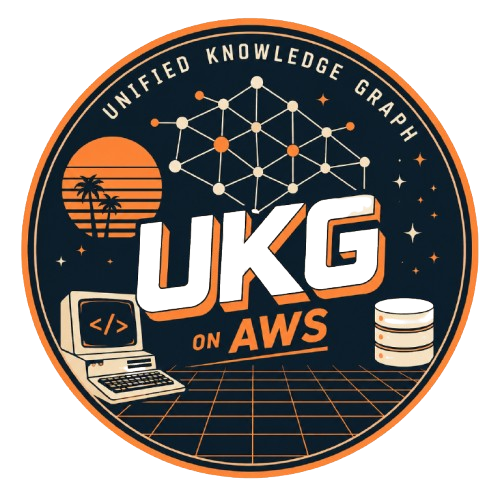

# Unified Knowledge Graph RAG on AWS

[](./LICENSE)
[](https://www.python.org/downloads/)

🇰🇷 **[한국어 README](./README.ko.md)** · 🤝 **[Contributing](./CONTRIBUTING.md)**

<p align="center">
  
</p>

An AWS-native knowledge graph RAG (Retrieval-Augmented Generation) framework that turns large, multilingual document corpora into a knowledge graph on Amazon Neptune and Amazon OpenSearch Service and answers questions over it with Amazon Bedrock, using multi-hop graph traversal to reason across document boundaries. It reimplements Microsoft GraphRAG and LightRAG on one shared stack, so you choose the retrieval methodology per query rather than per deployment. Running both methodologies on one stack, triple-hybrid search, incremental indexing, and multilingual processing are deliberate enhancements over the source papers.

Read the [AWS Open Source Blog introduction](https://aws.amazon.com/blogs/opensource/unified-knowledge-graph-rag-on-aws-graphrag-and-lightrag-on-one-stack/) for an overview of the architecture, both retrieval methodologies, and benchmark results.

## Why this framework

- **Two methodologies on one AWS stack.** GraphRAG (community summaries) and LightRAG (dual-level keywords) share ingestion, indexing, caching and search; only the retrieval algorithm differs, chosen per query. Every answer returns the sources that were actually in the model's context.
- **Triple-hybrid search.** BM25, vector search and Neptune graph traversal, fused with Reciprocal Rank Fusion and reranked with a Bedrock rerank model.
- **Incremental indexing.** With the doc-status registry on (`providers.doc_status.enabled`), only new and changed documents are re-indexed and merged into the live graph; deleting a document removes only what no other document states.
- **Multilingual.** Optional translation at indexing and query time, per-language analyzers (for example `nori` for Korean) and multilingual keyword extraction.
- **Prompt tuning, evaluation and visualization.** `run-prompt-tuning` writes domain-adapted prompts from a corpus sample; `run-eval` adds LLM-free coverage, retrieval and answer-match metrics to LangChain and RAGAS judges; `run-visualization` renders an exported graph.
- **Pluggable.** Storage and model backends sit behind ports, and strategies, renderers, parsers and providers register through registries ([extension guide](./docs/design.md#15-extension-guide)).

## Architecture


Ingestion is a resumable 12-stage pipeline (parse, chunk, extract entities and relationships, resolve, detect communities with LLM-written reports, index) into the graph and search stores: Neptune and OpenSearch on AWS, embedded SQLite or containers in local mode.

Every strategy runs through the same hybrid scorer and token budget. Pick one with `--search-strategy` (CLI) or `RAGInput.search_strategy` (Python):

| Strategy | Methodology | Use when |
|---|---|---|
| `auto` (default) | GraphRAG | You are not sure; an LLM router picks one of `search.auto_routable_strategies` per query (default `local`, `mix`, `global`; add `drift` to route to it) |
| `simple` | GraphRAG | Fast factual lookups; vector + keyword search without graph traversal |
| `local` | GraphRAG | Questions about specific entities and their relationships |
| `global` | GraphRAG | Broad or thematic questions, answered by map-reduce over community reports |
| `drift` | GraphRAG | Complex questions that need iterative exploration |
| `mix` | LightRAG | General LightRAG use; entity and relationship keyword retrieval plus chunk retrieval |
| `hybrid` | LightRAG | Keyword-driven graph questions, without the extra chunk retrieval |
| `naive` | LightRAG | A fast chunk-only baseline (BM25 + vector, no graph) and comparison runs |

See the [User Guide §4](./docs/user-guide.md#4-querying-run-rag) for per-strategy behavior and the [Design Doc](./docs/design.md) for the layer map, algorithms, data model and the detailed [ingestion](./docs/design.md#4-ingestion-pipeline), [incremental](./docs/design.md#5-incremental-indexing) and [retrieval](./docs/design.md#6-retrieval-two-methodologies) diagrams.

## Quickstart

### Choose how to run

| Path | Graph and vector stores | Models | Start here |
|---|---|---|---|
| **Local mode** (development, no AWS) | Embedded SQLite graph and vector stores and registry, no server; or Gremlin Server and OpenSearch in containers ([`docker/compose.local.yaml`](./docker/compose.local.yaml)) | Ollama (or any OpenAI-compatible server), or Amazon Bedrock | Follow [Local mode](./docs/user-guide.md#local-mode-no-aws): pull the two Ollama models, then pass `--backend local` |
| **Existing AWS resources** | Your Neptune cluster and OpenSearch domain (plus DynamoDB for incremental indexing, and an S3 bucket only to sync the stage cache) | Amazon Bedrock | Copy `config-template.yaml` to `config.yaml` and set the endpoints |
| **Bundled CDK stack** | Created by [`iac/`](./iac/README.md), with a Fargate data plane and a Step Functions ingestion pipeline | Amazon Bedrock | [Deploy on AWS](#deploy-on-aws-optional), then [`iac/README.md` After deploy](./iac/README.md#after-deploy) |

The AWS paths call Amazon Bedrock, so enable the
[required models](./docs/user-guide.md#required-models) first. Local mode is
for development and evaluation only: the embedded stores serve one host and
about 100,000 documents per index, the containers have no authentication or TLS, and small
local models extract weaker graphs.

### Prerequisites

Python 3.11–3.12 and [uv](https://docs.astral.sh/uv/) (`pip` also works). Local mode needs [Ollama](https://ollama.com) (and Docker with Compose 2.23.1+ only for the stores in containers); the AWS paths need credentials with Bedrock access and, for existing resources, a Neptune cluster and an OpenSearch domain (the framework connects to services and never creates them); the CDK stack needs what [`iac/README.md`](./iac/README.md#quick-start) lists.

### Install and configure

```bash
git clone https://github.com/awslabs/unified-kg-rag-on-aws.git
cd unified-kg-rag-on-aws
uv sync --extra eval --extra viz        # or: pip install -e '.[eval,viz]'
cp config-template.yaml config.yaml     # then set your Bedrock region and service endpoints
```

If OpenSearch uses username/password instead of IAM (`aws.opensearch.use_iam: false`), copy `.env-template` to `.env` in the directory you run the CLIs from and fill in the credentials. `uv sync` alone installs ingestion and queries; `run-eval`'s LangChain and RAGAS judges need the `eval` extra and `run-visualization` the `viz` extra. Parsing Markdown and HTML needs the optional `unstructured` extra (`uv sync --extra unstructured`); PDF, TXT, CSV, and JSON work out of the box.

### Ingest, query, evaluate

`uv run` runs the CLIs in the project environment; with `pip`, activate the virtual environment instead and drop the `uv run` prefix.

```bash
# Index a corpus (incremental when the doc-status registry is on)
uv run run-ingestion --source-directory ./source --config-path config.yaml

# Query with either methodology, or chat with conversation memory
uv run run-rag --query "What are the main themes?" --search-strategy global --config-path config.yaml
uv run run-rag --query "How are Alice and Acme related?" --search-strategy mix --config-path config.yaml
uv run run-rag --interactive --use-memory --conversation-id my-session --config-path config.yaml

# Evaluate (LangChain + RAGAS + graph-aware coverage, retrieval and answer-match metrics)
uv run run-eval --data-path eval_data.json --config-path config.yaml

# Optional: render an exported graph, or tune prompts to your domain
uv run run-visualization --data-path visualization_data.json --output-directory ./viz --config-path config.yaml
uv run run-prompt-tuning --source-directory ./source --output-path tuned_prompts.yaml --config-path config.yaml
```

The [User Guide](./docs/user-guide.md) covers every CLI, the evaluation data format and the evaluators, the [CLI Reference](./docs/cli.md) every flag, and the [Configuration Reference](./docs/configuration.md) every configuration key.

## Deploy on AWS (optional)

The [`iac/`](./iac/README.md) AWS CDK app provisions the whole stack: a VPC with endpoints, Neptune, OpenSearch, the DynamoDB document-status table, an S3 cache bucket, an ECS Fargate data plane, a Step Functions ingestion pipeline, CloudWatch dashboards and alarms, and an optional Bedrock Guardrail.

[`iac/README.md`](./iac/README.md#quick-start) has the `cdk synth`, `cdk bootstrap` and `cdk deploy --all` commands and every `-c key=value` option. The stores are reachable only from inside the VPC, so the deployed Fargate tasks run the CLIs; [After deploy](./iac/README.md#after-deploy) has the commands to push the image, start an ingestion and run a query or an evaluation.

> **Cost and teardown.** Neptune and OpenSearch bill hourly, and `public` network mode adds NAT gateways. The default `dev` environment tears down with `cdk destroy --all`; non-dev environments default to retaining stateful stores with deletion protection on. Review the hardening options (`use_cmk`, `deletion_protection`, Multi-AZ sizing, `vpc_flow_logs`) in [`iac/README.md`](./iac/README.md) before production use.

## Documentation

| Document | Covers |
|---|---|
| [User Guide](./docs/user-guide.md) ([한국어](./docs/user-guide.ko.md)) | Configuration, CLI flags, incremental indexing, evaluation, library usage, [limitations](./docs/user-guide.md#12-limitations) |
| [CLI Reference](./docs/cli.md) | Every flag of every CLI: default and description (generated from the parsers) |
| [Configuration Reference](./docs/configuration.md) | Every configuration key: type, default, description (generated from the code) |
| [Model Catalog](./docs/models.md) ([한국어](./docs/models.ko.md)) | Supported Bedrock models and per-provider request differences |
| [Operator Runbook](./docs/operations.md) ([한국어](./docs/operations.ko.md)) | Re-ingestion, incremental runs, failed documents, caches, common errors |
| [Design Doc](./docs/design.md) ([한국어](./docs/design.ko.md)) | Hexagonal architecture, algorithms, data model, extension guide, further reading |
| [`iac/README.md`](./iac/README.md) | CDK stacks, topology, cost drivers, `-c key=value` options, Guardrail deployment, after-deploy commands |
| [CONTRIBUTING.md](./CONTRIBUTING.md) | Development setup, tests, quality gate, branch and commit rules |
| [CHANGELOG.md](./CHANGELOG.md) | Release notes |
| [SECURITY.md](./SECURITY.md) | Reporting security issues |

## Security & Disclaimer

This project is a **reference framework provided for educational and illustrative purposes**. It is offered "AS IS" without warranty of any kind (see [LICENSE](LICENSE)). **It should not be deployed to a production environment without your own additional security testing, threat modeling, and hardening.**

- Run it in your own AWS account against your own resources; you are responsible for IAM policies, network configuration, data classification, and end-user authentication in your deployment.
- The optional CDK stack (`iac/`) provides secure defaults (private-VPC isolation, encryption at rest with AWS-managed keys or an optional customer-managed KMS key via `use_cmk`, enforced TLS, least-privilege IAM, an optional Bedrock Guardrail for PII and prompt-attack filtering), but you own the deployment and should review it for your environment.
- Enable the Bedrock Guardrail (`aws.bedrock.guardrail`) and apply rate limiting and monitoring appropriate to your use case before production use.
- To report a security issue, see [SECURITY.md](SECURITY.md); please do not open a public issue.

## Contributing

Contributions are welcome. See [CONTRIBUTING.md](CONTRIBUTING.md) for development setup, tests and the pull-request workflow, and [Design Doc §15](./docs/design.md#15-extension-guide) for extension recipes; most extensions are a registry registration and need no dispatch-code edits.

## License

This project is licensed under the Apache-2.0 License. See the [LICENSE](LICENSE) file for details. Maintained by AWS under the awslabs organization.

## Acknowledgments

Thanks to **Jihyeon Kang** for significant contributions to the library's feature development and validation, and to **Yusuke Tanimiya** for a thorough review and real-corpus testing — both of which strengthened the framework ahead of release.

## References

- Microsoft GraphRAG: [From Local to Global: A Graph RAG Approach to Query-Focused Summarization](https://arxiv.org/abs/2404.16130) · [library](https://github.com/microsoft/graphrag)
- LightRAG: [Simple and Fast Retrieval-Augmented Generation](https://arxiv.org/abs/2410.05779) · [library](https://github.com/HKUDS/LightRAG)

Further reading on GraphRAG (DRIFT search, dynamic community selection, auto-tuning, LazyGraphRAG) is listed in the [Design Doc](./docs/design.md#16-further-reading).
