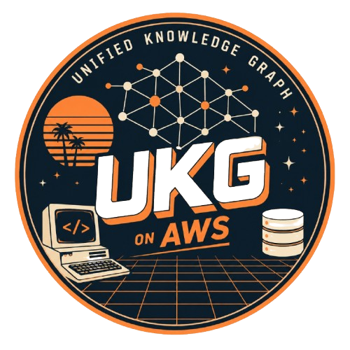

# Unified Knowledge Graph RAG on AWS

[](./LICENSE)
[](https://www.python.org/downloads/)
[](https://github.com/awslabs/unified-kg-rag-on-aws/actions/workflows/quality.yml)

🇰🇷 **[한국어 README](./README.ko.md)** · 🤝 **[Contributing](./CONTRIBUTING.md)**



Unified Knowledge Graph RAG on AWS turns a large, multilingual document collection into a knowledge graph on Amazon Neptune and Amazon OpenSearch Service and answers questions over it with Amazon Bedrock, returning the source passages each answer used. It runs four published methods on one index: Microsoft GraphRAG, LightRAG, HippoRAG 2 and, opt-in, RAPTOR. You choose the method per question, not per deployment, and build only the methods you use. Beyond the papers it adds hybrid search (keyword, vector and graph, fused and reranked), incremental indexing that removes exactly what a deleted document stated, Korean and other non-English corpora, merging a knowledge graph you already have, and an evaluation CLI whose defaults are backed by published measurements. Try it locally in five minutes without an AWS account.

**For** teams who want graph RAG (retrieval-augmented generation over a knowledge graph) in their own AWS account and need to pick a method, measure it and keep the index current as documents change.

<!-- Console demo GIF goes here, once the console app lands (at most 5 MB and 15 s, with a PNG fallback).
Alt text: "Console demo: a question about two companies is answered with the mix strategy; the answer lists its source passages, and the panel shows the knowledge-graph neighbourhood and the strategy the router chose." -->

## Why this framework

- **Four methods on one index.** GraphRAG (community summaries), LightRAG (dual-level keywords), HippoRAG 2 (Personalized PageRank over entities and passages) and RAPTOR (a summary tree, opt-in) share ingestion, indexing, caching and search; only the retrieval algorithm differs. `indexing.methodologies` builds only what the selected ones read ([Methodology profiles](./docs/concepts/overview.md#methodology-profiles)), and every answer returns the source passages that were in the model's context.
- **Hybrid search.** BM25, vector search and Neptune graph traversal, fused with Reciprocal Rank Fusion and reranked with a Bedrock rerank model. `simple` and `naive` read no graph, and `global` maps community reports instead ([Retrieval](./docs/concepts/retrieval.md)).
- **Incremental indexing.** With the document-status registry on, only new and changed documents are re-indexed and merged into the live graph, and deleting a document removes only what no other document states ([Incremental indexing](./docs/guides/incremental.md)).
- **Bring your own knowledge graph.** Seed graphs (JSONL, CSV or RDF instance data) merge a graph you already have into the extracted one as virtual documents: the documents stay canonical, and the seed adds descriptions, properties, IRIs and edges ([Seed graphs](./docs/guides/seed-graphs.md)).
- **Multilingual.** Optional translation at indexing and query time, per-language analyzers (`nori` for Korean) and multilingual keyword extraction ([Multilingual corpora](./docs/guides/multilingual.md)).
- **Measured, not assumed.** `run-eval` scores answers with LLM-free metrics by default (answer match, retrieval hit rate, graph coverage) and opt-in LLM judges (RAGAS, assertions), compares strategies with paired intervals and meters each query's cost; the defaults it set are on [Defaults and evidence](./docs/concepts/defaults-and-evidence.md) ([Evaluation](./docs/guides/evaluate.md)).

How this compares with the papers and with Amazon Bedrock Knowledge Bases GraphRAG: [Overview](./docs/concepts/overview.md#compared-with-amazon-bedrock-knowledge-bases-graphrag).

<a id="quickstart"></a>

## Quickstart (five minutes, no AWS)

This runs everything on one machine: embedded SQLite stores and [Ollama](https://ollama.com) models. You need Python 3.11–3.12, [uv](https://docs.astral.sh/uv/) and Ollama.

**1. Install** (the `local` extra installs PyTorch, several GB on Linux; [CPU-only build](./docs/getting-started/local.md#install)):

```bash
git clone https://github.com/awslabs/unified-kg-rag-on-aws.git
cd unified-kg-rag-on-aws
uv sync --extra local
```

**2. Pull the two default models:**

```bash
ollama pull qwen2.5:7b-instruct
ollama pull bge-m3
```

**3. Write a two-file sample corpus** (the names, companies and figures are made up):

```bash
mkdir -p sample-corpus
cat > sample-corpus/acme.txt <<'EOF'
Acme Robotics is a manufacturer of warehouse robots based in Springfield.
Alice Chen is the chief engineer at Acme Robotics and leads its motion-control team.
In 2024 Acme Robotics signed a supply agreement with Globex Sensors.
EOF
cat > sample-corpus/globex.txt <<'EOF'
Globex Sensors makes lidar sensors for mobile robots.
Bob Martin runs the sensor division of Globex Sensors.
Under its agreement with Acme Robotics, Globex Sensors supplies the lidar units
for the Acme warehouse robots.
EOF
```

**4. Build the knowledge graph:**

```bash
UKR__LOGGING__LEVEL=WARNING uv run run-ingestion --backend local --source-directory ./sample-corpus
```

**5. Ask a question** (`--verbose` also lists the sources the answer used; the first query downloads a small rerank model from Hugging Face):

```bash
UKR__LOGGING__LEVEL=WARNING uv run run-rag --backend local --search-strategy mix --verbose \
  --query "How are Acme Robotics and Globex Sensors related?"
```

[Getting started locally](./docs/getting-started/local.md) continues from here: a GraphRAG query, and an evaluation of two strategies without an LLM judge.

### Choose how to run

| Path | Graph and vector stores | Models | Start here |
|---|---|---|---|
| **Local mode** (development, no AWS) | Embedded SQLite graph and vector stores and registry, no server; or Gremlin Server and OpenSearch in containers ([`docker/compose.local.yaml`](./docker/compose.local.yaml)) | Ollama (or any OpenAI-compatible server), or Amazon Bedrock | [Getting started locally](./docs/getting-started/local.md) |
| **Existing AWS resources** | Your Neptune cluster and OpenSearch domain (plus DynamoDB for incremental indexing, and an S3 bucket only to sync the stage cache) | Amazon Bedrock | [Getting started on AWS](./docs/getting-started/aws.md): install, credentials, required models and a first run |
| **Bundled CDK stack** | Created by [`iac/`](./iac/README.md), with a Fargate data plane and a Step Functions ingestion pipeline | Amazon Bedrock | [Deploy on AWS](#deploy-on-aws-optional), then [`iac/README.md` After deploy](./iac/README.md#after-deploy) |

Local mode is for development and evaluation only: the embedded stores serve one host and about 100,000 documents per index, the containers have no authentication or TLS, and small local models extract weaker graphs.

## Architecture


Ingestion is a resumable 13-stage pipeline: parse, chunk, extract entities and relationships, merge duplicate entities, detect communities with LLM-written reports, index, and for `raptor` build a summary tree. It writes to Neptune and OpenSearch on AWS, or to embedded SQLite or containers in local mode. Every strategy then runs in one chain over the same indexes and token budget; pick one with `--search-strategy` (CLI) or `RAGInput.search_strategy` (Python):

| Method | Strategies | Strong at |
|---|---|---|
| GraphRAG (community summaries) | `local`, `global`, `drift`, `simple`, `structured` | Thematic questions over the whole corpus (`global`, `drift`), questions about specific entities (`local`), and counts, rankings and paths the graph store computes (`structured`) |
| LightRAG (dual-level keywords) | `mix`, `hybrid`, `naive` | Keyword-driven lookups, and a fast chunk-only baseline (`naive`) |
| HippoRAG 2 (Personalized PageRank) | `ppr` | Multi-hop questions at the lowest cost: one LLM call a query |
| RAPTOR (summary tree, opt-in) | `tree` | A cheap index without graph extraction; on multi-hop questions it answered better than `naive`, below the graph strategies ([evidence](./docs/concepts/defaults-and-evidence.md#raptor-summary-tree)) |

`iterative` wraps `mix` or `local` with bounded follow-up rounds on the bridge entities of a multi-hop question. `auto`, the default, lets an LLM router pick one of `search.auto_routable_strategies` per query (default `local`, `mix`, `global`, `iterative`). [Retrieval](./docs/concepts/retrieval.md#search-strategies--when-to-use-which) explains when to use which strategy, and the [Design Doc](./docs/design.md) the layers, algorithms and data model.

To do all of this in a browser on your machine, start the local [console](./docs/guides/console.md) (`run-console`; `uv run python console/demo/demo.py --models fake` tries it on a synthetic corpus).

## Deploy on AWS (optional)

The [`iac/`](./iac/README.md) AWS CDK app provisions the whole stack: a VPC with endpoints, Neptune, OpenSearch, the DynamoDB document-status table, an S3 cache bucket, an ECS Fargate data plane, a Step Functions ingestion pipeline, CloudWatch dashboards and alarms, and an optional Bedrock Guardrail. [`iac/README.md`](./iac/README.md#quick-start) has the `cdk synth`, `cdk bootstrap` and `cdk deploy --all` commands and every `-c key=value` option; the stores are reachable only from inside the VPC, so the deployed Fargate tasks run the CLIs ([After deploy](./iac/README.md#after-deploy)).

> **Cost and teardown.** Model calls are the cost that grows with the corpus: building an index of 3,318 short paragraphs (about 280,000 words) with the default models took 16,069 Bedrock calls, $371.64 at November 2026 list prices, and a query cost from $0.016 (`ppr`) to about $0.06 (`mix`, `global`) ([how it was measured](./docs/concepts/defaults-and-evidence.md#how-the-measurements-were-run); [cost levers](./docs/guides/ingest.md#cost-levers)). Neptune and OpenSearch bill hourly, and `public` network mode adds NAT gateways. The default `dev` environment tears down with `cdk destroy --all`; non-dev environments default to retaining stateful stores with deletion protection on. Review the hardening options (`use_cmk`, `deletion_protection`, Multi-AZ sizing, `vpc_flow_logs`) in [`iac/README.md`](./iac/README.md) before production use.

## Documentation

Start at the [documentation hub](./docs/index.md) ([한국어](./docs/index.ko.md)): reading paths by role, a page map and an "I want to" index.

| You are | Start with |
|---|---|
| **First-time evaluator** (no AWS) | [Getting started locally](./docs/getting-started/local.md), then the [Overview](./docs/concepts/overview.md) |
| **Builder on AWS** | [Getting started on AWS](./docs/getting-started/aws.md), then [Configuration](./docs/guides/configure.md), [Ingestion](./docs/guides/ingest.md) and [Querying](./docs/guides/query.md), or [`iac/README.md`](./iac/README.md) for the CDK stack |
| **Operator** | The [Operator Runbook](./docs/operations.md) and [`iac/README.md`](./iac/README.md) |
| **Evaluator or researcher** | [Evaluation](./docs/guides/evaluate.md), [Defaults and evidence](./docs/concepts/defaults-and-evidence.md) and [Beyond the papers](./docs/concepts/overview.md#beyond-the-papers) |
| **Extender** | The [Design Doc](./docs/design.md) and its [Extension Guide](./docs/design.md#15-extension-guide) |
| **Contributor** | [CONTRIBUTING.md](./CONTRIBUTING.md) |

Every flag is in the [CLI Reference](./docs/reference/cli.md), every configuration key in the [Configuration Reference](./docs/reference/configuration.md), and the supported models in the [Model Catalog](./docs/reference/models.md). Release notes: [CHANGELOG.md](./CHANGELOG.md). The [AWS Open Source Blog post](https://aws.amazon.com/blogs/opensource/unified-knowledge-graph-rag-on-aws-graphrag-and-lightrag-on-one-stack/) introduced the first release, GraphRAG and LightRAG on one stack.

## Security & Disclaimer

This project is a **reference framework provided for educational and illustrative purposes**. It is offered "AS IS" without warranty of any kind (see [LICENSE](LICENSE)). **It should not be deployed to a production environment without your own additional security testing, threat modeling, and hardening.**

- Run it in your own AWS account against your own resources; you are responsible for IAM policies, network configuration, data classification, and end-user authentication in your deployment.
- The optional CDK stack (`iac/`) provides secure defaults (private-VPC isolation, encryption at rest with AWS-managed keys or an optional customer-managed KMS key via `use_cmk`, enforced TLS, least-privilege IAM, an optional Bedrock Guardrail for PII and prompt-attack filtering), but you own the deployment and should review it for your environment.
- Enable the Bedrock Guardrail (`aws.bedrock.guardrail`) and apply rate limiting and monitoring appropriate to your use case before production use.
- To report a security issue, see [SECURITY.md](SECURITY.md); please do not open a public issue.

## Contributing

Contributions are welcome. See [CONTRIBUTING.md](CONTRIBUTING.md) for development setup, tests and the pull-request workflow, and [Design Doc §15](./docs/design.md#15-extension-guide) for extension recipes; most extensions are a registry registration and need no dispatch-code edits.

## License

This project is licensed under the Apache-2.0 License. See the [LICENSE](LICENSE) file for details. Maintained by AWS under the awslabs organization.

## Acknowledgments

Thanks to **Jihyeon Kang** for significant contributions to the library's feature development and validation, and to **Yusuke Tanimiya** for a thorough review and real-corpus testing — both of which strengthened the framework ahead of release.

## References

- Microsoft GraphRAG: [From Local to Global: A Graph RAG Approach to Query-Focused Summarization](https://arxiv.org/abs/2404.16130) · [library](https://github.com/microsoft/graphrag)
- LightRAG: [Simple and Fast Retrieval-Augmented Generation](https://arxiv.org/abs/2410.05779) · [library](https://github.com/HKUDS/LightRAG)
- HippoRAG 2: [From RAG to Memory: Non-Parametric Continual Learning for Large Language Models](https://arxiv.org/abs/2502.14802) · [library](https://github.com/OSU-NLP-Group/HippoRAG)
- RAPTOR: [Recursive Abstractive Processing for Tree-Organized Retrieval](https://arxiv.org/abs/2401.18059) · [code](https://github.com/parthsarthi03/raptor)

Further reading on GraphRAG (DRIFT search, dynamic community selection, auto-tuning, LazyGraphRAG) is listed in the [Design Doc](./docs/design.md#16-further-reading).
