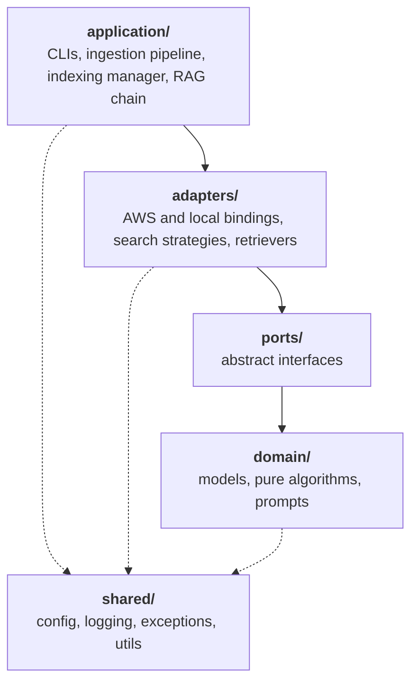

# Unified Knowledge Graph RAG on AWS — 기술 문서

> 🇬🇧 English version: [docs/design.md](./design.md)

용어는 [용어집](./glossary.ko.md)을 따릅니다.

이 문서는 라이브러리를 어떻게, 왜 그렇게 만들었는지 다루는 **기여자와 고급 사용자용 설계
레퍼런스**입니다. 사용법은 [사용자 가이드](./user-guide.ko.md), 모든 설정 키는
[설정 레퍼런스](./configuration.md)(영문), 기여 절차는 [CONTRIBUTING.md](../CONTRIBUTING.md),
확장 방법은 [§15](#15-확장-가이드)에 있습니다.

## 목차

1. [개요와 설계 철학](#1-개요와-설계-철학)
2. [헥사고날 아키텍처 (포트와 어댑터)](#2-헥사고날-아키텍처-포트와-어댑터)
3. [도메인 모델](#3-도메인-모델)
4. [수집 파이프라인](#4-수집-파이프라인)
5. [증분 인덱싱](#5-증분-인덱싱)
6. [검색: 두 방법론](#6-검색-두-방법론)
7. [하이브리드 스코어링과 토큰 관리](#7-하이브리드-스코어링과-토큰-관리)
8. [AWS 서비스 통합](#8-aws-서비스-통합)
9. [평가 프레임워크](#9-평가-프레임워크)
10. [시각화와 분석](#10-시각화와-분석)
11. [프롬프트와 프롬프트 튜닝](#11-프롬프트와-프롬프트-튜닝)
12. [설정 시스템](#12-설정-시스템)
13. [테스트 전략](#13-테스트-전략)
14. [CI/CD와 보안](#14-cicd와-보안)
15. [확장 가이드](#15-확장-가이드)
16. [참고 자료](#16-참고-자료)

---

## 1. 개요와 설계 철학

`unified-kg-rag-on-aws`는 Microsoft GraphRAG와 LightRAG 방법론을 AWS 네이티브
스택(Bedrock, Neptune, OpenSearch, S3, DynamoDB) 위에 다시 구현합니다. 설계 원칙은 다음과
같습니다.

- **두 방법론, 하나의 인프라.** GraphRAG(커뮤니티 요약)와 LightRAG(이중 레벨 키워드)는
  수집, 인덱싱, 캐싱, 다국어 처리, 하이브리드 검색을 함께 쓰며 **검색 알고리즘만
  다릅니다**.
- **일반화 우선.** 도메인 규칙 하드코딩과 정규 표현식 휴리스틱을 피합니다. 의미 판단은
  LLM이나 권위 있는 데이터에 맡기고, 토큰 수는 모델의 토크나이저 API가 있으면 그것으로(없으면
  문자 체계를 고려한 추정치로) 세며, 임계값과 가중치는 설정으로 정합니다.
- **헥사고날 경계.** 도메인과 알고리즘 코드는 추상 포트에 의존하고, AWS(와 로컬) 어댑터는
  그 뒤에 있습니다.
- **레지스트리 기반 확장.** 검색 전략, 렌더러, 파서, 공급자는 레지스트리로 등록하므로
  디스패치 코드를 고치지 않습니다. 평가기는 메서드 하나에서 `EvaluatorType`별로 연결합니다(§2.4).


---

## 2. 헥사고날 아키텍처 (포트와 어댑터)

### 2.1 의존성 규칙과 레이어 맵

import는 **안쪽을 향합니다**: `application → adapters → ports → domain`이며, 어느 레이어든
공통 커널 `shared/`를 import할 수 있습니다. 어떤 `domain/` 모듈도 LangChain, LangSmith,
boto3/botocore, lxml, opensearch-py, gremlin-python을 간접적으로도 로드하면 안 되므로
`shared/`와 `shared/utils/`는 가볍게 유지합니다(LangChain에 묶인 도우미는
`shared.utils.langchain`과 `shared.utils.document_converter`, rich 도우미는
`shared.utils.display`). `tests/unit/test_domain_purity.py`가 새 인터프리터에서 이를 검사합니다.



점선 화살표는 어느 레이어든 `shared/`를 import할 수 있다는 뜻입니다. 검색 전략은 어댑터이고
도메인에는 그 레지스트리만 있으므로 두 방법론이 같은 포트에 연결됩니다.


```
unified_kg_rag/
├─ __init__.py         # 공개 API 파사드: 지원하는 이름을 지연 재내보내기
├─ domain/              # 기술 중립 코어 (boto3/LangChain/백엔드 import 없음)
│  ├─ models/           #   Pydantic 도메인 모델
│  ├─ ingestion/        #   순수 알고리즘: delta_detector, graph_builder/resolver/analyzer,
│  │  └─ merge/         #   claim_resolver, contributions, derivation; merge/ = 실행 간 병합
│  ├─ retrieval/        #   strategy_registry, index_prefixes, hybrid_normalization
│  └─ prompts/          #   버전 관리되는 프롬프트 템플릿
├─ ports/               # 도메인이 의존하는 추상 인터페이스 (DocStatusPort,
│                       #   BaseIndexer/GraphIndexer/VectorIndexer, ModelFactoryPort,
│                       #   ContentGuardPort — ports/__init__이 포트 카탈로그)
├─ adapters/            # 구체적인 기술 바인딩
│  ├─ aws/              #   Bedrock 모델 팩토리, Neptune/OpenSearch 클라이언트, S3 전송과 캐시
│  ├─ local/            #   Ollama/OpenAI 호환 모델, 크로스 인코더, 내장 SQLite 그래프·검색 저장소
│  ├─ llm/              #   공급자 중립 체인 조립, 일시적 오류 재시도, 토큰 추정
│  ├─ observability/    #   OpenTelemetry 트레이서, 내보내기, LangChain 콜백
│  ├─ storage/          #   Neptune/OpenSearch/SQLite 그래프 인덱서 (쓰기 측 포트 구현)
│  ├─ retrievers/       #   Neptune/OpenSearch/SQLite 그래프 리트리버
│  ├─ doc_status/       #   DynamoDB/SQLite 문서 상태 레지스트리 (DocStatusPort)
│  ├─ guardrail/        #   Bedrock ApplyGuardrail (ContentGuardPort)
│  ├─ search_strategies/#   simple/local/global/drift + lightrag(mix/hybrid/naive)
│  ├─ retrieval/        #   추상 리트리버/전략 베이스, hybrid scorer, 토큰/메모리 매니저
│  ├─ ingestion/        #   LLM/IO 결합: chunker, *_extractor, loader, parser,
│  │                    #   translator, gleaner, community_detector
│  ├─ renderers/        #   그래프 시각화 렌더러
│  ├─ evaluators/       #   평가기 베이스 + langchain/ragas 평가기
│  ├─ store_errors.py   #   is_fatal_retrieval_error: 치명 오류와 부분 실패를 가르는 정책 (§8.1)
│  ├─ providers.py      #   Providers: 실행마다 쓰는 모델·저장소 공급자 묶음
│  └─ provider_registry.py # @register_provider: 역할과 kind별 빌더
├─ application/         # 오케스트레이션 + 진입점
│  ├─ cli/              #   run-ingestion/rag/eval/visualization/prompt-tuning, prepare-benchmark
│  ├─ ingestion/        #   DataIngestionPipeline + pipeline_stages, IncrementalIndexer,
│  │                    #   네임스페이스 쓰기 임대, 추출 레코드 저장소
│  ├─ storage/          #   IndexingManager (인덱서 fan-out)
│  ├─ retrieval/        #   rag_chain (GraphRAGChain, RAGInput/Output)
│  ├─ prompts/          #   PromptTuner (LLM 기반 코퍼스 프로파일링)
│  ├─ bootstrap.py      #   build_providers: composition root
│  └─ observability.py  #   configure_observability: 추적 백엔드 설치
├─ shared/              # 공통 커널 (config, logging, exceptions, metrics,
│                       #   cache/pipeline manager, utils)
├─ evaluation/          # 실제 로직 패키지: evaluation_manager / graph_aware /
│                       #   retrieval / answer_match, 전략 비교 + 쌍대 평가,
│                       #   benchmarks/ (MuSiQue)
└─ visualization/       # 실제 로직 패키지: 렌더 루프 + embeddings/exporters
```

- **실제 로직 패키지.** `evaluation/`(매니저와 LLM을 쓰지 않는 평가기)과
  `visualization/`(렌더 루프, `embeddings/`, `exporters/`. 렌더러는 `adapters/renderers/`).
  그 밖의 모듈은 실제 위치(`application.*`, `adapters.*`, `domain.*`)에서 import합니다.
- **벤더 패키지와 역할 패키지.** 벤더 패키지(`adapters/aws/`, `adapters/local/`)에는 기술
  바인딩(클라이언트, 내장 엔진과 저장소, 모델 팩토리, 토큰 카운터, 캐시)이, 역할
  패키지(`storage/`, `retrievers/`, `doc_status/`, `guardrail/`)에는 애플리케이션이 연결하는
  포트 구현이 있습니다. 역할 패키지는 벤더 패키지를 import할 수 있지만 그 반대는 안 됩니다.
  `NeptuneIndexer`가 `NeptuneClient`로 쓰듯 `SQLiteGraphIndexer`는 `SQLiteGraphStore`에 씁니다.

### 2.2 포트(추상 인터페이스)

| 포트 | 위치 | 어댑터 | 비고 |
|---|---|---|---|
| `DocStatusPort` | `ports/doc_status.py` | `adapters/doc_status/dynamodb.py`, `sqlite.py`. 테스트용 `FakeDocStatusStore` | 문서 상태와 문서별 텍스트 단위. 인덱스 네임스페이스별로 나뉨 |
| `ContentGuardPort` | `ports/guardrail.py`(`GuardVerdict` 포함) | `adapters/guardrail/bedrock.py`(Bedrock `ApplyGuardrail`) | 원본 질의와 최종 답변을 검사(§14) |
| `GraphIndexer`(쓰기) | `ports/indexer.py` | `adapters/storage/neptune_indexer.py`, 로컬 `sqlite_graph_indexer.py` | 전체 빌드와 델타의 단일 계약(`upsert_*` / `delete_by_id`) |
| `VectorIndexer`(쓰기) | `ports/indexer.py` | `adapters/storage/opensearch_indexer.py`(OpenSearch, 또는 `SearchEngineClient`를 통한 내장 엔진) | 위와 같음 |
| `BaseGraphRAGRetriever`(읽기) | `adapters/retrieval/base.py` | `adapters/retrievers/{neptune,opensearch,sqlite_graph}_retriever.py` | 검색 어댑터 |
| 모델 팩토리, 토큰 카운터 | `ports/model_factory.py`(`ModelFactoryPort`, `TokenCounterPort`, `*ModelInfo` 레코드) | `adapters/aws/bedrock.py`, `bedrock_models.py`, `token_counter.py`. 로컬 `adapters/local/{models,embeddings,rerank,token_counter}.py` | `Providers` 번들 하나로 전달(§15) |

읽기 측 베이스(`BaseGraphRAGRetriever`,
`BaseSearchStrategy`)와 `BaseGraphRAGEvaluator`는 `__init__`에서 인프라(스코어러, 토큰
매니저)를 만드는 *어댑터 베이스*이므로 `adapters/`에 두고, `ports/__init__`은 이름만
적습니다.

### 2.3 역할 기반 리트리버 주입

전략은 리트리버를 **백엔드가 아니라 역할로** 받습니다: `RetrieverRole.GRAPH`(그래프 확장)와
`RetrieverRole.DOCUMENT`(벡터·어휘 조회). 전략은 `self.graph_retriever` /
`self.document_retriever`로만 접근하고, 체인의 역할 → 빌더 맵이 구현을 연결하므로 그래프
백엔드를 바꿔도 전략 코드는 바뀌지 않습니다.

```python
# domain/retrieval/strategy_registry.py
@register_strategy(SearchStrategy.LOCAL, required_roles=(RetrieverRole.DOCUMENT, RetrieverRole.GRAPH))
class LocalSearchStrategy(BaseSearchStrategy): ...
```

쓰기 경로에도 고정된 저장소 역할이 둘 있습니다. `IndexingManager`는 항상 그래프 저장소와
벡터 저장소에 씁니다. 분배(엔티티는 두 저장소에, 엔티티를 간선보다 먼저, 고아 간선 연쇄
삭제)는 도메인 지식이기 때문이며, 각 역할을 어느 백엔드가 맡을지는 열려 있습니다
(`providers.graph.kind` / `providers.vector.kind`, 또는 주입한 인덱서).

### 2.4 레지스트리

- **검색 전략**: `@register_strategy(...)`(`domain/retrieval/strategy_registry.py`).
  클래스, 필요한 역할, 질의 입력을 `SearchStrategy`를 키로 등록합니다.
- **공급자**: `@register_provider(ProviderRole.X, "kind")`(`adapters/provider_registry.py`).
  모든 모델, 저장소, 레지스트리 역할에서 `providers.<role>.kind`가 고르는 빌더입니다.
- **렌더러**: `@register_renderer("name")`(`adapters/renderers/base.py`). **파서**:
  `ParserFactory.register_loader(".ext", Loader)`.
- **평가기**: `EvaluationManager._resolve_evaluator_class`에서 `EvaluatorType`마다 지연 import
  분기 하나.

### 2.5 의존성 규칙 검증과 공개 API

`tests/unit/test_domain_purity.py`는 `TYPE_CHECKING` import까지 포함해 모든 import에서 레이어
계약을 강제합니다. `domain/`은 `ports`/`adapters`/`application` 모듈을 import하지 않고,
`ports/`와 `shared/`는 다른 레이어를 import하지 않으며, `adapters/`는 `application`,
`evaluation`, `visualization` 모듈을 import하지 않고, `evaluation/`은 체인을 통해서만
애플리케이션에 닿습니다. 타입 전용 참조 둘이 `TYPE_CHECKING` 아래에 있는지도 확인합니다.
전략 레지스트리의 `BaseSearchStrategy`와 델타 탐지기의 `DocStatusPort` 타입 표기입니다(런타임
import는 순환이 됨).

**공개 API.** 패키지 밖의 호출자는 `unified_kg_rag`에서 import하며, 그 `__all__`이 지원하는
표면입니다. 프레임워크를 쓰는 이름(`Config`, `get_config`, `DataIngestionPipeline`,
`GraphRAGChain`, `RAGInput` / `RAGOutput` / `SearchOutput`, `EvaluationManager` 등)과 확장하는
이름(포트, `Providers` / `build_providers`, 레지스트리)으로 나뉩니다. 그 밖의 모듈 경로는
내부용이며, 내보낸 이름, 설정 키, CLI 플래그와 종료 코드, 저장 형식이 바뀔 때만 호환성이
깨지는 변경입니다. 이름은 처음 접근할 때 불러오고(`import unified_kg_rag`는 아무것도 로드하지
않음) `tests/unit/test_public_api.py`가 목록을 고정합니다.

---

## 3. 도메인 모델

`domain/models/`에는 인프라 의존성이 없는 순수 Pydantic 모델이 있습니다.

- `Entity`(`name`, `description`, `type`, `text_unit_ids`, `community_ids`, `rank`,
  `confidence`, 임베딩 필드), `Relationship`(`source_id` / `target_id`, `description`,
  `weight`, `text_unit_ids`), `Community` / `CommunityReport`, `TextUnit`,
  `Covariate`(주장)
- `DocStatus`(선기록 레코드 `PENDING` 다음에 `PROCESSED` / `FAILED` / `QUARANTINED`),
  `DocStatusRecord`(내용 해시, 문서의 텍스트 단위, 접미사), `DocumentDelta`(new / changed /
  unchanged / deleted와 failed, quarantined, quarantined_unchanged, deferred, settings_changed ID), `DocumentLineage`(문서 하나가 만든 텍스트 단위)
- `SearchQuery` / `SearchResult` / `RetrievalResult`, `SearchStrategy` / `SearchType` /
  `RetrieverRole`

**계보가 핵심 데이터입니다.** 엔티티와 관계는 자신이 기술된 `text_unit_ids`를 기록합니다.
엔티티가 텍스트 단위와 관련 있는지는 토큰 겹침 휴리스틱이 아니라 이 계보로 정하므로 언어와
무관하며, 증분 제거도 이 계보를 따릅니다(§5).

**순위(MS GraphRAG와 동일).** 엔티티의 `rank`는 차수이고, 관계의 `rank`는 두 끝점의 차수
합입니다(`domain/ingestion/graph_rank.py`). 전체 빌드가 정하고, 증분 병합은 쓰는 항목에
대해 저장된 그래프의 이웃으로 다시 계산합니다.

**인덱스 접미사.** OpenSearch 인덱스와 Neptune 레이블의 이름은
`<prefix>-<suffix>[-<additional_suffix>]`입니다. 수집은
`processing.document_parsing.index_value`를 쓰고 질의는 `RAGInput.suffix`(`--suffix`)로
고르며, 둘 다 비우면 `default`입니다. 테넌트나 코퍼스 버전마다 접미사 하나를 씁니다.

**표시 이름과 식별 키.**

- `Entity.name`은 원문이 쓴 표시 형태를 다듬고 공백만 정리해 유지하므로(`clean_display_name`)
  컨텍스트와 리포트가 "$1,000 penalty"나 "C++"를 그대로 인용할 수 있습니다.
- ID는 `entity_key(name)`(`shared/utils/common.py`)의 해시입니다. NFKC, casefold, `_`와
  `-`를 공백으로, 따옴표와 쉼표 제거, 공백 압축, 끝의 문장 부호 제거를 적용하되 **그 밖의
  기호와 모든 문자 체계의 문자·숫자는 유지**합니다. "ACME  Corp."와 "Acme Corp"는 ID를
  공유하고, "C++"와 "C#"은 그렇지 않으며, 비어 있지 않은 이름이 빈 키가 되는 일은 없습니다.
  모든 정확한 이름 매칭(추출, gleaning, 주장 해석, 증분 병합)과 퍼지 매처의 shingle도 같은
  키를 씁니다.
- **키를 바꾸면 모든 ID가 바뀌므로** 전체를 다시 인덱싱해야 합니다.

---

## 4. 수집 파이프라인

`DataIngestionPipeline`(`application/ingestion/pipeline.py`)은 체크포인트를 남기는 12개 단계를
실행하므로, 다시 실행하면 마지막으로 유효한 단계 다음부터 재개합니다. 추출은 텍스트 단위마다
하고 그래프는 병합한 단위별 레코드에서 해석하므로, 전체 빌드는 배치 구성에 좌우되지 않고 증분
실행은 건드린 항목을 다시 도출할 수 있습니다(§5).


| # | 단계 | 모듈 | 비고 |
|---|---|---|---|
| 1 | 문서 파싱 | `parser.py`(`ParserFactory`) | PDF/TXT/CSV/JSON(+ `unstructured` extra로 MD/HTML) |
| 2 | 문서 로딩 | `loader.py` | 선택적 MinHash 중복 제거, 증분 비교 |
| 3 | 청킹 | `chunker.py` | intelligent(LLM 경계, 기본값) 또는 simple |
| 4 | 번역 | `translator.py` | 선택. 원본 언어 = 대상 언어면 건너뜀 |
| 5 | 그래프 추출 | `graph_extractor.py` | 텍스트 단위별 엔티티와 관계 |
| 6 | gleaning | `gleaner.py` | 선택. 마지막 답변이 무언가를 더한 동안 단위에 다시 물음 |
| 7 | 그래프 해석 | `graph_resolver.py`, `description_summarizer.py` | 이름 변형 병합, 긴 설명 재요약(LLM 호출) |
| 8-9 | 주장 추출과 해석 | `claim_extractor.py`, `claim_resolver.py` | 선택(기본값 꺼짐) |
| 10 | 그래프 분석 | `graph_analyzer.py` | 그래프 구성과 통계 |
| 11 | 커뮤니티 탐지 | `community_detector.py` | 계층적 Leiden과 구조화된 리포트 |
| 12 | 인덱싱 | `application/storage/indexing_manager.py` | 그래프·벡터 저장소. 전체 빌드 또는 델타 |

단계 순서는 `DataIngestionPipeline.STAGE_CLASSES`에 있고, 모든 단계는 실행의 `Providers`
번들에서 모델과 저장소를 받습니다.

### 4.1 추출 레코드와 추출 저장소 (5-8단계)

- **텍스트 단위마다 레코드 하나.** 추출과 gleaning은 단위마다 `TextUnitExtraction` 하나를
  씁니다(`domain/models/extraction.py`). 그 단위가 자기 말로 기술한 엔티티와 관계, 그리고 그
  단위에서 거부된 엔티티 키가 들어 있습니다. gleaning은 한 번에 레코드 하나만 고칩니다.
  프롬프트에 그 단위의 항목만 넣으므로 수정이 다른 단위의 내용에 닿지 않습니다(MS
  GraphRAG와 LightRAG도 청크마다 자기 추출을 gleaning함).
- **해석은 모든 레코드의 병합에서 시작합니다**
  (`domain/ingestion/contributions.merge_contributions`: 항목은 ID로 병합하고 가중치는 단위별로
  유지). 그래서 병합한 그래프는 어떤 단위가 한 배치에 묶였는지에 좌우되지 않습니다. 주장
  프롬프트에는 그 단위의 엔티티만 넣으므로 단위의 주장은 그 단위에만 좌우됩니다.
- **추출 저장소**는 레코드를 `<fingerprint>:<처리한 텍스트의 SHA-256>` 키로 벡터 저장소의
  추출 레코드 인덱스에 보관합니다. 지문(`cache_keys.unit_record_fingerprint`)은 모델,
  추출·gleaning·주장 설정, 대상 언어, 적용 중인 프롬프트 템플릿을 포함합니다. 텍스트와
  설정에 맞는 레코드가 저장되어 있는 단위는 LLM을 호출하지 않고 그 레코드를 쓰므로, 수정한
  문서는 바뀐 청크만 다시 추출하고 다른 문서나 재구축의 같은 청크도 레코드를 재사용합니다.
  `--force-rebuild`는 모든 레코드를 다시 추출하고 갱신하며, 저장소를 읽을 수 없으면 로그를
  남기고 다시 추출합니다. 레코드를 쓰지 못하면 그 단위를 실패로 처리하므로
  (`records_not_stored`) 문서는 `FAILED`로 기록되고 다시 추출됩니다. 증분 실행은 레코드에서
  도출하기 때문입니다(§5.4).
- **텍스트 단위는 저장된 레코드를 가리킵니다**(`attributes.extraction_records`). 키는 단위를
  인덱싱할 때 실행의 레코드에서 계산하므로(캐시된 단위에 써 두지 않음) 재개한 실행도 같은 키를
  씁니다.
- **레코드는 저장된 텍스트 단위가 가리키는 동안 남습니다.** 텍스트 단위를 모두 쓴 전체
  구축이나 reset은 그 단위들이 가리키는 레코드만 남기고(`VectorIndexer.retain_extraction_records`가
  새 인덱스로 복사한 뒤 별칭을 옮김), 증분 실행은 제거된 텍스트 단위만 가리키던 레코드를 지웁니다.
- **gleaning은 관찰한 출력으로 멈춥니다.** 단위는 이전 답변이 새것을 더한 동안만
  (`max_rounds`까지) 다시 보냅니다. 빈 답변이 MS GraphRAG가 별도의 예/아니요 프롬프트로 묻는
  "빠진 것 없음" 신호이므로 그 호출을 쓰지 않습니다.

### 4.2 그래프 식별과 병합 (5-7단계)

- **관계 식별(의도적 차이).** 관계 ID는
  `relationship:{entity_key(source)}:{entity_key(target)}:{type}`을 소문자로 해시합니다.
  모델이 쓴 `type`이 식별에 들어가고 간선에 방향이 있으므로, 한 쌍 사이의 유형 둘은 여기서는
  간선 둘이고 MS GraphRAG와 LightRAG에서는 하나입니다(커뮤니티 그래프는 여전히 하나로 합침,
  §4.3). 부분을 이스케이프 없이 `:`로 이으므로 이름이나 유형에 `:`가 있으면 충돌할 수
  있지만, 고치려면 저장된 모든 관계의 키를 바꿔야 하므로 형식을 유지합니다.
- **끝점은 관계의 텍스트 단위도 인용합니다(의도적 차이).** 엔티티는 자신이 끝점인 관계의
  텍스트 단위도 인용하며, 어떤 단위도 나열하지 않은 끝점은 그 텍스트 단위를 인용하는 스텁
  엔티티가 됩니다(`relationship_endpoints.cite_relationship_endpoints`). upstream에서는
  엔티티의 텍스트 단위가 어떤 청크가 함께 추출되었는지에 좌우되지만, 여기서는 엔티티를
  언급하는 청크에만 좌우되므로 증분 실행이 전체 빌드와 같은 것을 인용하고, 문서를 지우면
  엔티티는 남은 문서 가운데 그 엔티티를 언급하는 텍스트 단위로 정확히 줄어듭니다. 대가로
  local 검색과 커뮤니티 계보가 엔티티를 관계로만 언급하는 청크에도 닿습니다. 엔티티
  근거 검사를 켜면 gleaning은 그 청크에서 근거 없음으로 거부된 엔티티를 가리키는 관계를
  버리므로 스텁이 그 엔티티를 되살리지 않습니다.
- **엔티티 병합.** 두 이름은 `compact_name_key`가 같으면 병합합니다. 이 키는
  `entity_key`에서 정해진 짧은 법인 형태 표기 목록(`(주)`, `주식회사`, `株式会社`,
  `有限公司`, 끝의 `Inc` / `Ltd` / `LLC` / `Co` / `Corp` 등)과 한자·한글·가나 옆의 공백을 뺀
  것이므로 "(주)가나다", "가나다 상사" / "가나다상사", "Acme Inc" / "Acme"가 병합됩니다.
  병합한 그룹은 가장 많은 텍스트 단위가 인용한 이름을 쓰므로(동률이면 가장 작은 이름) 결과가
  입력 순서에 좌우되지 않습니다.
- **퍼지 매칭은 선택입니다**(`processing.fuzzy_entity_resolution`). 이름 유사도는 이름
  대부분이 같은 서로 다른 조직("Northfield University" / "Northfield University
  Hospital")도 합치기 때문입니다. 켜면 `processing.similarity_threshold`를 넘는 이름이라도
  *구별 토큰*(숫자가 든 토큰, 한 글자, 로마 숫자)이 같고 유형이 호환되며, 한자·한글·가나로
  끝나는 이름은 마지막(중심) 글자가 같을 때만 연결합니다("가나다연구원"과 "가나다연구소"는
  따로 둠). 유형 인식 union-find는 유형이 다른 두 이름을 한 그룹에 넣지 않으며, 증분 병합도
  같은 매처를 쓰므로 전체 빌드와 증분 빌드가 같은 이름을 묶습니다.
- **병합한 설명**은 이어 붙이므로 `DescriptionSummarizer`가 토큰 예산을 넘는 설명을 저렴한
  모델로 다시 요약합니다(MS GraphRAG `summarize_descriptions`, LightRAG와 동일. 한 호출의
  입력보다 길면 map-reduce). 호출이 실패하면 이어 붙인 설명을 유지합니다.

### 4.3 커뮤니티 (10-11단계)

- **커뮤니티 그래프.** `GraphBuilder`는 엔티티 쌍마다 간선이 하나인 무방향 그래프를
  만듭니다. 같은 쌍 사이의 다른 유형이나 반대 방향 관계는 가중치를 합쳐 그 간선을 함께 쓰므로
  Leiden은 쌍의 전체 강도를 봅니다.
- **계층(의도적 차이).** 레벨 0은 엔티티 그래프 전체를 Leiden으로 한 번 분할한 것이고, 더
  높은 레벨은 이전 레벨 커뮤니티의 그래프를 `max_levels`까지 분할합니다. 모듈성의 해상도 한계
  때문에 레벨 0 커뮤니티는 코퍼스와 함께 커져 리포트 하나로 설명할 수 없게 되므로, 구성원이
  `max_cluster_size`(기본 20)개를 넘는 커뮤니티는 자기 하위 그래프에서 다시 분할합니다.
  `min_community_size`보다 작은 레벨 0 커뮤니티는 가장 강하게 연결된 이웃에 합칩니다.
  `min_community_size`보다 작은 연결 요소(관계가 없는 엔티티, 서로만 이어진 두 엔티티)는
  커뮤니티와 리포트를 만들지 않습니다. 건너뛰는 것은 이것뿐이며, 가장 큰 요소 말고는 모두
  버리는 MS GraphRAG의 `use_lcc`와 다릅니다. 그래프가 델타뿐인 증분 실행에서는 작은 연결
  요소가 전체 빌드가 묶을 전체 그래프에서 `min_community_size`에 이르면 묶습니다. 실행이
  처리하지도 지우지도 않는 문서의 텍스트 단위를 인용하는 저장된 관계를 따라가며, 일괄 읽기는
  많아야 `min_community_size`번입니다. 이 요소와 이어진, 커뮤니티가 없는 저장된 엔티티는
  재구축 전까지 커뮤니티 없이 남습니다(`community_drift`의 `unclustered_entities`). 유일한 자식과 같은 부모는 만들지 않으므로 서로
  다른 커뮤니티는 리포트를 한 번만 받습니다. Leiden이 실패하면 계층을 자르지 않고 단계가
  실패합니다.
- **결정성.** Leiden의 분할은 삽입 순서에 좌우되고 `graspologic_native`는 프로세스마다 다른
  순서로 레이블을 돌려주므로, 탐지기는 노드와 간선을 정렬하고 레벨마다 가장 작은 구성원
  ID로 번호를 다시 매깁니다. 같은 그래프와 `random_state`는 항상 같은 커뮤니티와 ID를
  냅니다.
- **리포트(MS GraphRAG와 동일).** 리포트 입력은 커뮤니티의 엔티티를 차수순으로 정렬해
  `max_entities_per_report`개로 자르고 `max_report_context_tokens`에 맞춰 담습니다(최상위
  엔티티는 항상 들어감). 리포트는 아래에서 위로 만들므로, 컨텍스트가 넘칠 부모는 자르는
  대신 자식 리포트 요약을 넣습니다(`enable_sub_community_rollup`). 프롬프트는 구조화된
  리포트(요약, 설명이 붙은 0-10 등급, 발견 사항)를 돌려주고, 임베딩과 검색에 쓰는
  `full_content`는 이를 렌더링해 만들므로 두 번째 호출이 없습니다.
- **리포트 계보.** 리포트마다 `text_unit_ids`와 `document_ids`(구성원 전체의 합집합으로,
  인용 근거가 아니라 출처)와 계층 안의 위치가 있으며, global 검색은 이 위치로 리포트를
  고릅니다(§6.1.1).

### 4.4 파이프라인 인프라

- **재개.** 각 단계의 출력은 실행의 pipeline id 아래에 체크포인트로 남습니다
  (`shared/pipeline_manager.py`, `shared/cache_manager.py`). 단계 캐시 키는 §12에 있습니다.
- **S3 동기화**(`adapters/aws/s3_cache.py`)는 단계가 끝날 때마다 바뀐 파일을 업로드하며,
  데이터를 그것을 가리키는 메타데이터보다 먼저 올립니다. SIGTERM을 받으면 `run-ingestion`은
  실행 중인 단계를 멈추고(`request_stop`: 체크포인트를 쓰는 중이면 미루며 핸들러는 I/O를 하지
  않음) 체크포인트를 업로드합니다.
- **LLM 응답 캐시**(`adapters/llm/response_cache.py`): 모든 수집 모델에 붙는 LangChain
  `BaseCache`로, 렌더링한 메시지와 모델·생성 설정을 키로 단계 캐시와 함께 저장합니다. 이전 실행의 항목은 실행마다 한 번까지만 쓰고 잘린 응답은 보관하지 않으므로,
  잘못된 응답 뒤의 재시도는 모델을 다시 호출합니다.
- **출력 수정.** 구조화된 출력은 `FixingConfig` 기반 output-fixing 파서로 파싱합니다.
- **자원.** 파이프라인은 `close()`에서 인덱서와 클라이언트 자원을 해제하며,
  `run-ingestion`이 `finally`에서 호출합니다(§8.2).

---

## 5. 증분 인덱싱

문서 상태 레지스트리를 켜면 실행은 코퍼스를 레지스트리와 내용 해시로 비교해 새 문서, 바뀐
문서, 실패한 문서만 처리합니다. 레지스트리는 문서마다 텍스트 단위를 기록하고, 제거할 때는
그것을 인용하는 항목을 저장소에 묻습니다. 선기록 프로토콜로 다음 실행이 어떤 중단이든 복구하며,
결과는 현재 코퍼스의 전체 빌드와 같아집니다.


### 5.1 단계

따로 표시하지 않은 이름은 `IncrementalIndexer` 메서드(`application/ingestion/incremental.py`)입니다.

1. **델타 탐지**(`domain/ingestion/delta_detector.py`).
   `DocStatusPort.diff(incoming, scope)`가 내용 해시로 문서를 new, changed, unchanged,
   deleted로 분류합니다. `doc_id`는 `<namespace>#<네임스페이스, 소스 범위, 상대 경로의 해시>`이고
   네임스페이스가 레지스트리 파티션이므로, 실행은 자기 네임스페이스만 읽고(DynamoDB
   projected `Query` 한 번) 두 코퍼스나 테넌트가 레코드를 공유하지 않습니다. 삭제 후보는
   실행의 범위에 속한 레코드뿐이며, 파싱이나 로딩에 실패한 파일은 삭제가 아니라 `failed`로
   보고합니다. 옮긴 코퍼스의 이전 레코드는 넘겨받지 않으며(옮긴 것과 같은 경로의 다른 호스트
   코퍼스를 구별할 수 없음) 실행이 이전 범위를 폐기할 때까지 그대로 둡니다
   (`indexing.retire_source_scopes`). 처리할 때마다 실행을 죽이는 문서는 격리하거나 미룹니다(§5.3).
2. **선기록**(`write_ahead`). 저장소에 쓰기 전에 새 문서와 바뀐 문서를 모두 `PENDING`
   (어떤 문서도 그 해시를 갖지 않는 내용 해시 `"pending"`)으로 기록하며, 저장된 텍스트
   단위와 이번 실행이 쓸 텍스트 단위의 합집합을 일괄 쓰기 한 번으로 남깁니다. 레지스트리
   항목 한도(DynamoDB 400KB, 텍스트 단위 약 10,000개)를 넘는 레코드는 아무것도 쓰기 전에
   여기서 실행을 실패시킵니다.
3. **오래된 산출물 정리**(`remove_changed_and_deleted`). 바뀐 문서와 삭제된 문서의 텍스트
   단위를 접미사마다 한 번에 제거하므로(5단계), 그 문서들만 기술하던 산출물도 함께
   사라집니다.
4. **델타 upsert**(`commit`). 델타가 건드리는 저장된 엔티티와 관계(압축 이름 키로, 퍼지
   매칭을 켜면 저장된 이름 전체로 찾음)와 그 엔티티의 저장된 간선을 다시 읽고, 델타를 병합한
   뒤 내용을 추출 레코드에서 도출하며(§5.4), 델타 주장은 같은 ID의 저장된 주장과 병합합니다.
   Neptune은 멱등적 `coalesce(unfold, addV)` upsert로, OpenSearch는 살아 있는 별칭 인덱스에
   ID로 쓰며, 키가 바뀐 항목의 이전 ID는 쓰기가 성공한 뒤에만 지웁니다.
5. **삭제 전파**(`IndexingManager.remove_text_units`). 제거한 텍스트 단위를 인용하는 항목을
   저장소에 묻습니다(엔터티는 `GraphIndexer.find_ids_citing`, `VectorIndexer.find_documents`).
   엣지는 인용된 엔터티에 닿는 엣지에서 찾고, 재개한 제거(제거한 텍스트 단위 일부가 이미 벡터
   저장소에 없거나 벡터 저장소가 알 수 없음)만 `find_relationship_ids_citing`으로 텍스트 단위에서
   찾습니다(Neptune에서는 접미사의 엣지 전체 스캔). 제거한
   텍스트 단위만 인용하는 항목은 두 저장소에서 지우되 벡터 사본을 먼저 지웁니다(재시도는 그래프로
   지울 대상을 찾으므로, 중단된 실행은 고아 벡터 사본이 아니라 그래프 사본을 남김). 다른 텍스트 단위도 인용하는 항목은
   그 텍스트 단위를 빼고 가중치를 다시 계산하며 남은 텍스트 단위로 내용을 다시 도출합니다.
   커뮤니티와 리포트는 인용하는 텍스트 단위가 하나도 남지 않으면 지웁니다. 제거가 실패하면
   삭제된 문서의 레코드를 재시도용으로 남기고 단계가 실패합니다(델타에 바뀐 문서가 있으면
   커밋 전에).
6. **레지스트리 갱신**(`commit`). `PENDING` 레코드를 일괄 쓰기 한 번으로 문서별 텍스트 단위,
   범위, 상대 경로가 담긴 `PROCESSED`나 `FAILED` 레코드로 바꿉니다(`FAILED`의 다섯 가지
   원인: [운영 런북](./operations.ko.md#실패한-문서)). `failure_count`는 같은 내용의 연속
   실패를 세며, `indexing.max_document_failures`에 이르면 문서를 변경 없음으로 봅니다.
   그 뒤 제거된 텍스트 단위만 가리키던 추출 레코드를 지웁니다(최선 노력 방식).

**제한:** 공유 커뮤니티와 리포트는 바뀌거나 삭제된 문서가 기여한 내용과 키가 바뀐 엔티티의
이전 ID를 전체 재구축 때까지 유지하며(§5.5), 설명, 이름, ID, 유형, 필터, 순위, 주장은 실행마다
다시 도출합니다.

### 5.2 전체 재구축 (`indexing.reset`)

`indexing.reset`은 비교를 건너뛰고 접미사를 오프라인으로 만들지 않은 채 전체 인덱싱 경로로
코퍼스 전체를 다시 만듭니다. 격리된 문서(§5.3)는 건너뛰고 레코드를 그대로 두며, 나머지
모든 문서를 `PENDING`으로 기록하고, 벡터 인덱스는 새
타임스탬프 인덱스에 쓴 뒤 각각 다 만들어지면 별칭을 옮기며, 그래프는 제자리에서 다시
만듭니다(`GraphIndexer.begin_rebuild`가 빌드가 쓰는 모든 정점과 간선에 태그를 붙이고,
`end_rebuild`가 태그 없는 접미사의 엔티티, 커뮤니티, 간선을 지움). 쓰기가 제자리 upsert이므로
그래프 질의는 마지막 정리 전까지 이전 항목과 다시 만든 항목을 섞어 봅니다. 모든 문서를 다시
기록한 뒤에야 네임스페이스의 다른 레코드를 지우므로,
실패한 재구축은 아무것도 지우지 않습니다. 그래프 쓰기가 일부 실패한 재구축
(`indexing.max_failure_rate` 안)은 재시도가 이전 사본을 찾도록 정리를 건너뛰고, 기록하지
않고 실패로 보고합니다(`neptune_sweep`). 대체된 문서의 레코드를 지우면 그 정점과 간선이
고아가 되기 때문입니다.

세대 전환(새 레이블과 포인터)은 채택하지 않았습니다. Neptune 레이블은 이름을 바꿀 수 없어
모든 리트리버가 질의마다 현재 세대를 찾아야 하고, 재구축 동안 그래프를 두 번 저장하게
되기 때문입니다.

### 5.3 크래시 복구(선기록 프로토콜)

레지스트리는 저장소와 원자적으로 갱신되지 않으므로 실행은 어느 두 쓰기 사이에서든 멈출 수
있습니다. 불변식 하나를 지킵니다: **레지스트리가 설명할 수 없는 것을 저장소가
갖기 전에, 레지스트리가 이미 그것을 기록합니다.** 선기록 레코드는 모든 제거와 upsert보다
앞서고, 삭제된 문서의 행은 산출물보다 나중에 지우며, `PENDING` 레코드는 문서의 쓰기가 끝난
뒤에만 바꿉니다. 다음 실행은 중단된 실행을 다음과 같이 복구합니다.

- `PENDING`은 어떤 내용 해시와도 같지 않으므로, 코퍼스에 남은 문서는 파일이 인덱싱한 버전으로
  되돌아갔더라도 바뀐 문서로, 코퍼스에서 사라진 문서는 삭제된 문서로 분류되며, 그 텍스트
  단위가 중단된 실행이 썼을 수 있는 내용을 모두 덮습니다.
- 제거는 이번 실행의 `PENDING` 레코드 이전에 저장된 레코드로 계획하므로, 복구 실행은 일부 쓴
  내용을 먼저 지웁니다.
- 중단은 `indexing.max_document_failures`에 세지 않습니다(`PENDING` 레코드의
  `failure_count`는 0).
- 키가 바뀐 항목의 이전 ID는 새 복사본을 쓴 뒤에만 지우므로, 중단되어도 최악의 경우 두
  복사본이 남고 재시도가 둘을 함께 도출합니다.

**시도와 격리**(`domain/ingestion/attempts.py`). 처리하다 태스크를 죽이는 문서는 이후 모든
실행을 같은 방식으로 멈추게 합니다.

- **열기와 닫기.** 실행은 diff 뒤(그리고 document_loading 뒤에서 재개할 때) 처리할 모든
  문서에 시도를 열고(`incremental.open_attempts`: 함께 처리하는 문서 수 `attempt_batch`,
  `attempted_hash`. 새 문서는 텍스트 단위 없는 `PENDING` 레코드를 받음), 프로세스가 어떻게
  끝나든(완료, 실패, SIGTERM이나 Ctrl-C) 닫습니다(`close_attempts`). 다음 실행에서도 열려 있는
  시도는 그 내용에서 한 번 더 죽은 것(`attempt_count`)이고, 그때의 배치는
  `attempt_batch`개(`crash_batch`)입니다. reset은 시도를 열지 않으며(선기록 레코드는 저장된
  시도 필드를 그대로 둠), 커밋하는 실행에서 텍스트 단위를 만들지 않은 문서는 혼자 죽은 것으로
  셉니다.
- **계획**(`plan_attempts`, diff에서). 죽은 횟수가 `indexing.max_document_attempts`에 이른
  변경 문서가 의심 문서이고, 마지막으로 혼자 처리되다 죽은 문서(`crash_batch` 1)는
  `quarantined`입니다. 그렇지 않으면 실행은 가장 작은 배치에서 죽은 의심 문서의 앞쪽
  절반(doc id 순)만 처리하고 다른 새 문서와 변경된 문서는 모두 `deferred`(처리하지도 지우지도
  않음)로 분류합니다. 실행이 죽으면 의심 문서가 그 절반으로 좁혀지고, 끝나면 그 절반을
  커밋합니다. 그래서 `n`개 가운데 원인 문서 하나는 대략 `log2(n) + 1`번의 실행으로 가려지고,
  함께 죽었다는 이유로 격리되는 문서는 없습니다.
- **격리 레코드**: 시도한 내용의 해시, 죽은 횟수, `error_info`의 이유가 담긴 `QUARANTINED`.
  시도가 인덱싱에 이르렀다면(레코드가 선기록 `PENDING` 레코드) 제거 단계가 시도들이 쓴 것을
  지우고 텍스트 단위를 남기지 않으며, 그렇지 않으면 인덱싱된 버전과 그 텍스트 단위를
  유지합니다. 내용이 바뀌거나 한도를 죽은 횟수보다 크게 올릴 때까지 unchanged로
  읽힙니다(`diff`가 `DocumentDelta.quarantined_unchanged`에 넣고, 한도를 올리면
  `release_quarantined`가 changed로 분류). 죽은 횟수는 내용별로 세므로 추출 설정을 바꿔도
  다시 격리되고, 전체 재구축도 이 문서를 건너뜁니다.
- **재개 검사**(`delta_still_applies`). 복원한 델타의 문서 가운데 레코드가 사라졌거나 다른
  내용을 담았거나 한도에 이른 것이 있으면 document_loading부터 재개합니다. 지표:
  `total_documents_quarantined`(CDK `DocumentsQuarantined` 경보)와 `total_documents_deferred`.

비용은 실행마다 레지스트리 일괄 쓰기 한 번(시도에 쓰기와 읽기 두 번씩 더)과 접미사마다 몇
번의 저장소 일괄 조회입니다. `tests/unit/test_incremental_write_ahead.py`와
`tests/property/test_incremental_interruption_properties.py`는 실행을 쓰기 단계마다 중단하고
다음 실행이 새 전체 빌드와 같아지는지 확인합니다.

### 5.4 식별, 도출한 내용, 병합 규칙

- **문서 식별**(`shared/utils/document_identity.py`). 문서 버전의 ID는 코퍼스 루트 기준 상대
  경로와 전체 텍스트의 해시이므로 코퍼스는 어디에 체크아웃하든 같은 ID를 내고, 증분 실행은
  텍스트 단위를 레지스트리 `doc_id`로 키를 잡으므로 텍스트 단위는 레코드 하나에만 속합니다.
  둘 중 한 규칙이라도 바꾸면 다시 인덱싱해야 합니다.
- **도출한 내용**(`domain/ingestion/derivation.py`). 병합과 제거는 건드린 항목의 구조(ID,
  텍스트 단위, 단위별 가중치)를 유지하고, 내용은 지금 인용하는 텍스트 단위의 레코드에서 전체
  빌드의 코드(`merge_contributions`, `GraphResolver`, `ClaimResolver`)로 다시 도출하므로,
  현재 코퍼스의 전체 빌드가 주는 값과 같습니다. 삭제된 문서의 텍스트는 공유 설명과 주장에서
  빠지고, 이름과 유형은 현재 득표를 따르며, 도출한 이름의 ID가 다른 엔티티는 그 ID를 받고
  (`Derived.id_remap`) 간선과 주장도 따라갑니다. 저장된 레코드가 없는 텍스트 단위를 인용하는
  항목은 저장된 내용을 유지합니다(WARNING과 인덱싱 단계의 `underived_items` 지표).
- **전체 빌드가 되돌리는 병합.** 저장된 엔티티가 전체 빌드라면 나누어 두는 것을 함께 담고 있을
  수 있습니다(유형이 같던 동안 합쳐진 두 표기). 이름 키와 텍스트 단위를 공유하는 해석 결과
  엔티티를 모두 도출해, 가장 잘 맞는 것은 저장된 ID로, 나머지는 각각 별도 엔티티로 둡니다
  (`Derived.split_from`). 나뉘거나 ID가 바뀐 엔티티의 저장된 간선도 함께 도출하므로
  (`Derived.rewired`) 각 간선은 자신을 서술한 쪽을 따르고, 끝점을 바꾼 간선은 이제 같아진
  도출 간선과 합쳐집니다. 전체 빌드가 긋지만 저장된 간선이 없는 간선(이전 병합이 자기 루프로
  버린 간선)은 추가하고, 끝점이 이제 한 엔티티로 해석되는 저장된 간선은 폐기한 ID와 함께
  지우며(`Derived.dropped`), 교차 실행 병합이 다른 ID에 합친 델타 ID도 지웁니다(중단된 실행이
  벡터 사본을 남겼을 수 있음). 간선은 해석이 주는 단위별 강도를 받고, 주장의 서술은 전체
  빌드처럼 텍스트 단위 ID 순서로 병합합니다.
- **비용.** 도출은 저장된 것이 있을 때만 하고(첫 빌드는 그래프 해석이 만든 델타를 그대로
  씀) 키 색인으로 매칭합니다. 늘어나기만 한 저장 요약(항목이 이전에 인용한 텍스트 단위를 모두
  그대로 인용)은 저장된 요약과 새 설명으로 다시 요약하고(LightRAG가 저장된 설명에 합치는
  방식), 텍스트 단위를 잃은 항목은 도출한 설명으로 요약하므로 제거된 텍스트가 남지 않습니다.
  rank만 바뀌어 다시 쓰는 저장된 간선은 다시 임베딩하지 않고 그 자리에서 갱신합니다.
- **병합 규칙**(`domain/ingestion/merge/merger.py`, MS GraphRAG `update/*`에서 옮김). 모두
  멱등적입니다.

| 산출물 | 매칭 기준 | 병합 방식 |
|---|---|---|
| 엔티티 | ID, 없으면 식별 키 | 설명 줄 합집합, `text_unit_ids`와 `community_ids` 합집합, 신뢰도와 순위는 최댓값, 속성은 합집합(델타 우선)이되 `filters`는 키별로 값의 합집합, 저장된 이름과 유형 유지(이후 도출이 전체 빌드의 값을 정함) |
| 관계 | ID, 없으면 (source, target, type) | 엔티티와 같음. 가중치 = 뒷받침하는 텍스트 단위별 강도의 합(`attributes.text_unit_weights`)이므로 결과가 합집합의 전체 빌드와 같음. 끝점 이름은 병합한 엔티티에서 다시 도출 |
| 주장 | ID | 전체 빌드 `ClaimResolver` 규칙: 설명과 원문 합집합, `text_unit_ids` 합집합, 저장된 상태 유지 |
| 커뮤니티 | 내용에서 도출한 ID | 덧붙임(§5.5) |

### 5.5 델타 실행의 커뮤니티

델타 실행은 MS GraphRAG의 갱신 경로처럼 다시 클러스터링하지 않고 델타 하위 그래프만
클러스터링합니다. 그래서 커뮤니티 ID는 내용에서 도출하며(레벨과 정렬한 구성원 ID의 해시,
`L{level}_C{i}`는 표시 이름으로만 남음), 델타의 커뮤니티와 리포트는 코퍼스의 것을 덮어쓰지
않고 그 옆에 덧붙습니다. 코퍼스 커뮤니티는 인용하는 텍스트 단위가 하나도 남지 않으면
지우고, 공유 커뮤니티는 그래프 전체를 다시 분할하는 유일한 경로인 전체 재구축 때까지 리포트를
유지합니다(`indexing.community_drift_threshold`가 재구축이 필요할 때를 알림). 델타의 루트
커뮤니티는 계층의 모든 단면에 들어가므로 global 검색의 단면은 재구축 전까지 커집니다. 단면
상한과 더 얕은 단면으로 내려가는 처리(§6.1.1)가 이를 제한하고, 드리프트 지표가
보고합니다(`added_roots`). 채택하지 않은 대안은 이미 클러스터링된 엔티티로 된 델타 커뮤니티를
단면에서 빼는 방식(그 리포트만 델타를 설명하고, 저장된 커뮤니티 ID에는 지워진 커뮤니티도
남아 있음)과 델타 실행마다 전체 그래프를 다시 탐지하는 방식(모든 리포트를 다시 만들며
리포트마다 LLM 호출)입니다.

### 5.6 동시성

레지스트리를 쓰면 실행은 첫 단계 전에 네임스페이스의 쓰기 임대를 얻어 끝날 때까지
유지합니다(`application/ingestion/namespace_lease.py`). 레지스트리 조건부 쓰기 한 번이며,
하트비트가 `indexing.lease_seconds`의 6분의 1마다 갱신합니다(임대 요청은 시간 제한이 짧고
3번까지 시도). 두 번째 실행은 무엇이든 읽거나 쓰기 전에 `NamespaceLeaseError`로 실패합니다.

- **쓰기 차단 장치**(`shared/write_fence.py`). 모든 증분 레지스트리 쓰기, 인덱싱 단계, 재구축
  정리, Neptune 쓰기 배치나 삭제, GET과 HEAD를 뺀 OpenSearch 인덱싱 요청이 먼저 임대를
  확인합니다. 임대를 놓은 뒤, 그리고 마지막으로 성공한 갱신을 보낸 시각부터 기간이 3분의 1보다
  적게 남으면 확인이 실패하므로(저장소의 만료도 그 시각부터 셈), 임대를 잃은 실행은 쓰기 요청
  하나가 기간의 3분의 1보다 오래 걸리지 않는 한 아직 임대를 가진 동안 멈춥니다. 두 번째 차단
  장치는 중지(SIGTERM이나 Ctrl-C)가 요청되면 작업자 스레드의 쓰기를 실패시킵니다. 파이프라인을
  실행하는 스레드는 정리하는 동안 계속 씁니다.
- **조건부 쓰기는 없습니다.** `BatchWriteItem`은 조건을 받지 않고 저장소 쓰기는 레지스트리를
  조건으로 걸 수 없으므로, 이 여유 시간이 차단 장치입니다.
- **체크포인트.** S3 체크포인트를 내려받기 전에 임대를 얻고, 중지된 실행은 체크포인트를 올린
  뒤에야 놓습니다.

레지스트리가 없으면 아무것도 잠그지 않으며, 한 접미사의 동시 실행은 별칭과 레이블에서
경쟁합니다([운영 런북](./operations.ko.md#동시-실행)).

---

## 6. 검색: 두 방법론

`GraphRAGChain`(`application/retrieval/rag_chain.py`, LCEL Runnable)은 모든 전략에 같은 체인을
씁니다: 대화 메모리(후속 질문을 독립된 질문으로 다시 씀) → 전략 결정 → 질의 처리(번역, 엔티티
또는 키워드 추출) → 검색 → 융합과 재순위화 → (RAG) 컨텍스트 예산과 답변. 방법론은
`RAGInput.search_strategy`로 고릅니다.


- **체인이 끝나는 지점.** `search` / `asearch`는 융합·정렬한 결과(`SearchOutput`)를 돌려주고,
  `invoke` / `ainvoke` / `stream`은 같은 단계를 거쳐 결과를 토큰 예산(§7)에 맞춰 담은 뒤
  `RAGOutput`을 돌려주며, 그 출처는 답변 모델이 본 섹션과 정확히 같습니다. 예산을 적용한
  컨텍스트가 비어 있으면 LLM을 호출하지 않고 답할 수 없다고 응답합니다.
- **그래프 확장**은 `local`과 `drift`에 포함되고, `mix` / `hybrid`에서는 선택입니다
  (`search.lightrag_search.enable_graph_expansion`). 전략은 벡터 저장소에서 시드 엔티티를 찾아
  그 ID를 그래프 리트리버에 넘기고, 리트리버는 그 ID에서만 확장합니다.
- **인덱스 하나, 두 방법론(의도적 확장).** 수집은 두 방법론에 필요한 것의 합집합을 만듭니다
  (MS GraphRAG는 관계 벡터 인덱스를, LightRAG는 커뮤니티를 만들지 않음). LightRAG만 쓰는
  배포는 `graph.community_detection.enabled: false`로 Leiden과 모든 리포트 호출을 건너뛸 수
  있으며, 그러면 `global`과 `drift`는 쓸 수 없습니다.

### 6.1 GraphRAG 방법론 (`adapters/search_strategies/`)

- **simple** — 그래프 없이 만들어진 모든 인덱스를 벡터·어휘로 검색합니다. 주장 인덱스는 주장
  추출을 켰을 때만 포함합니다.
- **local** — 후보 엔티티 → 그래프 확장 → 빈도 필터 → 그 텍스트 단위에 커뮤니티 리포트
  섹션과 관계 섹션을 더합니다(MS GraphRAG local 검색).
  `search.local_search.include_bridge_relationships`(기본값 켜짐)이면 확장한 엔티티에 붙은
  관계도 가져오며, 검색된 두 엔티티 사이의 간선이 먼저입니다. 이런 간선은 관계 벡터 질의가
  잘 찾지 못하는 다중 홉 연결의 홉을 담습니다. 주장을 켜면 맞는 주장을 넣습니다(MS GraphRAG
  covariate). 섹션 조회는 엔티티 체인과 동시에 실행합니다.
- **global** — 커뮤니티 계층의 한 단면(아래)에 대한 MS GraphRAG global 검색으로, 점수가 붙은
  핵심 포인트로 map-reduce합니다.
- **drift** — MS GraphRAG DRIFT 검색(`drift_search.py`).
  *프라이머:* 가장 중요한 리포트 모양의 가상 답변(`DriftHydePrompt`)으로 가장 비슷한 리포트
  `k_followups`개를 고르고 `primer_folds`개 묶음으로 나누며, 묶음마다 중간 답변, 점수, 후속
  질의를 돌려받습니다. *액션:* `n_depth` 라운드 동안 점수가 가장 좋은 열린 후속 질의마다
  local 검색을 (재순위화 없이) 실행하고 점수와 새 후속 질의가 붙은 답을 받습니다.
  *리듀스:* 중간 답변(합성 섹션 하나이며 보고된 출처가 되지 않음)과 한 번 재순위화한 local
  근거를 답변 모델에 넘깁니다. 리포트나 프라이머 후속 질의가 없으면 질문 자체를 후속 질의
  하나로 씁니다.
  - 기본값 `k_followups` 10, `n_depth` 2: 질의마다 LLM 호출 최대 27번(MS GraphRAG의 20, 3은
    67번). 프라이머 호출과 액션은 `search.max_concurrency`개씩 동시에 실행합니다.
  - 프라이머는 MS GraphRAG처럼 `community_level` 하나가 아니라 모든 깊이의 리포트를
    검색합니다. 세분도는 유사도가 고릅니다(합성 6홉 코퍼스에서 깊이 2 단면은 하위 질문 21개 중
    16개, 모든 깊이는 21개에 답함).
  - 치명적 오류는 질의를 실패시키고 진행 중인 호출을 취소하며, 그 밖의 실패는 그 답변만
    뺍니다(`degraded_error`). 한 단계 전체가 실패하고 `processing.ignore_errors`가 꺼져 있을
    때만 질의가 실패하고, 액션이 모두 실패한 라운드에서 라운드를 끝냅니다.
- **auto** — LLM 라우터(`StrategySelectionPrompt`)가 `search.auto_routable_strategies`에서
  파이프라인이 제공할 수 없는 전략을 뺀 것 가운데 고릅니다(`global`과 `drift`는 커뮤니티
  리포트가 필요함). 프롬프트는 라우팅할 수 있는 전략만 정확히 설명하며, 알아볼 수 없는 출력은
  `local`로 대신합니다. 기본 집합은 `local`, `mix`, `global`이고(`drift`는 LLM 호출이 최대
  27번), 라우팅할 전략이 하나뿐이면 라우터를 호출하지 않습니다. 프롬프트는 이름이 있는
  엔티티에서 이어지는 질문을 `local`로 보냅니다(합성 다중 홉 하네스의 exact match: `local`
  0.925, `mix` 0.40).

#### 6.1.1 Global search (`global_search.py`)

**어떤 리포트를 쓰는가.** 리포트마다 계층 안의 위치(아래에서 센 `level`, 루트에서 센
`depth`, 부모와 자식, `max_cut_depth`)가 있습니다. 깊이 `D`의 단면은 깊이 `D`의 모든
커뮤니티와 그 위에서 끝나는 리프입니다(`depth <= D <= max_cut_depth`). 모든 엔티티를 한
번씩 덮는 MS GraphRAG의 roll-up이며, MS GraphRAG는 `community_level`을 루트에서 세므로
깊이로 단면을 고릅니다.

- **고정 단면(기본값)** — 단면을 순위순으로 훑되 상한(`max_reports_per_level`, 한 요청에
  들도록 최대 `max_query_size` - 1)보다 하나 더 요청하므로 상한과 정확히 같은 단면도 완전합니다. 더 큰 단면은
  상한 안에 드는 가장 깊은 얕은 단면에 자리를 내주며(`global_cut_depth`), 같은 엔티티를 더 넓은
  리포트로 덮습니다. 루트 단면조차 들지 않을 때만 설정한 단면으로 제한한 하이브리드 검색이
  가장 비슷한 리포트를 그만큼 고릅니다(`global_level_capped`). global 검색에서 유사도가 쓰이는
  곳은 여기뿐입니다. 상한은 리포트 수로 세며 이것이 map 호출 수를 제한합니다.
- **동적 선택**(`use_dynamic_selection`) — MS GraphRAG의 `DynamicCommunitySelection`입니다.
  루트 리포트의 관련성을 평가하고, 관련 있는 리포트의 자식을 리프까지 따라가며, 어떤 깊이에서
  관련 리포트가 없으면 다음 깊이 전체를 `community_depth`까지 평가합니다(MS GraphRAG의
  `max_level`처럼 이 대체 경로만 제한). 평가는 `search.max_concurrency`개씩 실행합니다.

**map-reduce.** 리포트가 `map_reduce_min_results`개 이상이면 `map_context_tokens`(MS GraphRAG의
`data_max_tokens`) 크기의 배치로 담고, 배치마다 map 호출(`search.max_concurrency`개씩)이 0-100점이
붙은 핵심 포인트를 뽑으며 포인트마다 근거 리포트의 `report_ids`를 적습니다(MS GraphRAG의
`[Data: Reports (ids)]`. 프롬프트의 리포트 id는 배치 안의 순번이며 다시 리포트로 매핑합니다).
`map_relevance_threshold` 이하인 포인트를 버리고 나머지를 순위대로
`max_map_reduce_tokens`에 담아, 기본값(`reduce_with_llm: false`)에서는 합성 섹션 하나로 답변
모델에 바로 넘기고(별도의 reduce 호출은 사실을 빠뜨릴 수 있는 재작성만 더했음) 그 뒤에
포인트가 인용한 리포트를 붙입니다. 배치의 리포트를 하나도 인용하지 않은 포인트는 배치 전체를
근거로 삼습니다.

**성능 저하 처리.** map 호출이 실패했거나 파싱할 수 없는 출력을 낸 배치는 *평가되지 않음*으로
둡니다. 통과한 포인트가 없지만 평가되지 않은 리포트가 있으면 그 리포트를 그대로 넘기므로 global
검색은 여전히 답하고, 검색 메타데이터에 이를 기록합니다(`degraded_error`). 모든 map 호출이
실패했고(모델 컨텍스트보다 긴 프롬프트로 인한 실패는 제외) `processing.ignore_errors`가 꺼져
있으면 DRIFT처럼 첫 오류로 질의가 실패합니다. 모든 배치를 평가했는데 모든 포인트가 버려졌으면 아무것도 돌려주지
않고(`map_reduce_no_relevant_points`), 체인은 MS GraphRAG처럼 답할 수 없다고 답합니다.

### 6.2 LightRAG 방법론 (`lightrag_search.py`)

공용 하이브리드 인프라 위에서 이중 레벨 키워드 검색(`KeywordsExtractionPrompt`가 상위·하위
레벨 키워드를 추출)을 합니다.

- **naive** — 그래프 없이 청크만 요청의 `search_type`으로 검색합니다(기본값 `hybrid`는 BM25 +
  벡터, `vector`는 upstream 기준선).
- **hybrid** — 하위 레벨 키워드 → 엔티티 인덱스, 상위 레벨 키워드 → 관계
  인덱스(LightRAG의 `relationships_vdb`), 한 홉 확장(엔티티 결과 → 붙은 관계, 관계 결과 →
  끝점 엔티티), 그리고 이 항목들이 인용하는 청크입니다.
- **mix** — hybrid에 매칭된 엔티티와 관계가 인용하는 원본 청크(LightRAG의
  `_find_related_text_unit_*`처럼 인용한 항목 수로 순위를 매김)와 naive 청크 검색을 더합니다.

서로 독립적인 질의를 먼저 동시에 실행하고, 그다음 확장을, 마지막으로 인용한 청크를
가져옵니다. 키워드가 없는 짧은 질의는 원본 질의를 하위 레벨 키워드로
씁니다(`raw_query_fallback_max_len`). upstream LightRAG에는 다중 홉 탐색이 없으므로 그래프
확장은 선택입니다.

---

## 7. 하이브리드 스코어링과 토큰 관리

- **HybridScorer**(`adapters/retrieval/hybrid_scorer.py`)는 소스별 결과를 RRF(`rrf_k`)나
  가중치로 융합하고, 재순위화한 뒤, MMR 다양성 필터(`diversity_lambda`)를 적용하고 유형별
  할당이나 `top_k`로 자릅니다. upstream LightRAG가 자르기 전에 청크 후보를 모두 재순위화하듯
  재순위화가 다양성보다 먼저이므로, 융합 점수로 자르다가 재순위화 모델이 첫째로 꼽을 항목을
  잃지 않습니다. 질의마다 자기 `RerankTrace`에 재순위화 결과를 기록해 `SearchResult.metadata["rerank"]`로 보고합니다. 재순위화 모델을 만들 수 없으면 융합
  순서를 유지하거나(`unavailable`) `search.reranking.required`일 때 예외를 냅니다.
- **TokenManager**(`adapters/retrieval/token_manager.py`)는 컨텍스트를 답변 모델의 예산에
  담습니다. 섹션 유형마다 상한이 있는 몫(`search.token_manager.type_budgets`)을 받고, 그 안에서
  섹션을 점수순으로 담으며 처음 넘치는 섹션을 잘라 맞춥니다. 어떤 유형이 다 쓰지 못한 예산은
  아직 후보가 남은 유형에 넘깁니다(LightRAG가 그래프 섹션이 남긴 예산을 청크에 주듯 전략의
  `spare_context_budget_first` 유형이 먼저). 그래서 유형 간 점수 비교가 아니라 몫이 구성을
  정합니다. 합성된 global 섹션을 먼저 앉힙니다. `RAGOutput.sources`는 이 선택으로 만들므로
  답변 모델이 본 것만 잘린 텍스트까지 그대로 담습니다.
- **토큰 계산**(`adapters/aws/token_counter.py`, `adapters/local/token_counter.py`). Bedrock
  `count_tokens` API를 받는 언어 모델에는 그 API를, 그 밖에는 문자 체계를 고려한
  추정치(`adapters/llm/token_estimate.py`)를 씁니다. CountTokens는 기본 Claude 5.x 모델과 모든
  임베딩·재순위화 모델을 거부하므로 기본값에서는 모든 계산이 추정치입니다. 일시적이지 않은
  실패는 그 모델을 프로세스 전체에서 지원하지 않음으로 표시합니다. 로컬 모델은 추정치나
  tiktoken을 씁니다.

---

## 8. AWS 서비스 통합

| 서비스 | 모듈 | 용도 |
|---|---|---|
| **Bedrock** | `adapters/aws/bedrock.py`, `bedrock_models.py`(기능 카탈로그) | LLM, 임베딩, 재순위화. 추론 프로파일 해석, 공급자에 맞춘 요청 형식(Claude 4.6+의 adaptive thinking과 `effort`, OpenAI GPT의 `reasoning.effort`), 지원하는 모델의 프롬프트 캐싱. 선별 항목, 공급자 계열 기본값, `aws.bedrock.model_overrides`로 어떤 모델 ID든 받음 |
| **Neptune** | `adapters/aws/neptune.py` | SigV4를 쓰는 `wss://` Gremlin(로컬 Gremlin Server는 `ws://`). 일괄 upsert와 삭제, `indexing.neptune.index_concurrency`로 동시 배치. 모든 인덱서 요청은 새 연결로 재시도하며 반복해도 안전함(정점과 간선은 ID로 만들거나 찾음). 끝점 정점이 없는 간선은 실패로 처리하고 저장된 사본을 남김. 커뮤니티는 정점만 씀(`MemberOf` 간선 없음. 엔티티가 `community_ids`에 자기 커뮤니티를 적음) |
| **OpenSearch** | `adapters/aws/opensearch.py` | kNN(HNSW, 기본 `lucene` 엔진은 OpenSearch 2.13에서 `cosinesimil` 지원)과 BM25, 동기·비동기 SigV4 클라이언트, 별칭 관리, 일괄 upsert와 삭제, 언어별 분석기 |
| **S3** | `adapters/aws/s3_cache.py` | 단계 캐시 동기화(`aws.s3.encryption`이 강제하지 않으면 버킷 기본 암호화) |
| **DynamoDB** | `adapters/doc_status/dynamodb.py` | 문서 상태 레지스트리 |

AWS 세션은 번들의 것(`Providers(boto_session=...)`이므로 가짜 세션이나 moto 세션을 주입할 수
있음)이며, AWS 클라이언트가 처음 요청할 때 `aws.profile_name`으로 만듭니다.

### 8.1 검색 오류 가시성

인증, 설정, 저장소 오류를 "결과 없음"으로 감추지 않습니다. 정책 하나,
`is_fatal_retrieval_error()`(`adapters/store_errors.py`)가 **예외 타입만으로** 판단합니다.
치명적 오류는 질의를 실패시키고, 나머지는 그 오류를 낸 섹션만 축소합니다. 모든 하위 검색은 `BaseSearchStrategy._safe_aretrieve`를 거치므로 섹션 처리기가
치명적 오류를 삼킬 수 없습니다.

| 실패 | 발생하는 예외 | 결과 |
|---|---|---|
| 저장소 연결 불가, 연결 종료, 클라이언트 재시도 뒤에도 429/502/503/504 | `StoreConnectionError` | 치명적 |
| `search.store_timeout_seconds` 안에 응답 없음 | `StoreTimeoutError` | 치명적 |
| HTTP 401/403, Neptune `AccessDeniedException` | `StoreAccessDeniedError` | 치명적 |
| HTTP 400(필드와 형식이 다른 필터 값, 차원이 다른 벡터) | 서버의 이유가 담긴 `StoreRequestRejectedError` | 치명적 |
| 일시적이지 않은 Bedrock 오류(잘못된 모델 ID, 접근 권한 없음, 자격 증명 없음) | botocore 오류 | 치명적 |
| 원인과 관계없이 질의 임베딩 실패 | `EmbeddingModelError` | 치명적(모든 벡터 섹션에 필요) |
| 로컬 모델 서버의 408/429가 아닌 4xx, 재시도 뒤에도 연결 불가 | `openai` / `httpx` 오류 | 치명적 |
| 모델 컨텍스트보다 긴 프롬프트 | `ContextOverflowError`(vLLM / llama.cpp는 일반 400) | 치명적이지 않음: 해당 global 검색 map 배치만 평가되지 않음(모든 배치가 실패하면 제외) |
| 요청 하나의 실패(검색 하나의 HTTP 500) | 그 밖의 예외 | 해당 섹션만 축소 |

Neptune 세부 사항: 끊긴 연결은 버려지고 다음 질의나 재시도가 새로 엽니다. 질의 탐색은
리트리버가 소유한 스레드에서 실행되며 `search.store_timeout_seconds`의 두 배로 제한됩니다.
클라이언트를 닫으면 풀 연결이나 늦은 응답을 기다리던 요청을 실패시킵니다. 인덱서의 읽기 제한 시간은 Neptune 자체의 120초 질의 제한보다 긴 고정 180초입니다.

### 8.2 클라이언트 수명 주기와 자원 해제

리트리버는 Neptune 웹소켓과 스레드 풀, OpenSearch HTTP 풀을 여는데, 닫지 않으면 가비지
컬렉션 때까지 누수되므로 모든 레이어가 예외를 내지 않는 최선 노력 방식의
`close()` / `aclose()`를 제공합니다.

- `OpenSearchClient`와 `NeptuneClient`는 풀을 닫습니다(OpenSearch는 이벤트 루프가 바뀔 때도
  이전 클라이언트를 그 루프에서 닫음).
- `IndexingManager.close()`와 `GraphRAGChain.close()` / `aclose()`는 자기가 만든 것을 닫습니다.
  체인을 만든 쪽이 닫아야 하며 finalizer는 안전망일 뿐입니다. CLI는 `finally`에서 닫습니다.
- `GraphRAGChain`은 리트리버와 전략을 이벤트 루프별로 캐시하고, 동기 진입점은 체인이 소유한
  루프 스레드 하나에서 실행하므로 동기 호출을 반복해도 같은 클라이언트를 씁니다. 블로킹
  호출은 `asyncio.to_thread`로 `processing.io_workers` 크기의 기본 실행기에서 실행하며, 이
  크기가 동시 Bedrock 호출 수를 정합니다(비동기 호스트는 `configure_event_loop`).

### 8.3 다국어 처리

- **분석기.** `indexing.opensearch.language_analyzers`가 언어를 OpenSearch 분석기에
  매핑합니다(기본값 `en: english`, `ko: nori`). Amazon OpenSearch Service 도메인은 Nori
  패키지를 연결해야 `nori`를 가지므로 CDK 배포는 `ko`를 기본 제공 `cjk`로 매핑하며, 클러스터에
  없는 분석기는 그 이름을 밝힌 오류로 인덱스 생성을 실패시킵니다.
- **식별 키**는 모든 문자 체계의 문자를 유지합니다(§3).
- **번역**은 원본 언어와 대상 언어가 같고 다른 대상 언어가 없으면
  건너뜁니다(`TranslationConfig.is_noop`).
- **인코딩.** UTF-8이 아닌 텍스트 파일은 `charset-normalizer`가 감지한 인코딩으로 다시
  읽습니다.

---

## 9. 평가 프레임워크

`EvaluationManager`(`evaluation/`)는 `_resolve_evaluator_class`(`EvaluatorType`마다 지연 import
분기 하나)로 평가기를 만들고, 모든 답변을 생성한 뒤 결과를 채점합니다. 평가기마다 무엇을
측정하는지는 [사용자 가이드 §6](./user-guide.ko.md#평가기)에 있으며, 설계상 선택은 다음과
같습니다.

- **LLM을 쓰지 않는 평가기가 기본입니다.** `answer_match`, `retrieval`, `graph_aware`는
  결정적이고 비용이 없으므로 LangChain과 RAGAS 심사 모델과 함께 기본으로 실행합니다.
- **`graph_aware`는 재현율만 냅니다.** 정밀도와 F1을 내려면 자유 형식 답변의 엔티티를 모두
  나열해야 하므로 재현율에 다른 이름을 붙이는 데 그칩니다. 답변 텍스트 커버리지는 길이에
  따라 늘어나므로 검색된 출처의 커버리지와 답변 길이도 보고합니다.
- **`retrieval`은 출처가 아니라 파일을 셉니다.** 커뮤니티 리포트는 커뮤니티의 모든 파일에
  귀속되므로, 출처 하나로 세면 임의의 리포트가 거의 완벽한 hit@k를 얻었습니다.
- **전략 비교**(`evaluation/comparison.py`, `pairwise.py`). 전략을 여럿 주거나 `--repeats`를
  주면 같은 질의를 실행하고, 지표마다 반복에 걸쳐 질의별 평균을 내 시드를 고정한 짝지은
  부트스트랩 구간으로 질의별로 비교합니다(전체 평균을 비교하면 질의 난이도와 잡음이 차이에
  섞임). 선택 항목인 쌍대 심사(GraphRAG와 LightRAG 논문처럼 포괄성, 다양성,
  empowerment, 직접성)는 두 답변 순서를 모두 판정하고 순서와 관계없이 같은 판정만 남깁니다.
  실패한 답변은 빼지 않습니다(빼면 질 질의에서 실패하는 전략이 그 질의에 답한 전략만큼 좋아
  보임). 다른 실행이 그 질의를 채점한 모든 지표에서 0점이 되고, 한쪽 답변이 실패한 쌍은
  판정 없이 다른 쪽이 이깁니다.
- **실행 매니페스트.** 수집은 `IndexBuildRecord`(pipeline id, 모드, 빌드 시각, 문서 수, 추출
  지문과 설정, 패키지 버전)를 벡터 인덱스 매핑의 `_meta`에 기록하고(`VectorIndexer.record_build`),
  질의한 접미사마다 다시 읽습니다. 설정 해시는 답변에 영향을 주는 설정만 덮으므로(§12) 환경이
  달라도 같습니다.
- **벤치마크.** `prepare-benchmark`(`evaluation/benchmarks/musique.py`)는 실행 시점에 MuSiQue
  코퍼스와 데이터셋을 만들고, `evaluation.answer_normalization: official_squad`는 EM/F1을
  공개된 수치와 비교할 수 있게 합니다.

---

## 10. 시각화와 분석

`visualization/`(`GraphVisualizationManager`, 렌더 루프)이 `adapters/renderers/`의
렌더러(`BaseRenderer`, `@register_renderer`, `RenderContext`)를 구동합니다.
`InteractiveRenderer`(pyvis 네트워크와 커뮤니티 계층)와 `StaticRenderer`(Bokeh 차수, 중심성,
커뮤니티 크기 차트)가 있습니다. 레이아웃은 노드마다 `name: description`을 임베딩해 차원을
줄입니다(기본값 UMAP, 실패하면 spring 레이아웃). `run-visualization`은 수집 없이 내보낸 그래프
JSON으로 렌더링하며, 수집이 기본으로 쓰는 레이아웃 없는 파일에는 시드를 고정한 spring
레이아웃과 설정한 중심성을 계산합니다.

---

## 11. 프롬프트와 프롬프트 튜닝

- **프롬프트**(`domain/prompts/`)는 템플릿과 변수를 클래스 속성으로 갖는 `BasePrompt`
  클래스이며 코드로 버전 관리합니다. 다섯 개를 뺀 모든 프롬프트는 설정(`custom_prompts`)으로
  재정의할 수 있으며, 그 다섯 개는 [사용자 가이드](./user-guide.ko.md#사용자-정의-프롬프트)에
  있습니다.
- **프롬프트 튜닝**(`application/prompts/tuner.py`, MS GraphRAG `prompt_tune` 기반)은 코퍼스
  표본으로 도메인, 언어, 페르소나, 엔티티 유형을 파악하고 검토해 적용할 `custom_prompts`
  조각을 씁니다. 실행 중에 자동으로 적용하지 않습니다. 튜닝한 프롬프트는 페르소나 머리말만
  바꾸고 내장 출력 규칙(XML 스키마, `source_text` 원문 근거)은 그대로 두므로 파서와 근거
  검사가 계속 동작합니다.

---

## 12. 설정 시스템

설정은 `shared/config.py`(`get_config`)가 읽는 중첩 Pydantic 트리(`domain/models/config.py`,
루트 `Config`) 하나입니다. [docs/configuration.md](./configuration.md)는
`scripts/gen_config_reference.py`가 이 트리에서 생성하며(오래되면
`tests/unit/test_config_reference.py`가 실패), `config-template.yaml`은 주석이 달린 시작
파일입니다. [docs/cli.md](./cli.md)도 같은 방식으로 CLI 파서에서 생성합니다
(`scripts/gen_cli_reference.py`, `tests/unit/test_cli_reference.py`).

- **읽기**(`Config.as_input`). 설정은 계층(기본값 < `backend` 프리셋 < 파일 < 환경)에서 한
  번 검증합니다. `UKR__<SECTION>__<KEY>`는 모델 트리에 맞춰 어떤 키든 지정하고(맞춰 둘 변수
  표가 없음), `AWS_PROFILE` / `AWS_REGION`은 파일이 비워 둔 키만 채웁니다. 알 수 없는 키는 `allow_unknown_keys`가 아니면 실패하고, 옮겨진
  키(`MOVED_KEYS`)는 대신할 키를 알려 주며 실패하고, 제거된 키(`REMOVED_KEYS`)는 경고를 남기고
  무시됩니다. `Config`는 검증에 쓴 입력을 보관하므로
  `with_provider_overrides`(CLI 공급자 플래그)가 그 입력과 이후 변경으로 다시 만들고,
  `--backend`를 바꾸면 이전 프리셋이 채운 값만 사라집니다.
- **모델 선택**(`ModelsConfig`). `models` 섹션 하나가 모든 모델을 정합니다: 두 계층, 역할별
  재정의(`ModelRole`), 임베딩 모델과 차원, 재순위화 모델. 각 계열의 공급자는
  `providers.<family>.kind`이고 `Config._check_models`가 ID를 그 공급자 기준으로 검사합니다.
  값은 적은 그대로 두고 읽을 때 해석하며(`Config.model_id`, `embedding_model_id`,
  `rerank_model_id`), 선택하지 않은 공급자의 설정은 로드할 때 알립니다.
- **단계 캐시 키**(`shared/utils/cache_keys.py`). `CONFIG_KEYING`이 모든 필드를 분류합니다.
  출력에 영향을 주는 첫 단계부터 키에 들어가거나, 이유와 함께 키에서 빠집니다. 단계의 키는
  그 단계와 모든 앞 단계에 적용되는 키 필드(꺼진 블록은 스위치만), 패키지 버전, 코퍼스 목록을
  해시합니다. 분류되지 않은 필드는
  모든 단계의 키에 들어가므로(오래된 적중이 아니라 미스), `tests/unit/test_cache_key_coverage.py`가
  분류될 때까지 실패합니다. `run-eval` 매니페스트의 `retrieval_config_sha256`이 해시하는
  범위(`answer_settings`)도 이 표가 정합니다. `shapes_answers=False`로 표시한 키 밖의 필드(호출
  대상, 처리량, 텔레메트리, 프로비저닝, 캐시 저장)와 몇 가지 위치 필드(코퍼스와 레지스트리
  경로, 테이블 이름, 가드레일 ID)를 뺀 모든 필드입니다.
- **추출 설정.** `per_document`로 표시한 키 필드가 문서의 추출 설정이 되며, 그 지문을 커밋한
  문서마다, 설정 자체를 레지스트리 범위마다 한 번 기록하고 다음 실행이 필드별로 비교합니다
  (릴리스가 추가한 설정은 기본값인 동안 변경이 아님). 섹션 추가는 §15에 있습니다.

---

## 13. 테스트 전략

테스트(`tests/{unit,integration,property,fixtures/fakes}/`)는 **기본적으로 AWS 없이**
실행합니다.

- **포트 기반 가짜 구현**(`tests/fixtures/fakes/`)이 저장소와 레지스트리를 메모리에 구현하고,
  `moto`가 DynamoDB와 S3 어댑터를 검증합니다.
- **속성 테스트**(hypothesis)는 병합 법칙, 증분과 전체 빌드의 수렴, 중단된 실행, 융합 단조성,
  MinHash와 토큰 추정 동등성을 다루고,
  `tests/integration/test_doc_status_conformance.py`는 `DocStatusPort.diff` 분할을 모든
  레지스트리에 대해 검사합니다.
- **저장소 적합성 테스트**
  (`tests/integration/test_{graph_store,vector_store,retrieval}_conformance.py`)는 저장소
  계약을 한 번 쓰고 `StoreHarness`(`tests/fixtures/store_backends.py`)로 모든 백엔드에서
  실행합니다: 가짜 구현, 내장 SQLite 저장소, `docker/compose.local.yaml`
  컨테이너(`LOCAL_STORES=1`), Neptune과 OpenSearch Service(`-m aws`). `test_store_parity.py`는
  SQLite와 OpenSearch 컨테이너가 합성 코퍼스에 같은 순위를 매기는지 확인합니다(어휘·하이브리드
  상위 10개가 같고 kNN recall@10 ≥ 0.98).
- **마커**: `unit`, `integration`, `property`, `aws`(실제 AWS, CI에서 제외), `slow`.
  `uv run pytest -m "not aws" --cov=unified_kg_rag`로 실행합니다.

---

## 14. CI/CD와 보안

- **CI**(`.github/workflows/`): `quality`가 풀 리퀘스트와 `main` 푸시를 검사하고(린트, 타입,
  커버리지 하한이 있는 테스트, 이미지 빌드, cdk-nag를 포함한 IaC synth), `licenses`가 의존성
  라이선스를, `security`가 보고 전용 ASH 스캔을 실행합니다. 로컬 검사는
  [CONTRIBUTING.md](../CONTRIBUTING.md#checks-to-run-before-pushing)에 있습니다.
- **Dependabot**은 `uv` 잠금 파일(루트와 `iac/`)과 SHA로 고정한 Actions를 매주 갱신하며, 호환성이
  깨지는 갱신은 이유를 기록하고 보류합니다.
- **보안 강화.** 내용 해시는 SHA-256만 쓰고, 자격 증명은 코드가 아니라 환경에서 받습니다.
- **질의 가장자리의 가드레일**(`ports/guardrail.py`, `adapters/guardrail/bedrock.py`).
  `GraphRAGChain`은 메모리, 라우팅, 검색 전에 원본 질의(source `INPUT`)를, 생성 뒤에 최종
  답변(`OUTPUT`)을 검사합니다. 차단되면 질의를 끝내고, 마스킹되면 텍스트를 바꾸며, 가드레일
  오류는 질의를 닫힌 쪽으로 실패시킵니다. 그 사이의 모델 호출에는 가드레일을 붙이지 않습니다.
  붙인 가드레일은 프롬프트 전체를 판정하므로 Converse에서는 검색된 코퍼스와 지시문까지 사용자
  입력으로 보고(잘못된 프롬프트 공격 차단, 컨텍스트 × 호출 수의 비용), InvokeModel에서는
  입력 태그 없이 프롬프트 공격 필터가 동작하지 않습니다. 수집과 평가 모델에는
  가드레일을 붙이지 않습니다.

---

## 15. 확장 가이드

프레임워크 확장 방법은 이 절 한 곳에 모았습니다. 전략, 렌더러, 파서는 레지스트리로, 평가기는 타입 맵의 분기 하나로, 백엔드는 생성자 주입으로 확장하며, 어느 경우에도 디스패치 코드를 고치지 않습니다. 포트, `Providers`, 레지스트리는 `unified_kg_rag`에서 내보냅니다(§2.5).

- **새 검색 전략**: `SearchStrategy` enum 멤버 추가(`domain/models/retrieval.py`. CLI 선택지도 이를 따릅니다) + `BaseSearchStrategy` 상속 + `@register_strategy(SearchStrategy.X, required_roles=(...), query_inputs=frozenset({QueryInput.ENTITIES}))` + `adapters/search_strategies/__init__.py`에서 export + `STRATEGY_ROUTING_GUIDE`(`domain/prompts/retrieval.py`)에 항목 추가(단위 테스트가 `auto`를 뺀 모든 전략에 항목을 요구). `query_inputs`는 전략이 읽는 질의 측 LLM 추출을 선언하며(`entity_focus`용 `ENTITIES`, `hl_keywords`/`ll_keywords`용 `DUAL_KEYWORDS`), 체인은 나머지 추출을 건너뜁니다. 커뮤니티 리포트로 답하는 전략은 `needs_community_reports=True`도 넘겨, 리포트가 없는 구성에서 `auto`가 고르지 않게 합니다. `rag_chain`은 고치지 않습니다. `auto`가 고를 수 있게 하려면 `search.auto_routable_strategies`에 추가하세요.
- **새 스토리지/LLM 백엔드**: 해당 포트를 구현한 뒤, `@register_provider(ProviderRole.X, "kind")`(`adapters/provider_registry.py`)로 새 `providers.<역할>.kind`의 빌더를 등록하고 설정에서 고르거나, 그 포트를 쓰는 생성자에 넘깁니다(아래 "커스텀 백엔드" 참고). 매니저의 `__init__`에 하드코딩하지 마세요.
- **새 평가기**: `BaseGraphRAGEvaluator` 상속 + `EvaluationManager._resolve_evaluator_class`에 분기 추가 + `EvaluatorType` enum 추가.
- **새 렌더러**: `BaseRenderer` 상속 + `@register_renderer("name")`. 등록은 import할 때 일어납니다. `GraphVisualizationManager`는 프로세스에서 import된 모든 렌더러를 보지만, `run-visualization`은 `adapters/renderers/__init__.py`가 import하는 렌더러만 봅니다.
- **새 파서 / 파일 형식**: `ParserFactory.register_loader(".ext", MyLangChainLoader, loader_kwargs=..., file_type_name=...)` — LangChain `BaseLoader` 하위 클래스면 무엇이든 됩니다. 팩토리를 고칠 필요가 없고, 등록한 확장자는 자동으로 탐색·파싱 대상이 됩니다. 내장 형식은 같은 확장자를 등록하면 덮어씁니다.
- **새 설정 섹션**: Pydantic `BaseModel` 정의 → `Field(default_factory=...)`로 부모에 연결 → 모든 필드를 설명하고 `docs/configuration.md`를 재생성한 뒤 `config-template.yaml`에 추가(§12 참고).


### 커스텀 백엔드 (AWS 없이 실행)

서비스 사이의 모든 의존성은 포트 뒤에 있습니다. 포트는 공급자 번들의 역할이며 그 어댑터는
`providers.<role>.kind`가 공급자 레지스트리로 고르고, 오케스트레이터는 어떤 포트든 **생성자
주입**으로도 받으므로 커스텀 백엔드에 하위 클래스나 디스패치 수정이 필요 없습니다. 포트와 기본
어댑터, 로컬 어댑터(`[local]` extra)는 다음과 같습니다.

| 포트 | 계약 | 기본 어댑터(로컬 어댑터) | 주입 방법 |
|---|---|---|---|
| `LLMFactoryPort` / `EmbeddingFactoryPort` / `RerankFactoryPort` (`ports/model_factory.py`, `Protocol`) | LangChain 호환 모델을 반환하는 `get_model()` / `get_model_info()` | `BedrockLanguageModelFactory` / `BedrockEmbeddingModelFactory` / `BedrockRerankModelFactory`(`openai_compatible`, `ollama`. `cross_encoder`, `none`) | `GraphRAGChain`, `DataIngestionPipeline`, `EvaluationManager`의 `providers=`(아래). `GraphRAGChain(model_factory=...)`는 LLM만 담은 묶음 |
| `TokenCounterPort` (`ports/model_factory.py`, `Protocol`) | `count_tokens()` / `truncate_to_token_limit()` | `BedrockTokenCounter`(`LocalTokenCounter`: 추정치 또는 tiktoken. LLM kind를 따름) | `Providers(token_counter_factory=...)` |
| `VectorIndexer` / `GraphIndexer` (`ports/indexer.py`, ABC) | `index_*` / `upsert_*` / `delete_by_id`. 증분 조회(`GraphIndexer.find_ids_citing` / `find_relationship_ids_citing` / `find_entity_ids_by_name_key`, `VectorIndexer.find_documents` / `delete_extraction_records` / `retain_extraction_records`)의 기본 구현은 "알 수 없음"(`None`: 이를 통해 찾는 것이 없고 병합은 이름을 모두 읽음)과 아무것도 지우지 않음. `GraphIndexer.read_entities` / `read_relationships`의 기본값은 `[]`이므로, 재정의하지 않으면 델타 병합이 저장된 설명, 계보(`text_unit_ids`), 가중치를 덮어씀. `GraphIndexer.begin_rebuild` / `end_rebuild`(제자리 전체 구축, §5.2)의 기본값은 `False`(전체 구축이 레이블마다 먼저 지움). `initialize()`(기본값은 아무 작업 없음) / `clear()`는 `None`을 반환하고 실패하면 타입이 있는 저장소 예외(`StoreConnectionError`, `StoreConfigurationError` 등)를 발생시킴. `False`를 반환해도 무시됨 | `OpenSearchIndexer` / `NeptuneIndexer`(`gremlin`: 같은 어댑터로 Gremlin Server 사용. `sqlite`: `SQLiteSearchEngine` 위의 `OpenSearchIndexer` / `SQLiteGraphIndexer`) | `Providers(vector_indexer_factory=..., graph_indexer_factory=...)`, `DataIngestionPipeline(..., vector_indexer=..., graph_indexer=...)` 또는 `IndexingManager(vector_indexer=..., graph_indexer=...)` |
| 리트리버(역할별 빌더) | `BaseGraphRAGRetriever.aretrieve` | `OpenSearchRetriever` / `NeptuneRetriever`(`sqlite`: `SQLiteSearchEngine` 위의 `OpenSearchRetriever` / `SQLiteGraphRetriever`) | `Providers(retriever_builders=...)` 또는 `GraphRAGChain(retriever_builders={RetrieverRole.GRAPH: lambda: MyGraphRetriever(...)})` |
| `ContentGuardPort` (`ports/guardrail.py`, `Protocol`) | `async acheck(text, source)`가 `GuardVerdict`(`none` / `masked` / `blocked`, 이어서 쓸 텍스트)를 반환. 판정할 수 없으면 예외를 냄 | `BedrockGuardrail`(`aws.bedrock.guardrail.identifier`를 지정하면 생성) | `GraphRAGChain(guard=...)` |
| `DocStatusPort` (`ports/doc_status.py`, `Protocol`) | `get` / `get_many` / `put` / `put_many` / `delete` / `list_namespace` / `list_all` / `diff`(`extraction_fingerprint`를 받고 `DocumentDelta.quarantined_unchanged`를 채워야 함), `record_fits`, 쓰기 임대(`try_acquire_lease` / `lease_holder` / `release_lease`), 범위의 마지막 추출 설정(`get_extraction_settings` / `put_extraction_settings`). 모두 직접 호출합니다. 레코드의 네임스페이스는 `doc_id`의 `<namespace>#` 접두사이고(`doc_id_namespace`), 범위를 준 `diff`는 그 네임스페이스만 읽습니다. 상속하면 `get_many` / `put_many` / `record_fits` 기본 구현(호출마다 레코드 하나, 크기 한도 없음)을 물려받습니다 | `DynamoDBDocStatusStore`(`SQLiteDocStatusStore`) | `Providers(doc_status=...)` 또는 `DataIngestionPipeline(..., doc_status=...)`(어느 쪽이든 증분 인덱싱이 켜짐). `tests/integration/test_doc_status_conformance.py`를 통과해야 함 |

**커스텀 백엔드의 오류**는 메시지가 아니라 타입으로 분류합니다(§8.1). 질의를 실패시키려면
`ConnectionError`나 `ConfigurationError`의 하위 클래스(`shared/exceptions.py`의 타입이 지정된
저장소 오류)를 발생시키세요. 그 밖의 예외는 그 예외를 낸 섹션만 축소합니다.

**베이스 클래스가 아니라 Protocol.** 모델 팩토리 포트와 문서 상태 포트는 `runtime_checkable`
`Protocol`이므로 커스텀 클래스는 메서드 모양만 맞추면 됩니다.

```python
class MyLLMFactory:                       # structurally an LLMFactoryPort
    def get_model(self, model_id, **kwargs): ...   # returns a LangChain chat model
    def get_model_info(self, model_id): ...        # returns a LanguageModelInfo

chain = GraphRAGChain(config=cfg, model_factory=MyLLMFactory())
```

팩토리는 `**kwargs`를 받아 모르는 키를 무시해야 합니다. 호출자는
`model_purpose=ModelPurpose.INGESTION`(경로별 정책: 응답 캐시, 수집 effort, 질의 재시도) 같은
프레임워크 인자를 넘기므로, 엄격한 시그니처는 그런 첫 호출에서 `TypeError`를 냅니다.

**번들 하나, 모든 구성 요소.** `Providers`(`adapters/providers.py`)는 boto3 세션, 모델과 토큰
카운터 공급자, 저장소와 레지스트리 빌더를 담고, `application/bootstrap.py`(`build_providers`)가
컴포지션 루트입니다. 각 오케스트레이터는 번들 하나를 만들거나 받아 자기가 만드는 모든 것에
넘깁니다(체인의 프롬프트, 전략, 재순위화 모델, 토큰 매니저, 리트리버, 파이프라인의 단계와
인덱서, 평가의 심사 모델. 평가는 기본값으로 체인의 번들을 재사용).

```python
providers = Providers(
    cfg,
    llm_factory=MyLLMFactory(),
    embedding_factory=MyEmbeddingFactory(),
    # Reranking is on by default (search.reranking.enabled) and would otherwise
    # call Bedrock; pass a factory or set search.reranking.enabled: false.
    rerank_factory=MyRerankFactory(),
    token_counter_factory=lambda model_id, **_: MyTokenCounter(model_id),
)
chain = GraphRAGChain(config=cfg, providers=providers)
pipeline = DataIngestionPipeline(cfg, pipeline_config, providers=providers)
```

- 오케스트레이터 인자(`retriever_builders=`, `doc_status=`, `vector_indexer=` /
  `graph_indexer=`, `GraphRAGChain(model_factory=...)`)는 그것으로 만든 번들의 줄임말이며,
  `providers=`와 함께 넘기면 `ValueError`입니다.
- 주지 않은 것은 설정한 kind의 빌더가 필요할 때 만들고(모델 팩토리는 번들마다 최대 한 번),
  번들 없이 만든 구성 요소는 기본 번들을 만듭니다. DI 컨테이너는 일부러 두지 않습니다. 번들은
  프레임워크가 쓰는 것만 정확히 다룹니다.
- 대화 메모리는 체인에 속하며 대화를 인덱스 접미사, `user_id`, `conversation_id`로 구분합니다.
  체인 사이에 이력을 공유하려면 `MemoryManager(cfg)` 하나를 `memory_manager=`로 넘기세요.

**공급자 레지스트리.** `adapters/provider_registry.py`는 `(ProviderRole, kind)`를 번들을 받는
빌더에 매핑합니다. 새 kind는 번들, 설정 모델, 호출하는 곳 어디도 고칠 필요가 없습니다.

```python
from unified_kg_rag import ProviderRole, register_provider

@register_provider(ProviderRole.LLM, "my_server")
def _build(providers):
    return MyServerFactory(providers.config)
```

그러면 `providers.llm.kind: my_server`가 이를 고릅니다(Bedrock이 아닌 LLM kind에는 같은
kind의 토큰 카운터 빌더도 필요함). `backend: local`은 코드 경로가 아니라 설정
프리셋(`domain/models/provider_config.py`)이며, `providers`, `aws.neptune`, `aws.opensearch`와
컨텍스트 예산을 설정이 비워 둔 곳만 채웁니다.

**참조 구현.** `tests/fixtures/fakes/`의 메모리 내 가짜 구현은 인덱서 포트를 구현하며
파이프라인 전체를 실행합니다(`tests/integration/test_ingestion_stages.py`). 커스텀 저장소의
출발점입니다. 내장 SQLite 저장소는 백엔드를 추가하는 두 방법을 보여 줍니다. 벡터
저장소(`adapters/local/search_engine/`)는 OpenSearch 클라이언트 호출(`SearchEngineClient`)을
구현하므로 OpenSearch 인덱서와 리트리버가 그대로 그 위에서 동작합니다. Gremlin은 그렇게 흉내
낼 수 없으므로 그래프 저장소는 자체 `GraphIndexer`(`SQLiteGraphIndexer`)와 탐색만 구현하는
`GraphExpansionRetriever` 하위 클래스입니다.

### 의도적 설계 경계

다음 두 경계는 의도한 것입니다.

- **`SearchQuery`는 어댑터 용어(인덱스·레이블 접두사)를 담습니다.** 접두사는 저장소 조합마다
  자기 저장소에 매핑하는 논리적 컬렉션의 이름입니다(내장 SQLite 저장소도 같은 접두사를 씀).
  중요한 경계인 인덱서 포트와 모델 팩토리 포트는 추상화되어 주입됩니다. 백엔드 중립적인 질의
  모델은 위험이 큰 대규모 변경이라, 이름 붙은 컬렉션을 매핑할 수 없는 백엔드가 나타날 때나
  정당화됩니다.
- **인덱스 접미사와 산출물 유형마다 물리 OpenSearch 인덱스 하나.** 테넌트가 몇 개일 때는
  괜찮지만 접미사가 수만 개면 샤드 수가 늘어납니다. 확장 방안(산출물 유형마다 인덱스 하나와
  강제되는 테넌트 필드, 라우팅)은 인덱스, 검색, 삭제 경로를 바꾸므로 미뤘습니다. 메타데이터
  필터는 접근 제어가 아니라 관련성 필터이며, 격리는 별도의 접미사로
  합니다([운영 런북](./operations.ko.md#질의-권한과-테넌트-격리)).

---

## 16. 참고 자료

§6의 배경 지식으로 유용한 GraphRAG와 후속 방법에 관한 Microsoft Research 게시물입니다.

- [GraphRAG: Unlocking LLM Discovery on Narrative Private Data](https://www.microsoft.com/en-us/research/blog/graphrag-unlocking-llm-discovery-on-narrative-private-data/)
- [GraphRAG: New Tool for Complex Data Discovery Now on GitHub](https://www.microsoft.com/en-us/research/blog/graphrag-new-tool-for-complex-data-discovery-now-on-github/)
- [GraphRAG Auto-Tuning Provides Rapid Adaptation to New Domains](https://www.microsoft.com/en-us/research/blog/graphrag-auto-tuning-provides-rapid-adaptation-to-new-domains/)
- [Introducing DRIFT Search: Combining Global and Local Search Methods to Improve Quality and Efficiency](https://www.microsoft.com/en-us/research/blog/introducing-drift-search-combining-global-and-local-search-methods-to-improve-quality-and-efficiency/)
- [GraphRAG: Improving Global Search via Dynamic Community Selection](https://www.microsoft.com/en-us/research/blog/graphrag-improving-global-search-via-dynamic-community-selection/)
- [LazyGraphRAG: Setting a New Standard for Quality and Cost](https://www.microsoft.com/en-us/research/blog/lazygraphrag-setting-a-new-standard-for-quality-and-cost/)
- [Introducing GraphRAG 1.0](https://www.microsoft.com/en-us/research/blog/moving-to-graphrag-1-0-streamlining-ergonomics-for-developers-and-users/)
