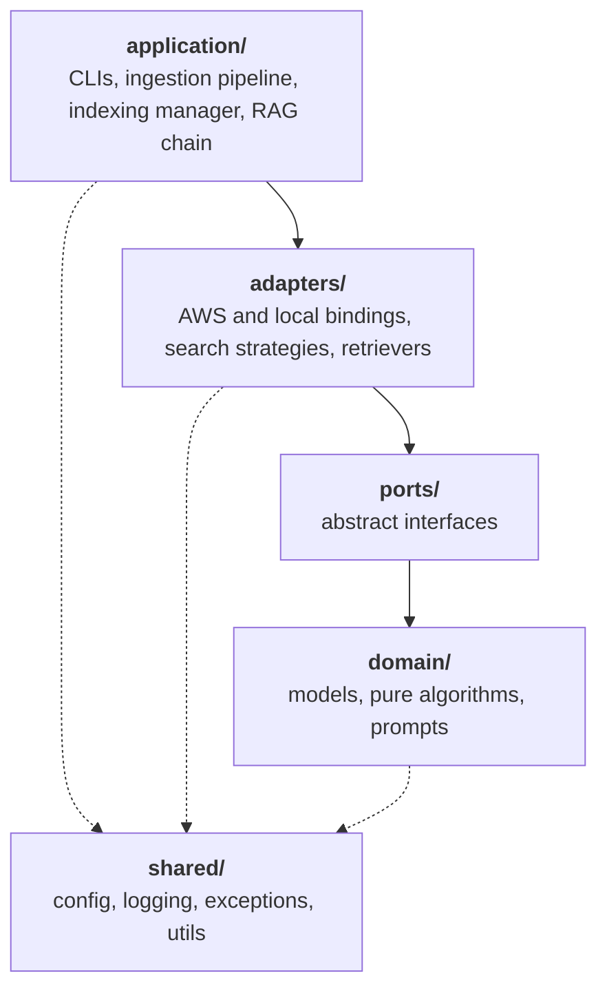

# Unified Knowledge Graph RAG on AWS — Technical Documentation

> 🇰🇷 한국어판: [docs/design.ko.md](./design.ko.md)

This is the **design reference for contributors and advanced users**: how the
library is built and why. Usage is in the [User Guide](user-guide.md), every
configuration key in the [Configuration Reference](./configuration.md), the
contribution workflow in [CONTRIBUTING.md](../CONTRIBUTING.md), and extension
recipes in [§15](#15-extension-guide).

## Table of Contents

1. [Overview and Design Philosophy](#1-overview-and-design-philosophy)
2. [Hexagonal Architecture (Ports & Adapters)](#2-hexagonal-architecture-ports--adapters)
3. [Domain Model](#3-domain-model)
4. [Ingestion Pipeline](#4-ingestion-pipeline)
5. [Incremental Indexing](#5-incremental-indexing)
6. [Retrieval: Two Methodologies](#6-retrieval-two-methodologies)
7. [Hybrid Scoring and Token Management](#7-hybrid-scoring-and-token-management)
8. [AWS Service Integration](#8-aws-service-integration)
9. [Evaluation Framework](#9-evaluation-framework)
10. [Visualization & Analytics](#10-visualization--analytics)
11. [Prompts and Prompt Tuning](#11-prompts-and-prompt-tuning)
12. [Configuration System](#12-configuration-system)
13. [Testing Strategy](#13-testing-strategy)
14. [CI/CD and Security](#14-cicd-and-security)
15. [Extension Guide](#15-extension-guide)
16. [Further Reading](#16-further-reading)

---

## 1. Overview and Design Philosophy

`unified-kg-rag-on-aws` reimplements the Microsoft GraphRAG and LightRAG
methodologies on an AWS-native stack (Bedrock, Neptune, OpenSearch, S3,
DynamoDB). Its design principles:

- **Two methodologies, one infrastructure.** GraphRAG (community summaries)
  and LightRAG (dual-level keywords) share ingestion, indexing, caching,
  multilingual processing and hybrid search; **only the retrieval algorithm
  differs**.
- **Generalization first.** No hardcoded domain rules or regex heuristics:
  semantic judgments go to the LLM or to authoritative data, token counts to
  the model's tokenizer API where it has one (a script-aware estimate
  otherwise), and thresholds and weights are configuration.
- **Hexagonal boundaries.** Domain and algorithm code depends on abstract
  ports; the AWS (and local) adapters sit behind them.
- **Registry-based extension.** Search strategies, renderers, parsers and
  providers register through registries, with no change to dispatch code;
  evaluators map from `EvaluatorType` in one method (§2.4).


---

## 2. Hexagonal Architecture (Ports & Adapters)

### 2.1 Dependency Rule and Layer Map

Imports point **inward**: `application → adapters → ports → domain`, and any
layer may import the cross-cutting `shared/` kernel. No `domain/` module may
load LangChain, LangSmith, boto3/botocore, lxml, opensearch-py or
gremlin-python, even transitively, so `shared/` and `shared/utils/` stay
dependency-light (LangChain-coupled helpers in `shared.utils.langchain` and
`shared.utils.document_converter`, rich ones in `shared.utils.display`);
`tests/unit/test_domain_purity.py` checks this in a clean interpreter.



Dotted arrows: any layer may import `shared/`. Search strategies are
adapters; the domain holds only their registry, so both methodologies plug
into the same ports.


```
unified_kg_rag/
├─ __init__.py         # public API facade: lazy re-exports of the supported names
├─ domain/              # technology-agnostic core (no boto3/LangChain/backend imports)
│  ├─ models/           #   Pydantic domain models
│  ├─ ingestion/        #   pure algorithms: delta_detector, graph_builder/resolver/analyzer,
│  │  └─ merge/         #   claim_resolver, contributions, derivation; merge/ = cross-run merger
│  ├─ retrieval/        #   strategy_registry, index_prefixes, hybrid_normalization
│  └─ prompts/          #   version-controlled prompt templates
├─ ports/               # abstract interfaces the domain depends on (DocStatusPort,
│                       #   BaseIndexer/GraphIndexer/VectorIndexer, ModelFactoryPort,
│                       #   ContentGuardPort — ports/__init__ is the port catalog)
├─ adapters/            # concrete technology bindings
│  ├─ aws/              #   Bedrock model factories, Neptune/OpenSearch clients, S3 transfer and caches
│  ├─ local/            #   Ollama/OpenAI-compatible models, cross-encoder, embedded SQLite graph/search stores
│  ├─ llm/              #   provider-neutral chain assembly, transient retry, token estimate
│  ├─ observability/    #   OpenTelemetry tracer, exporters, LangChain callback
│  ├─ storage/          #   Neptune/OpenSearch/SQLite-graph indexers (write-side port implementations)
│  ├─ retrievers/       #   Neptune/OpenSearch/SQLite-graph retrievers
│  ├─ doc_status/       #   DynamoDB/SQLite document-status registries (DocStatusPort)
│  ├─ guardrail/        #   Bedrock ApplyGuardrail (ContentGuardPort)
│  ├─ search_strategies/#   simple/local/global/drift + lightrag(mix/hybrid/naive)
│  ├─ retrieval/        #   abstract retriever/strategy bases, hybrid scorer, token/memory managers
│  ├─ ingestion/        #   LLM/IO coupled: chunker, *_extractor, loader, parser,
│  │                    #   translator, gleaner, community_detector
│  ├─ renderers/        #   graph visualization renderers
│  ├─ evaluators/       #   evaluator bases + langchain/ragas evaluators
│  ├─ store_errors.py   #   is_fatal_retrieval_error: the fatal-vs-degraded policy (§8.1)
│  ├─ providers.py      #   Providers: the per-run bundle of model and store providers
│  └─ provider_registry.py # @register_provider: builders keyed by role and kind
├─ application/         # orchestration + entry points
│  ├─ cli/              #   run-ingestion/rag/eval/visualization/prompt-tuning, prepare-benchmark
│  ├─ ingestion/        #   DataIngestionPipeline + pipeline_stages, IncrementalIndexer,
│  │                    #   namespace lease, extraction-record store
│  ├─ storage/          #   IndexingManager (indexer fan-out)
│  ├─ retrieval/        #   rag_chain (GraphRAGChain, RAGInput/Output)
│  ├─ prompts/          #   PromptTuner (LLM-based corpus profiling)
│  ├─ bootstrap.py      #   build_providers: the composition root
│  └─ observability.py  #   configure_observability: installs the tracing backend
├─ shared/              # cross-cutting kernel (config, logging, exceptions, metrics,
│                       #   cache/pipeline manager, utils)
├─ evaluation/          # real logic package: evaluation_manager / graph_aware /
│                       #   retrieval / answer_match, strategy comparison + pairwise
│                       #   judge, benchmarks/ (MuSiQue)
└─ visualization/       # real logic package: render loop + embeddings/exporters
```

- **Real logic packages.** `evaluation/` (the manager and the LLM-free
  evaluators) and `visualization/` (the render loop, `embeddings/`,
  `exporters/`; renderers are in `adapters/renderers/`). Everything else is
  imported from its real location (`application.*`, `adapters.*`,
  `domain.*`).
- **Vendor and role packages.** Vendor packages (`adapters/aws/`,
  `adapters/local/`) hold technology bindings (clients, embedded engines and
  stores, model factories, token counters, caches); role packages
  (`storage/`, `retrievers/`, `doc_status/`, `guardrail/`) hold the port
  implementations the application wires. A role package imports a vendor
  package, never the reverse: `SQLiteGraphIndexer` writes to
  `SQLiteGraphStore` as `NeptuneIndexer` writes through `NeptuneClient`.

### 2.2 Ports (Abstract Interfaces)

| Port | Location | Adapters | Notes |
|---|---|---|---|
| `DocStatusPort` | `ports/doc_status.py` | `adapters/doc_status/dynamodb.py`, `sqlite.py`; `FakeDocStatusStore` for tests | Document status and each document's text units, partitioned by index namespace |
| `ContentGuardPort` | `ports/guardrail.py` (with `GuardVerdict`) | `adapters/guardrail/bedrock.py` (Bedrock `ApplyGuardrail`) | Screens the raw query and the final answer (§14) |
| `GraphIndexer` (write) | `ports/indexer.py` | `adapters/storage/neptune_indexer.py`; local `sqlite_graph_indexer.py` | One contract for full builds and deltas (`upsert_*` / `delete_by_id`) |
| `VectorIndexer` (write) | `ports/indexer.py` | `adapters/storage/opensearch_indexer.py` (on OpenSearch, or on the embedded engine through `SearchEngineClient`) | Same |
| `BaseGraphRAGRetriever` (read) | `adapters/retrieval/base.py` | `adapters/retrievers/{neptune,opensearch,sqlite_graph}_retriever.py` | Retrieval adapters |
| Model factories, token counter | `ports/model_factory.py` (`ModelFactoryPort`, `TokenCounterPort`, the `*ModelInfo` records) | `adapters/aws/bedrock.py`, `bedrock_models.py`, `token_counter.py`; local `adapters/local/{models,embeddings,rerank,token_counter}.py` | Carried by one `Providers` bundle (§15) |

The read-side bases (`BaseGraphRAGRetriever`, `BaseSearchStrategy`) and
`BaseGraphRAGEvaluator` are *adapter bases*: they build infrastructure
(scorer, token manager) in `__init__`, so they live in `adapters/` and
`ports/__init__` only names them.

### 2.3 Role-Based Retriever Injection

Strategies receive retrievers **by role, not by backend**:
`RetrieverRole.GRAPH` (graph expansion) and `RetrieverRole.DOCUMENT`
(vector and lexical lookup). They reach them only through
`self.graph_retriever` / `self.document_retriever`, and the chain's role →
builder map binds the implementation, so swapping the graph backend changes
no strategy code.

```python
# domain/retrieval/strategy_registry.py
@register_strategy(SearchStrategy.LOCAL, required_roles=(RetrieverRole.DOCUMENT, RetrieverRole.GRAPH))
class LocalSearchStrategy(BaseSearchStrategy): ...
```

The write path has two fixed store roles: `IndexingManager` always writes a
graph store and a vector store, because the fan-out (entities to both stores,
entities before edges, the orphan-edge cascade) is domain knowledge; which
backend fills each role is open (`providers.graph.kind` /
`providers.vector.kind`, or an injected indexer).

### 2.4 Registries

- **Search strategies**: `@register_strategy(...)`
  (`domain/retrieval/strategy_registry.py`): a class, its required roles and
  query inputs, keyed by `SearchStrategy`.
- **Providers**: `@register_provider(ProviderRole.X, "kind")`
  (`adapters/provider_registry.py`): the builder `providers.<role>.kind`
  selects, for every model, store and registry role.
- **Renderers**: `@register_renderer("name")` (`adapters/renderers/base.py`);
  **parsers**: `ParserFactory.register_loader(".ext", Loader)`.
- **Evaluators**: one lazy-import branch per `EvaluatorType` in
  `EvaluationManager._resolve_evaluator_class`.

### 2.5 Dependency Rule Verification and Public API

`tests/unit/test_domain_purity.py` enforces the layer contracts on every
import, `TYPE_CHECKING` ones included: `domain/` imports no
`ports`/`adapters`/`application` module, `ports/` and `shared/` import no other
layer, `adapters/` import no `application`, `evaluation` or `visualization`
module, and `evaluation/` reaches the application only through the chain. It
also checks that the two type-only references stay under `TYPE_CHECKING`: the
strategy registry naming `BaseSearchStrategy` and the delta detector's
`DocStatusPort` annotation (a runtime import would be a cycle).

**Public API.** Callers outside the package import from `unified_kg_rag`,
whose `__all__` is the supported surface: the names for using the framework
(`Config`, `get_config`, `DataIngestionPipeline`, `GraphRAGChain`, `RAGInput`
/ `RAGOutput` / `SearchOutput`, `EvaluationManager`, ...) and for extending it
(the ports, `Providers` / `build_providers`, the registries). Other module
paths are internal; only a change to the exported names, configuration keys,
CLI flags and exit codes, or stored formats is breaking. Names resolve on
first access (`import unified_kg_rag` loads nothing), and
`tests/unit/test_public_api.py` pins the list.

---

## 3. Domain Model

`domain/models/` holds pure Pydantic models with no infrastructure
dependency:

- `Entity` (`name`, `description`, `type`, `text_unit_ids`, `community_ids`,
  `rank`, `confidence`, embedding fields), `Relationship` (`source_id` /
  `target_id`, `description`, `weight`, `text_unit_ids`),
  `Community` / `CommunityReport`, `TextUnit`, `Covariate` (claim);
- `DocStatus` (a `PENDING` write-ahead record, then `PROCESSED` / `FAILED` /
  `QUARANTINED`), `DocStatusRecord` (content hash, the document's text units,
  suffix), `DocumentDelta` (new / changed / unchanged / deleted, plus failed,
  quarantined, quarantined-unchanged, deferred and settings-changed ids),
  `DocumentLineage` (the text units one document produced);
- `SearchQuery` / `SearchResult` / `RetrievalResult`, `SearchStrategy` /
  `SearchType` / `RetrieverRole`.

**Lineage is the core data.** Entities and relationships record the
`text_unit_ids` they were stated in. This lineage, not a token-overlap
heuristic, decides whether an entity relates to a text unit, in any
language, and incremental removal follows it (§5).

**Rank (MS GraphRAG parity).** An entity's `rank` is its degree, a
relationship's the sum of its endpoints' degrees (`domain/ingestion/graph_rank.py`).
A full build sets them; an incremental merge recomputes them for what it
writes over the stored graph's neighbours.

**Index suffix.** Every OpenSearch index and Neptune label is named
`<prefix>-<suffix>[-<additional_suffix>]`: ingestion writes
`processing.document_parsing.index_value`, queries select `RAGInput.suffix`
(`--suffix`), both `default` when unset; one suffix per tenant or corpus
version.

**Display names and identity keys.**

- `Entity.name` keeps the display form the source used, only trimmed and
  whitespace-collapsed (`clean_display_name`), so context and reports quote
  "$1,000 penalty" or "C++" verbatim.
- Ids hash `entity_key(name)` (`shared/utils/common.py`): NFKC, casefold, `_`
  and `-` as spaces, quote marks and commas dropped, whitespace collapsed,
  trailing sentence punctuation stripped, **every other symbol and the
  letters and digits of all scripts kept**. "ACME  Corp." and "Acme Corp"
  share an id; "C++" and "C#" do not; a non-empty name never yields an empty
  key. Every exact-name match (extraction, gleaning, claim resolution,
  incremental merges) and the fuzzy matcher's shingles use the same key.
- **Changing the key changes every id**, so it requires a full re-index.

---

## 4. Ingestion Pipeline

`DataIngestionPipeline` (`application/ingestion/pipeline.py`) runs 12
checkpointed stages, so a re-run resumes after the last valid one. Extraction
works per text unit and the graph is resolved from the merged per-unit
records, so a full build does not depend on batching and an incremental run
can re-derive what it touches (§5).


| # | Stage | Module | Notes |
|---|---|---|---|
| 1 | Document parsing | `parser.py` (`ParserFactory`) | PDF/TXT/CSV/JSON (+ MD/HTML with the `unstructured` extra) |
| 2 | Document loading | `loader.py` | optional MinHash deduplication; the incremental diff |
| 3 | Chunking | `chunker.py` | intelligent (LLM boundaries, default) or simple |
| 4 | Translation | `translator.py` | optional; skipped when source = target language |
| 5 | Graph extraction | `graph_extractor.py` | entities and relationships per text unit |
| 6 | Gleaning | `gleaner.py` | optional; re-asks a unit while its last answer added something |
| 7 | Graph resolution | `graph_resolver.py`, `description_summarizer.py` | merges name variants, re-summarizes long descriptions (calls the LLM) |
| 8-9 | Claim extraction and resolution | `claim_extractor.py`, `claim_resolver.py` | optional (off by default) |
| 10 | Graph analysis | `graph_analyzer.py` | graph build and statistics |
| 11 | Community detection | `community_detector.py` | hierarchical Leiden and structured reports |
| 12 | Indexing | `application/storage/indexing_manager.py` | graph and vector stores; full build or delta |

The stage order lives in `DataIngestionPipeline.STAGE_CLASSES`; every stage
gets its models and stores from the run's `Providers` bundle.

### 4.1 Extraction records and the extraction store (stages 5-8)

- **One record per text unit.** Extraction and gleaning write one
  `TextUnitExtraction` per unit (`domain/models/extraction.py`): the
  entities and relationships that unit states, in its own words, plus the
  entity keys rejected for it. Gleaning edits one record at a time: its
  prompt lists the unit's own items, and a correction never reaches what
  another unit says (MS GraphRAG and LightRAG likewise glean each chunk's own
  extraction).
- **Resolution starts from the merge of all records**
  (`domain/ingestion/contributions.merge_contributions`: items merged by id,
  weights kept per unit), so the merged graph does not depend on which units
  shared a batch. Claim prompts list the unit's own entities, so a unit's
  claims depend on the unit alone.
- **The extraction store** keeps each record, keyed by
  `<fingerprint>:<SHA-256 of the processed text>`, in the vector store's
  extraction-records index. The fingerprint
  (`cache_keys.unit_record_fingerprint`) covers the models, the extraction,
  gleaning or claim settings, the target language and the prompt templates in
  effect. A unit whose text and settings have a stored record takes it
  instead of an LLM call, so an edited document re-extracts only its changed
  chunks, and identical chunks elsewhere or in a rebuild reuse theirs.
  `--force-rebuild` re-extracts and refreshes every record; an unreadable
  store is logged and the run re-extracts. A record that cannot be written
  fails its unit (`records_not_stored`), so its document is recorded `FAILED`
  and extracted again: incremental runs derive from the records (§5.4).
- **A text unit names its stored records** in `attributes.extraction_records`,
  computed from the run's records when the unit is indexed (not set on the
  cached units), so a resumed run writes them too.
- **A record stays while a stored text unit names it.** A full build or
  reset whose text units were all written keeps only the records they name
  (`VectorIndexer.retain_extraction_records` copies them into a new index and
  swaps the alias); an incremental run deletes the records only removed text
  units named.
- **Gleaning stops on observed output**: a unit is re-sent (up to
  `max_rounds`) only while its previous answer added something new. An empty
  answer is the "nothing missing" signal MS GraphRAG asks for with a separate
  yes/no prompt, so no call is spent on it.

### 4.2 Graph identity and merging (stages 5-7)

- **Relationship identity (deliberate divergence).** A relationship id hashes
  `relationship:{entity_key(source)}:{entity_key(target)}:{type}`, lowercased,
  so the model-written `type` is part of the identity and the edge is
  directed: two types between one pair are two edges here and one in MS
  GraphRAG and LightRAG (the community graph still joins them, §4.3). The
  parts are joined with `:` unescaped, so a `:` in a name or type can collide;
  the format is kept because fixing it would re-key every stored relationship.
- **Endpoints cite their relationships' text units (deliberate
  divergence).** An entity also cites the text units of each relationship it
  is an endpoint of, and an endpoint no unit listed becomes a stub entity
  citing them (`relationship_endpoints.cite_relationship_endpoints`). Upstream, an
  entity's text units depend on which chunks were extracted together; here
  they depend only on the chunks that name it, so an incremental run cites
  what a full build cites and a removed document strips an entity to exactly
  the surviving text units that name it. The cost: local search and
  community lineage also reach chunks that mention an entity only through a
  relationship. With entity grounding on, gleaning drops a relationship naming
  an entity rejected as ungrounded for its chunk, so no stub brings it back.
- **Entity merging.** Two names merge when their `compact_name_key` is equal:
  `entity_key` without a short, fixed list of legal-form designators (`(주)`,
  `주식회사`, `株式会社`, `有限公司`, a trailing `Inc` / `Ltd` / `LLC` / `Co` /
  `Corp`, ...) and without spaces next to Han, Hangul or Kana, so
  "(주)가나다", "가나다 상사" / "가나다상사" and "Acme Inc" / "Acme" merge. A
  merged group takes the name cited by the most text units (ties: the
  smallest), so the result does not depend on input order.
- **Fuzzy matching is opt-in** (`processing.fuzzy_entity_resolution`), because
  name similarity also joins different organizations that share most of their
  name ("Northfield University" / "Northfield University Hospital"). When it is
  on, names link above `processing.similarity_threshold` only when their
  *discriminator tokens* (tokens with a digit, single letters, Roman numerals)
  are identical, their types are compatible, and, for names ending in Han,
  Hangul or Kana, their final (head) characters are equal ("가나다연구원" and
  "가나다연구소" stay apart). A type-aware union-find never groups two
  differently typed names; the incremental merge uses the same matcher, so
  full and incremental builds group the same names.
- **Merged descriptions** are concatenated, so `DescriptionSummarizer`
  re-summarizes those over a token budget with a cheap model (map-reduce when
  one exceeds a call's input); a failed call keeps the concatenation. The
  trigger is a cost variant of upstream, not parity: MS GraphRAG
  `summarize_descriptions` summarizes every item with more than one
  description and LightRAG also at `force_llm_summary_on_merge` (8)
  fragments; here only the token budget triggers it.

### 4.3 Communities (stages 10-11)

- **Community graph.** `GraphBuilder` builds an undirected graph with one edge
  per entity pair; relationships of other types or directions between the pair
  share it, with the summed weight, so Leiden sees the pair's total strength.
- **Hierarchy (deliberate divergence).** Level 0 is one Leiden partition of the
  whole entity graph; each coarser level partitions the graph of the previous
  level's communities, up to `max_levels`. Because modularity's resolution
  limit grows level-0 communities with the corpus beyond what one report can
  describe, a community over `max_cluster_size` (default 20) members is
  partitioned again on its own subgraph. Level-0
  communities under `min_community_size` merge into their strongest neighbour.
  A connected component smaller than `min_community_size` (an isolated
  entity, a pair) gets no community or report; only these are skipped, unlike
  MS GraphRAG's `use_lcc`, which drops every component but the largest. On an
  incremental run, whose graph is only the delta, a small component is
  clustered when it reaches `min_community_size` in the whole graph a full
  build would cluster: walking the stored relationships that cite text units
  of documents the run neither processes nor removes, at most
  `min_community_size` batched reads. Stored entities without a community it
  links to stay without one until a rebuild (`community_drift`
  `unclustered_entities`). A
  parent identical to its only child is never created, so each distinct
  community is reported once. A Leiden failure fails the stage instead of
  truncating the hierarchy.
- **Determinism.** Leiden's partition depends on insertion order and
  `graspologic_native` returns labels in a per-process order, so the detector
  sorts nodes and edges and renumbers each level by its smallest member id:
  the same graph and `random_state` always yield the same communities and ids.
- **Reports (MS GraphRAG parity).** A report's input sorts the community's
  entities by degree, caps them at `max_entities_per_report` and packs them
  into `max_report_context_tokens` (the top entity always fits). Reports are
  generated bottom-up, so a parent whose context would overflow folds in its
  children's report summaries instead of truncating
  (`enable_sub_community_rollup`). The prompt returns a structured report
  (summary, 0-10 rating with explanation, findings); `full_content` for
  embedding and search is rendered from it, with no second call.
- **Report lineage.** Each report carries `text_unit_ids` and `document_ids`
  (the union over its members: provenance, not citation support) and its
  place in the hierarchy, which global search selects by (§6.1.1).

### 4.4 Pipeline infrastructure

- **Resume.** Each stage's output is checkpointed under the run's pipeline id
  (`shared/pipeline_manager.py`, `shared/cache_manager.py`); the stage cache
  key is described in §12.
- **S3 sync** (`adapters/aws/s3_cache.py`) uploads the changed files after
  every stage, data before the metadata that refers to it. On SIGTERM,
  `run-ingestion` stops the running stage (`request_stop`: deferred while a
  checkpoint is written, no I/O in the handler) and uploads its checkpoint.
- **LLM response cache** (`adapters/llm/response_cache.py`): a LangChain
  `BaseCache` on every ingestion model, keyed by the rendered messages and the
  model and generation settings, stored with the stage cache. An earlier
  run's entry is served at most once per run and truncated responses are not
  kept, so a retry after a bad response asks the model again.
- **Output fixing.** Structured outputs are parsed with a
  `FixingConfig`-based output-fixing parser.
- **Resources.** The pipeline releases indexer and client resources in
  `close()`, which `run-ingestion` calls in `finally` (§8.2).

---

## 5. Incremental Indexing

With the doc-status registry on, a run diffs the corpus against the registry
by content hash and processes only new, changed and failed documents. The
registry lists each document's text units, and removal asks the stores what
cites them. A write-ahead protocol lets the next run repair any
interruption, and the result converges to a full build of the current corpus.


### 5.1 The steps

Names are `IncrementalIndexer` methods (`application/ingestion/incremental.py`)
unless noted.

1. **Delta detection** (`domain/ingestion/delta_detector.py`).
   `DocStatusPort.diff(incoming, scope)` classifies documents as new, changed,
   unchanged or deleted by content hash. A `doc_id` is
   `<namespace>#<hash of namespace, source scope and relative path>`, and the
   namespace is the registry partition, so a run reads only its namespace (one
   projected DynamoDB `Query`) and two corpora or tenants never share a record.
   Only records of the run's scope are deletion candidates; files that failed
   to parse or load are reported `failed`, not deleted. A moved corpus's old
   records are never adopted (a move cannot be told from another host's corpus
   on the same path) until a run retires the old scope
   (`indexing.retire_source_scopes`). Documents whose processing keeps killing
   the run are quarantined or deferred (§5.3).
2. **Write-ahead** (`write_ahead`). Before any store write, every new and
   changed document is recorded `PENDING` (content hash `"pending"`, which no
   document hashes to) with the union of its stored text units and the ones
   this run will write, in one batched write. A record over the registry's
   item limit (DynamoDB 400 KB, about 10,000 text units) fails the run here,
   before anything is written.
3. **Stale cleanup** (`remove_changed_and_deleted`). The text units of changed
   and deleted documents are removed in one pass per suffix (step 5), so an
   artifact only they state goes too. Deleted documents are first recorded
   `PENDING`, so one restored before its removal finished reads changed.
4. **Delta upsert** (`commit`). The stored entities and relationships the
   delta touches (found by compact name key, every stored name with fuzzy
   matching on) and the stored edges of its entities are read back, the delta
   is merged into them and their content derived from the extraction records
   (§5.4); delta claims merge with the stored claims of the same id. Neptune
   writes with an idempotent `coalesce(unfold, addV)` upsert, OpenSearch by id
   into the live alias index; old ids of re-keyed items are deleted only after
   the writes succeeded. Before the first write the commit notes the
   entities it splits, re-keys or rewires in one record of the suffix's
   extraction store (`pending-commit`), deleted once the old ids are: those
   decisions live in memory only, and the next commit of the suffix derives
   the noted entities, their stored edges and the claims about them again,
   so a killed commit's half-written split is finished. It also retires
   the noted entities' copies only the vector store holds, with the vector
   edges at them (the killed commit got to its vector writes only), and a
   run that only removes in the suffix reads the note all the same.
5. **Deletion propagation** (`IndexingManager.remove_text_units`). The stores
   are asked what cites the removed text units (`GraphIndexer.find_ids_citing`
   for entities, `VectorIndexer.find_documents`); edges are found among the
   cited entities' incident edges, and only a resumed removal (some removed
   text units already gone from the vector store, or a vector store that
   cannot tell) looks them up by text unit with
   `find_relationship_ids_citing`, on Neptune a scan of the suffix's edges.
   An item citing only removed text units is
   deleted from both stores, the vector copy first (a retry finds what to
   delete through the graph, so an interrupted run leaves a graph copy, not
   an orphaned vector copy); one citing others too is stripped of them, its
   weight recomputed and its content derived again from the text units left.
   A strip that merges or re-keys items (another spelling of a stripped
   entity's name, which need not cite the removed text units), or derives
   claims under new ids, notes before its first write the entities on both
   sides of the merge, the edges it re-keyed or dropped, the claims about a
   split's entities and the new claim ids, in one record of the
   suffix's extraction store (`pending-strip`, with those of a note a retry
   finishes) and deletes it once their old ids are gone; every removal reads
   it, so a resumed one strips them again. The claims about the other stored
   spellings of a re-keyed, renamed or split entity's name are derived again
   too: one may resolve to it now.
   A community or report goes once none of its text units is stored. A failed
   removal keeps the deleted documents' records for a retry and fails the
   stage (before the commit when the delta has changed documents).
6. **Registry update** (`commit`). The `PENDING` records are replaced, in one
   batched write, by `PROCESSED` or `FAILED` records with each document's text
   units, scope and relative path (the five causes of `FAILED`:
   [runbook](./operations.md#failed-documents)). `failure_count` counts
   consecutive failures of the same content; after
   `indexing.max_document_failures` the document reads unchanged. A run that
   stops before this step at a stage that failed on all of its units still
   records FAILED the documents whose units failed for an error of their own,
   so a document that always fails cannot block every later run. Only such
   errors count, here and at this commit: unparseable or cut-off output, and
   a request the model rejects for its content (the factory's
   `is_item_error`: a Bedrock `ValidationException`, HTTP 400/413/422, minus
   rejections of the model or a setting). Any other error (an outage,
   credentials, a quota, a setting, a bug) counts for none. When every unit
   sent fails and its own errors are of one cause (alike in type, code and
   HTTP status, not message; or all unparseable or cut-off output; a unit
   that failed otherwise, throttled say, is left out), output errors on the
   units of more than one document count for none (a server-side output cap
   cuts them all; a short request cannot tell). Otherwise the stage sends one
   known-good request through the same chain, bypassing the LLM response
   cache: failed too (for output errors, unparseable counts as failed), the
   cause is the model or a setting and none counts; answered, the errors are
   the documents' own. Extraction
   records only removed text units named are then deleted (best effort).

**Limitation:** shared communities and reports keep what a changed or deleted
document contributed, and a re-keyed entity's old id, until a full rebuild
(§5.5); descriptions, names, ids, types, filters, ranks and claims are
derived again on every run.

### 5.2 Full rebuild (`indexing.reset`)

`indexing.reset` skips the diff and rebuilds the whole corpus with the
full-index path, without taking the suffix offline. Quarantined documents
(§5.3) are skipped and keep their records; every other document, and every
indexed one the corpus dropped, is recorded `PENDING`; the vector indices are written into new timestamped indices whose
aliases swap when each is built; the graph is rebuilt in place
(`GraphIndexer.begin_rebuild` tags every vertex and edge the build writes, and
`end_rebuild` drops the suffix's entities, communities and edges without the
tag). The writes upsert in place, so graph queries see previous and rebuilt
items mixed until that final drop. Only after every
document is recorded again are the namespace's other records deleted, so a
failed rebuild drops nothing. A rebuild whose graph writes partly failed
(within `indexing.max_failure_rate`) skips the drop, so a retry still finds the
previous copies, and is reported failed (`neptune_sweep`) rather than recorded:
clearing the replaced documents' records would orphan their vertices and edges.

A generation switch (new labels plus a pointer) was rejected: Neptune labels
cannot be renamed, so every retriever would resolve the current generation on
each query and the graph would be stored twice during the rebuild.

### 5.3 Crash recovery (write-ahead protocol)

The registry is not updated atomically with the stores, so a run can stop
between any two writes. One invariant holds: **before the stores hold
anything the registry cannot account for, the registry already lists it.**
Write-ahead records precede every removal and upsert, deleted documents' rows
go only after their artifacts, and a `PENDING` record is replaced only after
the document's writes landed. The next run repairs an interrupted one:

- `PENDING` never equals a content hash, so a document still in the corpus
  reads changed, even if its file went back to the indexed version; one no
  longer in the corpus reads deleted, and its text units cover everything the
  interrupted run may have written.
- The removal plans from the record stored before the current run's own
  `PENDING` record, so a recovery run removes the partial writes first.
- An interruption is not counted toward `indexing.max_document_failures`
  (a `PENDING` record has `failure_count` 0).
- Old ids of re-keyed items are deleted only after their new copies are
  written, so an interruption leaves at worst both copies, which the retry
  derives together.

**Attempts and quarantine** (`domain/ingestion/attempts.py`). A document
whose processing kills the task would stop every later run the same way.

- **Open and close.** After the diff (and when a run resumes past
  document_loading) the run opens an attempt on every document it processes
  (`incremental.open_attempts`: `attempt_batch` = documents processed
  together, `attempted_hash`; a new document gets a `PENDING` record without
  text units) and closes them however the process ends: finished, failed,
  SIGTERM or Ctrl-C (`close_attempts`). An attempt still open on the next run
  is one more death of that content (`attempt_count`) in a batch of
  `attempt_batch` (`crash_batch`). A reset opens none (the write-ahead record
  keeps the stored attempt fields); a document that produces no text units in
  a committing run counts as a death alone.
- **Plan** (`plan_attempts`, at the diff). A changed document whose deaths
  reach `indexing.max_document_attempts` is a suspect; one whose last death
  was alone (`crash_batch` 1) is `quarantined`. Otherwise the run processes
  the first half (by doc id) of the suspects that died in the smallest batch
  and classifies every other new or changed document `deferred` (neither
  processed nor deleted). A death narrows the suspects to that half and a run
  that ends commits it, so one culprit among `n` is isolated in about
  `log2(n) + 1` runs and no document is quarantined for dying with it.
- **Quarantined record**: `QUARANTINED` with the attempted content hash, its
  deaths and the reason in `error_info`. When the attempts reached indexing
  (the record is the write-ahead `PENDING` one), the removal pass removes what
  they wrote and no text units are kept; otherwise the indexed version and its
  text units stay. It reads unchanged (`diff` lists it in
  `DocumentDelta.quarantined_unchanged`) until the content changes or the
  limit is raised above its deaths (`release_quarantined` then classifies it
  changed); deaths count per content, so new extraction settings quarantine
  it again, and a reset skips it too.
- **Resume check** (`delta_still_applies`). A resumed run whose restored
  delta names a document whose record is gone, holds other content, reached
  the limit or was written by another pipeline id since (`written_by`; a
  record written before the field has none and counts as another pipeline
  id's unless it is `PROCESSED` without an open attempt, and even then when
  it was committed under other extraction settings for a document the delta
  re-extracts for a settings change), or deletes a document another
  pipeline id (or a record without a writer) has recorded in another scope
  since, resumes from document_loading instead. A resume past
  a stage that recorded failed text units starts at that stage, so the units
  are retried rather than recorded `FAILED` again; a reset resumed past the
  stages that store extraction records starts at the first whose records
  another run deleted. Metrics:
  `total_documents_quarantined` (CDK `DocumentsQuarantined` alarm) and
  `total_documents_deferred`.

The cost is one extra batched registry write per run (two more writes and
reads for the attempts) and a few batched store lookups per suffix.
`tests/unit/test_incremental_write_ahead.py` and
`tests/property/test_incremental_interruption_properties.py` interrupt a run at
every write and check that the next run converges to a fresh full build.

### 5.4 Identity, derived content and merge rules

- **Document identity** (`shared/utils/document_identity.py`). A document
  version's id hashes its path relative to the corpus root and its full text,
  so without the registry a corpus yields the same ids wherever it is checked
  out; an incremental run keys text units by the registry `doc_id`, which
  also holds the source scope (`document_parsing.source_scope`, else the
  resolved source directory), so each belongs to one record and the ids hold
  only from the same directory or with a fixed scope. Changing either rule
  requires a re-index.
- **Derived content** (`domain/ingestion/derivation.py`). The merge and the
  strip keep each touched item's structure (id, text units, per-unit
  weights); its content is then derived from the records of the text units it
  cites now, by the full build's own code (`merge_contributions`,
  `GraphResolver`, `ClaimResolver`), so the item gets what a full build of the
  current corpus gives it: a deleted document's text leaves shared
  descriptions and claims, names and types follow the current votes, and an
  entity whose derived name has another id takes that id
  (`Derived.id_remap`), its edges and claims following. An item citing a text
  unit without a stored record keeps its stored content (a WARNING and the
  indexing stage's `underived_items` metric).
- **Merges a full build undoes.** A stored entity may hold what a full build
  keeps apart (two spellings merged while their types agreed): every resolved
  entity sharing a name key and a text unit with it is derived, the best
  match under its id and each other as its own entity (`Derived.split_from`).
  The stored edges of a split or re-keyed entity are derived with it
  (`Derived.rewired`), so each follows the part that states it and a
  re-pointed edge merges with the derived edge it now equals. An edge a full
  build draws that no stored edge is (an earlier merge dropped it as a
  self-loop) is added; a stored edge whose endpoints now resolve to one
  entity is deleted with the retired ids (`Derived.dropped`), as is a delta
  id the cross-run merge folded into another (an interrupted run may have
  left its vector copy). Edges take the resolution's per-unit strengths, and
  claim statements merge in text-unit id order, as in a full build.
- **Cost.** Derivation runs only where something is stored (a first build
  writes the delta as graph resolution made it) and matches through a key
  index. A stored summary that only grew (the item still cites every text unit
  it did) is summarized from itself and the new description, as LightRAG
  merges into the stored one; an item that lost a text unit is summarized from
  its derived description, so removed text goes. A stored edge rewritten for
  its rank only is updated in place, not embedded again.
- **Merge rules** (`domain/ingestion/merge/merger.py`, ported from MS GraphRAG
  `update/*`), all idempotent:

| Artifact | Matched by | Merged as |
|---|---|---|
| Entity | id, else identity key | description lines unioned; `text_unit_ids` and `community_ids` unioned; max confidence and rank; attributes unioned (delta wins) except `filters`, whose values are unioned per key; the stored name and type are kept (the derivation then sets what a full build would) |
| Relationship | id, else (source, target, type) | as entities; weight = sum of the strengths per supporting text unit (`attributes.text_unit_weights`), so the result equals a full build over the union; endpoint names re-derived from the merged entities |
| Claim | id | full-build `ClaimResolver` rules: descriptions and source texts unioned, `text_unit_ids` unioned, the stored status kept |
| Community | content-derived id | appended (§5.5) |

### 5.5 Communities on delta runs

A delta run clusters only the delta subgraph, as MS GraphRAG's update path
appends rather than re-clusters. Community ids are therefore content-derived
(a hash of the level and the sorted member ids; `L{level}_C{i}` survives only
as a display name), so a delta's communities and reports are appended next to
the corpus's instead of overwriting them. A corpus community goes once none of
its text units is stored; shared ones keep their report until a full rebuild,
the only path that re-partitions the whole graph
(`indexing.community_drift_threshold` reports when one is due). Each delta's
root communities join every cut of the hierarchy, so global search's cut
grows until a rebuild; the cap and the shallower-cut fallback (§6.1.1) bound
it, and the drift metrics report it (`added_roots`). Rejected alternatives:
leaving delta communities of already clustered entities out of the cuts
(their reports are the only ones describing the delta, and stored community
ids still name removed communities), and re-detecting the full graph on every
delta run (it would regenerate every report, an LLM call each).

### 5.6 Concurrency

With the registry, a run takes its namespace's write lease before its first
stage and holds it to its end (`application/ingestion/namespace_lease.py`):
one conditional registry write, renewed by a heartbeat every sixth of
`indexing.lease_seconds` (lease requests: short timeouts, 3 attempts). A
second run fails with `NamespaceLeaseError` before it reads or writes.

- **Write fence** (`shared/write_fence.py`). Every incremental registry
  write, indexing phase, rebuild sweep, Neptune write batch or drop and
  OpenSearch indexing request other than a GET or HEAD checks the lease
  first. The check fails once the lease was released, and once less than a
  third of the term is left since the last successful renewal was sent (the
  store's expiry runs from then), so a run that lost the lease stops while
  it still holds it, provided no single write request outlasts a third of
  the term. A second fence fails the worker threads' writes once a stop
  (SIGTERM or Ctrl-C) was requested; the thread running the pipeline still
  writes while it unwinds.
- **No conditional writes.** `BatchWriteItem` takes no condition and store
  writes cannot be conditioned on the registry, so the margin is the fence.
  The DynamoDB registry checks it before every attempt of a write request
  (a botocore before-send hook), not once per call, so its re-sends and
  retries stop with the lease too; an embedded (SQLite) write transaction
  checks it before it waits for the database's write lock and again once it
  holds it.
- **Takeover wait.** A write past the fence lands by the holder's expiry plus
  the longest request (its attempts are bounded by the request timeout), so
  a run that takes over an expired, unreleased lease holds its first write
  (not its reads) until then; a frozen process that sends a built request
  later than that is the one case the margin cannot cover.
- **Giving the lease up.** A run that ended or failed released it (its pools
  waited for their writes), and the next run writes at once. A stopped run
  (SIGTERM or Ctrl-C) leaves it expired, owner kept, since its pools do not
  wait for the requests in flight: the next run waits as after a crash, and
  the stop message says until when. With every store embedded (SQLite; told
  by the adapters the run builds, so an injected remote store counts as
  remote) the lease is released: a worker the stop left running fails at its next write
  transaction, and one already holding the database's lock commits before
  the next run can write that store; a takeover waits at most one store
  write (`search.store_timeout_seconds`). A
  run that ends during its own takeover wait hands the wait on: the lease
  goes back expired at the previous holder's expiry.
- **Checkpoint.** The lease is taken before the S3 checkpoint is downloaded
  and given up only after a stopped run uploaded it; the upload checks the
  lease is held (`check_fences_held`), not the takeover wait, so a run
  stopped during the wait still keeps its checkpoint.

Without the registry nothing locks, and concurrent runs on one suffix race on
its aliases and labels ([runbook](./operations.md#concurrent-runs)).

---

## 6. Retrieval: Two Methodologies

`GraphRAGChain` (`application/retrieval/rag_chain.py`, an LCEL Runnable) runs
one chain for every strategy: conversation memory (a follow-up is rewritten as
a standalone question) → strategy resolution → query processing (translation,
entity or keyword extraction) → retrieval → fusion and rerank → (RAG) context
budget and answer. `RAGInput.search_strategy` picks the methodology.


- **Where the chain stops.** `search` / `asearch` return the fused, ranked
  results (a `SearchOutput`); `invoke` / `ainvoke` / `stream` run the same
  steps, pack the results into the token budget (§7) and return a `RAGOutput`
  whose sources are exactly the sections the answer model saw. An empty
  budgeted context is answered "cannot answer" without calling the LLM.
- **Graph expansion** is part of `local` and `drift`, and opt-in for `mix` /
  `hybrid` (`search.lightrag_search.enable_graph_expansion`). Strategies find
  the seed entities in the vector store and pass their ids to the graph
  retriever, which expands from those ids only.
- **Under a document filter, expansion runs on the search store.** A graph
  holds no document attribute, so the walk goes over the relationships
  index instead (`BaseSearchStrategy._expand_over_passing_relationships`):
  each hop asks for the passing edges incident to the frontier vertices
  whose seed is short of its share, two requests (source and target side;
  plus one text-unit check under two or more keys), cached per query, and
  one entities-index read at the end (and, under two or more keys, a
  second text-unit check of the entities it reached). It keeps the graph walk's bounds
  (`max_hops`, `max_results_per_hop`, the budget split per seed, each seed
  at most its share) and scoring, but `degree` importance reads as `rank`
  (the index holds no degree). A side returns at most `min(max_query_size,
  live max_result_window)` edges, best first (a frontier past
  `max_terms_count` is asked in batches, each with its own page); when a
  side's page is full, the vertices still open are asked together once
  more at that side, and when that page is full too, each on its own, in
  waves of `search.max_concurrency`: each asks for what its wave may still
  take, and a wave leaves out what the waves before it reached. A hop costs
  one request per side, one more per full side, then one per open vertex
  and full side; under two or more keys each page adds a text-unit check.
  Edges back to a vertex already reached are left out by the store (a
  `must_not` on the other endpoint), so they cannot fill a page; past
  `max_terms_count` the exclusion keeps the vertices reached last, so edges
  back to the others can. An index
  built before
  relationships carried document filters passes no edge, so expansion keeps
  the seeds only until it is rebuilt; without the relationships index the
  graph walk runs, checked against the entities index. So is a graph walk
  under an entity key entity vertices do not store (`name.keyword`,
  `attributes.<path>`): the graph drops it, the entities index applies it
  (`_graph_unapplied_filters`), to the seeds too (LightRAG's relationship
  endpoints were found under no entity key).
- **One index, both methodologies (deliberate extension).** Ingestion builds
  the union of what both need (MS GraphRAG builds no relationship vector
  index, LightRAG no communities). A LightRAG-only deployment can set
  `graph.community_detection.enabled: false` to skip Leiden and every report
  call, leaving `global` and `drift` unavailable.

### 6.1 GraphRAG Methodology (`adapters/search_strategies/`)

- **simple** — vector and lexical search over every built index, no graph; the
  claims index joins the sweep only when claim extraction is on.
- **local** — candidate entities → graph expansion → frequency filter → their
  text units, plus a community-report section and a relationship section
  (MS GraphRAG local search). With
  `search.local_search.include_bridge_relationships` (default on), the
  relationships incident to the expanded entities are fetched too, edges
  between two retrieved entities first: they carry the hops of a multi-hop
  chain the relationship vector query rarely matches. With claims on,
  matching claims are injected (MS GraphRAG covariates). The section lookups
  run concurrently with the entity chain.
- **global** — MS GraphRAG global search over one cut of the community
  hierarchy (below), map-reduced into scored key points.
- **drift** — MS GraphRAG DRIFT search (`drift_search.py`).
  *Primer:* a hypothetical answer shaped like the most important report
  (`DriftHydePrompt`) selects the `k_followups` most similar reports, split
  into `primer_folds` folds, each returning an intermediate answer, a score
  and follow-up queries. *Actions:* for `n_depth` rounds the best-scored open
  follow-ups each run the local search (without rerank) and are answered with
  a score and new follow-ups. *Reduce:* the intermediate answers (one
  synthesized section, never a reported source) and the local evidence,
  reranked once, go to the answer model. Without reports or primer follow-ups,
  the question itself is the one follow-up.
  - Defaults `k_followups` 10, `n_depth` 2: at most 27 LLM calls a query (MS
    GraphRAG's 20 and 3: 67). Primer calls and actions run
    `search.max_concurrency` at a time.
  - The action local searches pack their context by the local type shares
    (`search.token_manager.type_budgets`, renormalized over the types
    present: about 0.60 text, 0.24 entities, 0.16 relationships), not MS GraphRAG's DRIFT
    `local_search_text_unit_prop` 0.9 / `local_search_community_prop` 0.1.
  - The primer searches reports of every depth, not MS GraphRAG's one
    `community_level`, so similarity picks the granularity (on a synthetic
    six-hop corpus a depth-2 cut answered 16 of 21 sub-questions, every depth
    21).
  - A fatal error fails the query and cancels the calls in flight; any other
    failure leaves only its own answer out (`degraded_error`). The query fails
    only when a whole step failed and `processing.ignore_errors` is off; a
    round whose actions all failed ends the rounds.
- **auto** — an LLM router (`StrategySelectionPrompt`) picks among
  `search.auto_routable_strategies` minus those the pipeline cannot serve
  (`global` and `drift` need community reports) and, with filters, those
  that do not apply every filter key (none left: `InvalidFilterError`,
  before any LLM call, so a filter never fails by route); the prompt
  describes exactly these candidates, and unrecognized output falls back to
  `local` (else the first candidate). The default set is `local`, `mix`,
  `global` (`drift` costs up to 27 LLM calls); with one candidate no router
  call is made. The
  prompt sends questions that chain from a named entity to `local` (synthetic
  multi-hop harness: `local` 0.925, `mix` 0.40 exact match).

#### 6.1.1 Global search (`global_search.py`)

**Which reports.** Each report carries its place in the hierarchy (`level`
bottom-up, `depth` from the root, parent and children, `max_cut_depth`). The
cut at depth `D` is every community at depth `D` plus the leaves that stop
above it (`depth <= D <= max_cut_depth`), MS GraphRAG's roll-up that covers
every entity once; MS GraphRAG counts `community_level` from the root, so the
depth selects the cut.

- **Fixed cut (default)** — every report of the cut is mapped, up to a cap:
  the cut is browsed by rank, one report more than the cap
  (`max_reports_per_level`, at most `max_query_size` - 1, and the live
  `max_result_window` - 1, so the probe fits one request; 99 by default) so a
  cut of exactly the cap is complete. A larger cut gives way to the deepest
  shallower cut that fits (`global_cut_depth`), covering the same entities in
  broader reports; MS GraphRAG has no cap and maps the whole cut. Only when even the root cut does not fit does a hybrid search,
  restricted to the configured cut, pick that many most similar reports
  (`global_level_capped`): the only place similarity enters global search.
  The cap counts reports, which bounds the map calls.
- **Dynamic selection** (`use_dynamic_selection`) — MS GraphRAG's
  `DynamicCommunitySelection`: rate the root reports for relevance, follow
  the children of the relevant ones to the leaves, and rate the whole next
  depth when a depth yields none, down to `community_depth` (MS GraphRAG's
  `max_level`, which bounds only this fallback). The walk starts at the roots
  as upstream's does but follows relevant reports to the leaves, where
  upstream's stops at `community_level`. Ratings run
  `search.max_concurrency` at a time.

**Map-reduce.** At least `map_reduce_min_results` reports are packed, in the
order the selection gives them (rank for the fixed cut, rating for dynamic
selection, similarity for the similarity fallback; MS GraphRAG shuffles
them), into batches of `map_context_tokens` (MS
GraphRAG's `data_max_tokens`); each map
call (`search.max_concurrency` at a time) extracts key points scored 0-100,
each naming its `report_ids` (MS GraphRAG's `[Data: Reports (ids)]`; a
report's id in the prompt is its ordinal in the batch, mapped back). Points
at or below `map_relevance_threshold` are dropped, the rest ranked, packed
into `max_map_reduce_tokens` and by default handed to the answer model as one
synthesized section (`reduce_with_llm: false`: a separate reduce call only
added a rewrite that could drop facts), followed by the reports they cite; a
point citing none of its batch's reports credits the whole batch.

**Degradation.** A batch whose map call failed or returned unparseable output
is *unrated*; when no point passed but some reports were never rated, those
reports pass through, so global search still answers, and the search
metadata records it (`degraded_error`). When every map call failed (other than
on a prompt longer than the model's context) and `processing.ignore_errors` is
off, the query fails with the first error, as DRIFT does. When every batch was
rated and every point rejected, it returns nothing
(`map_reduce_no_relevant_points`) and the chain says it cannot answer, as MS
GraphRAG does.

### 6.2 LightRAG Methodology (`lightrag_search.py`)

Dual-level keyword retrieval (`KeywordsExtractionPrompt` extracts high- and
low-level keywords) on the shared hybrid infrastructure:

- **naive** — chunks only, no graph, under the request's `search_type`
  (`hybrid`: BM25 + vector by default; `vector` approximates upstream's
  baseline and MS GraphRAG's `basic` search).
- **hybrid** — low-level keywords → entity index, high-level keywords →
  relationship index (LightRAG's `relationships_vdb`), one-hop expansion
  (entity hits → incident relationships, relationship hits → endpoint
  entities), and the chunks those items cite.
- **mix** — hybrid plus the source chunks the matched entities and
  relationships cite (LightRAG's `_find_related_text_unit_*` with its `WEIGHT`
  method: weighted polling, every matched item at least one chunk, without
  upstream's per-item sort by how many matched items cite a chunk; upstream's
  default `VECTOR` method is not implemented) and a naive chunk retrieval.

The independent queries run concurrently, then the expansions, then the cited
chunks. Short queries without keywords use the raw query as low-level
keywords (`raw_query_fallback_max_len`). Upstream LightRAG has no multi-hop
traversal, hence graph expansion is opt-in.

---

## 7. Hybrid Scoring and Token Management

- **HybridScorer** (`adapters/retrieval/hybrid_scorer.py`) fuses the
  per-source results by RRF (`rrf_k`) or weights, reranks, applies MMR
  diversity (`diversity_lambda`) and cuts to the per-type quota or `top_k`.
  Reranking comes before diversity (as upstream LightRAG reranks every chunk
  candidate before truncating), so a cut on fused scores cannot drop what the
  reranker ranks first. Each query records its rerank outcome on its own
  `RerankTrace`, reported as `SearchResult.metadata["rerank"]`; a rerank model
  that cannot be built leaves the fused order (`unavailable`) or raises under
  `search.reranking.required`.
- **TokenManager** (`adapters/retrieval/token_manager.py`) packs the context
  into the answer model's budget. Each section type gets a hard-capped share
  (`search.token_manager.type_budgets`); within it sections go in score order
  and the first that overflows is truncated. Budget a type leaves unused goes
  to the types that still have candidates (first to the strategy's
  `spare_context_budget_first` types, as LightRAG gives chunks what its graph
  sections leave), so shares, never cross-type score comparisons, decide the
  mix. The shares are of `max_context_tokens`, not upstream's numbers: at
  30000, LightRAG mix/hybrid get shares of text 18072, entities 7228 and
  relationships 4698 tokens (upstream: about 16000 / 6000 / 8000); after the
  512-token prompt buffer, the question and the section headers about 17700
  / 7050 / 4600 are packed. Synthesized global
  sections are seated first. `RAGOutput.sources` is
  built from this selection, so it lists only what the answer model saw,
  truncated text included.
- **Token counting** (`adapters/aws/token_counter.py`,
  `adapters/local/token_counter.py`). The Bedrock `count_tokens` API is used
  for language models that accept it, with a script-aware estimate otherwise
  (`adapters/llm/token_estimate.py`); CountTokens rejects the default Claude
  5.x models and every embedding and rerank model, so with the defaults every
  count is the estimate. A non-transient failure marks the model unsupported
  for the process. Local models use the estimate or tiktoken.

---

## 8. AWS Service Integration

| Service | Module | Purpose |
|---|---|---|
| **Bedrock** | `adapters/aws/bedrock.py`, `bedrock_models.py` (capability catalog) | LLM, embedding and rerank; inference-profile resolution, provider-aware request shaping (adaptive thinking and `effort` on Claude 4.6+, `reasoning.effort` on OpenAI GPT), prompt caching where supported; any model id works through curated rows, provider-family defaults and `aws.bedrock.model_overrides` |
| **Neptune** | `adapters/aws/neptune.py` | Gremlin over `wss://` with SigV4 (`ws://` for a local Gremlin Server); batch upsert and delete, `indexing.neptune.index_concurrency` concurrent batches; every indexer request is retried over a new connection and safe to repeat (vertices and edges are created or matched by id); an edge whose endpoint vertex is missing fails and keeps its stored copy; communities are vertices only (no `MemberOf` edges: an entity names its communities in `community_ids`) |
| **OpenSearch** | `adapters/aws/opensearch.py` | kNN (HNSW, `lucene` engine by default, which supports `cosinesimil` on OpenSearch 2.13) and BM25, sync and async SigV4 clients, alias management, bulk upsert and delete, per-language analyzers |
| **S3** | `adapters/aws/s3_cache.py` | Stage-cache sync (the bucket's default encryption unless `aws.s3.encryption` forces one) |
| **DynamoDB** | `adapters/doc_status/dynamodb.py` | The doc-status registry |

The AWS session is the bundle's (`Providers(boto_session=...)`, so a fake or
moto session can be injected), created from `aws.profile_name` when an AWS
client first asks for it.

### 8.1 Retrieval Error Visibility

Authentication, configuration and store failures are never disguised as "no
results". One policy, `is_fatal_retrieval_error()` (`adapters/store_errors.py`),
decides **by exception type alone**: fatal errors fail the query, the rest
degrade only the section that raised them. Every sub-retrieval goes through
`BaseSearchStrategy._safe_aretrieve`, so a section handler cannot swallow a
fatal error.

| Failure | Raised as | Outcome |
|---|---|---|
| Store unreachable, connection closed, or 429/502/503/504 after the client's retries | `StoreConnectionError` | fatal |
| No answer within `search.store_timeout_seconds` | `StoreTimeoutError` | fatal |
| HTTP 401/403, Neptune `AccessDeniedException` | `StoreAccessDeniedError` | fatal |
| HTTP 400 (a filter value of another type, a vector of another dimension) | `StoreRequestRejectedError` with the server's reason | fatal |
| Bedrock error that is not transient (bad model id, no access, no credentials) | botocore error | fatal |
| Query embedding failed, whatever the cause | `EmbeddingModelError` | fatal (every vector section needs it) |
| Local model server 4xx other than 408/429, or unreachable after retries | `openai` / `httpx` error | fatal |
| A prompt longer than the model's context | `ContextOverflowError` (or a plain 400 from vLLM / llama.cpp) | not fatal: that global-search map batch is left unrated, unless every batch fails |
| One failed request (an HTTP 500 for one search) | any other exception | degrades that section |

Neptune specifics: a lost connection is dropped so the next query or retry
opens a new one; a query traversal runs on retriever-owned threads, bounded by
twice `search.store_timeout_seconds`; closing the client fails requests still
waiting for a pooled connection or a late read; the indexer's read timeout is
a fixed 180 s, above Neptune's own 120 s query timeout.

### 8.2 Client Lifecycle / Resource Release

Retrievers open a Neptune WebSocket and thread pool and OpenSearch HTTP
pools, which leak until garbage collection unless closed, so every layer
exposes a best-effort `close()` / `aclose()` that never raises:

- `OpenSearchClient` and `NeptuneClient` close their pools (OpenSearch also
  when the event loop changes, awaiting the old client on its own loop).
- `GraphRAGChain.close()` / `aclose()` close what the chain built.
  `IndexingManager.close()` closes both its indexers, injected ones too.
  Indexers passed to `DataIngestionPipeline(vector_indexer=...,
  graph_indexer=...)` are borrowed: the pipeline never closes them, their
  owner does. A `Providers` indexer factory returns a new instance per call,
  which its caller closes. Whoever builds a chain must close it; a finalizer
  is only a safety net. The CLIs close in `finally`.
- `GraphRAGChain` caches retrievers and strategies per event loop; its sync
  entry points run on one chain-owned loop thread, so repeated sync calls reuse
  one set of clients. Blocking calls run in `asyncio.to_thread`, on a default
  executor sized to `processing.io_workers` (which bounds concurrent Bedrock
  calls; `configure_event_loop` for async hosts).

### 8.3 Multilingual Processing

- **Analyzers.** `indexing.opensearch.language_analyzers` maps a language to an
  OpenSearch analyzer (default `en: english`, `ko: nori`). An Amazon OpenSearch
  Service domain has `nori` only once its Nori package is associated, so the
  CDK deployment maps `ko` to the built-in `cjk`; an analyzer the cluster
  lacks fails index creation with an error naming it.
- **Identity keys** keep the letters of all scripts (§3).
- **Translation** is skipped when the source and target languages match and
  no other target is set (`TranslationConfig.is_noop`).
- **Encoding.** A non-UTF-8 text file is re-read with the encoding
  `charset-normalizer` detects.

---

## 9. Evaluation Framework

`EvaluationManager` (`evaluation/`) builds the evaluators through
`_resolve_evaluator_class` (one lazy-import branch per `EvaluatorType`) and
scores every result after all answers are generated. What each evaluator
measures is in the [User Guide §6](./user-guide.md#evaluators); the design
choices:

- **LLM-free evaluators are first-class.** `answer_match`, `retrieval` and
  `graph_aware` are deterministic and free, so they run by default next to the
  LangChain and RAGAS judges.
- **`graph_aware` emits recall only.** Precision and F1 would need every
  entity of a free-text answer enumerated, so they would only re-label recall.
  Because answer-text coverage grows with length, it also reports the
  coverage of the retrieved sources and the answer length.
- **`retrieval` counts files, not sources.** A community report is attributed
  to every file of its community, so counting it as one source let random
  reports score near-perfect hit@k.
- **Strategy comparison** (`evaluation/comparison.py`, `pairwise.py`). Several
  strategies or `--repeats` run the same queries; each metric is averaged per
  query over repeats and compared per query with a seeded paired bootstrap
  interval (pooled means would mix query difficulty and noise into the
  difference). The optional pairwise judge (comprehensiveness, diversity,
  empowerment, directness, as in the GraphRAG and LightRAG papers) judges both
  answer orders and keeps only order-stable verdicts. A failed answer is never
  dropped (a strategy failing on the queries it would lose would look as good
  as one answering them): it scores 0 on every metric another run scored the
  query on, and a pair with one failed answer goes to the other side
  unjudged.
- **Run manifest.** Ingestion records an `IndexBuildRecord` (pipeline id,
  mode, build time, documents, extraction fingerprint and settings, package
  version) in the vector index mappings' `_meta` (`VectorIndexer.record_build`),
  read back per queried suffix. The config hash covers only the settings that
  shape answers (§12), so it is equal across environments.
- **Benchmarks.** `prepare-benchmark` (`evaluation/benchmarks/musique.py`)
  builds a MuSiQue corpus and dataset at run time;
  `evaluation.answer_normalization: official_squad` makes EM/F1 comparable
  with published numbers.

---

## 10. Visualization & Analytics

`visualization/` (`GraphVisualizationManager`, the render loop) drives the
renderers of `adapters/renderers/` (`BaseRenderer`, `@register_renderer`,
`RenderContext`): `InteractiveRenderer` (pyvis network and community
hierarchy) and `StaticRenderer` (Bokeh degree, centrality and community-size
charts). The layout embeds each node's `name: description` and reduces it
(UMAP by default, a spring layout on failure). `run-visualization` renders
exported graph JSON without ingestion, computing a seeded spring layout and
the configured centrality for the layout-free file ingestion writes by
default.

---

## 11. Prompts and Prompt Tuning

- **Prompts** (`domain/prompts/`) are `BasePrompt` classes whose templates and
  variables are class attributes, version-controlled as code. All but five
  can be overridden from config (`custom_prompts`); the
  [User Guide](./user-guide.md#custom-prompts) lists the five.
- **Prompt tuning** (`application/prompts/tuner.py`, after MS GraphRAG
  `prompt_tune`) profiles a corpus sample (domain, language, persona, entity
  types) and writes a domain-adapted `custom_prompts` fragment to review and
  apply; nothing is applied at run time. A tuned prompt replaces only the
  persona preamble and keeps the built-in output rules (the XML schema, the
  verbatim `source_text` grounding), so the parser and grounding guard keep
  working.

---

## 12. Configuration System

The configuration is one nested Pydantic tree (`domain/models/config.py`,
root `Config`) loaded by `shared/config.py` (`get_config`).
[docs/configuration.md](./configuration.md) is generated from it by
`scripts/gen_config_reference.py`, and `tests/unit/test_config_reference.py`
fails when it is stale; `config-template.yaml` is the commented starting file.
[docs/cli.md](./cli.md) is generated the same way from the CLI parsers
(`scripts/gen_cli_reference.py`, `tests/unit/test_cli_reference.py`).

- **Loading** (`Config.as_input`). The config is validated once from its
  layers: defaults < `backend` preset < file < environment. `UKR__<SECTION>__<KEY>`
  sets any key, resolved against the model tree (no variable table to keep in
  step); `AWS_PROFILE` / `AWS_REGION` fill only keys the file leaves unset. Unknown keys fail the
  load unless `allow_unknown_keys`, a moved key (`MOVED_KEYS`) fails
  naming its replacement, and a removed key (`REMOVED_KEYS`) logs a warning
  and is ignored. `Config` keeps the input it was validated from, so
  `with_provider_overrides` (the CLI provider flags) rebuilds from it plus
  every later change, and switching `--backend` drops only what the old preset
  filled in.
- **Model selection** (`ModelsConfig`). One `models` section names every
  model: the two tiers, per-role overrides (`ModelRole`), the embedding model
  with its dimension and the rerank model. Each family's provider stays
  `providers.<family>.kind`, and `Config._check_models` validates the ids
  against it. Values stay as written and resolve on read (`Config.model_id`,
  `embedding_model_id`, `rerank_model_id`); a setting of a provider the config
  does not select is reported at load.
- **Stage cache keys** (`shared/utils/cache_keys.py`). `CONFIG_KEYING`
  classifies every field: keyed from the first stage whose output it shapes,
  or unkeyed with the reason. A stage's key hashes the keyed fields in effect
  for it and every upstream stage (a disabled block contributes its switch
  alone), the package version and the corpus manifest. An unclassified field
  keys every stage (a miss, never a stale hit), and
  `tests/unit/test_cache_key_coverage.py` fails until it is classified. The
  same table decides what the `run-eval` manifest's `retrieval_config_sha256`
  hashes (`answer_settings`): every field except the unkeyed ones marked
  `shapes_answers=False` (call routing, throughput, telemetry, provisioning,
  cache storage) and a few location fields (corpus and registry paths, the
  table name, the guardrail id).
- **Extraction settings.** The keyed fields marked `per_document` form a
  document's extraction settings: their fingerprint is recorded on each
  committed document and the settings once per registry scope, compared field
  by field on the next run (a setting a release adds is no change while it
  holds its default). Adding a section: §15.

---

## 13. Testing Strategy

Tests (`tests/{unit,integration,property,fixtures/fakes}/`) run **without AWS
by default**.

- **Port-based fakes** (`tests/fixtures/fakes/`) implement the stores and the
  registry in memory; `moto` covers the DynamoDB and S3 adapters.
- **Property tests** (hypothesis) cover merge laws, incremental-versus-full
  convergence, interrupted runs, fusion monotonicity, MinHash and token-estimate
  equivalence; `tests/integration/test_doc_status_conformance.py` checks the
  `DocStatusPort.diff` partition against every registry.
- **Store conformance suites**
  (`tests/integration/test_{graph_store,vector_store,retrieval}_conformance.py`)
  write each store contract once and run it on every backend through the
  `StoreHarness` (`tests/fixtures/store_backends.py`): the fakes, the embedded
  SQLite stores, the `docker/compose.local.yaml` containers (`LOCAL_STORES=1`)
  and Neptune and OpenSearch Service (`-m aws`); `test_store_parity.py`
  checks that SQLite and an OpenSearch container rank a synthetic corpus alike
  (same lexical and hybrid top 10, kNN recall@10 ≥ 0.98).
- **Markers**: `unit`, `integration`, `property`, `aws` (real AWS, excluded in
  CI), `slow`. Run `uv run pytest -m "not aws" --cov=unified_kg_rag`.

---

## 14. CI/CD and Security

- **CI** (`.github/workflows/`): `quality` gates pull requests and pushes to
  `main` (lint, types, tests with the coverage floor, the image build, the IaC
  synth with cdk-nag), `licenses` checks dependency licenses, `security` runs
  a report-only ASH scan; the local checks are in
  [CONTRIBUTING.md](../CONTRIBUTING.md#checks-to-run-before-pushing).
- **Dependabot** updates the `uv` locks (root and `iac/`) and the SHA-pinned
  Actions weekly; known-breaking bumps are held back with a recorded reason.
- **Hardening.** Content hashes use SHA-256 only; credentials come from the
  environment, never from code.
- **Guardrail at the query's edges** (`ports/guardrail.py`,
  `adapters/guardrail/bedrock.py`). `GraphRAGChain` screens the raw query
  (source `INPUT`) before memory, routing and retrieval, and the final answer
  (`OUTPUT`) after generation; a block short-circuits, a mask replaces the
  text, and a guardrail error fails the query closed. The model calls in
  between run unguarded: an attached guardrail judges the whole prompt, so on
  Converse it treats the retrieved corpus and the instructions as user input
  (false prompt-attack blocks, cost of context times calls), and on
  InvokeModel its prompt-attack filter is inert without input tags. Ingestion
  and evaluation models are never guarded.

---

## 15. Extension Guide

This section is the single reference for extending the framework. Strategies, renderers and parsers extend through registries, evaluators through one branch in their type map, and backends through constructor injection; none needs a change to dispatch code. The ports, `Providers` and the registries are exported from `unified_kg_rag` (§2.5).

- **New search strategy**: Add a `SearchStrategy` enum member (`domain/models/retrieval.py`; the CLI choices follow it) + subclass `BaseSearchStrategy` + `@register_strategy(SearchStrategy.X, required_roles=(...), query_inputs=frozenset({QueryInput.ENTITIES}))` + export from `adapters/search_strategies/__init__.py` + an entry in `STRATEGY_ROUTING_GUIDE` (`domain/prompts/retrieval.py`; a unit test requires one for every strategy but `auto`). `query_inputs` declares the query-side LLM extractions it reads (`ENTITIES` for `entity_focus`, `DUAL_KEYWORDS` for `hl_keywords`/`ll_keywords`); the chain skips the rest. A strategy answering from community reports also passes `needs_community_reports=True`, so `auto` skips it when none are built. Fetch by id through `BaseSearchStrategy._fetch_by_ids` (batched by the live limits), and cut or batch any other list filter (`terms`) to the live `max_terms_count` from `aindex_limits` of the index it reads: a longer list is refused (`InvalidFilterError`). Override `filtered_index_prefixes` with the indexes it searches with the caller's filters, so a filter key none of them declares is refused instead of dropped (the default checks every index). No edit to `rag_chain`; add it to `search.auto_routable_strategies` if `auto` may pick it.
- **New storage/LLM backend**: Implement the relevant port, then either register a builder for a new `providers.<role>.kind` with `@register_provider(ProviderRole.X, "kind")` (`adapters/provider_registry.py`) and select it in config, or pass the port to the constructor that uses it (see "Custom backends" below). Do not hardcode it into a manager's `__init__`.
- **New evaluator**: Subclass `BaseGraphRAGEvaluator` + add a branch in `EvaluationManager._resolve_evaluator_class` + an `EvaluatorType` enum.
- **New renderer**: Subclass `BaseRenderer` + `@register_renderer("name")`. Registration happens on import: `GraphVisualizationManager` sees any renderer imported in the process, `run-visualization` only those that `adapters/renderers/__init__.py` imports.
- **New parser / file format**: `ParserFactory.register_loader(".ext", MyLangChainLoader, loader_kwargs=..., file_type_name=...)` — any LangChain `BaseLoader` subclass; no edit to the factory, and the extension is then auto-discovered + parseable. Override a built-in by registering its extension.
- **New config section**: Define a Pydantic `BaseModel` → attach it to its parent via `Field(default_factory=...)` → describe every field, regenerate `docs/configuration.md` and add it to `config-template.yaml` (see §12).


### Custom backends (run without AWS)

Every cross-service dependency is behind a port. Each port is a role in the
provider bundle whose adapter `providers.<role>.kind` selects through the
provider registry, and the orchestrators also accept any port by
**constructor injection**, so a custom backend needs no subclassing or
dispatch edit. The ports, their default adapters and the local ones (the
`[local]` extra):

| Port | Contract | Default adapter (local adapters) | Inject via |
|---|---|---|---|
| `LLMFactoryPort` / `EmbeddingFactoryPort` / `RerankFactoryPort` (`ports/model_factory.py`, `Protocol`) | `get_model()` / `get_model_info()` returning a LangChain-compatible model; optional LLM-factory hooks: `is_transient_error(exc)` (which errors the ingestion batches retry; default `adapters.llm.retry.looks_transient`: network errors, HTTP 408/429/5xx), `is_item_error(exc)` (which errors count against a document, `indexing.max_document_failures`; default `looks_like_item_error`: HTTP 400/413/422 other than a rejected model or setting, read from `status_code` or `response.status_code`) and `transient_retry` (a `TransientRetryConfig`: with `is_transient_error`, query chains are retried under it) | `BedrockLanguageModelFactory` / `BedrockEmbeddingModelFactory` / `BedrockRerankModelFactory` (`openai_compatible`, `ollama`; `cross_encoder`, `none`) | `providers=` (below) on `GraphRAGChain`, `DataIngestionPipeline`, `EvaluationManager`; `GraphRAGChain(model_factory=...)` is an LLM-only bundle |
| `TokenCounterPort` (`ports/model_factory.py`, `Protocol`) | `count_tokens()` / `truncate_to_token_limit()` | `BedrockTokenCounter` (`LocalTokenCounter`: estimate or tiktoken; follows the LLM kind) | `Providers(token_counter_factory=...)` |
| `VectorIndexer` / `GraphIndexer` (`ports/indexer.py`, ABC) | `index_*` / `upsert_*` / `delete_by_id`; the incremental lookups (`GraphIndexer.find_ids_citing` / `find_relationship_ids_citing` / `find_entity_ids_by_name_key`, `VectorIndexer.find_documents` / `delete_extraction_records` / `retain_extraction_records` / `prune_text_unit_communities`) default to "cannot tell" (`None`: nothing is found through them, the merge reads every name) and to deleting nothing; the extraction-record store (`VectorIndexer.read_extraction_records` / `write_extraction_records` / `stored_extraction_record_keys`, by record key) defaults to keeping none (`{}`: every text unit is extracted, nothing is stored), and `stored_extraction_record_keys` to the keys `read_extraction_records` returns; `VectorIndexer.check_index_creation(suffix, rebuild=)` (called once per run before the first model call, for the indices the run will create: all of them on a `rebuild` (full build or reset), the missing ones otherwise; raises `StoreRequestRejectedError` for settings the store refuses) defaults to accepting them; `VectorIndexer.read_vector_copies` defaults to `{}` (every item an incremental run touches is written in full); `GraphIndexer.read_entities` / `read_relationships` default to `[]`, so without overrides the delta merge overwrites the stored descriptions, lineage (`text_unit_ids`) and weights; `GraphIndexer.begin_rebuild` / `end_rebuild` (in-place full build, §5.2) default to `False` (the full build clears each label first); `initialize()` (no-op by default) / `clear()` return `None` and raise a typed store error (`StoreConnectionError`, `StoreConfigurationError`, ...) on failure: a returned `False` is ignored; an `in_process = True` attribute (on the indexer and on the registry) says the store is embedded in this process, and only when all three say so does a stopped run release its lease at once (absent: remote) | `OpenSearchIndexer` / `NeptuneIndexer` (`gremlin`: the same adapter on Gremlin Server; `sqlite`: `OpenSearchIndexer` on `SQLiteSearchEngine` / `SQLiteGraphIndexer`) | `Providers(vector_indexer_factory=..., graph_indexer_factory=...)` (a new instance per call; its caller closes it), `DataIngestionPipeline(..., vector_indexer=..., graph_indexer=...)` (borrowed: never closed by the pipeline) or `IndexingManager(vector_indexer=..., graph_indexer=...)` (closed by `IndexingManager.close()`; §8.2) |
| retriever (role-keyed builder) | `BaseGraphRAGRetriever.aretrieve`; a document retriever must honour `SearchQuery.exclude` (leave out what it matches before the page is cut: the filtered walk's edge pages rely on it); `aindex_limits(prefix, suffix)` (the hits one search returns, the values one `terms` clause takes) defaults to the configured `index_settings`, so a backend whose live limits can be smaller overrides it; the strategies size every list they send by it (fetches by id in batches of `IndexLimits.id_batch_size`, walk frontiers and exclusions by `max_terms_count`, at most `search.max_concurrency` batches at once), so `aretrieve` may cut a search to its limits and need not batch; `filter_fields()` declares the filter keys the retriever applies (`None`, the default, accepts every key) and `filter_fields_for(prefixes)` those of the indexes a strategy filters (`BaseSearchStrategy.filtered_index_prefixes`), by default `filter_fields()`; `GraphRAGChain` rejects a caller key none of a strategy's `filtered_retrievers` declares, checking a custom retriever against the union of its keys | `OpenSearchRetriever` / `NeptuneRetriever` (`sqlite`: `OpenSearchRetriever` on `SQLiteSearchEngine` / `SQLiteGraphRetriever`) | `Providers(retriever_builders=...)` or `GraphRAGChain(retriever_builders={RetrieverRole.GRAPH: lambda: MyGraphRetriever(...)})` |
| `ContentGuardPort` (`ports/guardrail.py`, `Protocol`) | `async acheck(text, source)` returning a `GuardVerdict` (`none` / `masked` / `blocked`, the text to continue with); raises when it cannot decide | `BedrockGuardrail` (built when `aws.bedrock.guardrail.identifier` is set) | `GraphRAGChain(guard=...)` |
| `DocStatusPort` (`ports/doc_status.py`, `Protocol`) | `get` / `get_many` / `put` / `put_many` / `delete` / `list_namespace` / `list_all` / `diff` (which must take `extraction_fingerprint` and fill `DocumentDelta.quarantined_unchanged`), `record_fits`, the write lease (`try_acquire_lease` / `lease_holder` / `release_lease`) and a scope's last extraction settings (`get_extraction_settings` / `put_extraction_settings`), all called directly; a record's namespace is the `<namespace>#` prefix of its `doc_id` (`doc_id_namespace`), and `diff` with a scope reads only that namespace. A subclass inherits `get_many` / `put_many` / `record_fits` defaults (one record per call, no size limit) | `DynamoDBDocStatusStore` (`SQLiteDocStatusStore`) | `Providers(doc_status=...)` or `DataIngestionPipeline(..., doc_status=...)` (either turns incremental indexing on); pass `tests/integration/test_doc_status_conformance.py` |

**Errors from a custom backend** are classified by type, never by message
(§8.1): raise a `ConnectionError` or `ConfigurationError` subclass (the typed
store errors in `shared/exceptions.py`) to fail the query; any other
exception degrades only the section that raised it.

**Protocols, not base classes.** The model-factory and doc-status ports are
`runtime_checkable` `Protocol`s, so a custom class only needs the right method
shapes:

```python
class MyLLMFactory:                       # structurally an LLMFactoryPort
    def get_model(self, model_id, **kwargs): ...   # returns a LangChain chat model
    def get_model_info(self, model_id): ...        # returns a LanguageModelInfo
    # Optional hooks (defaults: adapters.llm.retry.looks_transient /
    # looks_like_item_error; no query-chain retry without transient_retry):
    def is_transient_error(self, exc): ...         # retry this error?
    def is_item_error(self, exc): ...              # the document's own error?
    transient_retry = TransientRetryConfig()       # query-chain retry policy

chain = GraphRAGChain(config=cfg, model_factory=MyLLMFactory())
```

A factory must keep the `**kwargs` catch-all and ignore keys it does not
understand: callers pass framework arguments such as
`model_purpose=ModelPurpose.INGESTION` (the per-path policy: response cache,
ingestion effort, query retry), and a strict signature raises `TypeError` on
the first one.

**One bundle, every component.** `Providers` (`adapters/providers.py`) holds
the boto3 session, the model and token-counter providers and the store and
registry builders; `application/bootstrap.py` (`build_providers`) is the
composition root. Each orchestrator builds or receives one bundle and passes
it to everything it constructs (the chain's prompts, strategies, reranker,
token managers and retrievers; the pipeline's stages and indexers; the
evaluation judges, which reuse the chain's bundle by default).

```python
providers = Providers(
    cfg,
    llm_factory=MyLLMFactory(),
    embedding_factory=MyEmbeddingFactory(),
    # Reranking is on by default (search.reranking.enabled) and would otherwise
    # call Bedrock; pass a factory or set search.reranking.enabled: false.
    rerank_factory=MyRerankFactory(),
    token_counter_factory=lambda model_id, **_: MyTokenCounter(model_id),
)
chain = GraphRAGChain(config=cfg, providers=providers)
pipeline = DataIngestionPipeline(cfg, pipeline_config, providers=providers)
```

- Orchestrator arguments (`retriever_builders=`, `doc_status=`,
  `vector_indexer=` / `graph_indexer=`, `GraphRAGChain(model_factory=...)`)
  are shorthand for a bundle built with them; passing one together with
  `providers=` raises `ValueError`.
- Anything not supplied is built lazily by the configured kind's builder (the
  model factories at most once per bundle); a component built without a bundle
  builds a default one. There is deliberately no DI container: the bundle
  covers exactly what the framework consumes.
- Conversation memory belongs to the chain and keys each conversation by index
  suffix, `user_id` and `conversation_id`; pass one `MemoryManager(cfg)` as
  `memory_manager=` to share history across chains.

**Provider registry.** `adapters/provider_registry.py` maps
`(ProviderRole, kind)` to a builder that receives the bundle; a new kind needs
no edit to the bundle, the config model or any call site:

```python
from unified_kg_rag import ProviderRole, register_provider

@register_provider(ProviderRole.LLM, "my_server")
def _build(providers):
    return MyServerFactory(providers.config)
```

`providers.llm.kind: my_server` then selects it (a non-Bedrock LLM kind also
needs a token-counter builder of the same kind). `backend: local` is a config
preset (`domain/models/provider_config.py`), not a code path: it fills in
`providers`, `aws.neptune`, `aws.opensearch` and the context budget only
where the config leaves them unset.

**Reference implementations.** The in-memory fakes of `tests/fixtures/fakes/`
implement the indexer ports and run the whole pipeline
(`tests/integration/test_ingestion_stages.py`): the starting point for a
custom store. The embedded SQLite stores show the two ways to add a backend:
the vector store (`adapters/local/search_engine/`) implements the OpenSearch
client calls (`SearchEngineClient`), so the unchanged OpenSearch indexer and
retriever run on it; Gremlin cannot be emulated that way, so the graph store
is its own `GraphIndexer` (`SQLiteGraphIndexer`) plus a
`GraphExpansionRetriever` subclass implementing only the traversal.

### Deliberate Design Boundaries

Two boundaries are intentional:

- **`SearchQuery` carries adapter vocabulary (index and label prefixes).** A
  prefix names a logical collection each store pairing maps to its own storage
  (the embedded SQLite stores reuse them). The boundaries that matter, the
  indexer and model-factory ports, are abstracted and injected; a
  backend-neutral query model would be a large, risky churn that only a
  backend unable to map named collections would justify.
- **One physical OpenSearch index per index suffix and artifact type.** Fine
  for a handful of tenants; tens of thousands of suffixes multiply the shard
  count. The scale-out fix (one index per artifact type with an enforced
  tenant field and routing) changes the index, search and delete paths and is
  deferred. Metadata filters are relevance filters, not access control:
  isolation comes from separate suffixes
  ([runbook](./operations.md#query-access-and-tenant-isolation)).

---

## 16. Further Reading

Microsoft Research posts on GraphRAG and its follow-up methods, useful background for §6:

- [GraphRAG: Unlocking LLM Discovery on Narrative Private Data](https://www.microsoft.com/en-us/research/blog/graphrag-unlocking-llm-discovery-on-narrative-private-data/)
- [GraphRAG: New Tool for Complex Data Discovery Now on GitHub](https://www.microsoft.com/en-us/research/blog/graphrag-new-tool-for-complex-data-discovery-now-on-github/)
- [GraphRAG Auto-Tuning Provides Rapid Adaptation to New Domains](https://www.microsoft.com/en-us/research/blog/graphrag-auto-tuning-provides-rapid-adaptation-to-new-domains/)
- [Introducing DRIFT Search: Combining Global and Local Search Methods to Improve Quality and Efficiency](https://www.microsoft.com/en-us/research/blog/introducing-drift-search-combining-global-and-local-search-methods-to-improve-quality-and-efficiency/)
- [GraphRAG: Improving Global Search via Dynamic Community Selection](https://www.microsoft.com/en-us/research/blog/graphrag-improving-global-search-via-dynamic-community-selection/)
- [LazyGraphRAG: Setting a New Standard for Quality and Cost](https://www.microsoft.com/en-us/research/blog/lazygraphrag-setting-a-new-standard-for-quality-and-cost/)
- [Introducing GraphRAG 1.0](https://www.microsoft.com/en-us/research/blog/moving-to-graphrag-1-0-streamlining-ergonomics-for-developers-and-users/)
