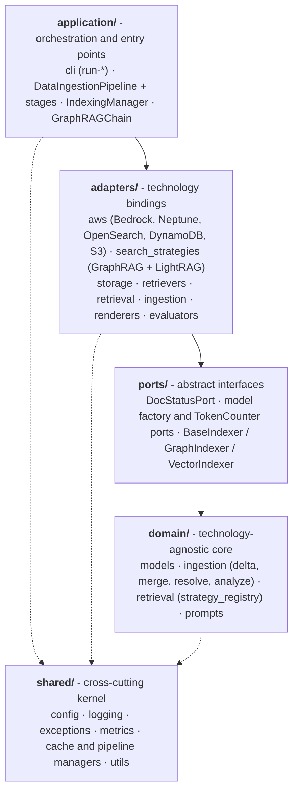
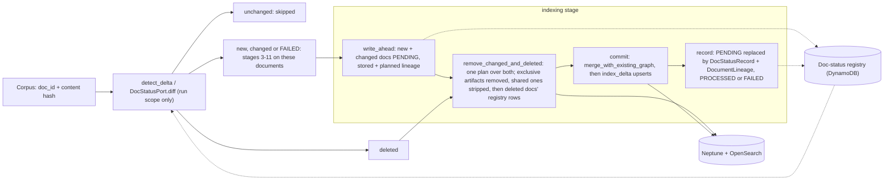

# Unified Knowledge Graph RAG on AWS — Technical Documentation

> 🇰🇷 한국어판: [docs/design.ko.md](./design.ko.md)

This document is a **design reference for contributors and advanced users**, covering the architecture, algorithms, data model, and operational aspects of the `unified-kg-rag-on-aws` library. For the "what/why" and a quick start, see [README.md](../README.md); for "how to use it," see the [User Guide](user-guide.md); for the contribution workflow, see [CONTRIBUTING.md](../CONTRIBUTING.md). Extension recipes are in [§15](#15-extension-guide).

## Table of Contents

1. [Overview and Design Philosophy](#1-overview-and-design-philosophy)
2. [Hexagonal Architecture (Ports & Adapters)](#2-hexagonal-architecture-ports--adapters)
3. [Domain Model](#3-domain-model)
4. [Ingestion Pipeline](#4-ingestion-pipeline)
5. [Incremental Indexing](#5-incremental-indexing)
6. [Retrieval: Two Methodologies](#6-retrieval-two-methodologies)
7. [Hybrid Scoring and Token Management](#7-hybrid-scoring-and-token-management)
8. [AWS Service Integration](#8-aws-service-integration)
9. [Evaluation Framework](#9-evaluation-framework)
10. [Visualization & Analytics](#10-visualization--analytics)
11. [Prompts and Prompt Tuning](#11-prompts-and-prompt-tuning)
12. [Configuration System](#12-configuration-system)
13. [Testing Strategy](#13-testing-strategy)
14. [CI/CD and Security](#14-cicd-and-security)
15. [Extension Guide](#15-extension-guide)
16. [Further Reading](#16-further-reading)

---

## 1. Overview and Design Philosophy

`unified-kg-rag-on-aws` is a library that reimplements the Microsoft GraphRAG and LightRAG methodologies on top of an AWS-native stack (Bedrock + Neptune + OpenSearch + S3 + DynamoDB). The core design principles are as follows.

- **Two methodologies, one infrastructure**: GraphRAG (community-summary) and LightRAG (dual-level keyword) share the same ingestion, indexing, caching, multilingual, and hybrid-search infrastructure, and **only the retrieval algorithm layer is swapped**.
- **Generalization first**: We avoid hardcoding, regex heuristics, and overfitting. Semantic judgments are delegated to the LLM or to authoritative data, token counting uses the Bedrock `count_tokens` API where the model accepts it and a script-aware estimate otherwise, and thresholds/weights are config-driven.
- **Hexagonal boundaries**: Domain/algorithm code depends on abstract ports, with concrete AWS adapters placed behind them.
- **Registry-based extension**: Search strategies and renderers are registered via decorator registries, so they can be extended without modifying dispatch code. Evaluators are mapped from `EvaluatorType` in one method (`EvaluationManager._resolve_evaluator_class`), so a new evaluator adds one branch there.

---

## 2. Hexagonal Architecture (Ports & Adapters)

### 2.0 Dependency Rule and Layer Map

Imports point **inward** (left imports right, never the reverse). `shared/` is a cross-cutting kernel any layer may use, so the package roots it imports stay dependency-light: importing any `domain/` module must not load LangChain, LangSmith, boto3/botocore, lxml, opensearch-py or gremlin-python, even transitively. LangChain-coupled helpers are imported from their own submodules (`shared.utils.langchain`, `shared.utils.document_converter`; the rich console helpers from `shared.utils.display`), never re-exported from `shared.utils`. `tests/unit/test_domain_purity.py` checks this in a clean interpreter. The two RAG methodologies (GraphRAG community-summary, LightRAG dual-level keyword) share one ingestion/indexing/caching/hybrid-search infrastructure and diverge only at the algorithm layer.



Solid arrows are the dependency rule (a layer imports only the layers it points to); dotted arrows show that any layer may import `shared/`. Search strategies are adapters: the domain only holds their registry, so both methodologies plug into the same ports.

```
unified_kg_rag/
├─ domain/              # technology-agnostic core (no boto3/LangChain/backend imports)
│  ├─ models/           #   Pydantic domain models
│  ├─ ingestion/        #   pure algorithms: delta_detector, graph_analyzer/
│  │  └─ merge/         #   builder/resolver, claim_resolver, merge/merger
│                       #   (IncrementalIndexer is orchestration, so it lives in application/)
│  ├─ retrieval/        #   strategy_registry, index_prefixes
│  └─ prompts/          #   version-controlled prompt templates
├─ ports/               # abstract interfaces the domain depends on (DocStatusPort,
│                       #   BaseIndexer/GraphIndexer/VectorIndexer,
│                       #   ModelFactoryPort — ports/__init__ is the port catalog)
├─ adapters/            # concrete technology bindings
│  ├─ aws/              #   Bedrock, Neptune, OpenSearch, DynamoDB, S3 clients
│  ├─ local/            #   Ollama/OpenAI-compatible models, cross-encoder, SQLite registry
│  ├─ llm/              #   provider-neutral chain assembly, transient retry, token estimate
│  ├─ observability/    #   OpenTelemetry tracer, exporters, LangChain callback
│  ├─ storage/          #   Neptune/OpenSearch indexers (write-side port implementations)
│  ├─ retrievers/       #   Neptune/OpenSearch retrievers
│  ├─ search_strategies/#   simple/local/global/drift + lightrag(mix/hybrid/naive)
│  ├─ retrieval/        #   abstract retriever/strategy bases, hybrid scorer, token/memory managers
│  ├─ ingestion/        #   LLM/IO coupled: chunker, *_extractor, loader, parser,
│  │                    #   translator, gleaner, community_detector
│  ├─ renderers/        #   graph visualization renderers
│  ├─ evaluators/       #   evaluator bases + langchain/ragas evaluators (the LLM-free graph_aware,
│                       #   retrieval and answer_match evaluators live in evaluation/)
│  ├─ providers.py      #   Providers: the per-run bundle of model and store providers
│  └─ provider_registry.py # @register_provider: builders keyed by role and kind
├─ application/         # orchestration + entry points
│  ├─ cli/              #   run-ingestion/rag/eval/visualization/prompt-tuning
│  ├─ ingestion/        #   DataIngestionPipeline + pipeline_stages
│  ├─ storage/          #   IndexingManager (indexer fan-out)
│  ├─ retrieval/        #   rag_chain (GraphRAGChain, RAGInput/Output)
│  ├─ prompts/          #   PromptTuner (LLM-based corpus profiling)
│  ├─ bootstrap.py      #   build_providers: the composition root
│  └─ observability.py  #   configure_observability: installs the tracing backend
├─ shared/              # cross-cutting kernel (config, logging, exceptions, metrics,
│                       #   cache/pipeline manager, utils)
├─ evaluation/          # real logic package: evaluation_manager / graph_aware /
│                       #   retrieval / answer_match
└─ visualization/       # real logic package: render loop + embeddings/exporters
```

> Layout note: `evaluation/` and `visualization/` are **real logic packages** —
> `evaluation/` holds `evaluation_manager` and the LLM-free
> `graph_aware_evaluator` / `retrieval_evaluator` / `answer_match_evaluator`;
> `visualization/` holds the render loop plus the `embeddings/` and
> `exporters/` subpackages (the renderers are in `adapters/renderers/`). Everything else is imported from its real
> location (`application.retrieval.rag_chain`,
> `application.storage.indexing_manager`, `application.ingestion.pipeline`,
> `adapters.*`, `domain.*`).

### 2.1 Ports (Abstract Interfaces)

| Port | Location | Adapter | Notes |
|---|---|---|---|
| `DocStatusPort` | `ports/doc_status.py` | `adapters/aws/dynamodb.py` (`DynamoDBDocStatusStore`), `adapters/local/sqlite_doc_status.py` (`SQLiteDocStatusStore`), `FakeDocStatusStore` for tests | Persists incremental-indexing document status/lineage |
| `GraphIndexer` (write-side) | `ports/indexer.py` | `adapters/storage/neptune_indexer.py`; local: `adapters/local/sqlite_graph.py` | Single contract for full + delta (`upsert_*`/`delete_by_id`) |
| `VectorIndexer` (write-side) | `ports/indexer.py` | `adapters/storage/opensearch_indexer.py` (on OpenSearch, or on `adapters/local/search_engine/` through `SearchEngineClient`) | Same |
| `BaseGraphRAGRetriever` (read-side) | `adapters/retrieval/base.py` | `adapters/retrievers/{neptune,opensearch,sqlite_graph}_retriever.py` (the graph ones on `graph_expansion.py`) | Retrieval adapters |
| LLM/Embedding/Rerank factories, token counter | `ports/model_factory.py` (`ModelFactoryPort`, `TokenCounterPort`, and the `LanguageModelInfo` / `EmbeddingModelInfo` / `RerankModelInfo` records `get_model_info` returns) | `adapters/aws/bedrock.py`, `adapters/aws/bedrock_models.py`, `adapters/aws/token_counter.py`; local: `adapters/local/{models,embeddings,rerank,token_counter}.py` | Carried by one `Providers` bundle (`adapters/providers.py`, built by `application/bootstrap.py`) that each orchestrator builds once and passes to every component; each role's adapter is the one `providers.<role>.kind` selects through `adapters/provider_registry.py` (default Bedrock; §15) |

> Design note: Pure ports (`DocStatusPort`, the write-side indexer ABCs) are gathered in `ports/`. The read-side abstract bases (`BaseGraphRAGRetriever`/`BaseSearchStrategy`) are "adapter bases" that construct infrastructure (HybridScorer/TokenManager) in `__init__`, so they live in `adapters/retrieval/base.py` and are imported from there; `ports/__init__` does not export them and only names them in its catalog docstring (no duplicate Protocol definition is kept). `BaseGraphRAGEvaluator` (`adapters/evaluators/base.py`) is an adapter base of the same kind.

### 2.2 Role-Based Retriever Injection

Search strategies are injected with retrievers **by abstract role, not by concrete backend name**.

- `RetrieverRole.GRAPH` → graph traversal/expansion (currently Neptune)
- `RetrieverRole.DOCUMENT` → vector/lexical lookup (currently OpenSearch)

Strategies access retrievers only via `self.graph_retriever` / `self.document_retriever` (base-class properties), and the role→adapter builder map in `rag_chain` binds the actual implementation. As a result, swapping the graph backend requires no changes to the strategy code.

```python
# domain/retrieval/strategy_registry.py
@register_strategy(SearchStrategy.LOCAL, required_roles=(RetrieverRole.DOCUMENT, RetrieverRole.GRAPH))
class LocalSearchStrategy(BaseSearchStrategy): ...
```

### 2.3 Registries

- **Search strategies**: `domain/retrieval/strategy_registry.py` — `@register_strategy(...)` registers a class, its required roles, and its query inputs against the `SearchStrategy` enum.
- **Evaluators**: `EvaluationManager._resolve_evaluator_class` — one explicit branch per `EvaluatorType` → evaluator class (lazy, import-on-use). Not a decorator registry: a new evaluator adds an enum member and a branch.
- **Renderers**: `adapters/renderers/base.py` — `@register_renderer("name")`.
- **Providers**: `adapters/provider_registry.py` — `@register_provider(ProviderRole.X, "kind")` registers the builder that `providers.<role>.kind` selects for each role (LLM, embedding, rerank, token counter, graph and vector indexer and retriever, doc-status registry).

This pattern follows the same philosophy as the existing `ParserFactory._loader_configs` (declarative parser registration).

> Write-path note: `IndexingManager` always writes to **two store roles**, a
> graph store and a vector/lexical store, rather than iterating a list of
> backends: both are constitutive of the framework, and the per-role fan-out
> (entities to both stores, entities-before-edges phasing, the orphan-edge
> cascade) is deliberate domain knowledge rather than arbitrary dispatch. Which
> backend fills each role is open: `providers.graph.kind` / `providers.vector.kind`
> select a registered builder (Neptune, Gremlin Server or the embedded SQLite
> graph; OpenSearch or the embedded SQLite vector store), or a
> `GraphIndexer` / `VectorIndexer` is injected
> (`IndexingManager(vector_indexer=…, graph_indexer=…)`). The read path does the
> same through the `RetrieverRole` → builder map.

### 2.4 Dependency Rule Verification Status

`domain/` imports no `ports`/`adapters`/`application` module at runtime, `ports/` and `shared/` import no other layer, and `adapters/` import no `application`, `evaluation` or `visualization` module; `evaluation/` reaches the application layer only through the chain (`application.retrieval`, `application.bootstrap`). `tests/unit/test_domain_purity.py` enforces these contracts on every import, including `TYPE_CHECKING` ones. Two compile-time-only exceptions exist, and the test checks that both stay under `TYPE_CHECKING`: `domain/retrieval/strategy_registry.py` references `adapters.retrieval.base.BaseSearchStrategy` (the registry stores strategy subclasses), and `domain/ingestion/delta_detector.py` annotates its parameters with `DocStatusPort` (the port module imports the domain models, so a runtime import would be a cycle). Extracting pure strategy/retriever ports would also remove the first type-level reference; it is left in place as a deliberate boundary (see "Deliberate Design Boundaries" at the end of this document).

Code imports from real layer locations (`application.retrieval.rag_chain`, `application.storage.indexing_manager`, `application.ingestion.pipeline`, and the `adapters.*` / `domain.*` modules). `evaluation/` and `visualization/` are real logic packages (see the layout note in §2).

---

## 3. Domain Model

The `domain/models/` package contains pure Pydantic models with no infrastructure dependencies.

- `Entity` (`name`, `description`, `type`, `text_unit_ids`, `community_ids`, `rank`, `confidence`, embedding fields)
- `Relationship` (`source_id`/`target_id`, `description`, `weight`, `text_unit_ids`, `description_embedding`)
- `Community` / `CommunityReport`, `TextUnit`, `Covariate` (claim)
- `DocStatus` (PENDING write-ahead record → PROCESSED|FAILED), `DocStatusRecord` (content hash + artifact lineage + suffix), `DocumentDelta` (new/changed/unchanged/deleted), `DocumentLineage` (per-document artifact attribution)
- `SearchQuery`/`SearchResult`/`RetrievalResult`, `SearchStrategy`/`SearchType`/`RetrieverRole`

**Rank (MS GraphRAG parity)**: an entity's `rank` is its degree (the number of distinct entities it is related to) and a relationship's `rank` the sum of its endpoints' degrees (`domain/ingestion/graph_rank.py`). Graph resolution sets them for a full build; an incremental merge recomputes them for every entity and relationship it writes, over the stored graph's neighbours (`GraphIndexer.read_neighbor_ids`) plus the delta's relationships. A stored entity the delta does not write keeps its rank until the next full build, including when a removed document dropped one of its edges.

**Lineage is the core data.** Entities/relationships record the `text_unit_ids` they appeared in at extraction time, and this lineage, rather than a token-overlap heuristic, decides "is this entity related to this text unit?" accurately and language-independently.

**Index suffix**: every OpenSearch index and Neptune label is named `<prefix>-<suffix>[-<additional_suffix>]`. The suffix is written at ingestion from `processing.document_parsing.index_value` and selected at query time by `RAGInput.suffix` (`--suffix` on `run-rag`/`run-eval`); both default to `default`, and `indexing.additional_suffix` appends the same second segment on both sides. This document calls the resulting value the *index suffix*; one per tenant or corpus version is the intended use.

**Entity names, IDs, and multilingual support**: `Entity.name` (and relationship `source_name`/`target_name`) keeps the *display form* the source used, only trimmed and whitespace-collapsed (`clean_display_name`), so retrieval context and community reports can quote "$1,000 penalty", "Section 4.2", or "C++" verbatim. Identity is a separate key: entity/relationship IDs are hashes of `entity_key(name)` (`shared/utils/common.py`), which applies NFKC + casefold, treats `_`/`-` as spaces, drops quote marks and commas, collapses whitespace, and strips trailing sentence punctuation, but **keeps every other symbol and the letters/digits of all scripts**. Case, whitespace, and quote variants of one name ("ACME  Corp." / "Acme Corp") therefore share an ID, while "C++" and "C#" stay distinct, and Korean, CJK, and accented names get unique IDs. A non-empty name never yields an empty key. Exact-name matching (extraction endpoint lookup, gleaner merges, claim resolution, incremental `merge_entities`) and the fuzzy matcher's shingles use the same key; the punctuation-stripping `normalize_name` is kept only for token-level similarity. **Changing the key changes every ID, so a graph indexed under a different key must be fully re-indexed** (incremental indexing would otherwise add new-ID duplicates next to the old entities).

---

## 4. Ingestion Pipeline

The `DataIngestionPipeline` in `application/ingestion/pipeline.py` runs 12 stages in order (`application/ingestion/pipeline_stages.py`).


| # | Stage | Module | Notes |
|---|---|---|---|
| 1 | Document parsing | `parser.py` (`ParserFactory`) | PDF/TXT/CSV/JSON out of the box (+MD/HTML via the optional `unstructured` extra) |
| 2 | Document loading | `loader.py` (`DirectoryLoader`) | MinHash deduplication |
| 3 | Chunking | `chunker.py` (`ChunkerFactory`) | simple / intelligent (LLM semantic) |
| 4 | Translation (optional) | `translator.py` | multilingual → target language |
| 5 | Graph extraction | `graph_extractor.py` | LLM entity/relationship extraction |
| 6 | Gleaning (optional) | `gleaner.py` | iterative refinement: up to `max_rounds` per text unit, re-gleaning only units whose last answer added something new |
| 7 | Graph resolution | `graph_resolver.py` + `description_summarizer.py` | name-variant merge (fuzzy matching opt-in), `text_unit_ids` union, **LLM re-summarization of merged descriptions** |
| 8 | Claim extraction (optional) | `claim_extractor.py` | factual assertions (covariate) |
| 9 | Claim resolution (optional) | `claim_resolver.py` | |
| 10 | Graph analysis | `graph_analyzer.py` | graph build and statistics (the visualization computes centrality with the same module) |
| 11 | Community detection | `community_detector.py` | hierarchical Leiden, community report generation (degree-sort + token-budget pack) |
| 12 | Indexing | `application/storage/indexing_manager.py` | OpenSearch + Neptune; a full build replaces every index type of the run's suffixes, emptying one the run has nothing of |

> The stage order is single-sourced in `DataIngestionPipeline.STAGE_CLASSES` (`application/ingestion/pipeline.py`). Every stage gets its models and stores from the run's provider bundle (`Providers`); **graph resolution (7) calls the LLM too**, because it re-summarizes merged descriptions.

**Relationship identity (deliberate divergence, with one known limitation)**: a relationship id hashes `relationship:{entity_key(source)}:{entity_key(target)}:{type}`, lowercased (`BaseProcessor._generate_relationship_id`). The free-text, model-written `type` is part of the identity, and the edge is directed: MS GraphRAG and LightRAG key an edge by its entity pair alone, so two types between one pair are one edge there and two here (the community graph still joins them on one undirected edge, see *Community graph* below). Type variants that differ only in case or surrounding whitespace share an id, but "works_for" and "works for" do not. The parts are joined with `:` without escaping, so a name or type containing `:` can collide with another split of the same string (source "A", target "B", type "x:y" and source "A", target "B:x", type "y" get one id). Such a collision needs both a `:` in a name or type and a matching neighbour, and fixing it would re-key every stored relationship, so the format is kept.

**Merged-description re-summarization (stage 7)**: Graph resolution merges descriptions of the same entity/relationship by simple concatenation, so the description of a popular entity that appears in many chunks grows without bound. `DescriptionSummarizer` (run in `GraphResolutionStage`) re-summarizes only descriptions that exceed a token budget into a single coherent description using a cheap LLM (parity with MS GraphRAG `summarize_descriptions` / LightRAG `_handle_entity_relation_summary`, controlled by `DescriptionSummarizationConfig`). The goal is to prevent embedding/prompt bloat. A description longer than one call's input budget (at most `description_summarizer.MAX_INPUT_TOKENS`, 12,000 tokens counted with the summary model's local token estimate; a summary model with a smaller context window gets half of what its window leaves beside `max_summary_tokens`, at least 1,000) is summarized map-reduce, as LightRAG does: its lines are packed into groups within the budget, each group is summarized, and the joined group summaries are summarized again until they fit one call. A description within the budget gets the same single call as before; if any call for a description fails, its concatenation is kept.

**Relationship endpoints cite the relationship's text units (stages 5-7; deliberate divergence)**: In MS GraphRAG and LightRAG an entity cites only the chunks that list it (MS GraphRAG drops a relationship whose endpoint no chunk lists; LightRAG adds such an endpoint citing the relationship's chunks but does not extend an entity that already exists), so an entity's text units depend on which chunks were extracted together. Here every relationship endpoint also cites the text units of each relationship it is an endpoint of, and an endpoint no chunk listed becomes a stub entity citing them (`domain/ingestion/relationship_endpoints.cite_relationship_endpoints`). First-pass extraction, every gleaning round (before its orphan drop, so a gleaned edge naming an entity the batch lacks adds a stub rather than vanishing) and the start of graph resolution apply the same step, and the incremental lineage (`build_document_lineage`) attributes endpoints to their relationships' documents on the same rule. The reason is incremental convergence: an entity's text units depend only on the chunks that name it, so an incremental run cites what a full build cites, and removing a document strips an entity to exactly the text units of the surviving documents that name it instead of deleting it under a surviving edge or leaving it with none. The cost is that local search and community lineage also reach chunks that mention an entity only through a relationship. With `entity_grounding.action: penalize`, an ungrounded relationship naming an entity its chunk did not extract is dropped rather than down-weighted, since keeping it would make that entity cite a chunk with no evidence for it. With grounding on, gleaning likewise drops a gleaned relationship naming an entity rejected as ungrounded for its chunk (by extraction, whose rejections it receives as the `rejected_entities` stage output, or by gleaning itself), and one naming an entity its chunk does not list unless the chunk's text contains that name; otherwise the stub step would bring the rejected or unsupported entity back. Gleaning's own additions follow `entity_grounding.action` as extraction's do: under `drop` an addition whose `text_evidence` is not in the chunk is rejected; under `penalize` an ungrounded gleaned entity is kept at its confidence times `penalty_factor` (then subject to `entity_confidence_threshold`), and an ungrounded gleaned relationship at its weight times `penalty_factor` only when the chunk lists both endpoints. An ungrounded correction is ignored under either action. **Stage cache**: a run resumed with the same `pipeline_id` reuses the stage outputs a previous version computed, so after upgrading from a version without this rule the resumed run indexes the old citations (graph resolution repairs them only when it runs again); use `--force-rebuild` or a new `pipeline_id`.

**Entity merging (stage 7 and incremental merge)**: By default two names merge only when their `compact_name_key` (below) is equal. `processing.fuzzy_entity_resolution` additionally links names whose `resolution_method` similarity reaches `processing.similarity_threshold` (default 0.85). It is off by default because name similarity also joins different organizations that share most of their name ("Northfield University" / "Northfield University Hospital", "Federal Bank" / "Federal Bank Board"), while genuine spelling variants mostly differ in case, spacing, punctuation or legal form, which the compact key already covers. A merged group takes the name cited by the most text units (ties: the smallest name) as its name and id, so the result does not depend on input order; relationships re-pointed at it take that name as their `source_name`/`target_name` too (`relationship_endpoints.sync_relationship_endpoint_names`, shared with gleaning). A fuzzy-matching worker that fails fails the stage unless `processing.ignore_errors` is on (then the name is matched exactly and the failure logged). The incremental merge matches delta names against the stored names with the same matcher and settings (one entity-name projection per delta run), so a full build and an incremental build group the same names.

**Fuzzy-merge guards**: Character-shingle similarity cannot distinguish identifiers that share a long prefix ("purchase order 1001" vs "purchase order 1002" score ~0.96 under MinHash; "vendor a" vs "vendor b" ~0.73). Two names are therefore fuzzy-linked only when their *discriminator tokens* are identical (`base_resolver.discriminator_tokens`: tokens containing a digit, single ASCII letters/digits, and multi-letter Roman numerals), and only when their entity types are compatible (same normalized type, or one side empty/`unknown`). For names ending in Han, Hangul, or Kana, the final character is usually the head noun, so such names are also linked only when their final characters are equal (`base_resolver.head_character`): "가나다연구원" (institute) and "가나다연구소" (lab) share every shingle but the head. Conversely, names whose `compact_name_key` is equal are linked with score 1.0: it strips a short, fixed list of legal-form designators at the start or end of the name (`(주)`, `주식회사`, `(유)`, `유한회사`, `(株)`, `株式会社`, `(有)`, `有限会社`, `有限公司`, and a trailing `Inc`/`Ltd`/`LLC`/`Co`/`Corp`) and drops spaces next to Han, Hangul, or Kana letters, so "(주)가나다", "가나다 상사"/"가나다상사", and "Acme Inc"/"Acme" merge. Designators are also removed before discriminator tokens are computed, so the "주" of "(주)" is not an identifier. These are matching rules only; entity ids still hash `entity_key`. `FuzzyMatcher.find_all_matches` applies the guards, so the full-build resolver and the incremental `merge_entities` path share them. The full-build resolver builds groups with a type-aware union-find (strongest links first, deterministic tie-break) that refuses any union which would place two differently typed names in one group, so an untyped name cannot bridge an `organization` and a `person`. Entities sharing an exact surface name always stay together. Relationship resolution groups by exact `(source_id, target_id, type)` after the entity remap and needs no separate guard.

**Community graph (stages 10-11)**: `GraphBuilder` builds an undirected graph with one edge per entity pair. Relationships of other types or in the other direction between the same pair share that edge: its `weight` is the sum of their weights (so Leiden sees the pair's total strength whatever the input order) and `relationships` lists each one by id. A community's `relationship_ids` and its report context therefore keep every relationship, each written in its own direction.

**Community report context pack (stage 11)**: The report-generation input **sorts entities within a community by graph degree in descending order** (ties broken by stable id sort), caps them at `max_entities_per_report`, and packs them to fit the `max_report_context_tokens` token budget (relationships are sorted/packed identically by the sum of both endpoints' degree, with weight as the tiebreak). The top-degree entity is always included (at least one) even if it alone exceeds the budget, so a report never ends up with empty context (`community_detector._prepare_report_input`). A community whose context left members out and has no sub-community report to stand in for them is logged with the number of entities kept.

**Community hierarchy (deliberate divergence from MS GraphRAG)**: MS GraphRAG runs graspologic's `hierarchical_leiden` top-down on the largest connected component and re-splits every cluster larger than `max_cluster_size`. Here level 0 is one Leiden partition of the whole entity graph, and each coarser level partitions the graph of the previous level's communities (edge weight = summed weight between them), up to `max_levels`, stopping when a level would merge nothing or everything into one community. There is no `max_cluster_size`: `resolution` alone sets the level-0 granularity (higher gives more, smaller communities). Level-0 communities below `min_community_size` entities merge into the neighbour community they share the most edge weight with (coarser levels are not merged: their nodes are whole communities); an entity with no relationships has no neighbour, so it stays a one-entity community with its own report, where MS GraphRAG's largest-component step leaves it out of every community. A Leiden failure at any level fails the stage (`GraphError`) instead of truncating the hierarchy.

**Sub-community roll-up (MS GraphRAG parity)**: When a coarse parent community's raw entity/relationship context would overflow `max_report_context_tokens`, or it has more entities than `max_entities_per_report`, rather than simply truncating, the report generator substitutes summaries of that community's already-generated child sub-community reports for the lowest-priority raw context. This requires bottom-up per-level generation: `generate_reports` groups communities by `level` and processes them finest-first (level 0 = leaf), accumulating each level's reports so a parent (`enable_sub_community_rollup`, default on) can fold in its children's summaries (`_generate_reports_with_rollup` / `_build_sub_community_context`, packed biggest-child-first within the same budget). Setting the flag false restores the flat, truncate-on-overflow path (`_generate_reports_flat`). Detection never creates a parent identical to its only child: a cluster Leiden leaves on its own at some level (often an isolated one) keeps its level and joins the first coarser community that merges it, or stays a root, so each distinct community is reported, embedded and retrieved once. Global and DRIFT search retrieve reports by similarity, not by level, so a root below the top level is still found.

**Structured community reports (MS GraphRAG parity)**: The report prompt emits a structured result — an executive `summary`, an importance `rating` (0-10) with a one-sentence `rating_explanation`, and a list of `findings`, each a one-line `summary` plus a multi-sentence `explanation` (`CommunityReport.findings`/`rating`, `CommunityFinding`). `content_length` sets how many findings it asks for (short 5-7, medium 7-10, long 10-15; `prompts.graph_extraction.REPORT_FINDINGS`, which also sizes the output-token floor). The free-text `full_content` used for embeddings, global-search map-reduce, and display is **rendered deterministically** from these structured fields (`CommunityReport.render_full_content`), so the structure adds no second LLM call and the embedding/search path is unchanged. The `rating` is also indexed on the community-reports OpenSearch document for importance-aware ranking.

**Community report lineage (stage 11)**: Each report carries `text_unit_ids` and `document_ids`, indexed as keyword fields on the community-reports document (`CommunityDetector._attach_report_lineage`). These are **community membership provenance**: the union of the member entities' `text_unit_ids`, and the documents those units came from. They are not report-input provenance — `max_entities_per_report` and the token budget may keep a member out of the prompt while its sources stay in the lineage — and they do not establish sentence-level citation support. They exist so a consumer can filter reports by source document or re-summarize a community per reader.

**Pipeline infrastructure**: Stage-checkpoint-based resumption (`shared/pipeline_manager.py`), S3 cache sync (`adapters/aws/s3_cache.py`), a `continue_on_error` toggle, per-stage caching (`shared/cache_manager.py`). The translation stage is skipped at no cost when `TranslationConfig.is_noop` (source == target & no additional languages). LLM output parsing consistently uses a `FixingConfig`-based output-fixing parser. The pipeline releases indexer/client resources via `close()`, which the `run-ingestion` CLI calls in `finally` (§8.6).

**Generalization in practice**:
- The relevance gate (which entities to include in the prompt for claim/gleaning) is decided by `text_unit_ids` lineage membership rather than a token-Jaccard regex heuristic → accurate and language-independent. A gleaning correction (`ENTITY_CORRECTION`/`RELATIONSHIP_CORRECTION`) likewise resolves only the entities and relationships citing its unit, the ones its prompt lists, so a unit never rewrites what only other units say. A retype or reversal of an edge other units also state applies to the unit's own share of it only (see *Merge semantics*).
- Gleaning stops per text unit on observed output, not on scores: a unit is re-sent (up to `max_rounds`) only while its previous answer added an entity or relationship the graph did not have. An empty answer is the model saying nothing more is missing, the signal MS GraphRAG asks for with a separate Y/N loop prompt, so no extra call is spent on it.

---

## 5. Incremental Indexing

When documents are added/changed/deleted, only the delta is processed instead of a full re-index.



The names are `IncrementalIndexer` methods (`application/ingestion/incremental.py`) unless noted. A document recorded `FAILED` is classified as changed on the next run until it reaches `indexing.max_document_failures`; final registry records are written only when the delta's writes pass the indexing failure gate, and until then the delta's documents keep their `PENDING` write-ahead records (step 2).

1. **Delta detection** (`domain/ingestion/delta_detector.py`): Builds `{doc_id: content_hash}` from a stable `doc_id` + content SHA-256 hash, and `DocStatusPort.diff(incoming, scope)` classifies them as new/changed/unchanged/deleted. `doc_id` hashes the document's index suffix (`index_value` + `indexing.additional_suffix`), its corpus source scope and its path relative to the corpus root, so two tenants' identically named files staged in the same directory, and two corpora on one suffix that share a relative path, stay distinct; a record keyed the legacy way (suffix + path) is adopted under the new key by the first run of its scope, and the delta is adjusted in memory (the adopted document moves from new to unchanged or changed by the adopted record's hash and status) rather than by a second diff, whose eventually consistent scan could still list the legacy key and read it as deleted. A corpus whose scope changed (a moved local directory) is never adopted from: the registry cannot tell a move from another host's corpus on the same path, so the old scope's records stay until a run lists it in `indexing.retire_source_scopes` (`--retire-source-scope`), which classifies every record of that scope in the run's suffix as deleted (one more projected scan per retired scope; the run's own scope is rejected). A local default-scope run with new documents warns about the other local source directories of its suffix, from the scopes the diff's scan already returns (`DocumentDelta.stored_scopes`). Deletion is **scoped**: only registry records of the run's scope (index suffix + corpus source, `document_parsing.source_scope` or the resolved source directory) are deletion candidates, and records written before scopes existed never are. Files that failed to parse or load this run are reported as `failed` and excluded from `deleted`.
2. **Write-ahead** (`IncrementalIndexer.write_ahead`): Before any store write, every new and changed document is recorded `PENDING` under its current key and the run's scope, with the content hash `"pending"` (`PENDING_CONTENT_HASH`, which no document hashes to) and the union of its stored lineage and the lineage this run is about to write. The records go out in one batched write (`DocStatusPort.put_many`, DynamoDB `BatchWriteItem`), after one batched read of the stored records (`get_many`), which the commit reuses for failure counting. A union over the registry's item limit (`DocStatusPort.record_fits`; DynamoDB 400 KB), as for a large document whose old and new lineage each fit, keeps the stored lineage in the record and the other planned ids in lineage overflow (`add_lineage_overflow`; in DynamoDB, items `<doc_id>#pending#<n>` of the same table marked `record_kind` `lineage_overflow`, which `get`, `get_many`, `list_all` and `diff` never return). A document whose own lineage cannot fit one record fails the run here, before anything is written. See *Crash recovery* below.
3. **Stale cleanup** (`IncrementalIndexer.remove_changed_and_deleted`): Before the delta is written, removes the existing artifacts of changed documents (so entities that disappear after re-extraction do not linger in the graph) and of deleted documents (step 5) that no *surviving* document references. The removal is planned once over changed + deleted, so an artifact that only a changed and a deleted document reference is removed too; planning the two sets separately would treat each as a survivor of the other and leave it behind with no text units.
4. **Delta upsert** (`IncrementalIndexer.commit`): With `indexing.cross_run_merge` (default on), `IndexingManager.merge_with_existing_graph` first reads back the existing entities/relationships the delta touches, per index suffix, and merges the delta into them (merge semantics below), so an entity shared with unchanged documents keeps their descriptions and `text_unit_ids`. A delta item that merged into a stored one under another id (a name-variant or fuzzy entity match, or an edge whose endpoint was remapped) is recorded in the lineage by the stored id (and added to the `PENDING` record before the write), and the delta's community members and claim subjects/objects are pointed at the stored id too. Delta claims are then merged with the stored claims of the same id, read back from the OpenSearch claims index (`merge_with_stored_claims`). `IndexingManager.index_delta` then writes the result as is: Neptune uses a Gremlin `coalesce(unfold, addV)` idempotent upsert; OpenSearch upserts by id into the live alias index. The relationship vector index is updated the same way.
5. **Deletion propagation** (in step 3's removal): Removes only the *exclusive* artifacts of deleted documents via `delete_by_id` (preserving shared entities), then their registry records. Targets the text-unit, entity, and relationship indices alike. Entities and relationships shared with surviving documents of the same index namespace (read from each record's scope; a record without a scope that its key does not tie to one namespace counts as a survivor of every namespace of its suffix) are kept but stripped of the removed documents' text units, with weight recomputed, in Neptune and OpenSearch alike (`IndexingManager.remove_text_units_from_shared`, which rewrites every shared item it reads back from Neptune, so a retry also repairs an OpenSearch copy an interrupted or failed strip did not reach; OpenSearch updates `text_unit_ids` and `weight` in place, `VectorIndexer.update_entity_lineage`/`update_relationship_lineage`, instead of re-embedding unchanged text). Shared claims, read back from the claims index, lose the removed text units the same way (`update_claim_lineage`); changed documents get the same treatment before their re-extraction is merged back in. If any removal fails, the deleted documents' registry records are kept for a retry and the indexing stage fails, so the run (and the `IndexingFailures` alarm) reports it: before the commit when the delta has changed documents (committing would replace their lineage and orphan the stale artifacts), after it otherwise.

   **Limitation**: a shared artifact's description keeps the text a changed or deleted document contributed. Removing it would mean re-summarizing the description from the remaining sources, an LLM call per affected artifact, so it is left until a full rebuild (`indexing.reset`). The same holds for a shared artifact's document `filters` values, which merging unions (`base_processor.union_document_filters`), and for shared communities and their reports (below).
6. **Registry update** (commit): Replaces the `PENDING` records, in one batched write, with `DocStatusRecord`s carrying each document's `DocumentLineage` (per-document artifact ids + suffix), the run's scope and the relative path. A document that translation, graph extraction, gleaning or claim extraction failed on for any of its text units is recorded `FAILED` (with the lineage of what was written), and `diff` classifies a `FAILED` record as changed even when its hash is unchanged, so the next run prunes and re-extracts it. The record counts consecutive failures of the same content (`failure_count`); after `indexing.max_document_failures` of them `detect_delta` classifies the document unchanged instead, so a deterministic failure is not re-extracted on every run.

`indexing.reset` skips the diff: the stores and the registry records of the run's namespace are cleared (other namespaces sharing the table keep theirs; for records written before scopes existed, see [Upgrading from pre-release builds](../CHANGELOG.md#upgrading-from-pre-release-builds)), every document is recorded `PENDING` (step 2), the whole corpus is rebuilt with the full-index path, and every document is recorded again (only when the rebuild's writes pass the same failure gate as a delta commit).

**Crash recovery (write-ahead protocol)**: the registry is not updated atomically with the stores, so a run can stop between any two writes (a killed task, a store outage, a failed gate). The protocol keeps one invariant: before the stores hold anything the registry cannot account for, the registry already lists it. Write-ahead records (step 2) precede the removal and the upsert, the deleted documents' rows are deleted only after their artifacts are, and the commit replaces a `PENDING` record only after the document's writes landed. A run that stops anywhere after step 2 leaves each unfinished document `PENDING`, and the next run repairs it:

- `PENDING_CONTENT_HASH` never equals a content hash, so a document that still exists is classified changed, even when its content went back to the version indexed before the interrupted run (without the write-ahead record the registry still held that version's hash, so the document read as unchanged while its artifacts had been pruned).
- A `PENDING` document that is gone is classified deleted (its record keeps the scope), and its lineage covers everything the interrupted run may have written, so nothing it added is left without a record.
- The removal plans a document of the current run from the record stored before its own `PENDING` record (after a crash, the crashed run's `PENDING` record), so a normal run prunes exactly what it pruned before, and a recovery run removes the interrupted run's partial writes before writing again. A new document's `PENDING` record retains nothing during the removal.
- A `PENDING` record has `failure_count` 0 and is never `FAILED`, so an interruption is not counted as a failure toward `indexing.max_document_failures`, but it resets the count: the commit of the same run counts a real failure from the record stored before the write-ahead one, while the next run counts from the `PENDING` record, so a document that had failed before is retried until it fails `indexing.max_document_failures` runs again. (A document already at the limit is not re-extracted and gets no `PENDING` record.)
- Lineage overflow belongs to a `PENDING` record: a later run reads it with the record (for its own documents in the write-ahead read, for another run's `PENDING` records in the removal plan) and adds new ids to it as new items, never rewriting earlier ones. The commit deletes it after replacing the record and the removal of a deleted document before deleting the record, so an interruption leaves at worst overflow next to a committed record. The diff's scan reports such overflow (next to a record that is not `PENDING`, or none: `DocumentDelta.orphan_overflow`), and the next run's write-ahead deletes it when the owner's record, read again, is of the run's namespace and still not `PENDING` (or the owner is one of the run's documents), even if the document is unchanged.
- Documents of the delta that produced no lineage stay `PENDING` (logged), and are re-extracted by the next run.

The cost is one extra batched registry write per run (two when the cross-run merge remapped ids), one batched read in place of one `GetItem` per document at commit, and one `BatchGetItem` key per document of the delta whose stored record is `PENDING` (and per deleted document) probing for lineage overflow. `tests/unit/test_incremental_write_ahead.py` and `tests/property/test_incremental_interruption_properties.py` interrupt a run at every write step and check that the next run converges to a fresh full build of the same corpus, of the corpus with the changed documents reverted, and of the corpus without the added documents.

**Document identity** (`shared/utils/document_identity.py`): a document version's `document_id` (from which text-unit ids derive) hashes the path relative to the corpus root plus the full text. The parsing and loading stages re-derive it against the root (`delta_detector.assign_document_identity`), so the same corpus yields the same ids wherever it is checked out or synced, and same-named files in different folders never collide. The registry `doc_id` (step 1) follows the same relative-path rule. Changing either rule changes ids and requires a re-index.

**Merge semantics** (`domain/ingestion/merge/merger.py`, ported from MS GraphRAG `update/*`): Entities merge by id, else by identity key (`entity_key`; description lines unioned without duplicates, union of `text_unit_ids` and `community_ids`, max confidence/rank, attributes unioned with the delta winning except `filters`, whose values are unioned per key, several values as a sorted list (`base_processor.merge_attributes`, the function graph resolution uses, so N items resolved at once and the same items merged two at a time agree; extraction and gleaning union filters the same way), existing ids preserved + a remap for entities that merged under a different id); relationships merge by id, else by (source, target, type) (same description and attribute rules; weight = sum of the extracted strengths per supporting text unit, kept on the edge as `attributes.text_unit_weights` so a delta replaces its text units' entries and the result equals a full build over the union — the same rule the full-build extractor and resolver apply, after MS GraphRAG's summed instance strength); after the relationship merge, an edge's `source_name`/`target_name` are re-derived from the merged entities (`sync_relationship_endpoint_names`), so a delta edge whose endpoint merged into a stored entity under another name names the stored entity, as a full build does after graph resolution; claims merge by id with the full-build `ClaimResolver` rules (`merge_claims`: descriptions and source texts unioned, stored first, sorted union of `text_unit_ids`, the stored status when it has one, which is `ClaimResolver`'s most-common rule for one stored and one delta claim but can differ from a full build over three or more documents, since the stored claim keeps no per-status counts; see [User Guide: Cross-run merge](./user-guide.md#cross-run-merge) for claims indexed before they stored their text units); communities are appended under content-derived ids (see *Communities on delta runs* below). Matching the id first keeps a stored entity that a gleaning correction renamed (its id still derives from the old name) as the one entity a later delta of the old name folds into. A gleaning correction that retypes or reverses a relationship instead re-keys it to the id of its corrected (source, target, type) (`GraphGleaner._apply_relationship_correction`), the id extraction gives an edge stated that way: a later document stating the corrected edge merges into it by id (an incremental run reads stored edges back by the delta's ids, so an edge that kept its original id was stored twice). The correction applies to the correcting text unit's statement only. Extraction merges every chunk's statement of an edge before gleaning, so when the edge also cites other text units, the unit's share (its text unit and stored strength) moves to a copy, which is corrected and re-keyed, and the other units keep the uncorrected edge (`GleaningIndex.split_relationship`). A full build and an incremental run, where those units are indexed in another run or their documents were deleted, therefore store the same edges with the same weights and lineage. Two things stay approximate, because what each unit contributed to them is no longer told apart after the merge: both edges keep the merged description, and the uncorrected edge keeps the union of the document `filters` (the copy takes its unit's). Edges an earlier version stored keep their original id until a full rebuild. The other way round, the merge keeps the stored name when the delta's copy of a stored entity was renamed by a gleaning correction: every edge carries a copy of its endpoints' names, and adopting the new name would leave the stored edges the delta does not rewrite naming the old one. Such a rename reaches the graph on the next full rebuild. So does a type change: the merge keeps the stored entity's type (a delta's type only fills a missing one), while a full build takes the type of the group's best-supported mention, after extraction and gleaning have merged a name's mentions by their most frequent type (a gleaning retype included), so an incremental run can keep a type a full rebuild replaces. Every rule is idempotent: re-applying a delta changes nothing. The cross-run merge runs per index suffix and reads the stored items back through `neptune_codec`, the exact inverse of the Neptune write encoding.

**Communities on delta runs**: a delta run clusters only the delta subgraph (MS GraphRAG's update path also appends rather than re-clustering). Community ids are therefore **content-derived** — a hash of the level and the sorted member entity ids (`community_detector.community_content_id`); the positional `L{level}_C{i}` label survives only as `short_id`/`name`. A delta community gets an id distinct from every corpus community unless its membership is identical (then the upsert rewrites the same community), so the delta's communities and reports (whose ids hash the community id) are appended next to the existing ones instead of overwriting `L0_C0…` of the full corpus. The upsert path therefore needs no read-back or id-offset merge. Corpus communities that contained a changed or deleted document's entities are removed through lineage only when exclusive to that document; shared ones keep their pre-change report until a full rebuild, which is also the only path that re-partitions the whole graph. Leiden's partition depends on node/edge insertion order even with a fixed seed, so the detector sorts nodes and edges before partitioning (`_canonical_graph`). `graspologic_native` also returns its labels in a Rust `HashMap` whose order changes from process to process, and that order would set the next level's cluster-graph node numbers and the small-community merge order, so each level's communities are renumbered by their smallest member id (`_partition_dict_to_communities`) and merge ties go to the lowest number. The same graph and `random_state` therefore always yield the same communities and ids at every level. Re-detecting over the full graph on every delta run was rejected: it would regenerate every community report (an LLM call each) per delta run, defeating incremental indexing.

**Concurrency**: concurrent runs are not supported, and nothing locks a suffix or a registry namespace. Two runs on the same index suffix race on its OpenSearch aliases and Neptune labels: a full reindex writes a new timestamped index, swaps the alias onto it and deletes the alias's older indices (`_reap_stale_indices`), so one run can delete the index the other is writing, and a reset clears the suffix's stores under the other run. Two runs on the same doc-status table namespace race on the registry: the removal plan (`_plan_removal`) reads the registry once, so records the other run writes after that read are not in the plan and can be pruned or have their artifacts removed. Runs on different suffixes with separate doc-status tables share neither. The CDK state machine does not block an overlapping execution and the stack starts none on its own (no schedule or trigger); see [Operator Runbook: Concurrent runs](./operations.md#concurrent-runs).

Enable with: `config.aws.dynamodb.enabled = true`.

---

## 6. Retrieval: Two Methodologies

The `GraphRAGChain` (an LCEL Runnable) in `application/retrieval/rag_chain.py` performs memory (a follow-up with conversation history is rewritten as a standalone question, `QueryRewritePrompt`) → strategy resolution → query processing (translation, entity/keyword extraction) → retrieval → (RAG) context build + answer generation. Routing, retrieval and the answer all read the standalone question. The methodology is selected via `RAGInput.search_strategy`.


`ChainMode` decides where the chain stops: `SEARCH` returns the fused, ranked retrieval results without an answer; `RAG` (the default) packs them into the token budget (`TokenManager`, §7), generates the answer, and returns a `RAGOutput` whose sources are exactly the sections the answer model saw. When the budgeted context is empty, the chain answers that it cannot answer without calling the LLM.

Neptune graph expansion is part of `local` and `drift`; for `mix`/`hybrid` it is opt-in (`search.lightrag_search.enable_graph_expansion`). The strategies find the seed entities in OpenSearch and pass their ids to the graph retriever as an `id` filter; `NeptuneRetriever` expands from those ids only and returns nothing for a query without one.

### 6.1 GraphRAG Methodology (`adapters/search_strategies/`)

- **simple**: OpenSearch-only vector/lexical, no graph. If claim extraction is enabled, the claims index is also automatically swept; if disabled, `_apply_claim_gate` explicitly excludes the claims index so a claims-off run never queries that index.
- **local**: Entity-centric — candidate entities → Neptune graph expansion → frequency filter → text-unit combination, enriched with a **community-report section** and a **relationship section** (like MS GraphRAG local search, which assembles entities + their community reports + in-network relationships + text units). `_retrieve_community_reports` and `_retrieve_relationships` query those indices with the entity focus (falling back to the raw query); the relationship section is gated on `build_relationship_vector_index` so a GraphRAG-only deployment that skips the relationship vector index issues no relationship lookup. If claim extraction is enabled, it **injects claims (covariates) into the context** like MS GraphRAG (`_retrieve_claims` queries the claims index separately and adds them as `all_results["claims"]`, folded into the token budget at `SectionType.CLAIM` priority). The default claims-off path performs no additional lookups at all. The community-report, relationship and claim lookups run concurrently with the entity → expansion → text-unit chain. With `search.local_search.include_bridge_relationships` (default on, needs the relationship index), the relationships incident to the expanded entities are fetched as well (`_fetch_incident_relationships`, shared with LightRAG's incident expansion), edges whose both endpoints were retrieved first — MS GraphRAG local's in-network relationships, which carry the hops of a multi-hop chain that the relationship vector query rarely matches.
- **global**: Community report search → selection by retrieval score, ties broken by indexed rank/rating (per-report LLM relevance scoring is opt-in via `use_dynamic_selection`, default off because the map step already rates the reports for the query) → fusion with the selected communities' text units, reserving `max_communities` slots for the reports and `text_unit_slots` (default `top_k`) for the chunks (`reserve_report_slots`) → **map-reduce synthesis** (see §6.1.1 below).
- **drift**: Iterative query evolution (community seeding → iteration 0 searches with the original query → later iterations refine the query / expand keywords from what was found → stop on low unique-result gain or `max_iterations`; an LLM convergence check is opt-in via `search.drift_search.enable_llm_convergence`). The accumulated results are fused with the same per-section-type quota as local search (`search.local_search.type_quota`), reranking text chunks only. Optionally (`search.drift_search.enable_primer`, default off) runs MS GraphRAG's **primer → follow-up** flow instead: a HyDE primer drafts a hypothetical answer from the seed community reports and decomposes the query into `primer_follow_ups` specific sub-queries, each run as its own search iteration (`_primer_search`/`_run_primer`), rather than carrying one mutating query forward. Falls back to the iterative loop if the primer yields no follow-ups, and skips the primer entirely when no candidate communities were found (there is nothing to ground it in). The hypothetical answer only steers the follow-up queries; it is never added to the answer context or the reported sources, because it is an LLM guess rather than retrieved evidence.
- **auto**: LLM routing via `StrategySelectionPrompt` among `search.auto_routable_strategies` (default local, mix, global, drift; simple is left out); the prompt's strategy guide is built from that list, so it describes exactly the strategies the router may pick. The response is parsed by word token, first routable name wins; unrecognised output, or a failed routing call under `processing.ignore_errors`, falls back to local, or to the first routable strategy when local is not routable.

#### 6.1.1 Global search map-reduce (`global_search.py`)

When `enable_map_reduce` is set and the results hold at least `map_reduce_min_results` community reports, it follows MS GraphRAG's canonical map-reduce. Below `map_reduce_min_results` the retrieved results **pass through unchanged** — no synthesis stage runs at all, because a handful of community reports do not need a map-reduce to be summarized.

1. **MAP** — Community reports (only them: the fused text units pass through, after the synthesized item) are batched in groups of `map_batch_size` (default 5, near MS GraphRAG's 12K-token map context), and for each batch `GlobalMapPrompt` asks the LLM to extract key points and score query relevance from **0-100**. Batches are run concurrently via `BatchProcessor`, with per-item graceful fallback.
2. **FILTER+RANK** — Drops points at or below `map_relevance_threshold` and sorts by score in descending order (`_filter_and_rank_points`).
3. **PACK** — Packs the top points up to the `max_map_reduce_tokens` token budget (based on `token_manager.count_tokens`, `_pack_points_within_budget`).
4. **REDUCE** — By default (`reduce_with_llm: false`) the packed points, with their relevance annotations, are prepended to the results as one `synthesized_key_points` `RetrievalResult` and the answer model does the synthesis itself: a separate reduce LLM only added a call and a second rewrite that could drop facts or assert that the summaries lack them. With `reduce_with_llm: true`, `MapReduceSummaryPrompt` first synthesizes a summary from the packed points (`_reduce_from_points`), prepended as `synthesized_summary`. Either item is flagged `metadata.synthesized`: the answer model reads it as context, but it is LLM output rather than retrieved evidence, so it is never reported in `RAGOutput.sources`.

Robustness: Even if the map response comes wrapped in code fences or prose, `_parse_map_payload` extracts the JSON, and a batch whose map call failed or returned unparseable output is tracked as *unrated*. `_concat_reduce` is the degradation path when no point passes the threshold but some reports were never rated — over just the unrated reports (all of them when every batch failed), which pass through unchanged unless `reduce_with_llm` summarizes them — so global search still answers instead of hard-failing or declaring no data for reports nobody judged. When the map stage rated *every* batch but every point scored at or below `map_relevance_threshold`, the reports were judged irrelevant: global search returns no results (flagged as `map_reduce_no_relevant_points` in the search metadata), matching MS GraphRAG's no-data answer, and the chain's empty-context guard replies "cannot answer" instead of synthesizing from rejected reports. `MapReduceSummaryPrompt` likewise restricts the reduce step to the provided points and tells it to say so when they do not answer the query.

### 6.2 LightRAG Methodology (`lightrag_search.py`)

Runs dual-level keyword retrieval (hl/ll extraction via `KeywordsExtractionPrompt`) on top of the shared hybrid infrastructure.

Modes (`RAGInput.search_strategy`):
- **naive** — chunk retrieval only, no graph: `chunk_stream_top_k` chunks under the request's `search_type` (`hybrid` BM25 + vector by default; `vector` is upstream's pure-vector baseline).
- **hybrid** — ll → entity index + hl → relationship index + one-hop cross-type expansion (entity hits → incident relationships, relationship hits → endpoint entities) + the chunks those items cite.
- **mix** — hybrid graph search, plus the **source chunks cited by the matched entities/relationships** (`text_unit_ids` lineage), plus a naive vector chunk retrieval, all blended in.

Per-source behavior:
- **Low-level keywords (ll)** → entity index (lexical + semantic, `entities_index_prefix`)
- **High-level keywords (hl)** → **relationship index** (corresponds to LightRAG's `relationships_vdb`; `relationships_index_prefix`, `Relationship.description` embedding)
- **Retrieval rounds** — the independent entity / relationship / (mix) vector-chunk queries run concurrently; the incident-relationship and endpoint-entity expansions then run concurrently; the cited chunks are fetched last (they depend on both). Upstream LightRAG has no multi-hop traversal, so the Neptune neighbourhood expansion (= GRAPH role, `indexing.neptune.max_hops`) is opt-in via `search.lightrag_search.enable_graph_expansion` (default `false`).
- **mix linked chunks** — entities and relationships are indexed with their `text_unit_ids` chunk lineage, so `mix` follows the matched entities/relationships back to the chunks that support them (`_collect_linked_chunk_ids` ranks chunk ids by how many matched items cite each, mirroring LightRAG's `_find_related_text_unit_from_entities`/`_from_relationships`), fetches those chunks by id, and blends them alongside the naive vector chunks. Degrades to the naive-only blend when an index predates the lineage field.
- If keyword extraction yields nothing, short queries fall back to using the raw query as ll keywords (config `search.lightrag_search.raw_query_fallback_max_len`)
- All sources are fused through the shared `HybridScorer`

> The two methodologies share the same ingestion outputs (entities/relationships/communities/chunks + embeddings) and branch only at the retrieval layer — so a single indexed corpus answers both GraphRAG and LightRAG queries with no re-indexing. This is a deliberate extension over the source papers: stock MS GraphRAG does not build a relationship vector index, and stock LightRAG does not do community detection/reports; here the ingestion builds the *union* so either methodology can run.
>
> The trade-off: a full ingestion pays GraphRAG's community-detection + report-generation cost even if you only query with LightRAG. For a LightRAG-only deployment, set `graph.community_detection.enabled: false` to skip the Leiden pass and all community-report LLM calls — `mix`/`hybrid`/`naive` need only entities, relationships, and the relationship vector index. (Leave it on if you want `global`/`drift` available.)

---

## 7. Hybrid Scoring and Token Management

- **HybridScorer** (`adapters/retrieval/hybrid_scorer.py`): Combines per-source results via RRF (`rrf_k`) or weighted fusion, diversity filtering (`diversity_lambda`), and Bedrock reranking. Weights/method come from `config.search.fusion`/`hybrid`. Reranking is only active when `search.reranking.enabled`, and `compress_documents` temporarily adjusts `top_n` to the document count before restoring it. If the rerank model cannot be built (initialization fails, or the provider returns no model), queries keep the fused order and report rerank status `unavailable`, or the scorer raises `RerankModelError` under `search.reranking.required`; status `disabled` is reserved for `search.reranking.enabled: false` and `providers.rerank.kind: none`. Each fusion call records its rerank outcome on the calling query's `RerankTrace` (created per `asearch`, never stored on the shared scorer), which the strategy reports as `SearchResult.metadata["rerank"]`.
  - **IAM caveat**: the Rerank API authorizes `bedrock:Rerank` against a different resource shape than `InvokeModel`, so a statement scoped to foundation-model or inference-profile ARNs denies it. The IaC task role grants `bedrock:Rerank` on `Resource: "*"` in its own statement (`ComputeStack._build_task_role` in `iac/stacks/compute_stack.py`). Without it the scorer logs `Reranking failed: ...` at ERROR and returns the fused results unreranked.
- **TokenManager** (`adapters/retrieval/token_manager.py`): Packs the context into the answer model's budget. Each section type present gets a hard-capped share of the budget (`search.token_manager.type_budgets`, renormalized over the types present); within its share a type's sections are taken in descending score order, the first one that overflows is truncated to fit (dropped if under `min_truncated_section_tokens`), and an unfilled share stays unused rather than going to another type, so the shares, not cross-type score comparisons, decide the mix. Synthesized global-search sections (map key points, reduce summary) are seated first. Only when no type can seat anything (a window too small for its shares) is the single highest-scoring section seated, truncated if needed. `SectionType.CLAIM` is the type used to fold query-time claims injection (§6.1) into the token budget. The chain keeps this selection (`OptimizedContext`) in state and builds `RAGOutput.sources` from it, so sources list only what the answer model saw, in retrieval-rank order: sections cut for budget are not reported, a section truncated to fit carries its truncated text and `metadata.truncated: true`, and each source's metadata keeps `truncated` / `source_id` / `document_ids` / `chunk_id` / `section_type` / `score` with `*_embedding` vectors removed. When the answer step short-circuits on an empty context, `sources` is empty.
- **Token counting** (`adapters/aws/token_counter.py`, `adapters/local/token_counter.py`): With the defaults every count is the script-aware estimate (`adapters/llm/token_estimate.py`): CountTokens rejects the default Claude 5.x models and all embedding and rerank models, so their counters skip it (see below). A language model that accepts it is counted with the Bedrock `count_tokens` API, falling back to the estimate on failure. Local language models use the estimate, or a BPE encoding with `providers.llm.tokenizer: tiktoken` (`[local]` extra). A non-transient failure (e.g. `AccessDeniedException`, or a `ValidationException` whose message says the model does not support the operation) marks the model unsupported process-wide so later counts skip the API; throttling, timeouts, and input-level `ValidationException`s do not. Blank or whitespace-only text never calls the API. Embedding and rerank counters are built without a client, so they never call the API (it does not accept those models); language models that CountTokens rejects (Claude 4.7+/5.x, OpenAI GPT) skip it by capability flag (`supports_count_tokens`). Truncation uses a convergence loop that estimates candidates by char ratio and validates them with the counter.

---

## 8. AWS Service Integration

| Service | Module | Purpose |
|---|---|---|
| **Bedrock** | `adapters/aws/bedrock.py`, `adapters/aws/bedrock_models.py` (capability catalog) | LLM/embedding/reranking. Automatic cross-region inference profile resolution, provider-aware request shaping (Anthropic adaptive thinking + `effort` on Claude 4.6+, `budget_tokens` on older Claude; `reasoning.effort` on OpenAI GPT via Converse), 1M context, prompt caching where the model supports explicit cache points, capability table (curated rows, then provider-family defaults by id prefix, then a conservative unknown default; `aws.bedrock.model_overrides` on top) so any Bedrock model id is accepted |
| **Neptune** | `adapters/aws/neptune.py` | Gremlin over `wss://` (`ws://` to a local Gremlin Server with `aws.neptune.use_ssl: false`), SigV4 IAM, batch upsert/delete. Write batches submit concurrently via a thread pool when `indexing.neptune.index_concurrency` > 1 (per-batch independent `IndexingStats` → merged on the main thread, no shared mutation), multiplexed over the Gremlin connection pool (`aws.neptune.pool_size`, raised to at least `index_concurrency`). Default 1 = sequential. Every indexer request, reads and drops included, is retried up to `indexing.neptune.max_attempts` times over a new connection, and repeating one changes nothing: vertices (full build and delta alike) are created or matched by id, a `MemberOf` edge is added only for an entity not yet a member, and a relationship edge only when its id is missing, so a retry after a lost response adds no duplicate |
| **OpenSearch** | `adapters/aws/opensearch.py` | Vector (kNN/HNSW, default engine **lucene**, which supports `cosinesimil` on OpenSearch 2.13 as deployed by `iac/`; faiss rejects `cosinesimil` before 2.19, so use it only with `innerproduct` for >1024-dim models — see the engine note in `config-template.yaml`) + BM25, async SigV4, sync/async clients, alias management, bulk upsert/delete, per-language analyzers (en→english, ko→nori, etc.) |
| **S3** | `adapters/aws/s3_cache.py` | Pipeline cache sync (encryption defaults to `BUCKET_DEFAULT` — the bucket's default encryption, e.g. a CMK; `AES256`/`aws:kms` force per-object SSE) |
| **DynamoDB** | `adapters/aws/dynamodb.py` | Incremental-indexing document-status registry |

The AWS session is the bundle's (`Providers(boto_session=...)`, by default created from `config.aws.profile_name` on first use), so a fake/moto session can be injected during testing. Only an AWS client asks for it: a local run, or a store without IAM auth, never resolves the profile.

### 8.5 Retrieval Error Visibility

The retrievers (`opensearch_retriever`/`neptune_retriever`) do not disguise authentication, configuration or store failures as "no results." One policy, `is_fatal_retrieval_error()` (`adapters/store_errors.py`), decides by exception type alone, never by message: fatal errors are re-raised with `exc_info`, and only the rest degrade to `[]`, so an incorrect IAM permission, a wrong model id or a store that is down surfaces instead of being buried as "0 search hits." The store clients translate failures at their boundary (`adapters/aws/opensearch.py`, `adapters/aws/neptune.py`): a store that cannot be reached, closed the connection or still answers 429/502/503/504 after the client's own retries raises `StoreConnectionError` (a `ConnectionError`), one that did not answer within `search.store_timeout_seconds` its subclass `StoreTimeoutError`, and a request refused the same way on every retry raises a `StoreConfigurationError` (a `ConfigurationError`): `StoreAccessDeniedError` for HTTP 401/403 or a Neptune `AccessDeniedException`, `StoreRequestRejectedError` with the server's reason for an HTTP 400 (a filter value of another type than its field, a query vector of another dimension). A botocore error from a model call, such as the query embedding, is fatal unless its code is a transient Bedrock one (`is_transient_bedrock_error`): an invalid or inaccessible model id, missing credentials, or a Bedrock endpoint that could not be reached or timed out after the model wrapper's retries fails the query. A failed query embedding is fatal whatever the cause, a 5xx left after the client's retries included (`EmbeddingModelError`): every vector section of the query shares that one embedding, so nothing is left to answer from. A local model server's error is fatal by the same rule: an OpenAI-compatible or Ollama HTTP 4xx other than 408/429 (a bad key, an unknown model) or a server that could not be reached or did not answer after the client's retries (`openai.APIConnectionError`, `httpx.TransportError`); the OpenAI, Ollama and httpx types are looked up only once their modules are loaded. A prompt longer than the model's context (`langchain_core`'s `ContextOverflowError`, which Bedrock raises as a `ValidationException`) is not fatal: only that prompt hits it, so a global-search map batch that overflows is left unrated and the others still answer. vLLM and llama.cpp report an overflow as a plain HTTP 400 (`openai.BadRequestError`), which LangChain does not map to `ContextOverflowError`, so the map step leaves a batch that got a 400 unrated too, unless every batch got one: a 400 on every map call (a parameter the server does not support, a model id it does not know) fails the query, whichever model the answer call uses. What remains transient is a failure of one request, such as an HTTP 500 for one search. Neptune's per-query `_execute_traversal` re-raises fatal errors too, so they reach that top-level guard, and a lost Neptune connection is dropped (`run_traversal`, `reset`) so the next query, or the indexer's next retry, opens a new one. The query traversal is built in its worker thread from the client's source of that moment (not before waiting for a pool slot), and runs on threads the retriever owns rather than the loop's default executor. Its bound of twice `search.store_timeout_seconds` frees the slot, not the thread; `reset` and `close` wake a request still waiting for a pooled connection of the closed client (gremlinpython's `close()` empties the pool and `pool.get()` has no timeout), which then fails as a lost connection. A request whose write was in flight when the client closed fails the same way: gremlinpython's `close()` shuts down the executor the read would run on, so the closed client's executor hands such a late read a failed future (`_close_connection`) instead of leaving the request unanswered and its thread waiting forever. A request that waits on a server that stopped answering is bounded by the transport's read timeout: on the query side by `search.store_timeout_seconds`, and on the indexer's side by a fixed 180 s, above Neptune's own 120 s default query timeout so its long writes and drops are not cut short; an ingestion request that times out is retried like other transient errors. The search strategies apply the same rule to every sub-retrieval through one helper, `BaseSearchStrategy._safe_aretrieve`, so a section-level handler cannot re-swallow a fatal error the retriever raised; a transient failure still degrades only that section, and local search keeps the seed entities the entities index found when graph expansion degrades.

### 8.6 Client Lifecycle / Resource Release

Each retriever build opens a Neptune WebSocket + thread pool and OpenSearch (a)sync HTTP pools. These resources leak until GC unless explicitly closed. Therefore every layer exposes best-effort `close()`/`aclose()` (never raising):

- **OpenSearchClient**: `close()`/`aclose()` + sync/async context managers (mirroring NeptuneClient). When the event loop changes, the previous `AsyncOpenSearch` is closed: awaited on its own loop while that loop runs, otherwise by running the aiohttp connector's close coroutine to completion without a loop, so per-loop aiohttp pools do not leak. `aclose()` awaits the transport close to prevent the "Unclosed client session" warning.
- **NeptuneClient**: Closes the Gremlin connection pool.
- **Chain wiring**: Retrievers/indexers delegate up to `IndexingManager.close()` / `GraphRAGChain.close()`·`aclose()` (iterating the cached retrievers). Whoever builds a chain must close it when done: a GC finalizer releases a dropped chain's retrievers and loop as a safety net, but only once the garbage collector reaches it (the chain is in a reference cycle, so that can be much later). The `run-rag` and `run-eval` CLIs call `await rag_chain.aclose()` in `finally`, and the `run-ingestion` CLI calls `pipeline.close()` in `finally`, releasing sockets at process exit.
- **Event loops**: `GraphRAGChain` caches retrievers and strategy instances per event loop (tracked by reference, not `id()`). Its sync entry points (`invoke`, `batch`, `stream`) run on one chain-owned loop thread, started lazily and stopped by `close()`/`aclose()`, so repeated sync calls reuse one set of loop-bound clients and also work from a thread that already runs a loop. When the loop does change, the evicted retrievers are closed — awaited on their own loop while it still runs. Blocking backend calls stay off the loop thread: the Neptune connect/close and the fusion + rerank step run via `asyncio.to_thread`, and the rerank `top_n` is applied to a per-call copy of the shared model. LangChain runs `ChatBedrockConverse.ainvoke` in the loop's default executor too, so that executor bounds concurrent Bedrock calls; the CLIs and the chain-owned loop size it to `processing.io_workers` (`shared/utils/event_loop.py`), and an async host does the same with `configure_event_loop`.

### 8.7 Multilingual Processing

- **OpenSearch analyzers**: The language→analyzer mapping is exposed via config (`indexing.opensearch.language_analyzers`, default `{"en": "english", "ko": "nori"}`) so it can be extended without code changes. nori (the Korean morphological analyzer) comes from the `analysis-nori` plugin: the local OpenSearch container installs it, but an Amazon OpenSearch Service domain has it only once its optional Nori package is associated, so the CDK deployment maps `ko` to OpenSearch's built-in `cjk` analyzer (character bigrams) instead (`opensearch_korean_analyzer`, injected as `OPENSEARCH_KOREAN_ANALYZER`). A mapping naming an analyzer the cluster lacks fails index creation with an error that names it. Languages without a mapping fall back to `default_analyzer`.
- **Entity ID normalization**: IDs hash `entity_key` (`shared/utils/common.py`): NFKC + casefold, symbols and letters/digits of all scripts preserved, only quotes/commas/trailing punctuation dropped → Korean, CJK, and accented names get unique IDs and "C++"/"C#" stay distinct, while `Entity.name` keeps the display form (§3). Non-empty input is not collapsed to an empty ID.
- **Translation skip**: When `TranslationConfig.is_noop` (source_language == target_language and no additional target languages), the translation stage is skipped in its entirety at no cost (`TranslationStage._should_skip` in `application/ingestion/pipeline_stages.py`).
- **Encoding auto-detection**: When the text parser hits a `UnicodeDecodeError` on a non-UTF-8 file, it detects the encoding via `charset-normalizer` and retries with an explicit `encoding=` (`FileParser._detect_encoding` in `adapters/ingestion/parser.py`). LangChain's `autodetect_encoding=True` (which pulls in the extra `chardet` dependency) is intentionally not used.

---

## 9. Evaluation Framework

`evaluation/` — `EvaluationManager` dispatches evaluators via `_resolve_evaluator_class` (one lazy-import branch per `EvaluatorType`).

- **LangChain evaluators**: correctness / partial_correctness (LLM-based rubric)
- **RAGAS evaluators**: answer_correctness/relevancy, context_precision/recall, faithfulness
- **Retrieval evaluator** (`retrieval_evaluator.py`): `hit_at_k`, `recall_at_k` (k = `evaluation.retrieval_k`) and `mrr` of the rank-ordered reported sources against the dataset's `reference_sources`, matched case-insensitively by file name (a reference without an extension also matches the file-name stem; document ids are not used: they are content hashes no dataset names). Deterministic, no LLM; skipped for queries without references or source provenance.
- **Answer-match evaluator** (`answer_match_evaluator.py`): `answer_contains` (headline) plus SQuAD-style normalized `exact_match` and `token_f1` (normalization keeps decimals and `C++`-style suffixes, so not leaderboard-comparable) against `answer` plus optional `metadata.answer_aliases` (max over references). Deterministic, no LLM; whitespace tokens, so for scripts without spaces token F1 degrades to exact match.
- **Graph-aware evaluator** (`graph_aware_evaluator.py`): Computes the rate at which the ground truth's `expected_entities`/`expected_relationships` appear in the generated answer (= coverage = recall) as `ENTITY_COVERAGE`/`RELATIONSHIP_COVERAGE`. Deterministic, no LLM required. Precision/F1 are not produced because they would require enumerating the entities in the answer (impossible from free text) — to avoid exaggerating the signal as a duplicate of recall. Latin characters use word-boundary contiguous token matching ("AI" does not match inside "airport"); CJK without whitespace falls back to substring matching. The manager injects the expectations via `result.metadata`, so the abstract signature is unchanged.

CLI: `run-eval --eval-data-path <json> [--search-strategy ...]`.

---

## 10. Visualization & Analytics

`visualization/` — `BaseRenderer` ABC + `@register_renderer` registry + `RenderContext`.

- `InteractiveRenderer` (pyvis network + community hierarchy), `StaticRenderer` (Bokeh degree/centrality/community-size)
- Layout: embeddings of each node's `name: description` + UMAP dimensionality reduction (spring layout on failure)
- **Standalone execution** (`application/cli/run_visualization.py`): Reads exported graph JSON without ingestion (`export_visualization_data` output format: `nodes`/`edges`/`layout`/`communities.hierarchy`), rehydrates it into typed objects, and renders with the registered renderers. The data-only file ingestion writes when rendering is off (`graph.visualization.export_data`, `domain/ingestion/visualization_data.py`) has an empty `layout` and no centrality; the CLI computes a seeded spring layout and the configured centrality for it.

---

## 11. Prompts and Prompt Tuning

- **Prompts** (`prompts/`): Classes based on `BasePrompt` whose templates and variables are class attributes (never instantiated). System/human templates are version-controlled as `.py`. Every prompt can be overridden from config via `CustomPromptConfig` (e.g., medical/legal/financial domains).
- **Prompt tuning** (`application/prompts/tuner.py`, ported from MS `prompt_tune`): Corpus sample → profile domain/language/persona/entity-types via a Bedrock LLM (`CorpusProfilePrompt`) → generate a domain-adapted `custom_prompts` YAML fragment. CLI: `run-prompt-tuning`. This is an explicit step where the user reviews and applies it to config, not automatic runtime application. The tuned `graph_extraction_system` / `community_report_system` replace only the persona preamble (`system_preamble`): the prompt's built-in `output_rules` (XML schema, verbatim `source_text` grounding) are embedded verbatim, so the parser and grounding guard keep working.

---

## 12. Configuration System

The nested Pydantic tree in `domain/models/config.py` (root `Config`), loaded by `shared/config.py` (`get_config`); the schema example is `config-template.yaml`.

- Sections: `backend`, `providers` (llm/embedding/rerank/graph/vector/doc_status), `aws` (bedrock/neptune/opensearch/s3/dynamodb), `fixing`, `processing` (document_parsing/chunking/translation/graph_extraction/gleaning/claim_extraction), `graph` (analysis/community_detection/visualization), `indexing` (opensearch/neptune), `search` (hybrid/fusion/reranking/global_search/local_search/drift_search/lightrag_search/token_manager), `memory`, `cache` (chunking), `logging`, `observability`, `evaluation`, `custom_prompts`.
- **Config-based generalization**: The language→analyzer mapping (`language_analyzers`), LightRAG fallback length, and eigenvector convergence parameters are all exposed via config.
- Adding a new config section: Define a Pydantic `BaseModel` → attach to its parent via `Field(default_factory=...)` → document in `config-template.yaml`.

---

## 13. Testing Strategy

`tests/{unit,integration,property,fixtures/fakes}/` — **AWS-free by default**.

- **Port-based fake adapters** (`fixtures/fakes/`): In-memory implementations of GraphStore/VectorStore/DocStatus verify domain logic without real AWS (the test-side benefit of hexagonal architecture).
- **moto**: Verifies the DynamoDB/S3 adapters against the boto3 surface.
- Layers: unit (models/registry/merge/dual-keyword/evaluation/token-counter/lineage relevance), property (hypothesis: merge laws and incremental-vs-full-build convergence, interrupted runs, fusion monotonicity, MinHash and token-estimate equivalence, hash length; the `DocStatusPort.diff` partition is checked against every registry in `tests/integration/test_doc_status_conformance.py`), integration (incremental add/change/delete cycles), regression.
- **Store conformance suites** (`tests/integration/test_{graph_store,vector_store,retrieval}_conformance.py`): each store contract is written once and runs on every backend through the `StoreHarness` of `tests/fixtures/store_backends.py`: the fakes (the reference for write semantics), the embedded SQLite stores, the Gremlin Server and OpenSearch containers of `docker/compose.local.yaml` (`LOCAL_STORES=1`) and Neptune and OpenSearch Service (`-m aws`, under a unique `indexing.additional_suffix` that is cleared afterwards). A backend without a capability (the fakes have no retrievers and no index administration) skips the tests that need it. `tests/integration/test_store_parity.py` (containers only) indexes one synthetic corpus into the SQLite engine and the OpenSearch container: lexical search must return the same top 10 with scores within 5 %, hybrid search (the retriever's min-max fusion of a lexical and a kNN search) the same top 10 with fused scores within 0.01, and the container's approximate kNN must find at least 98 % of the exact top 10 (recall@10 ≥ 0.98). The CI `local-stores` job runs both against the containers.
- Markers: `unit`, `integration`, `property`, `aws` (real AWS, excluded in CI), `slow`. `asyncio_mode = "auto"`.

Run: `uv run pytest -m "not aws" --cov=unified_kg_rag`.

---

## 14. CI/CD and Security

- **CI** (`.github/workflows/`): the `quality` workflow gates pull requests and pushes to `main` (lint, types, the test suite with its coverage floor, the image build and the IaC synth with cdk-nag); `licenses` checks dependency licenses when the dependency set changes, and `security` runs a report-only ASH scan on `main`. The workflow files are the source of truth for the job list, and [CONTRIBUTING.md](../CONTRIBUTING.md#checks-to-run-before-pushing) lists the checks to run locally.
- **Dependabot** (`.github/dependabot.yml`): weekly version updates for the `uv` lock (`/`), the IaC `uv` lock (`/iac`, a separate uv project), and the SHA-pinned GitHub Actions. Known-breaking bumps are held back with an `ignore` entry that records the reason.
- **pre-commit** (`.pre-commit-config.yaml`): Mirrors the CI gates. `pre-commit install`.
- **Security hardening**: Content hashes use SHA-256 exclusively (CWE-327-safe). Dependency-scan CVEs are addressed through the Dependabot pull requests above. Tokens are injected via environment/config (no hardcoding in code).

---

## 15. Extension Guide

This section is the single reference for extending the framework; the README, user guide and CONTRIBUTING.md link here. Strategies, renderers and parsers extend through registries, evaluators through one branch in their type map, and backends through constructor injection; none needs a change to dispatch code.

- **New search strategy**: Add a `SearchStrategy` enum member (`domain/models/retrieval.py`; strategies are keyed by this closed enum, and the CLI choices follow it) + subclass `BaseSearchStrategy` + `@register_strategy(SearchStrategy.X, required_roles=(...), query_inputs=frozenset({QueryInput.ENTITIES}))` + export from `adapters/search_strategies/__init__.py`. `query_inputs` declares the query-side LLM extractions the strategy reads (`ENTITIES` for `entity_focus`, `DUAL_KEYWORDS` for `hl_keywords`/`ll_keywords`); the chain skips the rest. No edit to `rag_chain` is needed; add the strategy to `search.auto_routable_strategies` if `auto` may pick it.
- **New storage/LLM backend**: Implement the relevant port, then either register a builder for a new `providers.<role>.kind` with `@register_provider(ProviderRole.X, "kind")` (`adapters/provider_registry.py`) and select it in config, or pass the port to the constructor that uses it (see "Custom backends" below). Do not hardcode it into a manager's `__init__`.
- **New evaluator**: Subclass `BaseGraphRAGEvaluator` + add a branch in `EvaluationManager._resolve_evaluator_class` + an `EvaluatorType` enum.
- **New renderer**: Subclass `BaseRenderer` + `@register_renderer("name")`. Registration happens on import: `GraphVisualizationManager` sees any renderer imported in the process, `run-visualization` only those that `adapters/renderers/__init__.py` imports.
- **New parser / file format**: `ParserFactory.register_loader(".ext", MyLangChainLoader, loader_kwargs=..., file_type_name=...)` — any LangChain `BaseLoader` subclass; no edit to the factory, and the extension is then auto-discovered + parseable. Override a built-in by registering its extension.
- **New config section**: Define a Pydantic `BaseModel` → attach it to its parent via `Field(default_factory=...)` → document it in `config-template.yaml` (see §12).

### Custom backends (run without AWS)

Every cross-service dependency is behind a port. Each port has a role in the
provider bundle, the role's adapter is chosen by `providers.<role>.kind` through
the provider registry (below), and the orchestrators also accept any port via
**constructor injection** — so a non-AWS or custom backend is wired in without
subclassing or editing dispatch code. The ports, their default
(Bedrock/Neptune/OpenSearch/DynamoDB) adapters and the local ones
(`adapters/local/`, the `[local]` extra; see the user guide's "Local mode"):

| Port | Contract | Default adapter (local adapters) | Inject via |
|---|---|---|---|
| `LLMFactoryPort` / `EmbeddingFactoryPort` / `RerankFactoryPort` (`ports/model_factory.py`, `Protocol`) | `get_model()` / `get_model_info()` returning a LangChain-compatible model | `BedrockLanguageModelFactory` / `BedrockEmbeddingModelFactory` / `BedrockRerankModelFactory` (`openai_compatible`, `ollama`; `cross_encoder`, `none`) | a `Providers` bundle (see below): `GraphRAGChain(providers=...)`, `DataIngestionPipeline(..., providers=...)`, `EvaluationManager(..., providers=...)`; `GraphRAGChain(model_factory=...)` is shorthand for an LLM-only bundle |
| `TokenCounterPort` (`ports/model_factory.py`, `Protocol`) | `count_tokens()` / `truncate_to_token_limit()` | `BedrockTokenCounter` (`LocalTokenCounter`: estimate or tiktoken; follows the LLM kind) | `Providers(token_counter_factory=...)` |
| `VectorIndexer` / `GraphIndexer` (`ports/indexer.py`, ABC) | `index_*` / `upsert_*` / `delete_by_id`; `initialize()` (a no-op unless overridden) / `clear()` return `None` and must raise a typed store error (`StoreConnectionError`, `StoreConfigurationError`, ...) on failure: a returned `False` is ignored | `OpenSearchIndexer` / `NeptuneIndexer` (`gremlin`: the same adapter on Gremlin Server; `sqlite`: `OpenSearchIndexer` on `SQLiteSearchEngine` / `SQLiteGraphIndexer`) | `Providers(vector_indexer_factory=..., graph_indexer_factory=...)`, `DataIngestionPipeline(..., vector_indexer=..., graph_indexer=...)` or `IndexingManager(vector_indexer=..., graph_indexer=...)` |
| retriever (role-keyed builder) | `BaseGraphRAGRetriever.aretrieve` | `OpenSearchRetriever` / `NeptuneRetriever` (`sqlite`: `OpenSearchRetriever` on `SQLiteSearchEngine` / `SQLiteGraphRetriever`) | `Providers(retriever_builders=...)` or `GraphRAGChain(retriever_builders={RetrieverRole.GRAPH: lambda: MyGraphRetriever(...)})` |
| `DocStatusPort` (`ports/doc_status.py`, `Protocol`) | `get` / `get_many` / `put` / `put_many` / `delete` / `list_all` / `diff` and `record_fits` / `add_lineage_overflow` / `get_lineage_overflow` / `delete_lineage_overflow`, all called directly. Subclassing `DocStatusPort` inherits defaults for all but `get` / `put` / `delete` / `list_all` / `diff` (one record per call, no size limit, no overflow) | `DynamoDBDocStatusStore` (`SQLiteDocStatusStore`) | `Providers(doc_status=...)` or `DataIngestionPipeline(..., doc_status=...)` (either turns incremental indexing on); conform structurally and pass `tests/integration/test_doc_status_conformance.py` |

**Errors from a custom retriever or backend** are classified by type, never
by message (`adapters/store_errors.is_fatal_retrieval_error`). To fail the
query instead of answering from no context, raise a `ConnectionError` or
`ConfigurationError` subclass: the typed store errors in `shared/exceptions.py`
(`StoreConnectionError`, `StoreTimeoutError`, `StoreConfigurationError`,
`StoreAccessDeniedError`, `StoreRequestRejectedError`) cover the usual cases.
Any other exception, such as `AWSServiceError("access denied ...")`, degrades
only the section that raised it.

Because the model-factory and doc-status ports are `runtime_checkable`
`Protocol`s, a custom class only needs the right **method shapes** — no base
class to import. Ollama and OpenAI-compatible servers are built in
(`providers.llm.kind`); a custom factory covers anything else, for example:

```python
class MyLLMFactory:                       # structurally an LLMFactoryPort
    def get_model(self, model_id, **kwargs): ...   # returns a LangChain chat model
    def get_model_info(self, model_id): ...        # returns a LanguageModelInfo

chain = GraphRAGChain(config=cfg, model_factory=MyLLMFactory())
```

**One bundle, every component.** `Providers` (`adapters/providers.py`) is a
value object holding the boto3 session, the LLM, embedding, rerank and
token-counter providers, and the builders of the graph and vector indexers and
retrievers and the doc-status registry. `application/bootstrap.py`
(`build_providers`) is the framework's composition root: it checks the
configured kinds and builds the bundle; each orchestrator builds one this way
(or receives one) and passes it explicitly to what it constructs, so an
injected or configured provider reaches all of them:

- `GraphRAGChain`: its own prompts, every search strategy (including the
  global map/reduce and DRIFT chains), the hybrid scorer's reranker, both token
  managers, and the default OpenSearch retriever's embeddings. Conversation
  memory (no model of its own: the follow-up rewrite is the chain's prompt) is
  process-wide by default (so history survives a chain built per request) and
  is created from the first chain's config; a later chain with a different
  memory config keeps the shared manager and logs a warning once. Pass
  `GraphRAGChain(memory_manager=MemoryManager(cfg))` to isolate a chain's
  conversations.
- `DataIngestionPipeline`: the chunker, translator, graph/claim extraction,
  gleaning, description summarization, community reports, the default
  OpenSearch indexer's embeddings and the visualization embedder.
- `EvaluationManager`: the LangChain and RAGAS judges (LLM, embeddings, token
  counter). By default it reuses the chain's bundle.

```python
providers = Providers(
    cfg,
    llm_factory=MyLLMFactory(),
    embedding_factory=MyEmbeddingFactory(),
    # Reranking is on by default (search.reranking.enabled) and would otherwise
    # call Bedrock; pass a factory or set search.reranking.enabled: false.
    rerank_factory=MyRerankFactory(),
    token_counter_factory=lambda model_id, **_: MyTokenCounter(model_id),
)
chain = GraphRAGChain(config=cfg, providers=providers)
pipeline = DataIngestionPipeline(cfg, pipeline_config, providers=providers)
```

The stores follow the same bundle: without `retriever_builders` the chain
reads, and without `doc_status`/`vector_indexer`/`graph_indexer` the pipeline
writes to, the stores `providers.graph` / `providers.vector` /
`providers.doc_status` select (see the table above). Those orchestrator
arguments (and `GraphRAGChain(model_factory=...)`) are shorthand for a bundle
built with them: with a `providers=` bundle, set them on the bundle instead
(passing both raises `ValueError`).

Anything not supplied is built lazily by the builder registered for the
configured kind (Bedrock, Neptune, OpenSearch and DynamoDB by default); the
model factories at most once per bundle, so a chain constructs its model
clients once rather than per component or per query; stores and the
doc-status registry are built once per consumer, and strategy instances are
reused per event loop. A component constructed directly, without a
bundle, still builds a default one from the same config, so existing direct
constructors keep working and follow `config.providers`. There is deliberately
no DI container: the bundle covers exactly the providers the framework
consumes.

**Provider registry.** `adapters/provider_registry.py` maps
`(ProviderRole, kind)` to a builder that receives the bundle; the built-in
kinds register at the bottom of `adapters/providers.py`, the local ones import
their adapter only when built. A new kind needs no edit to the bundle, the
config model or any call site:

```python
from unified_kg_rag.adapters.provider_registry import ProviderRole, register_provider

@register_provider(ProviderRole.LLM, "my_server")
def _build(providers):
    return MyServerFactory(providers.config)
```

and `providers.llm.kind: my_server` selects it (a non-Bedrock LLM kind also
needs a token-counter builder for the same kind, or
`Providers(token_counter_factory=...)`). `backend: local` is a config preset
(`domain/models/provider_config.py`), not a code path: it only fills in
`providers`, `aws.neptune` and `aws.opensearch` keys, and the retrieval
context budget (`search.token_manager.max_context_tokens`), that the config
leaves unset.
Model ids are strings; embedding and rerank ids are validated against the
Bedrock catalog only while the Bedrock provider serves that role.

> **Accept and ignore unknown kwargs.** Callers pass framework-specific keyword
> arguments through `get_model(model_id, **kwargs)` — for example
> `model_purpose=ModelPurpose.QUERY | INGESTION | EVALUATION`, which the Bedrock
> factory uses to scope guardrails. New ones may be added in later releases. A
> custom factory must keep the `**kwargs` catch-all and ignore keys it does not
> understand (and must not forward them blindly to a model constructor that
> rejects unknown arguments); a strict signature such as
> `get_model(self, model_id, temperature=0.0)` raises `TypeError` on the first
> call that passes `model_purpose`.

The in-memory fakes in `tests/fixtures/fakes/` (e.g. `FakeGraphStore`,
`FakeVectorStore`) are working reference implementations of the indexer ports —
the whole ingestion+indexing pipeline runs against them with no AWS
(`DataIngestionPipeline(cfg, pipeline_config, providers=Providers(cfg,
llm_factory=..., embedding_factory=..., doc_status=FakeDocStatusStore(),
vector_indexer_factory=lambda: vectors, graph_indexer_factory=lambda: graph))`,
or without a bundle `DataIngestionPipeline(cfg, pipeline_config,
doc_status=..., vector_indexer=..., graph_indexer=...)`, exercised in
`tests/integration/test_ingestion_stages.py`). They are
the recommended starting point for a custom store. Besides the AWS adapters the
framework ships the local ones in-tree (`adapters/local/`: OpenAI-compatible
and Ollama models, a cross-encoder reranker, a local token counter, the
SQLite registry and the embedded SQLite graph and vector stores that
`backend: local` selects). The two stores show the two ways to add a
backend. The vector store, `SQLiteSearchEngine` (`adapters/local/search_engine/`),
implements the `SearchEngineClient` protocol (`adapters/storage/search_engine.py`),
the OpenSearch client calls the indexer and retriever make, so the unchanged
`OpenSearchIndexer` and `OpenSearchRetriever` run on it and both backends
share one copy of the indexing and retrieval logic; a request outside the
query subset it implements is rejected (`StoreRequestRejectedError`). Gremlin
cannot be emulated that way, so the graph store is its own `GraphIndexer`
(`SQLiteGraphIndexer`, with `FakeGraphStore` as the reference for the write
semantics) and a `GraphExpansionRetriever` subclass
(`adapters/retrievers/graph_expansion.py`) that implements only the traversal;
the scoring, cutting and content building it shares with `NeptuneRetriever`.

### Deliberate Design Boundaries

The codebase makes three boundary calls worth stating explicitly, so they read as
intentional decisions rather than oversights:

- **`SearchQuery` carries adapter vocabulary (label/index prefixes) by design.**
  The domain query model exposes index/label prefixes that the search strategies
  and both retrievers read and write (~120 references). The second store
  pairing, the embedded SQLite graph and vector stores, kept it: a prefix names
  a logical collection (an index, a vertex label) that each pairing maps to its
  own storage, so the SQLite stores read the same prefixes without a new
  abstraction. The vector store speaks the OpenSearch protocol and the graph
  store keys its rows by the same `graph_label`. The hexagonal boundary that
  matters — the write-side indexer ports and the model-factory ports — *is*
  abstracted and dependency-injected (see §2.1 and the `IndexingManager` /
  `ModelFactoryPort` DI seams). Hoisting the vocabulary behind a fully
  backend-neutral query model would be a large, behavior-risking churn that a
  backend which cannot map named collections would have to justify.

- **Incremental `diff()` still scans the full DynamoDB table per run.**
  `DynamoDBDocStatusStore.diff()` scans the whole doc-status table to classify
  new/changed/unchanged *and* to compute `deleted` (deletion detection genuinely
  needs the full set of stored ids), so cost is O(total docs across all
  suffixes), not O(delta). The per-row payload is already minimized — the scan
  uses a `ProjectionExpression` to fetch only `doc_id` + `content_hash` (not the
  full record with its six artifact-id lists) — but the scan itself remains.
  This is fine for a single-corpus deployment; with tens of thousands of
  index suffixes (tenants or corpus versions) in one table it is still a real per-run
  cost. Eliminating the scan requires either a GSI keyed by index suffix (so a run
  scopes its query to its own partition) or a corpus manifest — both a
  schema/redeploy change, deferred until that scale is real. Pairs with the
  per-index-suffix OpenSearch index multiplication noted below.

- **One physical OpenSearch index per index suffix per artifact type.**
  Multi-tenant/versioned isolation uses a real index per index suffix
  (`{prefix}-{suffix}`). With a handful of tenants this is fine; with tens of
  thousands of index suffixes it multiplies the cluster's index/shard count and
  the cluster-state overhead. The scale-out fix is a single index per artifact
  type with a `tenant` filter field + routing (delete-by-query instead of index
  drop) — a behavior-affecting change across the index/search/delete paths,
  deferred as a dedicated migration. That design would
  need the tenant filter enforced on every index and Neptune label, unlike
  today's metadata filters: those apply only to the stores that declare a key
  (relationships, claims and community vertices pass unfiltered) and graph
  expansion and community reports cross documents, so they are relevance
  filters, not access control. Isolation comes from separate index suffixes
  (user guide §4, attribute filters).

---

## 16. Further Reading

Microsoft Research posts on GraphRAG and its follow-up methods, useful background for §6:

- [GraphRAG: Unlocking LLM Discovery on Narrative Private Data](https://www.microsoft.com/en-us/research/blog/graphrag-unlocking-llm-discovery-on-narrative-private-data/)
- [GraphRAG: New Tool for Complex Data Discovery Now on GitHub](https://www.microsoft.com/en-us/research/blog/graphrag-new-tool-for-complex-data-discovery-now-on-github/)
- [GraphRAG Auto-Tuning Provides Rapid Adaptation to New Domains](https://www.microsoft.com/en-us/research/blog/graphrag-auto-tuning-provides-rapid-adaptation-to-new-domains/)
- [Introducing DRIFT Search: Combining Global and Local Search Methods to Improve Quality and Efficiency](https://www.microsoft.com/en-us/research/blog/introducing-drift-search-combining-global-and-local-search-methods-to-improve-quality-and-efficiency/)
- [GraphRAG: Improving Global Search via Dynamic Community Selection](https://www.microsoft.com/en-us/research/blog/graphrag-improving-global-search-via-dynamic-community-selection/)
- [LazyGraphRAG: Setting a New Standard for Quality and Cost](https://www.microsoft.com/en-us/research/blog/lazygraphrag-setting-a-new-standard-for-quality-and-cost/)
- [Introducing GraphRAG 1.0](https://www.microsoft.com/en-us/research/blog/moving-to-graphrag-1-0-streamlining-ergonomics-for-developers-and-users/)
