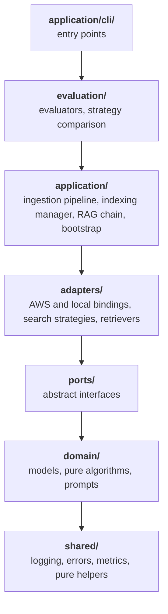

# Unified Knowledge Graph RAG on AWS — Technical Documentation

This is the **design reference for contributors and advanced users**: how the
library is built and why. Usage is in the guides of the [documentation hub](./index.md), every
configuration key in the [Configuration Reference](./reference/configuration.md), the
contribution workflow in [CONTRIBUTING.md](../CONTRIBUTING.md), and extension
recipes in [§15](#15-extension-guide).

## Table of Contents

1. [Overview and Design Philosophy](#1-overview-and-design-philosophy)
2. [Hexagonal Architecture (Ports & Adapters)](#2-hexagonal-architecture-ports--adapters)
3. [Domain Model](#3-domain-model)
4. [Ingestion Pipeline](#4-ingestion-pipeline)
5. [Incremental Indexing](#5-incremental-indexing)
6. [Retrieval: Methodologies](#6-retrieval-methodologies)
7. [Hybrid Scoring and Token Management](#7-hybrid-scoring-and-token-management)
8. [AWS Service Integration](#8-aws-service-integration)
9. [Evaluation Framework](#9-evaluation-framework)
10. [Visualization & Analytics](#10-visualization--analytics)
11. [Prompts and Prompt Tuning](#11-prompts-and-prompt-tuning)
12. [Configuration System](#12-configuration-system)
13. [Testing Strategy](#13-testing-strategy)
14. [CI/CD and Security](#14-cicd-and-security)
15. [Extension Guide](#15-extension-guide)
16. [Further Reading](#16-further-reading)

---

## 1. Overview and Design Philosophy

`unified-kg-rag-on-aws` reimplements the Microsoft GraphRAG and LightRAG
methodologies, with HippoRAG 2's Personalized PageRank and RAPTOR's summary
tree, on an AWS-native stack (Bedrock, Neptune, OpenSearch, S3, DynamoDB).
Its design principles:

- **Several methodologies, one infrastructure.** GraphRAG (community
  summaries), LightRAG (dual-level keywords), HippoRAG 2 (Personalized
  PageRank, §6.4) and RAPTOR (a summary tree, opt-in, §6.5) share
  ingestion, indexing, caching, multilingual processing and hybrid search;
  **only the retrieval algorithm differs**, and an ingestion builds only
  what the selected methodologies read (§4.6).
- **Generalization first.** No hardcoded domain rules or regex heuristics:
  semantic judgments go to the LLM or to authoritative data, token counts to
  the model's tokenizer API where it has one (a script-aware estimate
  otherwise), and thresholds and weights are configuration.
- **Hexagonal boundaries.** Domain and algorithm code depends on abstract
  ports; the AWS (and local) adapters sit behind them.
- **Registry-based extension.** Search strategies, renderers, parsers and
  providers register through registries, with no change to dispatch code;
  evaluators map from `EvaluatorType` in one method (§2.4).

Where the framework extends the GraphRAG and LightRAG papers (triple-hybrid
retrieval, several methodologies on one index, incremental indexing, multilingual
ingestion, bring-your-own graphs and schemas, measured defaults) and where it
deliberately departs from them is summarized in
[Overview: Beyond the papers](./concepts/overview.md#beyond-the-papers); the
sections below give the design behind each.


---

## 2. Hexagonal Architecture (Ports & Adapters)

### 2.1 Dependency Rule and Layer Map

Imports point **inward**. The layers, outermost first; a module imports its
own layer and the layers after it, never one before it:

| Layer | Package | Role |
|---|---|---|
| Entry points | `application/cli/` | the console scripts: parse flags, load config, wire, run |
| Evaluation | `evaluation/` | drives the RAG chain over a dataset; of the application it imports only the chain (`application/retrieval/`) and the composition root (`application/bootstrap.py`) |
| Application | `application/` | orchestration: ingestion pipeline, indexing manager, RAG chain, prompt tuner, config loading, composition root |
| Adapters | `adapters/` | technology bindings and port implementations |
| Ports | `ports/` | the interfaces the application wires and the adapters implement |
| Domain | `domain/` | models, pure algorithms, prompts |
| Shared kernel | `shared/` | logging, errors, metrics, tracing hooks, write fence, pure helpers |

The rule holds for every import: at module level, inside a function, and
under `TYPE_CHECKING` (a type-only import is still a dependency). Inside the
package the root facade is imported only for `__version__`.



An arrow reads "may import"; a layer may also import every layer further
down (the application imports the domain directly, every layer the kernel).

- **Ports sit outside the domain.** A port is written in terms of the domain
  models (`DocStatusPort.diff` returns a `DocumentDelta`), so the domain
  cannot import it back. Domain code that reads a store declares the subset
  it reads as its own `Protocol` (`domain.ingestion.delta_detector.
  DocStatusReader`, the read half of `DocStatusPort`); every port
  implementation satisfies it structurally, mypy checks each caller, and
  `tests/unit/test_fake_port_signatures.py` pins the two shapes together.
  The application hands the port in.
- **`shared/` is a leaf kernel.** It imports no other layer, so every layer,
  the domain included, uses it without a cycle. Code that needs the domain
  models lives in the layer it belongs to: config loading in
  `application/config.py`, the stage cache and resume managers in
  `application/ingestion/`, stage cache keys and document identity in
  `domain/ingestion/`, store names in `domain/retrieval/`, the LangChain
  helpers in `adapters/llm/langchain.py` and
  `adapters/ingestion/document_converter.py`, the rich console helpers in
  `application/cli/display.py`. `setup_logging` takes the configuration
  structurally (`shared.logging.HasLoggingSettings`).
- **Evaluation reaches the stores through the chain** (its retrievers,
  `GraphRAGChain.check_filter_values` / `check_filter_keys`) and imports no
  store adapter.
- **Backends are injected.** Vendor bindings (`adapters/aws/`,
  `adapters/local/`) and port implementations (the `storage/` indexers,
  `retrievers/`, `doc_status/`, `guardrail/`) are built by the provider
  builders and the composition roots: `application/bootstrap.py`
  (`build_providers`, `build_query_guard`, `build_checkpoint_sync`) and the
  CLIs. The orchestrators receive them (`Providers`, those builders, or a
  constructor argument).
- **Plugins through their registry.** Outside its package, a renderer,
  search strategy, evaluator, schema source or seed source is reached
  through the package root only, or, for renderers and evaluators, also
  their `base` module (§2.4); `tests/unit/test_layering.py` (`_PLUGINS`)
  lists the importable modules. The search-strategy registry lives with the
  strategy bases it stores (`adapters/retrieval/strategy_registry.py`), as
  the provider and renderer registries live with what they register.

No `domain/` module may load LangChain, LangSmith, boto3/botocore, lxml,
opensearch-py or gremlin-python, even transitively, so `shared/utils/`
holds only dependency-light helpers; `tests/unit/test_domain_purity.py`
checks this in a clean interpreter.


```
unified_kg_rag/
├─ __init__.py         # public API facade: lazy re-exports of the supported names
├─ domain/              # technology-agnostic core (no boto3/LangChain/backend imports)
│  ├─ models/           #   Pydantic domain models
│  ├─ ingestion/        #   pure algorithms: delta_detector, graph_builder/resolver/analyzer,
│  │  │                 #   claim_resolver, contributions, derivation, cache_keys,
│  │  │                 #   document_identity, seed_graph, visualization_data (+ layout helpers),
│  │  │                 #   community_clustering (Leiden hierarchy, content-named communities),
│  │  │                 #   methodologies (methodology -> stages), summary_tree (RAPTOR clustering)
│  │  └─ merge/         #   cross-run merger
│  ├─ retrieval/        #   store_names, index_prefixes, hybrid_normalization,
│  │                    #   ppr (HippoRAG 2 Personalized PageRank, §6.4), abstention
│  └─ prompts/          #   version-controlled prompt templates
├─ ports/               # interfaces the application wires, adapters implement (DocStatusPort,
│                       #   BaseIndexer/GraphIndexer/VectorIndexer, ModelFactoryPort,
│                       #   ContentGuardPort — ports/__init__ is the port catalog)
├─ adapters/            # concrete technology bindings
│  ├─ aws/              #   Bedrock model factories, Neptune/OpenSearch clients, S3 transfer and caches
│  ├─ local/            #   Ollama/OpenAI-compatible models, cross-encoder, embedded SQLite graph/search stores
│  ├─ llm/              #   provider-neutral chain assembly, transient retry, token estimate,
│  │                    #   LangChain batch/XML helpers (langchain.py)
│  ├─ observability/    #   OpenTelemetry tracer, exporters, LangChain callback
│  ├─ storage/          #   Neptune/OpenSearch/SQLite-graph indexers (write-side port implementations)
│  ├─ retrievers/       #   Neptune/OpenSearch/SQLite-graph retrievers
│  ├─ graph_query/      #   structured-query compilers (Gremlin, SQL) and their static checkers
│  ├─ doc_status/       #   DynamoDB/SQLite document-status registries (DocStatusPort)
│  ├─ guardrail/        #   Bedrock ApplyGuardrail (ContentGuardPort)
│  ├─ search_strategies/#   simple/local/global/drift + lightrag(mix/hybrid/naive) + ppr
│  │                    #   + tree + structured + iterative (wraps mix or local)
│  ├─ retrieval/        #   abstract retriever/strategy bases, strategy_registry, hybrid scorer,
│  │                    #   token/memory managers, ppr_ranking (PageRank over the stores)
│  ├─ ingestion/        #   LLM/IO coupled: chunker, *_extractor, loader, parser,
│  │                    #   translator, gleaner, community_detector, document_converter,
│  │                    #   tree_summarizer (RAPTOR summaries)
│  ├─ renderers/        #   graph visualization renderers
│  ├─ schema_sources/   #   @register_schema_source: extraction-schema loaders (file, owl)
│  ├─ seed_sources/     #   @register_seed_source: seed graph loaders (jsonl, csv, rdf)
│  ├─ source_files/     #   shared readers of a source's files: local/S3 locations, RDF files, checks, parse
│  ├─ evaluators/       #   evaluator bases + the ragas evaluator
│  ├─ store_errors.py   #   is_fatal_retrieval_error: the fatal-vs-degraded policy (§8.1)
│  ├─ providers.py      #   Providers: the per-run bundle of model and store providers
│  └─ provider_registry.py # @register_provider: builders keyed by role and kind
├─ application/         # orchestration + entry points
│  ├─ cli/              #   run-ingestion/rag/eval/visualization/prompt-tuning/describe,
│  │                    #   prepare-benchmark, run-mcp-server (mcp_tools, mcp_server: §8.4),
│  │                    #   run-console + console/ (the web console's server, jobs, APIs: §10.1),
│  │                    #   display (rich console helpers)
│  ├─ ingestion/        #   DataIngestionPipeline + pipeline_stages, IncrementalIndexer,
│  │                    #   namespace lease, extraction-record store, stage cache
│  │                    #   (cache_manager), resume (pipeline_manager; the resume
│  │                    #   point and rewinds in resume) and run metrics
│  │                    #   (pipeline_metrics), the summary-tree stage (summary_tree_stage)
│  ├─ storage/          #   IndexingManager (indexer fan-out) and its collaborators:
│  │                    #   cross_run_merge, removal, reannotation, stored_items;
│  │                    #   inspection (describe_namespace, export_graph: run-describe)
│  ├─ retrieval/        #   rag_chain (GraphRAGChain, RAGInput/Output), its query
│  │                    #   processing (query_processing) and filter-key checks
│  │                    #   (filter_validation), methodology_check (what a namespace holds),
│  │                    #   graph_lookup (the MCP tools' read-only store reads)
│  ├─ prompts/          #   PromptTuner (LLM-based corpus profiling)
│  ├─ bootstrap.py      #   the composition root: build_providers, build_query_guard,
│  │                    #   build_checkpoint_sync, resolve_extraction_schema,
│  │                    #   load_seed_graphs
│  ├─ config.py         #   get_config / ConfigLoader: file + environment -> Config
│  └─ observability.py  #   configure_observability: installs the tracing backend
├─ shared/              # leaf kernel (logging, exceptions, metrics, observability hooks,
│                       #   write fence, utils/: hashing, ids, concurrency, scripts)
└─ evaluation/          # real logic package: evaluation_manager / graph_aware /
                        #   retrieval / answer_match / assertion, strategy comparison +
                        #   pairwise judge, closed_book, benchmarks/ (MuSiQue, autoq)
```

- **Real logic package.** `evaluation/` (the manager and the LLM-free
  evaluators) is a layer of its own (above). Everything else is imported
  from its real location (`application.*`, `adapters.*`, `domain.*`).
- **Vendor and role packages.** Vendor packages (`adapters/aws/`,
  `adapters/local/`) hold technology bindings (clients, embedded engines and
  stores, model factories, token counters, caches); role packages
  (`storage/`, `retrievers/`, `doc_status/`, `guardrail/`) hold the port
  implementations the application wires. A role package imports a vendor
  package, never the reverse: `SQLiteGraphIndexer` writes to
  `SQLiteGraphStore` as `NeptuneIndexer` writes through `NeptuneClient`. Of
  the adapters, a vendor package imports only the other vendor package and
  the vendor-neutral kernel (`adapters/llm/`, `adapters/observability/`),
  which imports no other adapter package.

### 2.2 Ports (Abstract Interfaces)

| Port | Location | Adapters | Notes |
|---|---|---|---|
| `DocStatusPort` | `ports/doc_status.py` | `adapters/doc_status/dynamodb.py`, `sqlite.py`; `FakeDocStatusStore` for tests | Document status and each document's text units, partitioned by index namespace; the domain's delta reads its `DocStatusReader` subset |
| `ContentGuardPort` | `ports/guardrail.py` (with `GuardVerdict`) | `adapters/guardrail/bedrock.py` (Bedrock `ApplyGuardrail`) | Screens the raw query and the final answer (§14) |
| `GraphIndexer` (write) | `ports/indexer.py` | `adapters/storage/neptune_indexer.py`; local `sqlite_graph_indexer.py` | One contract for full builds and deltas (`upsert_*` / `delete_by_id`) |
| `VectorIndexer` (write) | `ports/indexer.py` | `adapters/storage/opensearch_indexer.py` (on OpenSearch, or on the embedded engine through `SearchEngineClient`) | Same |
| `BaseGraphRAGRetriever` (read) | `adapters/retrieval/base.py` | `adapters/retrievers/{neptune,opensearch,sqlite_graph}_retriever.py` | Retrieval adapters |
| `GraphQueryPort` (read) | `ports/graph_query.py` (`Protocol`) | `adapters/retrievers/{neptune,sqlite_graph}_retriever.py`; `FakeGraphQueryRetriever` for tests | Structured queries over one suffix's graph (§6.6) |
| Model factories, token counter | `ports/model_factory.py` (`ModelFactoryPort`, `TokenCounterPort`, the `*ModelInfo` records) | `adapters/aws/bedrock.py`, `bedrock_models.py`, `token_counter.py`; local `adapters/local/{models,embeddings,rerank,token_counter}.py` | Carried by one `Providers` bundle (§15) |

The read-side bases (`BaseGraphRAGRetriever`, `BaseSearchStrategy`) and
`BaseGraphRAGEvaluator` are *adapter bases*: they build infrastructure
(scorer, token manager) in `__init__`, so they live in `adapters/` and
`ports/__init__` only names them.

### 2.3 Role-Based Retriever Injection

Strategies receive retrievers **by role, not by backend**:
`RetrieverRole.GRAPH` (graph expansion) and `RetrieverRole.DOCUMENT`
(vector and lexical lookup). They reach them only through
`self.graph_retriever` / `self.document_retriever`, and the chain's role →
builder map binds the implementation, so swapping the graph backend changes
no strategy code.

```python
# adapters/retrieval/strategy_registry.py
@register_strategy(SearchStrategy.LOCAL, required_roles=(RetrieverRole.DOCUMENT, RetrieverRole.GRAPH))
class LocalSearchStrategy(BaseSearchStrategy): ...
```

The write path has two fixed store roles: `IndexingManager` always writes a
graph store and a vector store, because the fan-out (entities to both stores,
entities before edges, the orphan-edge cascade) is domain knowledge; which
backend fills each role is open (`providers.graph.kind` /
`providers.vector.kind`, or an injected indexer).

### 2.4 Registries

- **Search strategies**: `@register_strategy(...)`
  (`adapters/retrieval/strategy_registry.py`): a class, its required roles and
  query inputs, keyed by `SearchStrategy`; a wrapper (`iterative`) names the
  strategy it runs under a config (`wraps`, §6.3), and a strategy that reads
  less than its methodology requires names the index artifacts it reads
  (`required_artifacts`, §4.6).
- **Providers**: `@register_provider(ProviderRole.X, "kind")`
  (`adapters/provider_registry.py`): the builder `providers.<role>.kind`
  selects, for every model, store and registry role.
- **Renderers**: `@register_renderer("name")` (`adapters/renderers/base.py`);
  **parsers**: `ParserFactory.register_loader(".ext", Loader)`.
- **Schema sources**: `@register_schema_source("kind")`
  (`adapters/schema_sources/registry.py`): the loader
  `processing.graph_extraction.schema_source.kind` selects (§12).
- **Seed sources**: `@register_seed_source("kind")`
  (`adapters/seed_sources/registry.py`): the loader each
  `processing.seed_graphs[].kind` selects (§4.5).
- **Evaluators**: one lazy-import branch per `EvaluatorType` in
  `EvaluationManager._resolve_evaluator_class`.

### 2.5 Dependency Rule Verification and Public API

`tests/unit/test_layering.py` enforces §2.1 on every import of every
module (lazy and `TYPE_CHECKING` ones included, relative ones resolved):
the layer order, evaluation's reach into the application, injected
backends (also inside the adapters: the search strategies, the retrieval
kernel and the ingestion adapters import none), store-free evaluation,
vendor packages as leaves, plugins through their registries,
and the root facade imported only for `__version__`. Importing `pkg.mod`
runs `pkg/__init__.py`, so the imports a package's `__init__` makes count
for every module that imports from the package; outside the facade and the
console-script launcher, a package module is never imported by a name
string (`importlib.import_module`, `__import__`, `pkgutil.resolve_name`,
`importlib.util.find_spec`, also under an alias, through `getattr` or with
`name=`), and a dynamic import of a name the scan cannot read (a variable,
a concatenation, a relative name), `exec` or
`importlib.util.spec_from_file_location` needs an entry saying what it
imports. Its list of allowed exceptions is empty, and each rule has
a synthetic case it must catch. A clean-interpreter check pins the runtime
side, which the scan of edges cannot see (an allowed adapter module passing
a backend on): importing any module of the application (the CLIs and the
composition root aside), evaluation, the search strategies, the retrieval
kernel or the ingestion adapters loads no vendor binding, port
implementation, gremlin-python or opensearch-py.
`tests/unit/test_domain_purity.py` checks the third-party side: no domain
module loads an infrastructure package, even transitively.

**Public API.** Callers outside the package import from `unified_kg_rag`,
whose `__all__` is the supported surface: the names for using the framework
(`Config`, `get_config`, `DataIngestionPipeline`, `GraphRAGChain`, `RAGInput`
/ `RAGOutput` / `SearchOutput`, `EvaluationManager`, ...) and for extending it
(the ports, `Providers` / `build_providers`, the registries). Other module
paths are internal; only a change to the exported names, configuration keys,
CLI flags and exit codes, or stored formats is breaking. Names resolve on
first access (`import unified_kg_rag` loads nothing), and
`tests/unit/test_public_api.py` pins the list.

---

## 3. Domain Model

`domain/models/` holds pure Pydantic models with no infrastructure
dependency:

- `Entity` (`name`, `description`, `type`, `text_unit_ids`, `community_ids`,
  `rank`, `confidence`, embedding fields, the schema annotations
  `in_schema` / `type_iri`, the stated `iri` and the derived
  `source_kinds`), `Relationship` (`source_id` / `target_id`,
  `description`, `weight`, `text_unit_ids`, `in_schema` / `predicate_iri`,
  `source_kinds`; §4.2, §4.5),
  `Community` / `CommunityReport`, `TextUnit`, `Covariate` (claim);
- `DocStatus` (a `PENDING` write-ahead record, then `PROCESSED` / `FAILED` /
  `QUARANTINED`), `DocStatusRecord` (content hash, the document's text units,
  suffix), `DocumentDelta` (new / changed / unchanged / deleted, plus failed,
  quarantined, quarantined-unchanged, deferred and settings-changed ids),
  `DocumentLineage` (the text units one document produced);
- `SearchQuery` / `SearchResult` / `RetrievalResult`, `SearchStrategy` /
  `SearchType` / `RetrieverRole`;
- `SeedGraph` / `SeedNode` / `SeedEdge` (`seed_graph.py`): what a seed source
  reads, before conversion (§4.5).

**Lineage is the core data.** Entities and relationships record the
`text_unit_ids` they were stated in. This lineage, not a token-overlap
heuristic, decides whether an entity relates to a text unit, in any
language, and incremental removal follows it (§5).

**Rank (MS GraphRAG parity).** An entity's `rank` is its degree, a
relationship's the sum of its endpoints' degrees (`domain/ingestion/graph_rank.py`).
A full build sets them; an incremental merge recomputes them for what it
writes over the stored graph's neighbours. Only document-backed edges
count: an edge every text unit of which is a seed graph's adds to no
degree (§4.5), so with no seed graph the rank is the plain degree.

**Index suffix.** Every OpenSearch index and Neptune label is named
`<prefix>-<suffix>[-<additional_suffix>]`: ingestion writes
`processing.document_parsing.index_value`, queries select `RAGInput.suffix`
(`run-rag` / `run-eval`: `--suffix`, else the config's `index_value`), all
`default` when unset; one suffix per tenant or corpus version.

**Display names and identity keys.**

- `Entity.name` keeps the display form the source used, only trimmed and
  whitespace-collapsed (`clean_display_name`), so context and reports quote
  "$1,000 penalty" or "C++" verbatim.
- Ids hash `entity_key(name)` (`shared/utils/common.py`): NFKC, casefold, `_`
  and `-` as spaces, quote marks and commas dropped, whitespace collapsed,
  trailing sentence punctuation stripped, **every other symbol and the
  letters and digits of all scripts kept**. "ACME  Corp." and "Acme Corp"
  share an id; "C++" and "C#" do not; a non-empty name never yields an empty
  key. Every exact-name match (extraction, gleaning, claim resolution,
  incremental merges) and the fuzzy matcher's shingles use the same key.
- **Changing the key changes every id**, so it requires a full re-index.

---

## 4. Ingestion Pipeline

`DataIngestionPipeline` (`application/ingestion/pipeline.py`) runs 13
checkpointed stages, so a re-run resumes after the last valid one. Extraction
works per text unit and the graph is resolved from the merged per-unit
records, so a full build does not depend on batching and an incremental run
can re-derive what it touches (§5).


| # | Stage | Module | Notes |
|---|---|---|---|
| 1 | Document parsing | `parser.py` (`ParserFactory`) | PDF/TXT/CSV/JSON/MD/HTML (the `unstructured` extra, when installed, reads MD/HTML in place of the core readers; DOCX with the `docx` extra) |
| 2 | Document loading | `loader.py` | optional MinHash deduplication; the incremental diff |
| 3 | Chunking | `chunker.py` | intelligent (LLM boundaries, default) or simple |
| 4 | Translation | `translator.py` | optional; skipped when source = target language |
| 5 | Graph extraction | `graph_extractor.py` | entities and relationships per text unit |
| 6 | Gleaning | `gleaner.py` | optional; re-asks a unit while its last answer added something |
| 7 | Graph resolution | `graph_resolver.py`, `description_summarizer.py` | merges name variants, re-summarizes long descriptions (calls the LLM) |
| 8-9 | Claim extraction and resolution | `claim_extractor.py`, `claim_resolver.py` | optional (off by default) |
| 10 | Graph analysis | `graph_analyzer.py` | graph build and statistics |
| 11 | Community detection | `community_detector.py`, `domain/ingestion/community_clustering.py` | hierarchical Leiden (the clustering is pure, in the domain) and structured reports |
| 12 | Indexing | `application/storage/indexing_manager.py` (+ `cross_run_merge.py`, `removal.py`, `reannotation.py`) | graph and vector stores; full build or delta |
| 13 | Summary tree | `application/ingestion/summary_tree_stage.py`, `domain/ingestion/summary_tree.py` | only with `raptor` in `indexing.methodologies`: RAPTOR's tree over the stored text units, after indexing (§6.5) |

The stage order lives in `DataIngestionPipeline.STAGE_CLASSES`; every stage
gets its models and stores from the run's `Providers` bundle.

### 4.1 Extraction records and the extraction store (stages 5-8)

- **One record per text unit.** Extraction and gleaning write one
  `TextUnitExtraction` per unit (`domain/models/extraction.py`): the
  entities and relationships that unit states, in its own words, plus the
  entity keys rejected for it. Gleaning edits one record at a time: its
  prompt lists the unit's own items, and a correction never reaches what
  another unit says (MS GraphRAG and LightRAG likewise glean each chunk's own
  extraction). It lists the entities with their types and gives the
  extraction prompt's entity and relationship type blocks and its 1-10
  confidence and strength scales, so a gleaned item is typed and scored as
  an extracted one (a missing score takes extraction's default too).
- **Output format and gleaning (deliberate divergences).** Extraction asks
  for XML records (`GraphExtractionPrompt`): each entity with its type,
  description, a 1-10 `<confidence>` and a verbatim `<source_text>` span,
  each relationship with a strength and its span, where MS GraphRAG and
  LightRAG parse delimited tuples. The span is what entity grounding checks
  an item against its chunk with, and the confidence what
  `entity_confidence_threshold` filters on. Gleaning is a refinement prompt
  of its own (`GraphRefinementPrompt`), sent without the extraction's
  conversation: it lists the unit's text and current items and asks for
  missing items and corrections. Upstream continues the extraction
  conversation ("MANY entities were missed ...") with its history. A round
  here costs one prompt of the unit's text and items rather than a growing
  conversation, and it can correct an item (`ENTITY_CORRECTION`,
  `RELATIONSHIP_CORRECTION`), not only add one.
- **Resolution starts from the merge of all records**
  (`domain/ingestion/contributions.merge_contributions`: items merged by id,
  weights kept per unit), so the merged graph does not depend on which units
  shared a batch. Claim prompts list the unit's own entities, so a unit's
  claims depend on the unit alone. A claim's subject and object resolve
  only against the entities its own text units stated (`ClaimResolver`, in
  a full build as incrementally): a claim whose subject its units' entity
  extraction did not list is dropped (the prompt says so, and a unit whose
  record lists no entity is not asked), and an object not listed there is
  kept as the literal name the claim states (`object_id` empty), though
  another document states that entity. Statements of one claim whose
  statuses disagree merge into `disputed` (`merge_claim_statuses`); a
  model's status is read into the prompt's four (`claim_status`: `true`,
  `false`, `disputed`, `unknown`, as stored) at extraction and in each merge. Each unit's statement is resolved
  on its own, and resolution merges the statements that resolve to one
  claim id.
- **The extraction store** keeps each record, keyed by
  `<fingerprint>:<SHA-256 of the processed text>`, in the vector store's
  extraction-records index. The fingerprint
  (`cache_keys.unit_record_fingerprint`) covers the models, the extraction,
  gleaning or claim settings, the target language and the prompt templates in
  effect. A unit whose text and settings have a stored record takes it
  instead of an LLM call, so an edited document re-extracts only its changed
  chunks, and identical chunks elsewhere or in a rebuild reuse theirs.
  `--force-rebuild` re-extracts and refreshes every record; an unreadable
  store is logged and the run re-extracts. A record that cannot be written
  fails its unit (`records_not_stored`), so its document is recorded `FAILED`
  and extracted again: incremental runs derive from the records (§5.4).
- **A text unit names its stored records** in `attributes.extraction_records`,
  computed from the run's records when the unit is indexed (not set on the
  cached units), so a resumed run writes them too.
- **A record stays while a stored text unit names it.** A full build or
  reset whose text units were all written keeps only the records they name
  (`VectorIndexer.retain_extraction_records` copies them into a new index and
  swaps the alias), except a rebuild to fewer methodologies, which stops
  building an artifact the build record names and made from records
  (entities, relationships, graph, reports, claims): it keeps every record,
  so adding the methodology back extracts nothing again; an incremental run
  deletes the records only removed text units named.
- **Chunk boundaries are records too.** The intelligent chunker stores each
  pre-chunk's boundary answer in the same index, keyed by
  `<cache_keys.chunk_boundary_fingerprint>:<SHA-256 of the pre-chunk>` (the
  every-call and chunking settings, the chunking model and the boundary
  prompt), and the text units cut from it name the record (`chunks` in
  `attributes.extraction_records`), so it is kept and removed like the
  others. A pre-chunk with a stored answer takes it instead of a model call:
  a reset of an unchanged corpus asks the boundary model nothing, and a
  model that answers otherwise each time (no temperature control) cannot
  move the boundaries, and with them every downstream cache key, of
  unchanged text. The stage cache could not hold them: it is per pipeline
  id and keyed by the whole corpus. Only an answer that cuts its pre-chunk
  is stored: one it falls back from (lines that do not exist, a miss rate
  over the limit) would split it by size on every later run, so it is asked
  again, and a stored one of that kind is replaced. `--force-rebuild` asks
  again.
- **Translations are records too.** The translation stage stores a text
  unit's translations (every language it translates into) under
  `<cache_keys.translation_fingerprint>:<SHA-256 of the unit's text>` (the
  every-call and translation settings, the translation model, the source
  language, the translated languages and the translation prompt), and the
  unit names the record (`translation`). A unit with a stored record takes
  it instead of a model call, so a reset or an edit translates only text
  that changed, and extraction, which reads the translation and is keyed by
  it, reuses its records too: a model that translates otherwise each time
  would re-key every downstream record of unchanged text. A unit whose
  translation failed in any language stores none; `--force-rebuild`
  translates again.
- **A full build reuses the corpus-wide answers of unchanged input.** The
  LLM response cache keys a call by its prompt and model, which are stable
  (community ids are content ids), but it lives in the run's cache
  directory: a reset under a new pipeline id starts it empty, so before
  this every reset summarized every long description and reported every
  community again. When the run's graph is the corpus's (no registry, a
  reset, or no unchanged document), graph resolution reads the stored
  graph copies of the items over the summarization threshold (one read
  per suffix) and keeps a summary whose `summarized_from` is the hash of
  the item's description and whose `summarized_with` is
  `cache_keys.description_summary_fingerprint` (every-call settings, the
  summary model, the summarization section, the prompt), so a reset after
  a summarization setting change summarizes again; a copy the graph capped
  is not reused. The report answers are extraction-store records keyed by
  `<cache_keys.community_report_fingerprint>:<SHA-256 of the report input>`
  (the chain input as packed, with the community's name, which titles the
  report), stored with their generation time and named by the report
  (`attributes.report_record`), so the rebuild's retention keeps the ones
  its reports name. A stored answer gives the same report a call would
  (rank and lineage are recomputed), and its vectors are reused by digest.
  An incremental run that leaves documents unchanged neither reads nor
  writes them: its communities cluster the delta, which a full build
  clusters otherwise, so the first reset after incremental runs asks for
  those reports. `--force-rebuild` asks
  again and refreshes the records.
- **Gleaning stops on observed output**: a unit is re-sent (up to
  `max_rounds`) only while its previous answer added something new. An empty
  answer is the "nothing missing" signal MS GraphRAG asks for with a separate
  yes/no prompt, so no call is spent on it. `max_rounds` stays 3, against
  MS GraphRAG's 1, for the measured graph recall (§9.1).

### 4.2 Graph identity and merging (stages 5-7)

- **Entity identity (deliberate divergence).** An entity id hashes
  `entity:{entity_key(name)}`: the type is not part of it, so a name stated
  with two types is one entity, typed by the most frequent of its statements
  (document statements first, the smallest type on a tie;
  `contributions.merge_entity_contributions`). MS GraphRAG groups extracted
  entities by name and type; LightRAG keys them by name, as here.
- **Relationship identity (deliberate divergence).** A relationship id hashes
  `relationship:{entity_key(source)}:{entity_key(target)}:{type}`, lowercased,
  so the model-written `type` is part of the identity and the edge is
  directed: two types between one pair are two edges here and one in MS
  GraphRAG and LightRAG (the community graph still joins them, §4.3). The
  parts are joined with `:` unescaped, so a `:` in a name or type can collide;
  the format is kept because fixing it would re-key every stored relationship.
- **Endpoints cite their relationships' text units (deliberate
  divergence).** An entity also cites the text units of each relationship it
  is an endpoint of, and an endpoint no unit listed becomes a stub entity
  citing them (`relationship_endpoints.cite_relationship_endpoints`). Upstream, an
  entity's text units depend on which chunks were extracted together; here
  they depend only on the chunks that name it, so an incremental run cites
  what a full build cites and a removed document strips an entity to exactly
  the surviving text units that name it. The cost: local search and
  community lineage also reach chunks that mention an entity only through a
  relationship. With entity grounding on, gleaning drops a relationship naming
  an entity rejected as ungrounded for its chunk, so no stub brings it back.
- **Entity merging.** Two names merge when their `compact_name_key` is equal:
  `entity_key` without a short, fixed list of legal-form designators (`(주)`,
  `주식회사`, `株式会社`, `有限公司`, a trailing `Inc` / `Ltd` / `LLC` / `Co` /
  `Corp`, ...) and without spaces next to Han, Hangul or Kana, so
  "(주)가나다", "가나다 상사" / "가나다상사" and "Acme Inc" / "Acme" merge. A
  merged group takes the name cited by the most text units (ties: the
  smallest), so the result does not depend on input order. The list is
  applied whatever the entity's type: entity types are the user's
  vocabulary, so no type rule tells a company from a place, and a place
  written with a region code that is also a designator ("Springfield, CO")
  merges with its bare name ("Springfield").
- **Fuzzy matching is opt-in** (`processing.fuzzy_entity_resolution`), because
  name similarity also joins different organizations that share most of their
  name ("Northfield University" / "Northfield University Hospital"). When it is
  on, names link above `processing.similarity_threshold` only when their
  *discriminator tokens* (tokens with a digit, single letters, Roman numerals)
  are identical, their types are compatible, and, for names ending in Han,
  Hangul or Kana, their final (head) characters are equal ("가나다연구원" and
  "가나다연구소" stay apart). A type-aware union-find never groups two
  differently typed names. Without fuzzy matching, full and incremental
  builds group the same names (both merge by compact name key). With it, the
  incremental merge uses the same matcher but folds each delta entity into
  its one best-matching stored entity and does not join stored entities with
  each other: a delta name that links two stored names a full build chains
  into one group ("Northfield Medical Centre" between "... Center" and
  "... Centre Annex") merges with one of them only, until
  `indexing.reset: true` regroups the corpus.
- **Schema annotations are written, not extracted.** `IndexingManager`
  sets `in_schema` and `type_iri` on each entity and `in_schema` and
  `predicate_iri` on each relationship it writes, on every write path (full
  build, delta, the strip of a removal, the stored edges it rewrites for
  their names or rank), from the item's stored type and the schema
  (`domain/ingestion/schema_annotation.SchemaAnnotator`, matched by
  `schema_key`, so the lowercased type vote still matches). A pure function
  of the merged type, it gives a full build and an incremental run the same
  values; pattern conformance is not stored, since it depends on endpoint
  types other documents can change. Where the schema does not apply
  (`SchemaConformance.applies`: `off`, `align` with entity types alone),
  `in_schema` is `None`; where it applies, both kinds get it, and every item
  of a kind with no declared type is in schema (nothing of it is off schema,
  so `in_schema: true` never empties a kind); an IRI is written
  whenever the stored type names a declared type with an `iri` and the mode
  is not `off` (so `align` with entity types alone still links them), and is
  `None` otherwise. `None` is never written: models drop it from their dumps
  (`SchemaAnnotated`), extraction records never hold annotations, the
  Neptune codec and the OpenSearch documents omit it. A default config (no
  `iri` anywhere) therefore writes no annotation field on its items; only the index mappings gain
  `in_schema` (boolean) and the IRI keyword fields, added to live indices
  by the incremental preflight (`check_index_settings` →
  `_add_missing_fields`). Ids are unchanged; the IRIs are the seam for
  linking items to an external ontology. A schema edit that changes only
  the annotations (the digest, §12 "Extraction settings") is applied by
  `IndexingManager.reannotate`: each store lists its items' annotations
  with their types (`read_schema_annotations`; a relationship's vector copy,
  which holds no type, takes its edge's), and only those that differ are
  rewritten in place (`write_schema_annotations`: Neptune and the SQLite
  graph drop and set the two properties, OpenSearch a partial update with
  null for an unset one), so the stores end as a full build leaves them.
  Neptune lists the ids in one traversal and reads the annotations in
  `batch_size` batches; OpenSearch pages by id. A store that inherits the
  port's defaults (`rewrites_schema_annotations`, which compares the
  functions its methods are bound to, so a forwarding wrapper answers for
  the store it wraps) makes the pass read nothing; a store error ends the
  pass with a warning, not the run.
- **Merged descriptions** are concatenated, so `DescriptionSummarizer`
  re-summarizes those over a token budget with a cheap model (map-reduce when
  one exceeds a call's input); a failed call keeps the concatenation. The
  trigger is a cost variant of upstream, not parity: MS GraphRAG
  `summarize_descriptions` summarizes every item with more than one
  description and LightRAG also at `force_llm_summary_on_merge` (8)
  fragments; here only the token budget triggers it.

### 4.3 Communities (stages 10-11)

- **Community graph.** `GraphBuilder` builds an undirected graph with one edge
  per entity pair; relationships of other types or directions between the pair
  share it, with the summed weight, so Leiden sees the pair's total strength.
- **Hierarchy (MS GraphRAG parity below, deliberate divergence above).**
  One Leiden pass partitions the whole entity graph. Because modularity's
  resolution limit grows its communities with the corpus beyond what one
  report can describe, a community over `max_cluster_size` (default 20)
  members is partitioned again on its own subgraph, recursively, and stays
  the parent of its pieces, as graspologic's `hierarchical_leiden` (MS
  GraphRAG's `cluster_graph`) keeps it; the pass over the whole graph is
  the best partition at its scale, and regrouping the pieces afresh with
  one pass over their cluster graph recovered planted and LFR benchmark
  partitions worse (level purity 0.55-0.92 against 0.85-1.00 before the
  split; `tests/unit/test_community_hierarchy_quality.py`, which also checks
  the first pass against `graspologic_native.hierarchical_leiden`). Leaves
  are level 0 and a split community sits at its height above them. Where
  MS GraphRAG stops at the first pass, coarser levels above the highest of
  these communities partition the graph of the current top communities the
  same way (a group over `max_cluster_size` communities split and kept as
  the parent of its pieces), up to `max_levels`; a partition that puts
  every linked community under one root is no level. Leaf communities
  under `min_community_size` merge into their strongest neighbour, and a
  split community is the union of the pieces it keeps.
  A connected component smaller than `min_community_size` (an isolated
  entity, a pair) gets no community or report; only these are skipped, unlike
  MS GraphRAG's `use_lcc`, which drops every component but the largest. On an
  incremental run, whose graph is only the delta, a small component is
  clustered when it reaches `min_community_size` in the whole graph a full
  build would cluster: walking the stored relationships that cite text units
  of documents the run neither processes nor removes, at most
  `min_community_size` batched reads. Stored entities without a community it
  links to stay without one until a rebuild (`community_drift`
  `unclustered_entities`). A
  parent identical to its only child is never created, so each distinct
  community is reported once. A Leiden failure fails the stage instead of
  truncating the hierarchy.
- **Leiden runs (deviation).** `trials` 3 and `extra_forced_iterations` 2
  (the best of three seeded runs, two more refinement passes) where MS
  GraphRAG runs one trial of one iteration (`graphs/hierarchical_leiden.py`).
  Not measured against upstream's; it costs Leiden time only (no model
  call).
- **Determinism.** Leiden's partition depends on insertion order and
  `graspologic_native` returns labels in a per-process order, so the clustering
  (`domain/ingestion/community_clustering.py`) sorts nodes and edges and
  renumbers each level by its smallest member id:
  the same graph and `random_state` always yield the same communities and ids.
- **Leiden runs (deviation, unmeasured).** Each partition is the best of
  `trials` (3) seeded Leiden runs, each with `extra_forced_iterations` (2)
  passes after the first (`iterations: 3` to `graspologic_native`); MS
  GraphRAG's `hierarchical_leiden` runs once with `iterations=1`
  (`graphs/hierarchical_leiden.py`). The extra runs and passes cost Leiden
  time, not model calls, and keep the partition of highest modularity;
  whether that changes the reports or the answers was not measured.
- **Reports (MS GraphRAG parity, two deliberate deviations below).** A report's input takes the community's
  entities by degree (document-backed, §4.5), capped at
  `max_entities_per_report`, and packs them into `max_report_context_tokens`
  edge by edge, as MS GraphRAG's `sort_context`: the relationships among them
  by combined endpoint degree (then weight and id), each with its endpoints
  and, with claim extraction on, the claims about them; one that does not fit
  is left out and the next tried; the entities with no relationship among
  them come last; the top entity always fits. Packing the entities first left
  the relationships whatever budget remained (with 200-token descriptions, 2
  of 40 edges). MS GraphRAG's 8000-token budget with `max_cluster_size` 10 is
  the tuning point for larger reports: the defaults (4000, 20) are kept for
  cost. Reports are generated bottom-up. The prompt returns a structured
  report (summary, 0-10 rating with explanation, findings); `full_content`
  for embedding and search is rendered from it, with no second call. As MS
  GraphRAG's prompt (`prompts/index/community_report.py`), it allows only
  what the data supports ("Do not include information where the supporting
  evidence for it is not provided") and asks each finding for its
  references, `[Data: Entities (1, 3); Relationships (2, +more)]`, at most 5
  numbers a list; the entities and relationships are numbered in packing
  order, from 1, in place of GraphRAG's `human_readable_id`. The syntax
  stays ASCII in every report language (full-width brackets and commas a
  CJK answer may use are read too). The numbers name records only within
  that input, so `report_references.split_data_references` takes them out
  of the prose and the finding keeps the record ids
  (`CommunityFinding.entity_ids` / `relationship_ids`); claims and
  sub-community reports are not numbered. The stored report keeps its
  findings, ids included, in an unindexed field (`findings`, mapped
  `enabled: false`; an earlier index gets it in the preflight's additive
  mapping update), so a retrieved report and its reported source name the
  records each finding rests on (`report_references.report_cited_ids`).
  An incremental commit points them at the ids the cross-run merge kept,
  as it does a community's members. A report stored before cites none.
- **Sub-community roll-up (deviation).** When a parent's own context was
  cut, its children's report summaries (biggest child first, each with its
  rating) are added to that context under a second budget of
  `max_report_context_tokens` (`enable_sub_community_rollup`), so the
  prompt stays within about twice the raw budget. MS GraphRAG substitutes
  sub-community reports for the raw context that does not fit; adding them
  keeps the parent's best-connected entities and relationships verbatim, at
  up to twice the input tokens of a parent that overflows.
- **Report rank (deviation).** A report's `rank` is the sum of its members'
  document-backed degrees (`_compute_report_rank`, no model call; the member
  count without a graph), where MS GraphRAG's is the model's rating. The
  model's rating is kept as `rating` (in the report text, and a filter key
  of the reports index); global search's map step rates each report against
  the query instead. `rank` orders a search of the reports index without
  query text.
- **Report lineage.** Each report carries `text_unit_ids` and `document_ids`
  (the union over its members: provenance, not citation support) and its
  place in the hierarchy, which global search selects by (§6.1.1).

### 4.4 Pipeline infrastructure

- **Resume.** Each stage's output is checkpointed under the run's pipeline id
  (`application/ingestion/pipeline_manager.py`, `application/ingestion/cache_manager.py`); the stage cache
  key is described in §12. Where a resumed run starts, and the rewinds that
  move it back, are in `application/ingestion/resume.py`.
- **S3 sync** (`adapters/aws/s3_cache.py`) uploads the changed files after
  every stage, data before the metadata that refers to it. On SIGTERM,
  `run-ingestion` stops the running stage (`request_stop`: deferred while a
  checkpoint is written, no I/O in the handler) and uploads its checkpoint.
- **Reuse across runs.** Within what a run writes, a text embedded before
  with the same embedding provider, model and dimension keeps its stored
  vector (each vector stores a digest of its text, §5.2), so a changed
  document re-embeds only the chunks, descriptions and reports whose text
  changed, and a reset of an unchanged corpus embeds again only what it
  regenerates. The intelligent chunker's boundary answers are kept per
  pre-chunk in the extraction store (§4.1), so a reset or an edit asks the
  model only for pre-chunks whose text or chunking settings changed, and an
  unchanged pre-chunk keeps its boundaries even with a model that answers
  otherwise each time. Only an answer the chunker used is kept: a pre-chunk
  split by size instead (the answer named lines that do not exist) asks the
  model again on the next run. A full build (a reset, a first run, or a run
  without the registry) does the same for the corpus-wide answers: a
  description over the summarization threshold whose stored copy was
  summarized from the same text with the same summarization settings keeps
  that summary, and a community whose report input (its members,
  descriptions, edges and claims as packed, its roll-up text and name) and
  report settings are unchanged takes the stored answer (the extraction
  store keeps it, and the report names it in `attributes.report_record`). A
  community's name (`Level 0 Community 1a2b3c4d`) derives from its members,
  so a document that adds a community leaves the others' names, and their
  stored answers, as they were.
- **LLM response cache** (`adapters/llm/response_cache.py`): a LangChain
  `BaseCache` on every ingestion model, keyed by the rendered messages and the
  model and generation settings, stored with the stage cache. An earlier
  run's entry is served at most once per run and truncated responses are not
  kept, so a retry after a bad response asks the model again. A
  `BatchProcessor` item that failed every attempt drops the responses its
  calls were served or stored (`discard_if_item_fails`), so a re-run asks
  again for that item only instead of replaying them; so does an item whose
  answer the stage rejects afterwards (a graph or claims record that fails
  to build), through the `discards` the batch hands back. A call abandoned on
  its call timeout (`call_timeout_seconds`) is neither served nor stored: its late answer
  is not its item's, which was retried or failed meanwhile.
- **Output fixing.** Structured outputs are parsed with an output-fixing
  parser (the model of `models.roles.fixing`, always on). The XML parser unwraps one
  element wrapping the expected sections and reads a section holding only
  "None" (or "N/A", "null", "-") as empty; the extraction, claims and
  gleaning parsers raise `OutputParserException` for any other answer that
  parses but is not the prompt's shape (no section, a section holding
  prose, nameless entities in a complete answer), so the fixer repairs it
  as it repairs output that does not parse.
- **Resources.** The pipeline releases indexer and client resources in
  `close()`, which `run-ingestion` calls in `finally` (§8.2).

### 4.5 Seed graphs as virtual documents

A seed graph (`processing.seed_graphs`,
[Seed graphs](./guides/seed-graphs.md))
is a knowledge graph the user brings. It is imported as virtual documents
of the run's own corpus rather than through a second write path, so
lineage, removal, derivation, the extraction store and the write-ahead
protocol apply unchanged, and an incremental run converges to a full build
of the documents plus the configured seeds. No model reads a seed.

- **Load and convert.** `DataIngestionPipeline.__init__` calls
  `bootstrap.load_seed_graphs` right after `resolve_extraction_schema`,
  before any model is built: each item's registered loader returns a
  `SeedGraph`, and `convert_seed(graph, SeedConversionSettings, schema)`
  (`domain/ingestion/seed_graph.py`, pure) turns it into shard documents.
  It checks (duplicate ids, dangling edges, the caps, which fail instead
  of truncating), maps types (a `type_iri` / `predicate_iri` a schema type
  declares, the last-declared winning, else the label through
  `SchemaConformance`), conforms the whole seed at once (both endpoint
  types are known, so patterns always apply; under `qualify` each
  identity of a shared name, its IRI else its id, is checked by its own
  type, as the distinct entity it becomes), applies
  `on_name_collision`, shards nodes by `int(sha256(id)[:8], 16) % shards`
  (an edge goes with its source node), packs node cards (a node and its
  outgoing edges, by `(entity_key(name), id)`) into units of at most
  `max_items_per_unit` statements (a hub card is split; a shard over 2,000
  units fails naming its largest card's node, keeping a shard's registry
  record small) and renders
  `seed_graphs/<name>/<k>-of-<n>.jsonl`: a header line (name,
  `SEED_FORMAT_VERSION`, filters), then the units' canonical JSON lines,
  a blank line before each unit. The content hash therefore covers the
  name, the filters, the format, the schema's effect and every statement,
  and the output does not depend on the input's order. Every check is
  linear in the seed (an edge's endpoints are dict lookups). The models
  refuse what a store cannot write: a lone surrogate in any text, a name
  over 1,000 characters, an IRI over 4,000 or a type over 256, so each
  stays far under an indexed keyword's 32,766 bytes.
- **Keying.** `processing.seed_graphs` is neutral in `CONFIG_KEYING`: the
  conversions' digests are folded into the corpus fingerprint
  (`cache_keys.seed_corpus_fingerprint`), which keys every stage, and
  nothing enters `extraction_settings`, so where a seed is read from keys
  nothing and a seed edit re-extracts no document. Without seeds the
  fingerprint is the one it was.
- **Stages.** Loading appends the shards after deduplication
  (`assign_document_identity` keeps their path), so the registry diffs
  them like files. Chunking cuts them with `seed_text_units` into `sg-`
  units (the chunker's stable id, prefixed: they sort after every hex
  document unit id, and `is_seed_unit` is the one test anywhere).
  Translation, extraction, gleaning and claims leave them out; a seed
  unit's record is `parse_seed_unit(unit)`, a pure function of its text,
  stored under `SEED_RECORD_FINGERPRINT` (the format only, never a model
  setting), and its text unit names only that graph record. A failed
  report never fails a seed unit. With seeds configured an empty corpus
  is a valid run.
- **Document-first merge.** Every merge path (the records' merge, graph
  resolution, the incremental merge, derivation) applies one rule keyed
  on `is_seed_unit` (`document_first`): the type vote counts document
  statements and falls back to seed votes only when none gives a type;
  a resolved group's name is keyed `(-document units, -seed units,
  name)`, and its type is the named member's unless that is unknown
  (none, blank, `unknown`), then the known type the most units cite; confidence is the maximum over document statements when any
  exist. Descriptions stay a union, document lines first because records
  merge in unit-id order. `Entity.iri` is a stated field, kept in
  records, merged as the smallest non-null value (groups with several
  are counted). Seed properties live in `attributes.seed_properties`,
  merged per key, never over an extracted attribute; the OpenSearch
  entities index leaves them unmapped (`enabled: false`), so no key or
  value fails a write and none is filterable, and an incremental strip
  compares them (`_vector_content`), as a lineage update leaves stored
  attributes as written. The rules hold per
  name key: names that only resolve together (a legal-form variant, or
  fuzzy matching) let seed units break a tie between document spellings,
  and a document entity named only as a relationship endpoint (no type)
  takes the seed's type and confidence, as a gap filled.
- **Source kinds.** `annotate_sources` sets `source_kinds` where indexing
  sets the schema annotations: `None` for an item no seed unit cites,
  else the sorted kinds (`["document", "seed_graph"]` or
  `["seed_graph"]`). It is derived, left out of records, and written only
  when set, so an item no seed states is stored byte for byte as before
  and nothing is embedded again. Seed text units carry a `source_kind`
  keyword (no filter key). Graph edges store the list as a sorted JSON
  string (`encoded_source_kinds`); `SEED_ONLY_SOURCE_KINDS` is the one
  encoding of a seed-only edge.
- **Ranks.** `with_graph_ranks(counts=is_document_backed)` counts an edge
  unless every text unit it cites is a seed unit, in the full build,
  derivation and both incremental rank paths, which read stored
  neighbours through `GraphIndexer.read_neighbor_ids(document_backed=True)`
  (Neptune `bothE().not(has("source_kinds", '["seed_graph"]')).otherV()`;
  the SQLite graph and the fakes apply the same predicate; an edge
  without the property is document-backed). `count_neighbors` keeps every
  edge: it sizes the community walk, which clusters seeds too. The
  community detector ranks and selects report entities by
  document-backed degree, while Leiden sees every edge at its full
  weight. A large catalog seed therefore enriches the corpus's entities
  without turning its hubs into the top-ranked entities. Query-time
  `entity_importance_source: degree` counts the live edges, seeds
  included.
- **Communities.** A community whose text units are all seed units is
  stored without a report and counts as neither generated nor failed
  (`communities_seed_only`); a parent with one evidenced child is
  evidenced, and a child without a report leaves the parent its raw
  context. An incremental run's graph holds its delta only, so a
  community seed units alone state there is checked against the stored
  members (`_evidenced_by_stored_members`, one `read_entities` batch per
  suffix): a member citing a document unit the run does not replace, or
  stored without lineage and without seed-only `source_kinds`, evidences
  it. A seed added beside unchanged documents thus reports their
  communities as a full build does: the report reads each such member's
  stored description followed by the run's lines, and a member citing a
  unit the run replaces (an edited seed's earlier shard) has its stored
  description derived again from the records of its other units first,
  as the indexing's strip does (`stripped_descriptions`, one read of
  those units' records). The report then reads what the run indexes:
  that derived description, and the merge with the run's lines, are
  each summarized when over the threshold (`needs_summary`), as the
  strip and the merge summarize them, and the summaries go to the
  indexing through `PipelineContext.member_summaries`, marked
  `summarized_from`, so `reuse_summaries` takes them and the model is
  asked once (a resumed indexing summarizes again; the context does not
  persist them). A summary the indexing reuses, or an item already holds,
  is not summarized again even when it is over the threshold itself, so
  the run stores the description its report read. Without that, a hub's report entry was every line its
  documents state and could crowd it out of its own report. A full build
  summarizes the member's lines in one pass, so the two summaries are
  equivalent, not equal; with summarization off both read the lines
  whole (no cap: a cap would make the incremental input differ from the
  full build's). A member the run states with neither a type nor a
  description (the endpoint of a seed edge into a kept shard) reads its
  stored copy's type and description; an unread member store counts the
  communities in `reports_failed`, not `communities_seed_only`. The
  relationship lines are the run's graph's
  only (the delta's seed edges; a stored document edge between members
  is not read): clustering the delta only, the community itself can
  differ from a full build's. Global search answers from the
  reports, so content only seeds state is in none, while a mixed
  community's report describes its seed members too.
- **Scope (decided).** The shards belong to the source scope of the run
  that configures them. A separate `seed:<name>` scope per seed was
  rejected: every run-level registry path (the diff, attempts,
  write-ahead, commit, the per-scope extraction-settings record) assumes
  one scope per run, a reset clears every scope of the namespace, and a
  registry-off build has no scope at all. A seed-only scope is still a
  run whose corpus is only seeds, with a fixed `source_scope`. The
  trade-off: one seed configured on two scopes of a namespace is imported
  twice (the same ids, seed edge weights counted twice).
- **Model settings never re-import a seed**
  (`delta_detector.keep_seed_settings_unchanged`, in `detect_delta` and
  `delta_still_applies`): a shard the diff lists only as
  `settings_changed` is unchanged, since no model setting changes what it
  states; re-importing would only delete and re-embed its items. Its
  record keeps the earlier fingerprint, so later runs exempt it again. A
  schema change that changes the converted statements changes the content
  hash and re-imports the shard.
- **Reset.** A reset (or a registry-off full build) processes the whole
  corpus, configured seeds included, so the sweep keeps them. Before any
  write, `incremental._confirm_reset_of_seed_scopes` lists the namespace
  once (the quarantine check reads the same listing), counts as the run's
  own every record of a spelling of its source scope
  (`normalize_source_scope`, as the incremental diff's `_stored_spelling`
  does) and, when another scope holds seed paths (`is_seed_path`), or the
  corpus is seeds alone, the scope holds seed records of its own and
  another scope holds documents, asks the
  pipeline's `confirm` (the CLI's terminal prompt, `--confirm-reset` /
  `UKR_CONFIRM_RESET`, or `--yes`); a no, or no `confirm`, raises
  `ConfirmationDeclinedError`, which the stage and the pipeline pass on
  untouched (a cancellation, not a failed stage). Refusing every such
  reset was rejected: it would make the common case, a seed on the
  corpus, impossible to rebuild. The answer has its own input because
  `--yes` also accepts a resume's integrity issues, which an ECS task
  answering a reset must not accept blindly.
- **Empty corpus.** A corpus of seeds alone is a seed-only run only for a
  scope the registry holds no document of
  (`incremental._refuse_seeds_over_documents`, before any write, also
  under a reset): otherwise an unmounted volume or an empty S3 sync would
  delete the scope's documents with exit 0. An incremental run reads the
  scope's records from its delta (every record of the scope a seeds-only
  corpus does not match is `deleted` or `failed`), not the namespace. A
  reset from seeds alone of a scope with no record at all, beside other
  scopes' documents, fails too (`_refuse_seeds_over_other_scopes`): a
  seed-only scope's earlier runs recorded its seeds, so this is a new,
  moved or mistyped prefix, and the reset would rebuild the namespace
  from the seeds. Keyed on the registry, not on a flag: a seed-only scope
  needs no extra setting, and the mistake it guards against carries none.
  A scope's first run warns when another scope already holds a seed of
  the same name (its weights would count twice). A registry-off build
  cannot tell a seed-only corpus from a missing one, so
  `DocumentLoadingStage._confirm_seeds_alone` asks `confirm` before seeds
  alone replace an index that holds items (`holds_any_item`, one bounded
  read per store, and the vector store's `holds_any_text_unit`, so a
  corpus that stated no item counts; unknown or unreadable counts as
  holding). An index that
  holds none builds unasked: a first seed-only build loses nothing, and
  asking there would demand a flag for nothing.
- **Not in v1.** IRI-based identity and aliases, `owl:sameAs`, a
  retrievable fact card (seed units as TEXT context), and federation
  (§15, *New seed source*).

### 4.6 Methodology profiles

One ingestion builds what the selected methodologies read, and a query
fails fast when its strategy's methodology is not in the namespace, so a
LightRAG-only corpus never pays for GraphRAG's communities and reports.

- **Catalogue (domain, pure).** `domain/models/methodology.py` names the
  methodologies (`Methodology`: `graphrag`, `lightrag`, `hipporag`,
  `raptor`) and the index artifacts (`IndexArtifact`) each needs
  (`METHODOLOGY_PROFILES`, required and optional):

  | Methodology | Required | Optional (used when built) |
  |---|---|---|
  | `graphrag` | text units, entities, relationships, graph, communities | community reports (`global` and `drift` require them), relationship vectors, claims |
  | `lightrag` | text units, entities, relationships, relationship vectors, graph | — |
  | `hipporag` | text units, entities, relationships, relationship vectors, graph | — |
  | `raptor` | text units, summary tree | — (`tree` also reads the entities index where another methodology built it) |

  `domain/ingestion/methodologies.py` maps each artifact to the stages that
  build it and each stage to the stages it reads
  (`ARTIFACT_STAGES`, `STAGE_DEPENDENCIES`): `stages_for(artifacts)` is
  their closure. The summary tree is built by the `summary_tree` stage
  after indexing (§6.5), from the stored text units, so `raptor` alone runs
  no graph stage; `hipporag` needs nothing `lightrag` does not build, so
  every default index holds it, and so does a `[graphrag]` one while its
  optional relationship vectors are built
  (`indexing.opensearch.build_relationship_vector_index`, on by default):
  it holds `lightrag` too.
- **Selection.** `indexing.methodologies` (default `[graphrag, lightrag]`:
  what one ingestion built before profiles, every stage but `summary_tree`)
  selects what a run builds. The effective
  methodologies (`effective_methodologies`) leave out those whose required
  artifacts a switch turns off: `graph.community_detection.enabled: false`
  drops `graphrag`, `indexing.opensearch.build_relationship_vector_index:
  false` drops `lightrag` and `hipporag`, so a pre-existing light config
  reads as the profile it builds; none left is a config error.
  `graph.community_detection.report_generation.enabled: false` deselects
  nothing (`ArtifactSwitch.deselects`: the communities are still detected)
  but builds no community reports, so the namespace does not hold them:
  `local` answers without its report section, and `global` and `drift`,
  which read the reports, are refused before any model call with a message
  naming the switch. A stage
  runs when `stages_enabled` and its config section allow it and it is in
  `stages_for` the effective methodologies' artifacts, plus claims when
  `processing.claim_extraction.enabled` (claims are per-document extraction
  output, recorded in each document's extraction settings, so their switch
  alone governs them; with no selected methodology reading them a WARNING
  says so). For the default union every stage but `summary_tree` is selected
  (claims as their switch says), and
  `indexing.methodologies` keys no stage cache and, at its default, no
  evaluation manifest (`cache_keys._KEYED_ONCE_SET`), so default users see
  no change. An explicit `--enabled-stages` list wins in both directions
  (a listed stage runs, an unlisted one does not); a run that writes the
  index (lists `indexing`) and leaves out a stage a selected methodology
  needs logs a WARNING naming both (not for `OPTIONAL_STAGES`: parsing,
  translation, gleaning). A stage `--enabled-stages` names that no selected
  methodology needs (and its config section allows) is refused by
  `run-ingestion` before any model call (exit 2,
  `pipeline.unneeded_stage_error`): it would pay for an artifact
  the build record does not list. A library `stages_enabled` map, where
  switching one stage off leaves every other listed, runs it with a WARNING.
- **Build record.** `IndexBuildRecord` gains `artifacts` (what the namespace
  holds and the runs maintain) and `methodologies` (those whose required
  artifacts it holds, for manifests and readers). A run's artifacts
  (`built_artifacts`) are those whose producing stage completed in its
  context (a phased run's earlier phases count) and whose switch is on
  (relationship vectors, report generation). A full build records them; an
  incremental record keeps those both it and the stored record hold
  (`IndexBuildRecord.over`), so an artifact a run stopped maintaining leaves
  the record. An incremental run that writes nothing writes no record:
  what it left out is still current.
- **Adding a methodology** that needs an artifact the namespace does not
  hold (communities and reports for `graphrag`, relationship vectors for
  `lightrag`) needs the whole corpus, not a delta (the summary tree is the
  exception: it is built from the stored text units, §6.5): a run with the registry
  on that finds one (the stored record against the effective
  methodologies, `missing_artifacts`) rebuilds the namespace for that run
  (`indexing.reset`, WARNING), before any cache key is computed. A rebuild
  from one corpus deletes the namespace's other source scopes, so when the
  registry holds any (`incremental.other_source_scopes`) the run is refused
  instead (`ConfigurationError`, exit 2, nothing written). The rebuild
  reuses what the stores keep
  (§4.1, §4.4): chunk boundaries, translations, extraction records, description
  summaries and vectors, so its new model calls are the added
  methodology's (one report per community). Without the registry every run
  is a full build and reuses the same. A record written before profiles
  existed has no `artifacts`: it is read as holding what a run of the config
  builds (`held_artifacts`, from `artifacts_to_build`), so nothing is missing
  and an upgrade promotes no run.
- **Removing a methodology** stops maintaining its artifacts: the next run
  of the namespace records them gone (one with nothing to index narrows the
  stored record to what it builds, `_record_removed_artifacts`), and its
  strategies fail fast.
  Nothing is deleted: a reset with the remaining methodologies replaces the
  community-reports index with an empty one and drops the graph's community
  vertices (the rebuild sweep, §5.2). A run creates no vector index of an
  artifact it does not build (`artifacts_to_build`; a `raptor`-only run has
  no entities index): a full build only empties a live one, and the
  index-creation probe counts the same indices.
- **Query time.** Every strategy class declares `methodology`
  (`BaseSearchStrategy.methodology`): `graphrag` for `local`, `global`,
  `drift` and `simple`, `lightrag` for `mix`, `hybrid` and `naive`,
  `hipporag` for `ppr`, `raptor` for `tree`; a
  wrapper strategy (`iterative`) sets it per instance from the strategy it
  wraps. A strategy that reads other than its methodology requires declares
  its artifacts at registration (`StrategySpec.required_artifacts`):
  `naive` reads the text units alone, and `simple` sweeps the indexes the
  namespace holds (the text units at least), so any namespace holding the
  text units serves both, a `raptor`-only or `lightrag`-only one included.
  `global` and `drift`, which answer from the community reports, declare
  `graphrag`'s required artifacts and the reports
  (`REPORT_READER_ARTIFACTS`): with
  `graph.community_detection.report_generation.enabled: false` a namespace
  holds `graphrag` for `local` (as before profiles), the two are refused
  naming that switch, and a WARNING at load says so.
  `GraphRAGChain` reads the namespace's build record through the document
  retriever (`GraphRAGChain.aread_build_record`, cached per suffix for
  `methodology_check.HELD_TTL_SECONDS`, read again before a refusal; a
  failed read falls back to the config for that query only, uncached) and derives what it
  holds (`held_artifacts`, and the methodologies whose required artifacts
  they are, `methodologies_holding`; when there is no record or it predates
  profiles, every methodology whose required artifacts a run of the config
  builds, `artifacts_to_build`: a store the default run built before records
  holds `hipporag` too, as it holds the relationship vectors `ppr` reads),
  and passes the held artifacts to the strategy
  (`SearchQuery.metadata["held_artifacts"]`), which reads only the optional
  indexes the namespace holds and a run of the config builds
  (`index_prefixes.readable_artifacts`: `simple`'s sweep, `tree`'s graph
  buckets, `local`'s claims, relationship and report sections, `ppr`'s
  facts). After the methodology check, a query's filter keys are checked
  against the same indexes (`readable_index_prefixes`), so a key only an
  index the namespace lacks declares is refused, not dropped.
  An explicit strategy whose
  methodology (or declared artifacts) is not held raises `MethodologyNotIndexedError` (a
  `ConfigurationError`; `run-rag` and `run-eval` exit 2) before any model call, naming
  what the namespace holds, the strategies that serve it and how to add the
  methodology. `auto` routes only among the strategies
  of `search.auto_routable_strategies` the held artifacts serve, falling back to `local`, else `mix`,
  else the first registered strategy of a held methodology (`tree` on a
  `raptor`-only namespace).
  `local` counts as GraphRAG's: it reserves part of its
  context for the community-report section, so on a LightRAG-only index it
  would answer with that share unused; `mix`/`hybrid` serve the same entity
  questions there. When `auto` falls back, it warns once per
  configuration and held methodologies, not on every query.
- **Failure modes.** An unreadable record (store error, a backend without
  index metadata) reads as holding what a run of the config builds
  (`artifacts_to_build`), and so the methodologies whose required artifacts
  that holds (`methodologies_holding`); a
  record that over-claims cannot arise from a run (an artifact enters it
  only through a completed stage), and one that under-claims refuses
  queries until the next run that writes the namespace.

---

## 5. Incremental Indexing

With the doc-status registry on, a run diffs the corpus against the registry
by content hash and processes only new, changed and failed documents. The
registry lists each document's text units, and removal asks the stores what
cites them. A write-ahead protocol lets the next run repair any
interruption, and the result converges to a full build of the current corpus.
How to use it: [Incremental indexing](./guides/incremental.md).


### 5.1 The steps

Names are `IncrementalIndexer` methods (`application/ingestion/incremental.py`)
unless noted.

1. **Delta detection** (`domain/ingestion/delta_detector.py`).
   `DocStatusPort.diff(incoming, scope)` classifies documents as new, changed,
   unchanged or deleted by content hash. A `doc_id` is
   `<namespace>#<hash of namespace, source scope and relative path>`, and the
   namespace is the registry partition, so a run reads only its namespace (one
   projected DynamoDB `Query`) and two corpora or tenants never share a record.
   Only records of the run's scope are deletion candidates; files that failed
   to parse or load are reported `failed`, not deleted. A moved corpus's old
   records are never adopted (a move cannot be told from another host's corpus
   on the same path) until a run retires the old scope
   (`indexing.retire_source_scopes`). Documents whose processing keeps killing
   the run are quarantined or deferred (§5.3). A seed graph's shards are
   documents of the run's scope; one only an extraction setting changed
   for reads unchanged (§4.5).
2. **Write-ahead** (`write_ahead`). Before any store write, every new and
   changed document is recorded `PENDING` (content hash `"pending"`, which no
   document hashes to) with the union of its stored text units and the ones
   this run will write, in one batched write. A record over the registry's
   item limit (DynamoDB 400 KB, about 10,000 text units) fails the run here,
   before anything is written.
3. **Stale cleanup** (`remove_changed_and_deleted`). The text units of changed
   and deleted documents are removed in one pass per suffix (step 5), so an
   artifact only they state goes too. Deleted documents are first recorded
   `PENDING`, so one restored before its removal finished reads changed.
4. **Delta upsert** (`commit`). The stored entities and relationships the
   delta touches (found by compact name key, every stored name with fuzzy
   matching on) and the stored edges of its entities are read back, the delta
   is merged into them and their content derived from the extraction records
   (§5.4); delta claims merge with the stored claims of the same id. Neptune
   writes with an idempotent `coalesce(unfold, addV)` upsert, OpenSearch by id
   into the live alias index; old ids of re-keyed items are deleted only after
   the writes succeeded. Before the first write the commit notes the
   entities it splits, re-keys or rewires in one record of the suffix's
   extraction store (`pending-commit`), deleted once the old ids are: those
   decisions live in memory only, and the next commit of the suffix derives
   the noted entities, their stored edges and the claims about them again,
   so a killed commit's half-written split is finished. It also retires
   the noted entities' copies only the vector store holds, with the vector
   edges at them (the killed commit got to its vector writes only), and a
   run that only removes in the suffix reads the note all the same.
5. **Deletion propagation** (`IndexingManager.remove_text_units`). The stores
   are asked what cites the removed text units (`GraphIndexer.find_ids_citing`
   for entities, `VectorIndexer.find_documents`); edges are found among the
   cited entities' incident edges, and only a resumed removal (some removed
   text units already gone from the vector store, or a vector store that
   cannot tell) looks them up by text unit with
   `find_relationship_ids_citing`, on Neptune a scan of the suffix's edges.
   An item citing only removed text units is
   deleted from both stores, the vector copy first (a retry finds what to
   delete through the graph, so an interrupted run leaves a graph copy, not
   an orphaned vector copy); one citing others too is stripped of them, its
   weight recomputed and its content derived again from the text units left.
   A strip that merges or re-keys items (another spelling of a stripped
   entity's name, which need not cite the removed text units), or derives
   claims under new ids, notes before its first write the entities on both
   sides of the merge, the edges it re-keyed or dropped, the claims about a
   split's entities and the new claim ids, in one record of the
   suffix's extraction store (`pending-strip`, with those of a note a retry
   finishes) and deletes it once their old ids are gone; every removal reads
   it, so a resumed one strips them again. The claims about the other stored
   spellings of a re-keyed, renamed or split entity's name are derived again
   too: one may resolve to it now.
   Before writing them, a strip also notes the items it summarized or wrote
   unsummarized (`stripped-summaries`, with those of a note a resumed run
   reads), whose stored summary the commit summarizes again from the lines
   rather than extending it; the note is deleted once a commit's writes
   succeed, so a run that dies between its removal and its commit still
   converges with a full build.
   A community or report goes once none of its text units is stored. A failed
   removal keeps the deleted documents' records for a retry and fails the
   stage (before the commit when the delta has changed documents).
6. **Registry update** (`commit`). The `PENDING` records are replaced, in one
   batched write, by `PROCESSED` or `FAILED` records with each document's text
   units, scope and relative path (the five causes of `FAILED`:
   [runbook](./operations.md#failed-documents)). `failure_count` counts
   consecutive failures of the same content; after
   `indexing.max_document_failures` the document reads unchanged. A run that
   stops before this step at a stage that failed on all of its units still
   records FAILED the documents whose units failed for an error of their own,
   so a document that always fails cannot block every later run. Only such
   errors count, here and at this commit: unparseable or cut-off output, and
   a request the model rejects for its content (the factory's
   `is_item_error`: a Bedrock `ValidationException`, HTTP 400/413/422, minus
   rejections of the model or a setting). Any other error (an outage,
   credentials, a quota, a setting, a bug) counts for none. When every unit
   sent fails and its own errors are of one cause (alike in type, code and
   HTTP status, not message; or all unparseable or cut-off output; a unit
   that failed otherwise, throttled say, is left out), output errors on the
   units of more than one document count as each document's own, once a
   run, with no known-good request: a server-side output cap cuts them all
   and a short request cannot tell, but a batch that always fails must not
   stop every run with its deletions (the trade-off: a cap that persists
   `indexing.max_document_failures` runs excludes them, until their content
   or the extraction settings change). Otherwise the stage sends one
   known-good request through the same chain, bypassing the LLM response
   cache: failed too (for output errors, unparseable counts as failed), the
   cause is the model or a setting and none counts; answered, the errors are
   the documents' own. Claim extraction's errors of a unit's own count for
   none: claims are optional, so a document whose other stages succeeded is
   indexed without those claims and recorded `FAILED` once, for the next run
   to extract them again from the stored records, then `PROCESSED` without
   them (`incremental.run_failures`). A failure that counts for none
   adds one to the record's `retry_count` instead (new content, a success
   or an error of its own resets it; a stop or death during extraction
   leaves it, one during indexing resets it once the `PENDING` records are
   written), and from the second the run warns (`documents_retrying`).
   What counts as unparseable or cut-off output: graph extraction output
   naming no entity with a section left unclosed (cut off without a stop
   reason) is cut off, not retried; with every section closed it is
   malformed and retried like unparseable output. Output cut later keeps
   the entities before the cut (WARNING `XML output ends with <entities>
   unclosed`). An answer the model corrects is parsed by its last complete
   answer, each section by its last closed occurrence (INFO `XML output
   repeats <entities>, ...`), and a JSON answer by its last object that
   parses. An OpenAI-compatible server's context-length rejection that
   counts the requested `max_tokens` is a setting. The response behind a
   failed graph or claim extraction check is logged at DEBUG. Extraction
   records only removed text units named are then deleted (best effort).

**Limitation:** shared communities and reports keep what a changed or deleted
document contributed, and a re-keyed entity's old id, until a full rebuild
(§5.5); descriptions, names, ids, types, filters, ranks and claims are
derived again on every run.

### 5.2 Full rebuild (`indexing.reset`)

`indexing.reset` skips the diff and rebuilds the whole corpus with the
full-index path, without taking the suffix offline. Quarantined documents
(§5.3) are skipped and keep their records; every other document, and every
indexed one the corpus dropped, is recorded `PENDING`; the vector indices are written into new timestamped indices whose
aliases swap when each is built; the graph is rebuilt in place
(`GraphIndexer.begin_rebuild` tags every vertex and edge the build writes, and
`end_rebuild` drops the suffix's entities, communities and edges without the
tag). The writes upsert in place, so graph queries see previous and rebuilt
items mixed until that final drop. Only after every
document is recorded again are the namespace's other records deleted, so a
failed rebuild drops nothing. A rebuild whose graph writes partly failed
(within `indexing.max_failure_rate`) skips the drop, so a retry still finds the
previous copies, and is reported failed (`graph_sweep`) rather than recorded:
clearing the replaced documents' records would orphan their vertices and edges.

The corpus a reset rebuilds includes the run's configured seed graphs;
when another scope of the namespace holds seed graph shards, the run asks
before its first write (§4.5).

A generation switch (new labels plus a pointer) was rejected: Neptune labels
cannot be renamed, so every retriever would resolve the current generation on
each query and the graph would be stored twice during the rebuild.

**Unchanged text is not embedded again**, by a rebuild or a delta run. Each
vector field stores the digest of the text it embeds next to the vector
(`embedding_digests.<field>`), with the embedding provider, model, dimension
and (outside Bedrock) input cap hashed in. A write reads the stored digests
of its items, one search per write slice of 800 ids, from the alias's live
index: the one an upsert writes, or the one a rebuild is about to replace
(still the alias's target until the swap). It then reads only the vectors
whose digest is that of a text it writes, only those fields, 100 ids per
search and four searches in flight, and embeds the texts whose digest it
does not find. Reading every stored vector of a slice whose texts changed
held over 60 MB of response and parsed floats per search for vectors no
write took: rebuilding 2,000 reports at 1,024 dimensions with a third of the
texts changed peaked at 388 MiB, and peaks at 165 MiB this way. Reusing across a reset is safe because
the digest names the embedding settings: a reset after a model or dimension
change finds no matching digest (nor reads at all: the live index's `_meta`
records its model) and embeds everything. A vector an upsert replaced is
read as well (up to 2,048) and kept for a later write of its text (a
removal rewrites items the commit writes back); the commit, the run's last
write, and a rebuild read none (an upsert of 2,000 changed descriptions
reads 2,000 vector fields instead of 4,000). An index without the digest
field gets it with the other missing ones (§5.1) and its items are embedded
once more.
`--force-rebuild` embeds every text again.

### 5.3 Crash recovery (write-ahead protocol)

The registry is not updated atomically with the stores, so a run can stop
between any two writes. One invariant holds: **before the stores hold
anything the registry cannot account for, the registry already lists it.**
Write-ahead records precede every removal and upsert, deleted documents' rows
go only after their artifacts, and a `PENDING` record is replaced only after
the document's writes landed. The next run repairs an interrupted one:

- `PENDING` never equals a content hash, so a document still in the corpus
  reads changed, even if its file went back to the indexed version; one no
  longer in the corpus reads deleted, and its text units cover everything the
  interrupted run may have written.
- The removal plans from the record stored before the current run's own
  `PENDING` record, so a recovery run removes the partial writes first.
- An interruption is not counted toward `indexing.max_document_failures`
  (a `PENDING` record has `failure_count` 0).
- Old ids of re-keyed items are deleted only after their new copies are
  written, so an interruption leaves at worst both copies, which the retry
  derives together.

**Attempts and quarantine** (`domain/ingestion/attempts.py`). A document
whose processing kills the task would stop every later run the same way.

- **Open and close.** After the diff (and when a run resumes past
  document_loading) the run opens an attempt on every document it processes
  (`incremental.open_attempts`: `attempt_batch` = documents processed
  together, `attempted_hash`; a new document gets a `PENDING` record without
  text units) and closes them however the process ends: finished, failed,
  SIGTERM or Ctrl-C (`close_attempts`). An attempt still open on the next run
  is one more death of that content (`attempt_count`) in a batch of
  `attempt_batch` (`crash_batch`). A reset opens none (the write-ahead record
  keeps the stored attempt fields); a document that produces no text units in
  a committing run counts as a death alone.
- **Plan** (`plan_attempts`, at the diff). A changed document whose deaths
  reach `indexing.max_document_attempts` is a suspect; one whose last death
  was alone (`crash_batch` 1) is `quarantined`. Otherwise the run processes
  the first half (by doc id) of the suspects that died in the smallest batch
  and classifies every other new or changed document `deferred` (neither
  processed nor deleted). A death narrows the suspects to that half and a run
  that ends commits it, so one culprit among `n` is isolated in about
  `log2(n) + 1` runs and no document is quarantined for dying with it.
- **Quarantined record**: `QUARANTINED` with the attempted content hash, its
  deaths and the reason in `error_info`. When the attempts reached indexing
  (the record is the write-ahead `PENDING` one), the removal pass removes what
  they wrote and no text units are kept; otherwise the indexed version and its
  text units stay. It reads unchanged (`diff` lists it in
  `DocumentDelta.quarantined_unchanged`) until the content changes or the
  limit is raised above its deaths (`release_quarantined` then classifies it
  changed); deaths count per content, so new extraction settings quarantine
  it again, and a reset skips it too.
- **Resume check** (`delta_still_applies`). A resumed run whose restored
  delta names a document whose record is gone, holds other content, reached
  the limit or was written by another pipeline id since (`written_by`; a
  record without the field counts as another pipeline
  id's unless it is `PROCESSED` at the delta's content without an open
  attempt, and even then when
  it was committed under other extraction settings for a document the delta
  re-extracts for a settings change), or deletes a document another
  pipeline id (or a record without a writer) has recorded in another scope
  since, resumes from document_loading instead. So does one for whose
  scope another pipeline id has since added, changed or deleted a document
  outside the delta, and one whose `document_loading` inputs changed since
  the delta was computed (a reset, retry or corpus setting; WARNING
  `Rewinding resume point from ... to 'document_loading'`). A finished
  pipeline id run again counts as resumed; a run resumed after its own kill
  or stop keeps its delta. A resume past
  a stage that recorded failed text units starts at that stage, so the units
  are retried rather than recorded `FAILED` again; a reset resumed past the
  stages that store extraction records starts at the first whose records
  another run deleted. Metrics:
  `total_documents_quarantined` (CDK `DocumentsQuarantined` alarm) and
  `total_documents_deferred`.
- **Unread files and mass deletions.** The diff never deletes a file the
  run could not read: `failed_doc_ids` holds the files that failed to
  parse or load and those the parsing stage skipped because no loader
  reads their type (`PipelineContext.skipped_source_files`; otherwise an
  optional extra dropped from an image would read as the deletion of every
  such file). Skipped files are kept apart from failed ones only for the empty
  corpus rule: a seed-only scope with a stray unsupported file is still a
  seed-only run. Before its first write (`open_attempts`),
  `incremental._confirm_mass_deletion` asks the pipeline's
  `confirm_deletions` when the run's own deletions exceed
  `indexing.max_deletion_share` of `DocumentDelta.scope_documents` (the
  scope's records the diff read, counted by `detect_delta` before any
  document moves between the lists) in a scope of at least 10 documents.
  The retired scopes' records (`DocumentDelta.retired`) are left out: the
  run was told to delete them. So are seed graph shards, from both counts
  (`DocumentDelta.seed_deleted`, by the records' `is_seed_path`): the
  configuration removes them (a seed graph dropped or resharded), and a
  seed graph of many shards would dilute the share until a partial sync of
  most documents passed unasked. Its own input (`--confirm-deletions` /
  `UKR_CONFIRM_DELETIONS`) for the same reason as the reset's. A run with
  the registry off is not checked: the stores hold no per-document count
  to compare the corpus with (a port method on every backend for one
  check), and its empty-corpus case, the likeliest mistake, is already
  asked (`_confirm_seeds_alone` with seeds; without them an empty corpus
  fails the parsing stage). Metrics: `total_files_failed`,
  `total_files_skipped`, `total_documents_excluded`,
  `total_documents_deleted`.

The cost is one extra batched registry write per run (two more writes and
reads for the attempts) and a few batched store lookups per suffix.
`tests/unit/test_incremental_write_ahead.py` and
`tests/property/test_incremental_interruption_properties.py` interrupt a run at
every write and check that the next run converges to a fresh full build.

### 5.4 Identity, derived content and merge rules

- **Document identity** (`domain/ingestion/document_identity.py`). A document
  version's id hashes its path relative to the corpus root and its full text,
  so without the registry a corpus yields the same ids wherever it is checked
  out; an incremental run keys text units by the registry `doc_id`, which
  also holds the source scope (`document_parsing.source_scope`, else the
  resolved source directory), so each belongs to one record and the ids hold
  only from the same directory or with a fixed scope. Changing either rule
  requires a re-index.
- **Derived content** (`domain/ingestion/derivation.py`). The merge and the
  strip keep each touched item's structure (id, text units, per-unit
  weights); its content is then derived from the records of the text units it
  cites now, by the full build's own code (`merge_contributions`,
  `GraphResolver`, `ClaimResolver`), so the item gets what a full build of the
  current corpus gives it: a deleted document's text leaves shared
  descriptions and claims, names and types follow the current votes, and an
  entity whose derived name has another id takes that id
  (`Derived.id_remap`), its edges and claims following. An item citing a text
  unit without a stored record keeps its stored content (a WARNING and the
  indexing stage's `underived_items` metric).
- **Merges a full build undoes.** A stored entity may hold what a full build
  keeps apart (two spellings merged while their types agreed): every resolved
  entity sharing a name key and a text unit with it is derived, the best
  match under its id and each other as its own entity (`Derived.split_from`).
  The stored edges of a split or re-keyed entity are derived with it
  (`Derived.rewired`), so each follows the part that states it and a
  re-pointed edge merges with the derived edge it now equals. An edge a full
  build draws that no stored edge is (an earlier merge dropped it as a
  self-loop) is added; a stored edge whose endpoints now resolve to one
  entity is deleted with the retired ids (`Derived.dropped`), as is a delta
  id the cross-run merge folded into another (an interrupted run may have
  left its vector copy). Edges take the resolution's per-unit strengths, and
  claim statements merge in text-unit id order, as in a full build.
- **Cost.** Derivation runs only where something is stored (a first build
  writes the delta as graph resolution made it) and matches through a key
  index. A stored summary that only grew (the item still cites every text unit
  it did) is summarized from itself and the new description, as LightRAG
  merges into the stored one, and a stored description that is no summary is
  extended with the delta's summary when graph resolution made one (which
  would otherwise go unused). An item that lost a text unit is summarized from
  its derived description, so removed text goes, and so is an item this
  run's removal summarized; the removal leaves the summary of an item the
  delta derives again under its id to the commit (`expect_delta`), so an
  edited document's shared entity is summarized once, from its lines, as in a
  full build. A stored edge rewritten for its rank only is updated in place,
  not embedded again.
- **Merge rules** (`domain/ingestion/merge/merger.py`, ported from MS GraphRAG
  `update/*`), all idempotent:

| Artifact | Matched by | Merged as |
|---|---|---|
| Entity | id, else identity key | description lines unioned; `text_unit_ids` and `community_ids` unioned; max confidence and rank; attributes unioned (delta wins) except `filters`, whose values are unioned per key; the stored name and type are kept (the derivation then sets what a full build would) |
| Relationship | id, else (source, target, type) | as entities; weight = sum of the strengths per supporting text unit (`attributes.text_unit_weights`), so the result equals a full build over the union; endpoint names re-derived from the merged entities |
| Claim | id | full-build `ClaimResolver` rules: descriptions and source texts unioned, `text_unit_ids` unioned, the status both state or `disputed` when they disagree (`unknown` adds nothing) |
| Community | content-derived id | appended (§5.5) |

### 5.5 Communities on delta runs

A delta run clusters only the delta subgraph, as MS GraphRAG's update path
appends rather than re-clusters. Community ids are therefore content-derived
(a hash of the level and the sorted member ids), so a delta's communities and
reports are appended next to the corpus's instead of overwriting them. The
display name (`Level {level} Community {id[:8]}`, short id `L{level}_C{id[:8]}`)
derives from that id too: a positional `C{i}` would rename every community
sorted after an added one, and the name is part of a report's record key and
of its parent's roll-up text, so a reset would re-ask the model for
unchanged communities. A corpus community goes once none of
its text units is stored; shared ones keep their report until a full rebuild,
the only path that re-partitions the whole graph
(`indexing.community_drift_threshold` reports when one is due). Each delta's
root communities join every cut of the hierarchy, so global search's cut
grows until a rebuild; the cap and the shallower-cut fallback (§6.1.1) bound
it, and the drift metrics report it (`added_roots`). Rejected alternatives:
leaving delta communities of already clustered entities out of the cuts
(their reports are the only ones describing the delta, and stored community
ids still name removed communities), and re-detecting the full graph on every
delta run (it would regenerate every report, an LLM call each).
Across runs, the suffix's build record carries community counters
(`IndexBuildRecord.communities`): a full build starts them with the
communities it wrote, and `IndexBuildRecord.over` adds each delta commit's
appended communities minus those its removals deleted, keyed by a commit
identity (pipeline id and delta, `community_drift.commit_identity`) so a
resumed commit is counted once. `indexing.community_compaction` recommends a
rebuild from them (`community_drift.reset_reasons`); it never resets on its
own.
A seed graph added by a delta run is clustered on its own shards' entities
the same way, until a rebuild; a delta community only seed units evidence
gets no report (§4.5).

### 5.6 Concurrency

With the registry, a run takes its namespace's write lease before its first
stage and holds it to its end (`application/ingestion/namespace_lease.py`):
one conditional registry write, renewed by a heartbeat every sixth of
`indexing.lease_seconds` (lease requests: short timeouts, 3 attempts). A
second run fails with `NamespaceLeaseError` before it reads or writes.

- **Write fence** (`shared/write_fence.py`). Every incremental registry
  write, indexing phase, rebuild sweep, Neptune write batch or drop and
  OpenSearch indexing request other than a GET or HEAD checks the lease
  first. The check fails once the lease was released, and once less than a
  third of the term is left since the last successful renewal was sent (the
  store's expiry runs from then), so a run that lost the lease stops while
  it still holds it, provided no single write request outlasts a third of
  the term. A second fence fails the worker threads' writes once a stop
  (SIGTERM or Ctrl-C) was requested; the thread running the pipeline still
  writes while it unwinds.
- **No conditional writes.** `BatchWriteItem` takes no condition and store
  writes cannot be conditioned on the registry, so the margin is the fence.
  The DynamoDB registry checks it before every attempt of a write request
  (a botocore before-send hook), not once per call, so its re-sends and
  retries stop with the lease too; an embedded (SQLite) write transaction
  checks it before it waits for the database's write lock and again once it
  holds it.
- **Takeover wait.** A write past the fence lands by the holder's expiry plus
  the longest request (its attempts are bounded by the request timeout), so
  a run that takes over an expired, unreleased lease holds its first write
  (not its reads) until then; a frozen process that sends a built request
  later than that is the one case the margin cannot cover.
- **Giving the lease up.** A run that ended or failed released it (its pools
  waited for their writes), and the next run writes at once. A stopped run
  (SIGTERM or Ctrl-C) leaves it expired, owner kept, since its pools do not
  wait for the requests in flight: the next run waits as after a crash, and
  the stop message says until when. With every store embedded (SQLite; told
  by the adapters the run builds, so an injected remote store counts as
  remote) the lease is released: a worker the stop left running fails at its next write
  transaction, and one already holding the database's lock commits before
  the next run can write that store; a takeover waits at most one store
  write (`search.store_timeout_seconds`). A
  run that ends during its own takeover wait hands the wait on: the lease
  goes back expired at the previous holder's expiry.
- **Checkpoint.** The lease is taken before the S3 checkpoint is downloaded
  and given up only after a stopped run uploaded it; the upload checks the
  lease is held (`check_fences_held`), not the takeover wait, so a run
  stopped during the wait still keeps its checkpoint.

Without the registry nothing locks, and concurrent runs on one suffix race on
its aliases and labels ([runbook](./operations.md#concurrent-runs)).

**Lookups read once per run** (`shared/store_lookups.py`). Only a run's own
writes move its namespace's aliases and mappings while it holds the lease,
so the pipeline installs a run-scoped cache of which index each alias points
at and of each index's mappings, shared by the run's vector indexers (and
their worker threads). An alias swap or removal, an index deletion or a
mapping or `_meta` update through any of them drops the entries it changes
before its request is sent. A run that indexes nothing (an empty delta)
writes no build record and no extraction settings, so it writes nothing but
its lease.

### 5.7 Document changes from memory

`DataIngestionPipeline.insert_documents(documents)` and
`delete_documents(ids)` run named changes of one source scope (`"api"` by
default) through the incremental path above, so a service can keep a
namespace current without a corpus directory. Each call stages its
documents as pre-parsed `Document` JSON in a temporary directory, with
`file_path` `<root>/<id>` so the id is the document's relative path and
registry key (`compute_doc_id(id, namespace, scope)`), sets
`document_parsing.source_scope` for the call and runs the pipeline without
the parsing stage (the loading stage reads the staged JSON). The loading
stage hands `filter_to_delta` the ids to delete (none for an insert):
`detect_delta` then moves the scope's stored documents the call does not
hold from `deleted` to `kept` (and `unchanged`: downstream, a kept document
is an unchanged one, so the graph stages treat the run as an incremental
delta, never as a full build), deletes only the named ones and refuses one
the scope does not hold (`DocumentNotFoundError`); no mass-deletion
question is asked, since the caller named them. A call needs the registry
(without it every run is a full build of its documents) and refuses
`indexing.reset`, or a run the pipeline would rebuild to add a methodology
(read from the build record before the lease, `missing_artifacts`):
either would rebuild the namespace from the call's documents alone. A
rebuild of an API scope from its stored text units is not offered: the
units are chunks, not the documents, and their boundaries depend on the
chunker; the refusal names the methodologies held and the directory run
that adds one. The
staged document's `file_path` becomes its id after identity is assigned,
so its text units name the id, not the temporary directory.

### 5.8 Inspection and export

`application/storage/inspection.py` reads a namespace through two
`VectorIndexer` methods with "cannot" defaults: `describe_indices(suffix)`
(each index's live index, item count and `_meta`) and
`scan_items(kind, suffix, page_size=)`, a generator of pages in id order
without vector fields (search-after on `id`, one page read per page
consumed). `describe_namespace` joins them with the build record's
artifacts (`held_artifacts`), the strategies they serve
(`methodology_check.servable_strategies`, `routable_strategies`) and the
registry's records; `export_graph` writes text units first, keeping a map
of text unit id to document `file_path`, then entities, relationships,
community reports and claims, each with the documents of the text units it
cites, as JSON Lines or GraphML, so memory holds one page and that map.
`run-describe` is the CLI. It only reads: the embedded engine creates its
file on the first write, so describing where nothing was ingested leaves no
file behind; an unreadable registry is reported with
`DocStatusRegistryError.reason`, the error without its hint for an indexing
run; a missing extra and a namespace that holds no index are usage errors
(exit 2, on stderr, and in the JSON status).

---

<a id="6-retrieval-two-methodologies"></a>

## 6. Retrieval: Methodologies

`GraphRAGChain` (`application/retrieval/rag_chain.py`, an LCEL Runnable) runs
one chain for every strategy: conversation memory (a follow-up is rewritten as
a standalone question) → strategy resolution → query processing (translation,
entity or keyword extraction) → retrieval → fusion and rerank → (RAG) context
budget and answer. `RAGInput.search_strategy` picks the strategy, and so
the methodology: GraphRAG's (§6.1) and LightRAG's (§6.2), the wrapper
`iterative` (§6.3), HippoRAG 2's `ppr` (§6.4) and RAPTOR's `tree` (§6.5).


- **Where the chain stops.** `search` / `asearch` return the fused, ranked
  results (a `SearchOutput`); `invoke` / `ainvoke` / `stream` run the same
  steps, pack the results into the token budget (§7) and return a `RAGOutput`
  whose sources are exactly the sections the answer model saw. An empty
  budgeted context is answered "cannot answer" without calling the LLM.
- **Graph expansion** is part of `local`, `drift` and `ppr` (§6.4), and
  opt-in for `mix` / `hybrid` (`search.lightrag_search.enable_graph_expansion`). Strategies find
  the seed entities in the vector store and pass their ids to the graph
  retriever, which expands from those ids only.
- **Under a document filter, expansion runs on the search store.** A graph
  holds no document attribute, so the walk goes over the relationships
  index instead (`BaseSearchStrategy._expand_over_passing_relationships`):
  each hop asks for the passing edges incident to the frontier vertices
  whose seed is short of its share, two requests (source and target side;
  plus one text-unit check under two or more keys), cached per query, and
  one entities-index read at the end (and, under two or more keys, a
  second text-unit check of the entities it reached). It keeps the graph walk's bounds
  (`max_hops`, `max_results_per_hop`, the budget split per seed, each seed
  at most its share) and scoring, but `degree` importance reads as `rank`
  (the index holds no degree). A side returns at most `min(max_query_size,
  live max_result_window)` edges, best first (a frontier past
  `max_terms_count` is asked in batches, each with its own page); when a
  side's page is full, the vertices still open are asked together once
  more at that side, and when that page is full too, each on its own, in
  waves of `search.max_concurrency`: each asks for what its wave may still
  take, and a wave leaves out what the waves before it reached. A hop costs
  one request per side, one more per full side, then one per open vertex
  and full side; under two or more keys each page adds a text-unit check.
  Under a caller `id` list the walk stops once it has reached every listed
  id (the results keep only those, and a reached vertex's path is fixed).
  Edges back to a vertex already reached are left out by the store (a
  `must_not` on the other endpoint), so they cannot fill a page; past
  `max_terms_count` the exclusion keeps the vertices reached last, so edges
  back to the others can. Without the relationships index the graph walk
  runs, checked against the entities index. So is a graph walk
  under an entity key entity vertices do not store (`name.keyword`,
  `attributes.<path>`): the graph drops it, the entities index applies it
  (`_graph_unapplied_filters`), to LightRAG's seeds too (its relationship
  endpoints were found under no entity key; `local`'s and `drift`'s seeds
  were found under the filters).
- **Seed graph facts are entities and relationships, never text.** A
  seed graph's text units are stored (removal and derivation read
  them) but never retrieved as chunks: the
  OpenSearch retriever (OpenSearch and the embedded engine) adds one
  `must_not` on their `source_kind` to every text-units search, a fetch
  by id included, inside the kNN filter (efficient filtering on lucene
  and faiss, so seed units take none of the k). OpenSearch 2.13 refuses a
  kNN filter on an unmapped field, so unless the alias's mappings show
  `source_kind`, a kNN search first probes once per query for a unit
  holding it; an index that holds none gets no clause. An ids-only
  filter check keeps them: it returns no text. Local search ranks and
  fetches document units only and its `entity_frequency_threshold` counts
  document units; the LightRAG chunk follow drops seed units. The
  `source_kinds` and `iri` filter keys are probed like the schema
  annotations (`LATE_MAPPED_FIELDS`); `source_kinds: document` means
  document evidence, items without the field included (OpenSearch
  `should[term, must_not exists]`, Gremlin `or(has, hasNot)`, the SQLite
  vertex filter alike), and is dropped on an index none of whose
  documents holds the field, where it filters nothing. Community reports
  carry no source kind (a report summarizes its members, seed-only ones
  included; deriving one from the members would go stale whenever a seed
  edit changes a member's kinds without regenerating the report), so a
  `source_kinds` filter keeping one kind skips them in `local`, the DRIFT
  primer and `simple`'s sweep
  (`BaseSearchStrategy._source_kinds_skip_reports`), and `global`
  refuses the key (no index it reads declares it). A reported source
  with seed evidence gets `provenance` (`rag_chain.seed_provenance`:
  kind, the seed graphs its document filters name, the entity IRI);
  graph expansion projects a vertex's `iri` and `source_kinds` (kept a
  list, `graph_expansion._LIST_PROPERTIES`, where a value map's
  one-element list is otherwise read as its value), but vertices hold no
  document filters: `local` copies a candidate entity hit's
  `attributes.filters` onto the graph's copy of it
  (`LocalSearchStrategy._with_hit_filters`), and a source a graph walk
  alone reached names no seed graph.
- **One index, several methodologies (deliberate extension).** Ingestion builds
  the union of what the selected methodologies need: GraphRAG's and
  LightRAG's by default, which hold HippoRAG 2's too (MS GraphRAG builds no
  relationship vector index, LightRAG no communities). A
  LightRAG-only deployment selects `indexing.methodologies: [lightrag]` to
  skip Leiden and every report call; the namespace then holds no `graphrag`
  and its strategies are refused (§4.6).

### 6.1 GraphRAG Methodology (`adapters/search_strategies/`)

- **simple** — vector and lexical search over every built index, no graph; the
  claims index joins the sweep only when claim extraction is on.
- **local** — candidate entities → graph expansion → frequency filter → their
  text units, plus a community-report section and a relationship section
  (MS GraphRAG local search). Each query entity is looked up in the entities
  index on its own, concurrently: the entities of its name
  (`compact_name_key`) seed the expansion, else its top hit when that scores
  at least `search.local_search.seed_score_ratio` (0.6) of the best hit of
  any query entity (`seed_floor`: on a hybrid search the ratio is read at
  equal weights, where a hit only the kNN side found scores at most 0.5 of
  one both found, and rescaled piecewise linearly so 0.5 lands on
  `search.hybrid.vector_weight`, that hit's cap at any weights; a vector or
  lexical search compares raw scores, where the floor separates less); the seeds share the expansion budget in proportion to
  their scores (`seed_shares`; Neptune walks the seeds of each share in a
  request of its own). One lookup of the joined names seeded a wrong
  neighbour beside every right seed on a synthetic multi-hop corpus. With
  `search.local_search.include_bridge_relationships` (default on), the
  relationships incident to the expanded entities are fetched too, edges
  between two retrieved entities first: they carry the hops of a multi-hop
  chain the relationship vector query rarely matches. The others follow MS
  GraphRAG local's `_filter_relationships` order: by how many retrieved
  entities their outside endpoint links ("links"), then by rank (here rank,
  weight, then id); upstream's budget of `top_k_relationships` per selected
  entity is the relationship quota here. With claims on,
  matching claims are injected (MS GraphRAG covariates). The section lookups
  run concurrently with the entity chain. The community reports are, by
  default (`search.local_search.report_selection: similarity`), those most
  similar to the joined query entities, at every level, which always fill
  the report slots (`top_k / 2`). `membership` follows MS GraphRAG local's
  (`mixed_context._build_community_context`) with one difference: it takes
  the reports of the level-0 (leaf) communities the expanded entities name,
  where upstream takes each entity's community at the `community_level` cut
  (default 2, the entity's deepest level not past it; upstream numbers
  levels from the root), so the measurement below compares leaf reports,
  not upstream's cut, with similarity. The communities come from
  `community_ids`, which graph
  expansion projects from the vertex (the entities index holds none), most
  matched entities first, then by report rank, cut to the report slots and
  fetched alongside the text units. A community without a report (a seed
  graph's alone has none) adds nothing; when no expanded entity names a
  community (the walk under a document filter, which reads the entities
  index, or a failed expansion), or a `community_id` or `level` filter
  admits none of those communities, the similar reports stand in (under the
  filter). The search metadata's `report_selection` says which ran; DRIFT
  counts its follow-ups by each. On the
  synthetic 12-query multi-hop harness, membership put 3.8 reports a query
  in the context instead of 5.0, 42% of them naming an entity of the
  query's chain instead of 38% (19 such reports instead of 23), for 5%
  fewer report tokens (about 1,450 against 1,530); every query kept a
  relevant report and its gold text units. A real-model run then measured
  the answers: on 200 MuSiQue questions, two repeats each, membership
  scored exact match 4.0 points lower (95% CI -7.75 to -0.25) and token F1
  4.1 points lower (-7.7 to -0.6) than similarity, for about 0.5% fewer
  tokens. So similarity stays the default.
- **global** — MS GraphRAG global search over one cut of the community
  hierarchy (below), map-reduced into scored key points.
- **drift** — MS GraphRAG DRIFT search (`drift_search.py`).
  *Primer:* a hypothetical answer shaped like the most important report
  (`DriftHydePrompt`) selects the `k_followups` most similar reports, split
  into `primer_folds` folds, each returning an intermediate answer, a score
  and follow-up queries. *Actions:* for `n_depth` rounds the best-scored open
  follow-ups each run the local search (without rerank) and are answered with
  a score and new follow-ups. *Reduce:* the intermediate answers (one
  synthesized section each, citable by the lineage of what it read, never a
  reported source; §7.1) and the evidence (each
  primer fold's reports, each action's local search results), reranked
  once, go to the answer model. Without reports or primer follow-ups,
  the question itself is the one follow-up.
  - Defaults `k_followups` 10, `n_depth` 2: at most 27 LLM calls a query (MS
    GraphRAG's 20 and 3: 67). Primer calls and actions run
    `search.max_concurrency` at a time.
  - The action local searches pack their context by the local type shares
    (`search.token_manager.type_budgets`, renormalized over the types
    present: about 0.60 text, 0.24 entities, 0.16 relationships), not MS GraphRAG's DRIFT
    `local_search_text_unit_prop` 0.9 / `local_search_community_prop` 0.1.
  - The primer searches reports of every depth, not MS GraphRAG's one
    `community_level`, so similarity picks the granularity (on a synthetic
    six-hop corpus a depth-2 cut answered 16 of 21 sub-questions, every depth
    21).
  - A fatal error fails the query and cancels the calls in flight; any other
    failure leaves only its own answer out (`degraded_error`). The query fails
    only when a whole step failed and `processing.ignore_errors` is off; a
    round whose actions all failed ends the rounds.
- **auto** — an LLM router (`StrategySelectionPrompt`) picks among
  `search.auto_routable_strategies` minus those the pipeline cannot serve
  (`global` and `drift` need community reports) and, with filters, those
  that do not apply every filter key (none left: `InvalidFilterError`,
  before any LLM call, so a filter never fails by route); the prompt
  describes exactly these candidates, and unrecognized output falls back to
  `local` (else the first candidate). The default set is `local`, `mix`,
  `global`, `iterative` (`drift` costs up to 27 LLM calls; `iterative`'s
  guide entry keeps it to questions that chain facts through an unnamed
  bridge entity, §6.3); with one candidate no router
  call is made. The query processing the candidates may read (entities for
  `local`, keywords for `mix`/`hybrid` and a wrapper what it wraps reads,
  the translation) starts alongside
  the router (`search.auto_speculative_extraction`), so `auto`'s critical
  path is the router or the extraction, whichever is slower, then the
  strategy: two model round trips before retrieval became one. A routed
  strategy never waits for an extraction it does not read, nor does the
  query: it keeps running in the background (`_BackgroundExtractions`),
  uncancelled, so its result is cached, and its call counts in the query's
  usage from its start (`estimated_calls` until it answers; cancelling it
  saved nothing, since a cancelled task does not stop a request already
  sent). It is cancelled at the query's deadline or when the chain closes.
  We chose this over one router
  prompt that also returns entities and keywords because the router prompt
  and its decision stay byte-identical (no re-validation of the routing),
  `custom_prompts.strategy_selection_*` keeps working, and the router's
  output stays one word, at the price of one or two short fast-model
  calls a query. The extractions are cached per question, target language,
  model and prompt text (`search.query_extraction_cache_size`), so the
  repeats and arms of a comparison read the same ones. The
  prompt sends questions that chain from a named entity to `local` (synthetic
  multi-hop harness: `local` 0.925, `mix` 0.40 exact match).

#### 6.1.1 Global search (`global_search.py`)

**Which reports.** Each report carries its place in the hierarchy (`level`
bottom-up, `depth` from the root, parent and children, `max_cut_depth`). The
cut at depth `D` is every community at depth `D` plus the leaves that stop
above it (`depth <= D <= max_cut_depth`), MS GraphRAG's roll-up that covers
every entity once; MS GraphRAG counts `community_level` from the root, so the
depth selects the cut.

- **Fixed cut (default)** — every report of the cut is mapped, up to a cap:
  the cut is browsed by rank, one report more than the cap
  (`max_reports_per_level`, at most `max_query_size` - 1, and the live
  `max_result_window` - 1, so the probe fits one request; 99 by default) so a
  cut of exactly the cap is complete. A larger cut gives way to the deepest
  shallower cut that fits (`global_cut_depth`), covering the same entities in
  broader reports; MS GraphRAG has no cap and maps the whole cut. Only when even the root cut does not fit, or at once under a filter on a report key (`community_id`, `level`, `rating`: a shallower report passes it on its own, not through its members), does a hybrid search,
  restricted to the configured cut, pick that many most similar reports
  (`global_level_capped`): the only place similarity enters global search.
  The cap counts reports, which bounds the map calls.
- **Dynamic selection** (`use_dynamic_selection`) — MS GraphRAG's
  `DynamicCommunitySelection`: rate the root reports for relevance, follow
  the children of the relevant ones to the leaves, and rate the whole next
  depth when a depth yields none, down to `community_depth` (MS GraphRAG's
  `max_level`, which bounds only this fallback). The walk starts at the roots
  as upstream's does but follows relevant reports to the leaves, where
  upstream's stops at `community_level`. Ratings run
  `search.max_concurrency` at a time. A rating is the first number of the
  model's answer, clamped to the prompt's 1-10; an answer without one, like
  a failed call, keeps its report unrated (MS GraphRAG keeps a report it
  could not rate), recorded in `degraded_error` and
  `global_unrated_report_count`.

**Map-reduce.** At least `map_reduce_min_results` reports are packed, in the
order the selection gives them (rank for the fixed cut, rating for dynamic
selection, similarity for the similarity fallback; MS GraphRAG shuffles
them), into batches of `map_context_tokens` (MS
GraphRAG's `data_max_tokens`); each map
call (`search.max_concurrency` at a time, awaited on the event loop, so the
query deadline cancels them and starts no queued one) extracts key points scored 0-100,
each naming its `report_ids` (MS GraphRAG's `[Data: Reports (ids)]`; a
report's id in the prompt is its ordinal in the batch, mapped back). Points
at or below `map_relevance_threshold` are dropped, the rest ranked, packed
into `max_map_reduce_tokens` and handed to the answer model as synthesized
sections, one per point with the lineage of the reports it credits (§7.1;
no separate reduce call: it only added a rewrite that could drop facts),
followed by the reports they cite; a
point citing none of its batch's reports credits the whole batch.
`evidence_tokens` caps the cited report text (whole reports, best point
first) at 4000 tokens by default; null keeps the reports the answer's
context budget holds, the largest part of a global query's input, while MS
GraphRAG's reduce reads the key points only (`0`). Global answers with the
comprehensive prompt by default, modelled on MS GraphRAG's reduce prompt
(multiple paragraphs, markdown); every other strategy with the concise one
(`search.answer_prompt_style`, merged over that default). Both defaults are
measured choices (§9.1).

**Degradation.** A batch whose map call failed or returned unparseable output
is *unrated*; when no point passed but some reports were never rated, those
reports pass through, so global search still answers, and the search
metadata records it (`degraded_error`). When every map call failed (other than
on a prompt longer than the model's context) and `processing.ignore_errors` is
off, the query fails with the first error, as DRIFT does; a fatal error (no
model access) fails it even under `ignore_errors`. When every batch was
rated and every point rejected, it returns nothing
(`map_reduce_no_relevant_points`) and the chain says it cannot answer, as MS
GraphRAG does.

### 6.2 LightRAG Methodology (`lightrag_search.py`)

Dual-level keyword retrieval (`KeywordsExtractionPrompt` extracts high- and
low-level keywords) on the shared hybrid infrastructure:

- **naive** — chunks only, no graph, under the request's `search_type`
  (`hybrid`: BM25 + vector by default; `vector` approximates upstream's
  baseline and MS GraphRAG's `basic` search).
- **hybrid** — low-level keywords → entity index, high-level keywords →
  relationship index (LightRAG's `relationships_vdb`), one-hop expansion
  (entity hits → incident relationships, relationship hits → endpoint
  entities), and the source chunks the matched entities and relationships
  cite (LightRAG's `_find_related_text_unit_from_entities` /
  `_from_relations`).
- **mix** — hybrid plus a naive chunk retrieval.

The cited chunks are picked per side, entities first, as upstream does: the
relationship side drops only the chunks the entity side picked
(`entity_chunks`), and each side is cut to `chunk_stream_top_k`. The two
sides are separate fusion streams (`lightrag_linked_chunks`,
`lightrag_relation_chunks`) beside mix's naive chunks, so RRF interleaves
them as upstream's round robin does, and the text quota cuts the merged
chunks after the rerank (upstream's `chunk_top_k` cut). The cited chunks
follow the entity and relationship *search hits*; upstream follows its
merged lists instead, the hits plus the one-hop expansion (the relationships
incident to the matched entities, the endpoints of the matched
relationships), truncated to their token budgets (`operate.py`
`_build_query_context`, `_merge_all_chunks`). Following the merged lists measured no different
on the answers or retrieval of `mix` and `hybrid` ([evidence](./concepts/defaults-and-evidence.md#retrieval-switches)), so the hits alone
stay. `kg_chunk_pick_method`
picks within a side: `weight` (the default) is upstream's `WEIGHT` method,
weighted polling with every matched item at least one chunk, without
upstream's per-item sort by how many matched items cite a chunk, and both
sides fetched by id in one request; `vector` is its `VECTOR` method (upstream's
default), one search per side of the cited chunks for the query, under the
request's `search_type`, keeping `related_chunk_number * hits / 2`. A lineage
is read in chunk-id order, the order a full build stores; an incremental
merge appends the delta's chunks in arrival order, so reading the stored
order made the weighted pick depend on how the graph was built. `weight`
stays the default because the two measured no significant difference
(§9.1).

Two deliberate differences in which chunks are followed, both in the
measured setup (§9.1, "LightRAG chunk picking"):

- *What cites them.* Upstream follows the chunks of its merged, truncated
  lists: the entities include the relationship hits' endpoints (its global
  side) and the relationships the entity hits' incident edges (its local
  side). Here only the entity hits and the relationship hits cite chunks;
  the endpoints and incident edges reach the context as entities and
  relationships of their own, not as more chunk lineages, which keeps the
  cited chunks to the items the keywords matched.
- *Duplicates.* Upstream's polling keeps an item whose chunks all went to an
  earlier item (an empty list still takes a position, lowering the
  positions after it) and drops the chunks mix's naive search also found
  only at its round-robin merge, so their slots are lost. Here an item left
  without chunks takes no position, and the naive stream's chunks are left
  out before the polling, so the slots go to chunks the context does not
  already hold.

The independent queries run concurrently, then the expansions, then the cited
chunks. Short queries without keywords use the raw query as low-level
keywords (`raw_query_fallback_max_len`). Upstream LightRAG has no multi-hop
traversal, hence graph expansion is opt-in.

One deviation in what the high-level side searches: upstream's extraction
asks each relationship for its own high-level keywords and embeds the
relationship as keywords, endpoints and description; here extraction is
shared with GraphRAG, whose relationships carry no keywords, so a
relationship is embedded by its description alone (its endpoints and type
when it has none), and BM25-indexed over its description and its endpoint
names (`source_name`, `target_name`). Embedding the endpoints with the
description, as upstream does, measured no different on `hybrid` ([evidence](./concepts/defaults-and-evidence.md#retrieval-switches)). The high-level keywords of the query
then meet the description's words rather than a keyword list; asking
extraction for keywords would add output tokens to every unit of every
methodology and re-extract every stored corpus, so it waits for a measured
benefit.

### 6.3 Iterative bridge follow-up (`iterative_search.py`, opt-in)

No default selects `iterative` explicitly, but `auto` routes multi-hop
questions to it by default: it is in `search.auto_routable_strategies`,
and its router guide entry describes questions that chain facts through a
bridge entity the question does not name. An operator who leaves it out of
that list keeps `auto` off it. Real-model runs decided this: they measured
its answers against its base and the routing (multi-hop questions routed
to it, sensemaking and single-hop ones left to the other strategies), and
its latency cost ([Defaults and
evidence](concepts/defaults-and-evidence.md#iterative-follow-up-rounds)). It
targets one failure: on 200 MuSiQue questions (an earlier index of the same
benchmark) about 53 of `mix`'s 96 failures lacked a supporting passage, and the missing one was a later
hop's far more often than the first's (the last hop's 14-16% against the
first's 0-5%): round 0 finds the passage that names the bridge entity, not
the passage about it.

**Data flow.** The strategy wraps a base strategy by composition
(`search.iterative_search.base`: `local` or `mix`, default `mix`), built
through the strategy registry, so there is no dispatch on the base:

1. *Round 0* is the base's own search, unchanged (its fusion, rerank and
   quotas). A round 0 the controller calls sufficient returns the base's
   results as they are, so `iterative` then answers as the base does.
2. *Control.* A fast-model call (`models.roles.query_controller`,
   `IterativeControllerPrompt`) reads the question and the candidates packed
   as the answer's context is (the base's `spare_context_budget_first`),
   within `controller_context_tokens` (null: the answer's own budget, so
   the controller judges what the answer will read; a smaller cap leaves
   it only the first passages of a context of long chunks), plus what was already
   searched. It returns JSON (`parse_llm_json` with answer keys):
   `sufficient`, `known_facts`, `bridge_entities` (as the context writes
   them) and at most `max_next_queries` (2) `next_queries` naming them.
3. *Follow-up round.* The base search reruns seeded with the new bridge
   entities (local's `entity_focus`, so each is looked up by name and seeds
   the graph walk; mix's `ll_keywords`; the first follow-up query is the
   search text) without its own rerank, and each new follow-up query
   searches the text units (`round_top_k`, 5) under the request's
   `search_type`. A round whose verdict names no new bridge entity (only
   new queries) reruns `local`, which then looks its entities up by the
   search text, but not `mix`: mix seeds its entity and relationship
   searches from keywords alone, and without a bridge those would be the
   question's, which round 0 already searched, so the round is its text
   searches (mix rerun with no keyword would fall back to the search text
   as a keyword, or search no entity past `raw_query_fallback_max_len`). A
   query already searched (case-folded) or
   a bridge already followed (`compact_name_key`, so `동부 창고` and `동부창고` are one) is
   not searched again, a round follows at most five bridge entities
   (`search.iterative_search.max_bridge_entities`, the most follow-up
   queries a round may ask for), and the controller is shown the searched list: the
   redundant searches ReaRAG (arXiv 2503.21729) reports for open-ended
   search agents, which run on until their iteration limit, are what the
   caps and the dedupe prevent.
4. *Fusion.* Every round's candidates are fused once more by RRF, one
   bucket per round: `iterative_round_<n>` (round n's base search, round 0
   the first) and `iterative_round_<n>_text` (its follow-up queries' text
   units, interleaved), each weighable through `search.fusion.fusion_weights`
   (the base's own buckets were fused, with their weights, inside each
   round). The first follow-up query is the base rerun's search text, so
   its text units are searched twice, by mix's chunk stream (or local's
   PageRank passage seeds) and by the round's own text search, at different
   `top_k` and min-max normalization: the round bucket's own RRF credit is
   part of the measured ranking, so the two concurrent searches are kept. The base's rerank types (`text` for both bases) are reranked
   against the question and the follow-up queries joined, and each section
   type keeps the larger of round 0's count of it and the type quota
   (`search.local_search.type_quota`), so a round-0 item leaves only when a new one outranks
   it. Back to 2 while rounds remain (`max_rounds`, 2); the last round is
   judged too, so the final verdict is known.
5. *Answer.* The chain packs the final candidates into the usual token
   budget and the answer model answers once (the chain's answer step,
   output guardrail, grounding check and sources, unchanged).

**Layers.** The strategy is an adapter (`adapters/search_strategies/`),
registered with `@register_strategy(SearchStrategy.ITERATIVE,
wraps=...)`. `StrategySpec.wraps` names, per config, the strategy a wrapper
runs; `wrapped_strategy()` resolves it, and the chain reads the wrapped
strategy's query inputs (`query_processing.needs_query_entities` /
`needs_dual_keywords` with the config) and context packing
(`spare_context_budget_first`) through it, so `iterative` extracts and
packs exactly what its base does, and needs no index, store or community
report the base does not (same retriever roles; the base's methodology,
read through `strategy_methodology`). Whatever else is declared per
strategy should be read through `wrapped_strategy()` too. Its
filter checks delegate to the base (`filtered_index_prefixes`,
`filtered_retrievers`, `reserved_filter_keys`). The prompts are in
`domain/prompts/retrieval.py` (overridable as `custom_prompts.
iterative_controller_*`), the settings in `search.iterative_search`.

**Languages.** The chain passes the query's language in
`SearchQuery.metadata["query_language"]` (`query_processing.query_language`:
the index language, which is the source language when translation is off
and the target language when it is on, whatever language the query
requested); the controller prompt writes its queries and bridge names in
it, names as the context writes them. Nothing in the strategy parses text
but JSON; dedupe uses case folding and `compact_name_key`, which drops
spaces next to Han, Hangul and Kana. The text searches go through the
configured analyzers (the embedded engine's bigrams for dense scripts).

**Filters, scopes and provenance.** Every round's base search is the
caller's query with seeds added (`model_copy`, so its filters, suffix and
`search_type` are kept), and every text search uses `_scoped_filters`, so
a document filter or tenant scope applies in every round with the same
code-injected predicates as the base's. Fusion copies results, so a cited
follow-up passage keeps the provenance the base reports (`text_unit_ids`,
document attributes, `iri`, `source_kinds`, `attributes.filters`); no
synthesized item is added, so every source is retrieved evidence and the
retrieval evaluator scores it as any other.

**Deadline.** A follow-up round starts only while the query deadline
(`search.query_timeout_seconds`) leaves `search.model_timeout_seconds` for
the answer, and the rounds run in one `asyncio.timeout` that ends there:
past it the round in flight (its controller call, base search and text
searches) is cancelled and the answer reads what the rounds before it
found (`stop_reason: deadline`). When the controller had already judged
those candidates insufficient (the deadline cancels the round its verdict
started), the run reports it (`context_sufficient: false`,
`insufficiency_reason: deadline`); a deadline that cuts the controller's
own call leaves the verdict unknown. Without a deadline the round cap alone
bounds it.

**Failure modes.**

| Event | Outcome |
|---|---|
| Controller call raises a fatal error (no model access) | The query fails, as in every strategy |
| Any other failed call (throttled past its retries) | The rounds stop; the answer reads the earlier rounds' candidates; `degraded` names the step and `degraded_error` the error type |
| Unreadable controller JSON (no `sufficient`) | As above, without `degraded_error` (`controller_unparsed`) |
| A store request of a round fails | Degrades that sub-search to nothing (`_safe_aretrieve`), as in the base; fatal store errors fail the query |
| Deadline reached | The round in flight is cancelled (`deadline`); after an insufficient verdict on what is returned, `context_sufficient = False` |
| Insufficient after the round cap, or nothing new to search | `SearchResult.metadata["context_sufficient"] = False`, `insufficiency_reason` = the stop reason |

**Contract: `context_sufficient`** (`domain/retrieval/abstention.py`). Set (to `False`, absent otherwise)
only on a positive verdict: the controller's last verdict was insufficient
and no further round could run (`max_rounds` reached, no new lead, or the
deadline cancelling the round that verdict started). A degraded run, or one whose deadline came
before the controller judged what it returns, never sets it, its verdict
being unknown. The strategy does not abstain;
`search.abstention.on_insufficient` (§9.2) reads the flag in the answer
step. `metadata["iterative"]` records the base,
rounds, `stop_reason`, round 0's own rerank outcome (`rerank` is the
last fusion's), the searched queries, each verdict (sufficient,
bridge entities, queries, the number of known facts), the
results added over round 0, and the rounds' own model calls and tokens
(`usage`, by model, rerank requests included; the query's
`metadata["usage"]` counts them too). The follow-up queries and bridge
entities there are model-written: with
`check_output` the chain screens them as it screens synthesized results
(one check over them all; only when it intervenes each on its own,
masked or left out).

**Cost.** Per query at most `max_rounds + 1` controller calls (3) on the fast tier;
`max_rounds` reruns of the base search without rerank, up to
`max_rounds * max_next_queries` text searches, and one rerank call per
round. At the 2026-11 list prices ([Defaults and
evidence](concepts/defaults-and-evidence.md#list-prices-used)), a controller call
reading 8,000 context tokens costs about $0.001 (one reading the
answer's whole 30,000-token budget, the default, about $0.003 when the
chunks fill it) and a rerank $0.002, so the worst case adds about $0.007
a query to `mix`'s (about $0.013 at a full 30,000-token budget); latency adds one
fast-model call per round plus a base search and a rerank. The answer is
generated once. How often the controller stops early (KAG reports 84-98%
stopping after its first round), and the measured cost and latency per
query, are in [Defaults and
evidence](concepts/defaults-and-evidence.md#iterative-follow-up-rounds); a
query's usage counts its rerank requests (`rerank_search_units`).

**Fidelity: what the papers do and what we changed.** Neither IRCoT nor
KAG is ported as a library (there is nothing to diff against algorithm by
algorithm; their published settings are compared instead):

| | IRCoT (Trivedi et al., ACL 2023, arXiv 2212.10509) | KAG (Liang et al., arXiv 2409.13731) | `iterative` |
|---|---|---|---|
| Loop | Interleaves one chain-of-thought sentence with one retrieval: the first query is the question, each later one the last generated sentence (code: `query_source="question_or_last_generated_sentence"`) | Logical-form planner splits the question into sub-queries with operators (Retrieval, Sort, Math, Deduce, Output) linked by variables; each answered by graph retrieval, falling back to hybrid chunk and subgraph retrieval below a threshold; a Judge decides answerability, SupplyQuery writes a supplementary question (reflection, adopted from ReSP) | Controller loop: a sufficiency verdict, then follow-up queries and bridge entities; no planner (a KAG-style natural-language decomposition was measured no better than the loop, n.s., and removed) |
| Query per step | Last CoT sentence | Sub-query or supplementary question | Controller-written queries naming the bridge entities, plus the bridge entities as graph seeds |
| Retrieval per step | BM25 (Elasticsearch), K paragraphs, K tuned over {2, 4, 6, 8} (configs default 6) | Graph, then hybrid | The full base search (BM25 + kNN + graph walk for local; mix's dual-level streams) plus `round_top_k` (5) text units, fused by RRF and reranked |
| Collection cap | 15 paragraphs (`global_max_num_paras`) | — | The answer's token budget, each section type at round 0's share |
| Steps cap | 8 in the paper (footnote 4), 10 in the code default (`max_num_sentences`) | Reflection n = 3 rounds (`ref3`; benchmark configs `max_iteration: 3`) | `max_rounds` 2 follow-up rounds (3 retrieval rounds, as `ref3`) |
| Stop | The sentence says "answer is", or the cap | Judge says answered, or the cap | Controller says sufficient, nothing new to search, the cap, or the deadline |
| Final answer | A separate reader always (reading the CoT's own answer scored lower: MuSiQue F1 30.8 vs 24.9, Flan-T5-XXL) | Generator over the sub-answers | The answer model once, from retrieved evidence only |
| Models | Flan-T5 (base to XXL), GPT-3 code-davinci-002 | DeepSeek-V2 (baselines mixed backbones) | Controller on the fast tier (Haiku 5.5), answer on the default tier |

Why the changes: an LLM call per sentence (IRCoT) or per logical form (KAG)
costs more per query than a bounded number of fast-model verdicts, and
Adaptive-RAG measured IRCoT-style multi-step retrieval at 2.1-4.7 times the
steps and 3.3-8.8 times the time of single-step retrieval; the graph and
dense signals we already have make the bridge entity a better next query
than the last CoT sentence, whose text is a statement rather than a
question; the logical-form operators target numeric and comparative
questions our benchmarks do not exercise. The reported effects that
motivate it are modest and setting-dependent: IRCoT's QA F1 gain on
MuSiQue was +5.0 (Flan-T5-XXL) and +7.1 (GPT-3), retrieval recall +3.5 and
+12.5; KAG's reflection (ref1 to ref3) gained +4.4 F1 on MuSiQue for its
hybrid variant (44.3 to 48.7) but +0.2 and +1.2 on HotpotQA and 2Wiki. KAG's
current code re-plans the original question on a retry rather than writing
a supplementary question as the paper describes; ours follows the paper's
supplementary-question form.

### 6.4 HippoRAG 2 Personalized PageRank (`ppr`, `local` ranking)

A port of HippoRAG 2's retrieval (Gutiérrez, Shu, Qi, Zhou, Su, *From RAG to
Memory: Non-Parametric Continual Learning for Large Language Models*, ICML
2025, [arXiv 2502.14802](https://arxiv.org/abs/2502.14802); code
[OSU-NLP-Group/HippoRAG](https://github.com/OSU-NLP-Group/HippoRAG), MIT),
reimplemented on the graph and indexes ingestion already builds: the
algorithm is re-written here, none of its code is vendored or depended on.
HippoRAG 2 seeds a Personalized PageRank (PPR) over a graph of entities and
passages from the facts (triples) most similar to the question and from a
dense passage search, and ranks the passages by their PPR score; the paper
reports it above its dense-retrieval baselines on the multi-hop sets
(MuSiQue among them). It is used twice here: the `ppr` strategy is
opt-in, and the `local` ranking is the default, since a measured
answer-level result (§9.1) showed it better than the earlier order.

- **`ppr` strategy** (`adapters/search_strategies/ppr_search.py`,
  `methodology = Methodology.HIPPORAG`, config `search.ppr_search`): the
  HippoRAG 2 retrieval as a strategy of its own. No query-time LLM call
  besides the answer (no entity or keyword extraction). It reads the
  entities, relationships and their vector index, text units and the graph
  (the `hipporag` profile of §4.6, what `lightrag` builds); no community
  report, so every namespace that holds the relationship vector index
  serves it (the default profile, `[graphrag]` with its relationship
  vectors, `[lightrag]`, `[hipporag]`), and one without it (`[graphrag]`
  with `build_relationship_vector_index: false`, `[raptor]`) refuses it
  before any model call (`MethodologyNotIndexedError`). The `local` ranking
  below stays a `graphrag` strategy. `auto` never routes to `ppr`
  (`search.auto_routable_strategies` refuses it until a measurement shows
  where it wins): its answers were within the noise of `mix` and `local`
  at a fraction of their cost, and weaker on the longest chains, so it is
  the cheap, fast option a caller selects
  ([evidence](concepts/defaults-and-evidence.md#the-ppr-strategy)).
- **`local` ranking** (`search.local_search.text_unit_ranking: ppr`, the
  default; `support` orders the units by how many expanded entities cite
  each): the same PPR replaces the order of local search's text
  units (`_rank_text_unit_ids`) over local's own expansion; everything else
  of local (seeds, sections, quotas, rerank) is unchanged. DRIFT's follow-up
  local searches keep `support` (`search.drift_search.text_unit_ranking`):
  the ranking was measured for `local` alone. A retrieval-only screen
  chose its seeding (the PageRank adds to the passage hits beyond fusing
  them into `support`'s order, and seeding from the entities alone gains
  less), and answer runs against `support` made it the default
  ([evidence](concepts/defaults-and-evidence.md#local-ppr-ranking)). Its
  extra searches add CPU work in the querying process; with many concurrent
  queries in one process that work waits on the interpreter lock, which
  the embedded engine's id and exclusion lookups, the dense-script test and
  the query CLIs' one BLAS thread (`launch.one_blas_thread`) keep small.

**Data flow of `ppr`.**

1. *Seeds*, concurrently, each under the caller's filters and suffix: the
   `fact_top_k` (5, HippoRAG's `linking_top_k`) relationships-index hits of
   the question (*facts*) by kNN against the relationship descriptions
   (`fact_search_type`: HippoRAG's query-to-fact similarity; null for the
   request's search), and the `passage_seed_top_k` (20) text-units hits
   (*passage seeds*) under the request's `search_type` (BM25 + kNN fused by
   default), so vector, lexical and graph signals all seed. With
   `entity_seed_top_k` (default 0) the entities-index hits of the question
   seed too; should the relationship vector index be off at query time on a
   namespace that holds it, they take the facts' place (`fact_top_k` of
   them), so the strategy still seeds the graph.
2. *Neighbourhood*: graph expansion (§6, the graph walk or, under a document
   filter, the walk over the relationships index) from the facts' endpoints
   and the entity hits, `max_hops` (2) deep, at most
   `max_neighbourhood_entities` (100) entities besides the seeds, each seed's
   share of the budget in proportion to its fact score.
3. *Edges*: the relationships between two entities of the neighbourhood
   (`BaseSearchStrategy._neighbourhood_edges`, below), at most
   `max_edges_per_vertex` (50) per entity.
4. *Graph* (`domain/retrieval/ppr.py`, `PassageGraph`): one node per entity
   and per passage; one undirected edge of weight 1 per relationship (parallel
   relationships add up; HippoRAG counts the triples between two phrases),
   and one of weight 1 from each entity to each document text unit it cites
   (`text_unit_ids`; HippoRAG's passage-to-phrase *context* edges). An entity
   citing more than `entity_frequency_threshold` (20) document units adds
   no passage edges, a seed neither (it still passes its mass on through its
   relationships), which bounds the graph a hub would blow up. The passage
   seeds are passage nodes too; one no reached entity cites is a node
   without edges.
5. *Reset vector* (HippoRAG 2's seeding, `seed_weights`): the facts' scores
   are read relative to the best fact (HippoRAG min-max normalizes them; a
   BM25 score would otherwise outweigh the passage weight tenfold), the
   entity hits' alike. An entity of the graph scores the mean, over the
   facts that name it (each end counted, as HippoRAG counts a self-loop's
   two), of the fact's score divided by the number of document units the
   entity cites (at least 1), and only the `link_top_k` (5) best entities of
   the graph keep their score (an endpoint the stores did not return takes
   no slot); an entity hit is scored the same way. A passage seed scores
   `passage_node_weight` (0.05) times its hit score min-max normalized over
   the passage seeds (all 1 when they tie), so the lowest-scored seed resets
   with 0 and gains mass only through the graph: HippoRAG's lowest passage
   is the worst of the whole corpus, here it is the last of hits that
   matched (a deliberate difference, below). Normalized to sum 1.
6. *PPR* (`personalized_pagerank`): power iteration of
   `p = (1 - d) r + d (p P + (p · dangling) r)`, damping `d` = `damping`
   (0.5, the probability of following an edge), at most `max_iterations`
   (30) steps or until the L1 change is below `tolerance` (1e-6); the mass of
   a node without edges returns to the reset vector, as in igraph's
   (PRPACK) personalized PageRank HippoRAG calls. Nodes are ordered by id, so
   a run is deterministic; ties rank by id.
7. *Fusion buckets* (`search.fusion.fusion_weights` keys):
   `ppr_passages` (text: the passages by PPR score, the first text quota
   `max(2 * top_k, 20)` of them that pass the caller's filters, fetched by
   id), `ppr_seed_text_units` (text: the hybrid passage hits, in their
   order) and `ppr_facts` (relationship: the facts, in their order). RRF
   fuses them through `HybridScorer` (a passage both rank adds both terms),
   the reranker reorders the text candidates when `rerank` is on (the
   default; off records rerank `skipped`), each type keeps its quota, and
   the token budget packs the context as for every strategy.
8. *Answer*: the standard concise answer prompt
   (`search.answer_prompt_style`); the sources are the sections the model
   saw, with the provenance every strategy reports (§6: document ids,
   chunk ids, `text_unit_ids`, seed-graph provenance, `iri`,
   `source_kinds`), so `run-eval`'s retrieval evaluator scores it as any
   other.

**`local` ranking** is the variant the retrieval-only screen measured
([evidence](concepts/defaults-and-evidence.md#local-ppr-ranking);
`tests/unit/test_ppr_search.py` pins its ranking to the screen's prototype
on a fixture). It builds the same graph from local's expanded entities
(after its frequency filter, which keeps the seeds as nodes; past
`search.local_search.entity_frequency_threshold` a seed links no passage
either) and their text units, plus the endpoints of the question's
`search.local_search.ppr_seed_relationships` (5) relationships-index hits
(kNN, `fact_search_type`; an endpoint outside the neighbourhood is read from
the entities index and joins the graph with its relationships). Its reset
vector (`summed_seed_weights`): an entity's seed hit score plus the mean
score of the relationship hits naming it, both as the searches return them,
divided by its document units, each counted once as `ppr` counts them (no
`link_top_k` cut), plus the passage seeds
(`search.ppr_search.passage_seed_top_k` (20) text-unit hits of the question
under the request's search, weighted by `passage_node_weight`). The PPR
order over every passage node, passage seeds included, replaces
`_rank_text_unit_ids`: the passage hits enter local as seeds and candidates
of that ranking, not as a fusion bucket of their own (as measured), and are
not fetched again (only the ranked units they are not). Unlike `ppr`, which
scales each kind of hit to its best before seeding (`_relative`), local
seeds with the raw scores, as measured: under the default hybrid search
they are already on a 0-1 scale, but under `search_type: lexical` the BM25
scores of the entity seeds outweigh the facts' kNN scores and the
passages' `passage_node_weight`. Kept as measured; scaling them is a
change to measure first.

**DRIFT** follow-ups are local searches, but rank their text units by
`search.drift_search.text_unit_ranking` (`support` by default, what DRIFT
was measured with): `ppr` was measured for `local` alone and adds a
text-unit search, a relationship search, an edge read and an embedding to
each of up to 20 follow-ups. The
damping, iterations, tolerance and edges per entity are
`search.ppr_search`'s. The search metadata records `text_unit_ranking` and
the run's counts (`ppr`: `entities`, `relationships`, `linked_entities`,
`passages`, `entity_seeds`, `passage_seeds`, `fact_seeds`, `iterations`,
`converged`).

**Neighbourhood edges, one contract per backend.**
`BaseGraphRAGRetriever.aneighbourhood_edges(vertex_ids, query,
per_vertex=n)` returns the relationships whose two endpoints are both in
`vertex_ids`, each vertex contributing at most its first `n` such edges by
relationship id (the edges of either endpoint's first `n` are kept), as
`GraphEdge` (id, endpoints, stored weight, source kinds), sorted by
`(source_id, target_id, id)`. `None` (the base's default) means the backend
cannot tell; the strategy then reads the relationships index.

- Neptune / Gremlin Server (`NeptuneRetriever`):
  `local(bothE().where(otherV().<in the set>).order().by("id").limit(n))`
  from the set's vertices, in one request (custom vertex ids: `g.V(ids)` and
  `hasId`; property ids: `has("id", within(...))`, also while a full build
  switches the label). `indexing.neptune.deterministic_order: false` takes
  the store's first `n`, as the walk does. The traversal reads every
  incident edge of each vertex (a hub of 20,000 edges took 0.4 s on Gremlin
  Server, more than the expansion), so the retriever declares
  `scans_incident_edges` and, where the relationship vector index is
  built, the strategies read the edges from it as below (both endpoints in
  one terms query, no per-vertex scan); the graph serves them without it.
- SQLite (`SQLiteGraphRetriever`): one indexed `IN` read of the edges
  leaving each batch of 400 vertices (an edge within the set leaves one of
  them), the target kept when in the set, the first `n` per vertex by id in
  Python (`cap_edges_per_vertex`, once, in `aneighbourhood_edges`).
- Under a document filter (and from a graph that scans incident edges)
  the graph cannot tell which edges a passing document states, so the
  edges come from the relationships index
  (`_indexed_neighbourhood_edges`: one request per batch of source ids
  with the target pinned to the set, a page of at most `max_query_size`
  edges best first; a batch whose page comes back full is asked again in
  halves down to one vertex, and a source with more than a page is asked
  from its targets' end with the source pinned, so a hub's edges are all
  read; under two or more document keys an edge also needs one passing
  document by its text units), cut per vertex alike. Only a vertex past a
  page at both ends keeps its best-ranked page there. Without the halving
  the whole set got one page: on a real Neptune graph 100 of 178-678
  edges, and the PageRank ran on a rank-biased cut. A `source_kinds` filter applies to the edges of every path; there
  the index also applies the caller's relationship keys (`predicate_iri`,
  `in_schema`, `weight`), which the graph path does not apply to edges, as
  the graph walk crosses every edge.

`tests/integration/test_retrieval_conformance.py` pins one result for
SQLite, Gremlin Server (both vertex-id modes, `LOCAL_STORES=1`) and Neptune
(`-m aws`).

**Why a truncated neighbourhood can be enough.** PPR is the distribution of
where a walk that starts on the reset vector stops, continuing each step
with probability `d`. A node more than `h` hops from every reset node needs
at least `h + 1` steps, so it holds at most `d^(h+1)` of the mass: 12.5% past
2 hops, 6.25% (0.5^4) past 3 at `d = 0.5`. Restricting the graph to the
`h`-hop ball around the reset nodes changes only walks that step off its
boundary, which also take at least `h + 1` steps, so the scores move by at
most `2 d^(h+1)` in L1 (`tests/property/test_ppr_properties.py` checks the
bound on random graphs). The graph built here is not that ball, so the
bound does not cover it: the expansion's budget and per-vertex caps cut the
entity side, and a passage seed links only to the reached entities that
cite it, never to the other entities that do (an index of which entities
cite a passage would be one more read a query), so one no reached entity
cites holds its own reset mass. How much these cuts cost is part of the
measurement.

**Cost.** No LLM call at index time: the graph, the relationships' vectors
and the text units are what ingestion builds anyway. A `ppr` query costs the
question's embedding, three searches (facts, passages, optional entities),
one graph expansion, one edge read, one passage fetch, a PPR off the event
loop (`numpy`: a median of 2 ms for 50 entities and 200 passages, 8 ms for
150 and 600, 31 ms for 300 and 2,000), the rerank and the answer call: one LLM call,
where `local` makes two (entity extraction and answer). The `local` ranking
adds a passage search, a relationship search (`ppr_seed_relationships`)
and an edge read to a local query.

**Failure modes.** No seed at all (nothing matched): no results, so the
answer is "cannot answer" without a model call. A failed seed search,
expansion or edge read that is not fatal degrades that part only (logged;
fatal store errors fail the query, §8.1): without edges the PPR runs over the
entity-passage links, without an expansion over the seeds read from the
entities index; a reset vector without mass leaves the passage hits in their
own order. The `local` ranking falls back to `support` when the PPR has no
passage to rank. Without the relationships index, the edges under a document
filter come from the graph, unchecked against the filter, as the graph walk's
are (§6): an edge only excluded documents state can still carry mass, never
content.

**Fidelity to HippoRAG 2.** `tests/unit/test_ppr_hipporag_parity.py` runs the
original's PPR (python-igraph `personalized_pagerank`, PRPACK, as
`HippoRAG.run_ppr` calls it) and its seeding
(`graph_search_with_fact_entities`, executed from a checkout named by
`HIPPORAG_SRC`) on the same graphs, reset vectors and damping, and compares
the scores and passage order; it is skipped unless both are available (the
original is never a dependency) and runs weekly in the `fidelity` workflow,
at HippoRAG commit `d5c8329`. The deliberate differences:

| HippoRAG 2 | Here | Why |
|---|---|---|
| PPR over the whole graph | over a bounded neighbourhood of the seeds (`max_hops`, the expansion budget, `max_edges_per_vertex`) | a query reads a few store requests, not the corpus; the mass past `h` hops is at most `d^(h+1)` |
| Recognition memory: an LLM filters the top facts | no filter | no query-time LLM call; the facts are fused hybrid hits |
| Facts by dense similarity to triple embeddings, min-max over all facts | the top relationships-index hits by kNN (`fact_search_type`, lexical or hybrid on request), scores relative to the best | the relationship descriptions are the facts this index holds; the top `fact_top_k` alone are searched |
| Passage weights from a dense score of every passage | the top `passage_seed_top_k` hybrid hits, min-max over them (the last hit resets with 0) | a bounded search; hybrid like every strategy here. Kept unfloored: the parity tests compare these weights with the original's on the same scores, and no run measured a floor |
| PPR order alone ranks the passages | the PPR order and the passage hits are two fusion buckets, then the optional rerank | the hybrid fusion every strategy shares; `fusion_weights: {ppr_seed_text_units: 0}` and `rerank: false` come closest to the original |
| Synonymy edges between similar phrases | none | not a merge substitute: entity resolution (§4.2) joins only names with the same compact key, and similar names only with `processing.fuzzy_entity_resolution` (off by default), so near-synonyms stay separate entities linked only through shared passages; synonymy edges (kNN over entity name embeddings) are unmeasured |
| Fact edge weight: the triples between two phrases | 1 per stored relationship (merged over its text units) | one relationship per pair and type after merging |
| Every phrase links to its passages | not past `entity_frequency_threshold` units, seeds included | bounds the graph a hub entity would fill |
| A passage links to every phrase it contains | to the reached entities citing it; a passage hit none cites has no edge | the neighbourhood is read from the seeds outward, not passage by passage |
| (the `local` ranking) | its own seeding, `summed_seed_weights`, on raw search scores | the variant the retrieval screen measured |
| Self-loops kept | dropped | they only hold mass on their node |

### 6.5 RAPTOR summary tree (`raptor`, `tree`, opt-in)

The summary tree reimplements RAPTOR (Sarthi et al., ICLR 2024, arXiv
2401.18059; reference code github.com/parthsarthi03/raptor, MIT, read and
run for comparison only, never vendored): text units are clustered in
embedding space, each cluster is summarized by a model, the summaries are
clustered and summarized again, and a query searches every level at once
(RAPTOR's "collapsed tree"). It is opt-in: `raptor` is not in the default
`indexing.methodologies`, so no default ingestion builds a tree, and
`search.auto_routable_strategies` refuses `tree`: on MuSiQue's multi-hop
questions it answered better than `naive` (+8 points of `answer_contains`,
one repeat on one corpus) but well below `mix` and `local`, and slower than
`naive`
([Defaults and evidence](concepts/defaults-and-evidence.md#raptor-summary-tree)).
The published evidence is mixed too:
RAPTOR leads on specific QA in one unified benchmark (Zhou et al., arXiv
2503.04338: MuSiQue 24.1 against vanilla RAG's 17.2), but is below vanilla
RAG on GraphRAG-Bench's novel set (arXiv 2506.05690: fact retrieval 49.3
against 58.8). Its case is cheap indexing, not beating `global` on
summaries.

**Methodology (§4.6).** The tree is the `summary_tree` index artifact of the
methodology `raptor` (required: text units and the summary tree), and `tree`
declares `methodology = Methodology.RAPTOR`. The catalogue maps the
artifact to the `summary_tree` stage (`ARTIFACT_STAGES`,
`ARTIFACT_PRODUCERS`), which reads only the indexing stage's stored output
(`STAGE_DEPENDENCIES[SUMMARY_TREE] = {INDEXING, TRANSLATION}`: the stored
text units, translated when translation is on), so the stage runs only
when `raptor` is selected and `indexing.methodologies: [raptor]` alone
runs parsing, loading, chunking, translation (when configured), indexing of
the text units and the tree: no graph extraction, gleaning, resolution,
claims, graph analysis or communities. With the other methodologies the
tree is added beside their artifacts. The summary tree is not a
`CORPUS_WIDE_ARTIFACTS` member: it is built from what the stores hold, so
adding `raptor` to an existing namespace builds only the tree on the next
run (an empty delta included) instead of rebuilding the namespace, and
adding `graphrag` or `lightrag` to a `raptor`-only namespace extracts over
the documents (their rebuild) and leaves the tree as it is: the text units
do not change, so neither does the leaf-set digest. The indexing stage
writes the build record before the tree exists, so the stage adds
`summary_tree` to the record once the tree is current
(`VectorIndexer.add_build_artifacts`). An incremental record keeps only the
artifacts both it and the stored record name; the indexing stage keeps
naming a live tree while `raptor` is selected and its stale nodes were
deleted (*Incremental runs, resets and crash recovery* below), and a failed tree build drops it, so `tree` is
refused only until a run builds the tree again. On a `raptor`-only
namespace `auto` falls back to `tree` (§4.6's fallback), the only strategy of a held
methodology (`naive` and `simple` serve it too when selected).

**Placement and data flow.** A post-indexing stage,
`PipelineStageType.SUMMARY_TREE` (appended after `INDEXING`, so every
earlier stage keeps its cache key), run when `raptor` is selected, `application/ingestion/summary_tree_stage.py`:

1. *Leaves.* The stage reads the namespace's stored text units through
   `VectorIndexer.scan_text_units` (an id-ordered page walk, the seed
   graphs' units left out as every text search leaves them out): their
   id, indexed text (the `target_language` translation when one is
   stored, the source text otherwise, as the indexer embeds them), stored
   vector, `n_tokens` (counted again for a translation: the stored count
   is the source text's), file name and document `filters`. Reading the
   committed store, not the run's context, makes the tree a function of
   what is stored: an incremental run and a full build of the same corpus
   build the same tree, and a run with an empty delta can build a tree
   that is missing.
2. *Trigger.* The leaf-set digest (each leaf's id, a hash of the text the
   tree reads, its translation when it holds one, and its document
   `filters`: a reset that re-chunks, re-translates or re-filters text units
   under the same ids changes it) and the tree fingerprint (every tree setting,
   the summary model, prompt and language, the embedding model and
   dimension) are compared with the build record in the summary index's
   `_meta` (`summary_tree`). Equal and complete: nothing is done. A tree
   marked `partial` (a summary failed) is rebuilt; reuse makes that cost
   only the failed clusters.
3. *Clustering and assembly* (`domain/ingestion/summary_tree.py`, pure
   numpy, deterministic): below.
4. *Summaries* (`adapters/ingestion/tree_summarizer.py`,
   `TreeSummaryPrompt`, `ModelRole.SUMMARY_TREE` on the default tier, through
   `BatchProcessor` and the run's LLM response cache), one level at a time,
   bottom-up. A cluster whose input (its children's texts in id order, the
   language and the summary settings: `input_key`) equals a node of the
   live tree takes that node's summary and makes no call. *Length:* the
   prompt asks for the words (characters for Japanese, Chinese and Korean)
   that 70% of `max_summary_tokens` holds at the rate the token counter
   that bounds the summary gives the cluster's own texts (Claude Haiku
   wrote about 1.4 times the hinted length: at 90%, 70% of 603 MuSiQue
   summaries were over the budget and cut), so the hint
   follows the counter (the script-aware estimate scaled for the model's
   tokenizer, or tiktoken) and the language: a fixed words-per-token rate
   asks for too many words where the counter counts about 2 tokens a word,
   and the summaries end cut mid-sentence. A summary still over the
   budget keeps its longest prefix of whole sentences within it (`shared/utils/sentences.py`: `。！？．` anywhere,
   `.!?…` before whitespace and not a `.` before a lowercase word, a line
   break), and is cut at a character only when its first sentence is
   longer than the budget.
5. *Embedding and write.* The summaries are embedded by the vector
   indexer (`embed_summary_texts`, which takes the stored vector of a text
   whose digest the live summary index holds), and the whole tree is
   written into a new timestamped index whose alias is then swapped
   (`write_summary_tree`), the build record written with it. A tree is
   rebuilt, never patched.

The stage runs in its own usage scope (`run-ingestion` reports its calls,
tokens and cost as for any stage) and inside the run's lease and write
fence. It is skipped, with a warning, when the run's indexing stage failed.
It declares `PipelineStage.READS_STORES`: a run of it alone requires no
upstream stage to be backed by the stage cache (`resume._check_upstream_complete`;
after an upgrade the earlier stages' keys change while the stores still
hold their output), and probes only the indices the namespace lacks, as an
incremental run does, rather than every index of a full build.

**Clustering** (each step deterministic: inputs sorted by id, seeded by
`random_state`, coordinates rounded to 1e-6 so a BLAS thread count does not
flip a tie):

- *Reduce.* L2-normalize, center, project onto the top
  `min(reduction_dims (10), n - 1)` principal axes (numpy SVD, each axis's
  largest loading made positive). This replaces UMAP.
- *Partition one level.* `algorithm: kmeans` (default): Lloyd's iterations
  (at most 100), `k = ceil(n / target_children)` (6), hard assignments, an
  empty cluster re-seeded at the farthest point; two steps (about `sqrt(k)`
  coarse clusters, then each split by its share of `k`) when `n * k` passes
  4 million, so a 200,000-leaf level costs about `2 n sqrt(k)` distances.
  The initial centers are the farthest-first `k` of the `2k` nodes of lowest
  seeded id hash, a sample one added or removed node changes by one at
  most: k-means++ samples by cumulative distances, so one inserted node
  changed every later pick and a delta re-clustered, and re-summarized, the
  whole tree. On 2,000 synthetic leaves (40 blobs, 64 dimensions) a 1% delta
  reused 39% of the summaries with this start against 0.8% with k-means++,
  a 10% delta 8% against 0.6% (not yet measured on real embeddings).
  `algorithm: gmm` (RAPTOR's): its two steps, a global Gaussian mixture,
  then a local one inside each global cluster larger than `dims + 1`
  (local PCA of the members' vectors in place of upstream's local UMAP);
  each mixture is EM with full covariances (regularization 1e-6) started
  from k-means, k chosen by BIC over at most 8 values from half to twice
  the expected count, `sqrt(n / target_children)` for the global mixture
  and `members / target_children` for each local one, so the two multiply
  to about `n / target_children` (upstream compares 1..49, its
  `max_clusters` 50, which is slow on large levels;
  `TreeSettings.bic_grid = "upstream"` restores it for the fidelity tests
  only), and a node joins every cluster whose
  posterior exceeds `soft_threshold` (0.1, upstream's `threshold`), its best
  one when none does. Soft membership makes the tree a DAG; lineage is a
  union.
- *Token bound.* A cluster whose children exceed `max_cluster_tokens`
  (8,000, counted by the token counter, so Han, Hangul and Kana are counted
  about a character a token) is clustered again with the same algorithm
  and settings, at least two ways, until it fits (a split that does not
  shrink falls back to id-order packing).
- *Levels.* The new nodes' summary vectors are clustered again, up to
  `max_levels` (5, upstream `num_layers`), until a level holds at most
  `min_nodes_to_cluster` nodes (11, upstream's `reduction_dimension + 1`)
  or would shrink by less than `min_level_shrink` (20%). A cluster of one
  node is not summarized: the node is promoted to the next level. The top
  level may hold several roots.
- *Scope.* `scope: corpus` (default): one tree over the namespace's
  leaves, or one per value tuple of the `partition_by` document filter
  keys. `scope: document`: one tree per document (RAPTOR's own setting),
  documents told apart by their stored file path; one with fewer than
  `min_leaves_per_tree` (3) leaves gets none. MuSiQue's one-paragraph
  documents get no tree under `document`.

**Data model.** `SummaryNode` (`domain/models/summary_node.py`): `id` (a
content id: level, partition and sorted child ids), `level` (1..L; text
units are level 0 and are not copied), `text` (the summary, in the index
language), `child_ids`, `text_unit_ids` (the transitive leaves, sorted,
cut at `max_lineage_text_units`, 10,000: `lineage_complete` false then, and
a query resolves the lineage through the children), `n_leaves`,
`n_tokens`, `partition`, `language`, `input_key`, and `attributes`
(`index`, and the uniform `filters` below). The index is
`indexing.opensearch.summary_nodes_index_prefix`
(`graphrag-summary-nodes`): a kNN field, a `text` field analyzed with the
index language's analyzer (`language_analyzers`: `nori` or `cjk` for
Korean, `cjk` for Japanese and Chinese), keyword arrays for the lineage
and the filters. Neptune and the SQLite graph get nothing, so graph-store
parity is free; OpenSearch and the embedded engine share the indexer code.
Stored text units hold no document id, so a node carries none:
`text_unit_ids`, which the expanded passages and the retrieval evaluator
resolve to files, is its provenance.

**Multilingual.** Leaves are the indexed text, so a translated corpus is
clustered and summarized in its target language and an untranslated one in
its source language: the summaries are written in the index language
(`language_name`, the language the query side extracts in), whatever the
mix of the corpus. Every budget counts with the token counter. Without
translation a mixed-language corpus may cluster by language before topic;
`partition_by` on a language filter key splits the trees.

**Incremental runs, resets and crash recovery.** The rule is rebuild,
never patch: clusters move when the corpus does, so patching lineage up a
corpus tree would not converge with a full build, while a rebuild is the
same function of the same stored leaves (a property test checks it).
Unchanged clusters cost no call (`input_key` reuse) and no embedding
(digest reuse).

1. *Removal, fail-closed.* `IndexingManager.remove_text_units` first
   deletes every summary node citing a removed text unit and every node
   above it (by `child_ids`, so a node whose lineage was cut is found
   too): a summary paraphrases its children, so it goes even where other
   children remain. A full build (reset, or a run without the registry)
   deletes the nodes citing a text unit it did not write. Either deletion
   failing fails the indexing stage like any failed write.
2. *Rebuild.* The `summary_tree` stage then builds the new tree from the
   leaves and swaps it in.
3. *Between the two.* The indexing stage's build record keeps naming the
   summary tree where a live one exists, `raptor` is selected and every
   deletion of step 1 succeeded, so `tree` queries meet the old tree
   without the deleted nodes while the stage runs, and after a crash
   before it finished; new documents are reachable as leaves. The tree
   record still holds the old digest, so the next run rebuilds; an index
   a killed build left unswapped is deleted by the next build's reaper. A
   build that fails (the stage raises) drops the tree from the build
   record: `tree` is refused until a run builds it.

`refresh: on_reset` keeps step 1 on delta runs and rebuilds only on
`indexing.reset` (or a missing tree, or one some of whose summaries
failed), reporting the leaves no level-1 node
covers (`tree_uncovered_leaves`). `scope: document` rebuilds the trees of
every document too, but reuse makes an unchanged document's tree free.

**Filters, scopes and tenants.** One tree per index suffix, never across
suffixes. A node stores a document filter key only when every one of its
leaves has the same value for it (uniform-only, fail-closed); the
retriever's existing rule, "an item without the attribute is excluded",
does the rest: under `attr_k: x` a node passes only if all its documents
have `k = x`. This differs on purpose from reports and entities, which
pass when one document does: a summary sentence can restate an excluded
document directly in the answer context. `partition_by` keeps nodes pure
on its keys. The summary index declares `id`, `text`, `level`,
`text_unit_ids`, `child_ids`, `n_leaves`, `n_tokens`, `lineage_complete`,
`language`, `partition` and the document filters;
`filtered_index_prefixes` of `tree` names the text-units and summary
indexes, so a key neither declares is refused. A key only the text units
declare (`community_ids`, `source_kinds`) would be dropped on the summary
index by the retriever and the summaries returned unfiltered, so `tree`
reads no summary under it (both summary buckets are skipped,
`metadata.summaries_skipped_for_filters` names the keys) and answers from
the text units. Expanded passages are fetched under the caller's filters
too, and the graph bucket's text units are the best-weighted that pass them
(`_passing_ranked_units`), not the best-weighted cut before the check.

**Retrieval: `tree`** (`adapters/search_strategies/tree_search.py`,
`@register_strategy(SearchStrategy.TREE, required_roles=(RetrieverRole.DOCUMENT,))`,
no query-side model call). On a namespace whose build record does not
name the summary tree it is refused before any model call
(`MethodologyNotIndexedError`, §4.6). Its fusion buckets, run concurrently
under the request's `search_type` (BM25 + kNN by default):

| Bucket | What |
|---|---|
| `tree_text_units` | the hybrid text-unit search (`naive`'s) |
| `tree_summaries` | the hybrid search over every level of the summary index (the collapsed tree) |
| `tree_graph_summaries` | the summary nodes citing the text units of the top `graph_seed_entities` (8) entities a hybrid search of the entities index finds with the raw query (LightRAG's raw-query fallback, no model call), each node scored by the seed weights it covers over `sqrt(n_leaves)` so a root does not win by size |
| `tree_graph_text_units` | those entities' text units, ranked the same way |

The graph buckets run when the queried namespace holds the entities index
(`graph_signal: auto`, read from the held artifacts the chain passes in
`SearchQuery.metadata["held_artifacts"]`, the configured methodologies'
without them; `off` turns them off), so a `raptor`-only index answers from the
other two and reports `graph_signal: unavailable`. Text-unit ids are the
join key on purpose: they are never re-keyed by merges or renames, so the
tree needs no update when the graph changes. The graph walk of `local` is
not used: it would need the graph role on every query, which a
`raptor`-only deployment does not have.

Fusion is RRF over the buckets (`fusion_weights` apply), then the
cross-encoder rerank over leaves and summaries together (the one
comparator across the two types), MMR and the type quotas
(`text_top_k` 20, `summary_top_k` 10), then at most `max_nodes_per_level`
(3) summaries of any one level. Each kept summary is expanded to
`expand_children` (2) of its own passages: one search of the text units
within its lineage (`id` filter, cut to the live `max_terms_count`), under
the caller's filters, joined to the text with the summary's score just
below it (`expanded_from`). The context gets the new `summary` section
type, whose share is `search.token_manager.type_budgets.summary` (0.5); the
text units take the spare budget first (`spare_context_budget_first`), so
leaves always ground the answer. A summary reads `Summary (level 2, 14
passages): ...`; its source carries `level`, `child_ids`, `text_unit_ids`,
`n_leaves` and `lineage_complete`, so a user can expand it to the passages,
and the retrieval evaluator attributes it through its lineage (a `summary`
row in `by_source_type`), its files ranked after the passages' as every
lineage-attributed source's are (at its own rank a summary would fill the
top `k` with its lineage). A summary is index content written by a model at
ingestion, as a community report is; it is not `synthesized` (query-time
model output) and is reported as a source. Summaries are not used by
`naive`, `global` or `drift` (deferred until measured: each would change a
measured default path).

**Failure modes.**

| Event | Outcome |
|---|---|
| A summary call fails every attempt | The node is dropped and its children promoted; the record is `partial`, so the next run retries (only the failed clusters cost a call) |
| The vector store cannot page text units or embed (a custom backend: the port defaults return `None`) | The stage skips with a warning; no tree |
| More than `max_leaves_in_memory` (100,000) leaves in one tree | The stage fails before it reads their vectors, naming `partition_by` and `scope: document` |
| Writing the new index fails | The new index is dropped, the old tree (without its stale nodes) stays, the stage fails |
| Indexing failed in the same run | The stage is skipped |
| No summary tree at query time | `tree` is refused when the build record says so (`MethodologyNotIndexedError`); with a record from before methodology profiles it answers from the text units with `metadata["summary_tree"] = "missing"` and a WARNING. `run-ingestion --enabled-stages summary_tree` (with `raptor` selected) builds the tree from the stored text units |

**Cost.** Calls ≈ leaves / (children per node − 1), about 0.18 per leaf.
On the MuSiQue benchmark store (3,318 leaves, 0.37M tokens) the fast tier
(`models.roles.summary_tree: fast`) built 603 nodes with one call each,
reading about three times the corpus tokens; that run's tokens and cost
are in [Defaults and
evidence](concepts/defaults-and-evidence.md#raptor-summary-tree). Estimated
from those tokens at the [list prices](concepts/defaults-and-evidence.md#list-prices-used),
the default tier (Sonnet 5.5) costs about 20 times the fast tier, more
with reasoning tokens. A delta pays for the clusters whose children
changed. At query time `tree` costs a `naive` query plus up to three more
searches, a wider rerank, one search per expanded summary and the
summaries' context.

**Fidelity against the original** (`tests/unit/test_raptor_fidelity.py`).
Upstream's outputs on synthetic, pre-reduced points were recorded once by a
script run in upstream's own environment (its code at commit
`7da1d48`, with its model clients stubbed, UMAP replaced by an identity
truncation since it is unseeded upstream, and tiktoken by a word count, so
both sides cluster the same points and count the same tokens). The points
are generated in plain Python from SHA-256 draws
(`tests/fixtures/raptor_fidelity.py`), so the committed fixture
(`tests/fixtures/raptor/upstream.json`) holds only the cases' parameters and
upstream's answers, and the tests run in CI without upstream installed:

- *Tree assembly, exact.* Upstream's cluster assignments are replayed into
  our assembly (the partition function is a parameter of the pure
  builder), with the deviations below set to upstream's behaviour (single
  nodes summarized, no shrink stop): node count per layer, child sets, the
  token-bound splits and the stopping layer must be equal. They are, on all
  12 recorded trees (40-90 leaves of 150-700 words, 3,500-word bound).
- *Collapsed-tree selection, exact.* `collapsed_tree_reference`
  (`tests/fixtures/collapsed_tree.py`, not a product mode: cosine order,
  `top_k` 10, stop at the first node over the 3,500-token budget) must
  select upstream's node ids in upstream's order (it does on all 40 cases); the shipped `tree` strategy
  on the embedded store, vector search without rerank, graph buckets or
  expansion, must hold the reference's top 5 in its top 10.
- *Clustering, by agreement.* The BIC-chosen k equals upstream's
  (sklearn's) on at least 90% of the cases and is within one on all; the
  soft memberships at 0.1 reach an adjusted Rand index of at least 0.9; the
  global/local two-step finds upstream's global count and partition, and
  every local cluster of either side lies inside one global cluster. Exact
  equality is not the bar: our numpy EM is not sklearn's initialization.
  Two findings on the way: with full covariances, BIC is well posed only
  with enough points a cluster (with about 10 points a blob in 10
  dimensions upstream picked near-singleton clusters, 13 for 4 blobs of 57
  points; the recorded cases use 50-90 points a blob in 5 dimensions, where
  both sides pick the true count on all 40), and upstream's local step
  splits a single Gaussian blob of 100-130 points into 6-25 clusters, ours
  into 1-16: a BIC overfit no two EM implementations reproduce, so the
  local counts are not compared. RAPTOR's small clusters (6.7 children a
  parent in the paper) may owe as much to that overfit as to topics.
  Pull requests check the cluster count on one case per count (1 to 5) and
  two two-step cases; the weekly `fidelity` workflow runs every case, and
  checks the recorded answers against upstream's code at that commit.

Deviations from upstream, each deliberate:

| # | Upstream | Here | Why |
|---|---|---|---|
| 1 | UMAP (unseeded) | PCA by numpy SVD, sign-fixed, rounded | determinism, no numba/llvmlite, scale (Zhou et al.: GMM with UMAP did not finish in two days on the largest sets) |
| 2 | GMM, BIC over 1..49 | `kmeans` by default; `gmm` with a bounded grid, `upstream` grid optional | scale, stability on deltas |
| 3 | a one-node cluster is summarized | promoted without a call | no summary that only paraphrases one child |
| 4 | the recursion resets the reduction, threshold and tokenizer to defaults | the recursion keeps the configured ones | an upstream quirk |
| 5 | 3,500 cl100k tokens per cluster | 8,000 by the run's token counter | Claude's window; CJK-correct counts |
| 6 | 100-token chunks | the repository's chunker | one leaf set for every methodology |
| 7 | a generic English prompt | faithfulness rules, conflicts reported, the index language, a length hint | hallucination risk; multilingual requirement |
| 8 | one tree per input text | `corpus` scope by default, `document` available | multi-document corpora |
| 9 | stop at ≤ 11 nodes or 5 layers | the same, plus a stop when a level shrinks less than 20% | no near-identical levels |
| 10 | a node with no posterior above the threshold joins no cluster (it leaves the tree) | it joins its most likely cluster | every leaf stays reachable |
| 10a | GMM and k-means start from scikit-learn's k-means++ | farthest-first from a hash-ranked sample of the node ids | a delta keeps most clusters, so their summaries are reused |
| 11 | collapsed tree: cosine, `top_k` 10, 3,500 tokens | BM25 + kNN + graph signal, RRF, rerank, level quotas, passage expansion | hybrid-retrieval requirement; provenance |
| 12 | an in-memory pickle, no updates | a stored index, rebuilt with reuse, fail-closed removal, filters, tenancy | production indexing |

Where the tree keeps its state: the leaf-set digest is read from the
stored text units, not the registry, so the tree works without the
registry and is a function of the store; a summary is reused from the
live tree's nodes (`input_key`), not from extraction-store records, so the
full build's record retention is unchanged and a summary is reusable while
its cluster is in the last tree; and stale nodes are found by text-unit
lineage and their ancestors, not by document ids, which stored text units
do not hold.

### 6.6 Structured graph queries (`structured`, opt-in)

Counting, ranking and listing entities by type, relationship and property,
paths between two named entities and facts about curated (seed) properties
are questions a top-k context answers badly: `local` would count what its
context happens to hold. The `structured` strategy answers them by running a
query against the graph store and handing the result, with its evidence, to
the answer model. Neither upstream methodology has such a path (Microsoft
GraphRAG and LightRAG retrieve by similarity and community structure only);
the prior art is LLM-written Cypher (LangChain's `GraphCypherQAChain`,
neo4j-graphrag's `Text2CypherRetriever`, awslabs graphrag-toolkit's
BYOKG-RAG), which this design deliberately does not follow.

It is opt-in: no default selects it, `auto` routes to it only once it is
added to `search.auto_routable_strategies`, and that waits for the
structural benchmark (§9) to show a gain without a MuSiQue loss.

**The contract.** The model writes a small JSON *plan*
(`domain/models/graph_query.py`, `GraphQueryPlan`), never query text: up to
four node patterns joined by edge patterns in one line, each node naming
entity types, conditions on properties and optionally a name mentioned in
the question, plus one return clause (`rows`, `count`, `count_distinct`,
`group_count`, `aggregate`, `exists`, `path`). The plan has no field that
can name a vertex label, an index, a store, an id or a suffix. Code
validates it against a schema profile of the queried graph and compiles it
to Gremlin bytecode (Neptune and Gremlin Server) or parameterised SQL (the
embedded SQLite graph). Raw generated openCypher was rejected: it runs on
Neptune only, its multi-valued property reads lose `text_unit_ids` and
`source_kinds`, and scoping it to one suffix would need a complete
openCypher parser and rewriter.

**Facts this builds on**, rechecked at `1c80d7da` (after the methodology
profiles, the `iterative`, `ppr` and `tree` strategies, the filter-key
checks against held indexes, `query_language`, rerank metering and the
abstention contract):

- An entity vertex has the label `Entity-<suffix>[-<additional_suffix>]`
  (`graph_label`): the label is the only thing that separates suffixes in
  one cluster or SQLite file. The type is the `type` property; the
  relationship type is the edge label (SQLite: `edges.type`); edges join
  vertices of one label. Vertex lists (`text_unit_ids`, `community_ids`,
  `source_kinds`, a list attribute) are set-cardinality; an edge's lists
  are JSON strings; a dict attribute (`attr_seed_properties`, the seed
  properties) is one JSON string, stored, not indexed.
- A strategy declares `methodology` and may declare `required_artifacts`
  (§4.6). `structured` declares `Methodology.GRAPHRAG` and
  `required_artifacts = {text_units, entities, graph}`: any namespace that
  holds the graph serves it (`graphrag`, `lightrag`, `hipporag`), and one
  without (`[raptor]`) refuses it before any model call
  (`MethodologyNotIndexedError`).
- The chain checks filter keys against the indexes the strategy reads
  (`filtered_index_prefixes`), limited to those the namespace holds, and
  passes the query language (`SearchQuery.metadata["query_language"]`) and
  the held artifacts on every query.
- `SearchResult.metadata["context_sufficient"]` is the only abstention
  signal a strategy sets; the answer prompt's decline and hedge
  instructions follow it.

**Layers.**

| Layer | Module | What |
|---|---|---|
| domain | `models/graph_query.py` | the plan grammar, the profile, the validated plan, the store request and result, an in-memory `PropertyGraph` |
| domain | `retrieval/graph_query.py` | validation against the profile, the plan rendered in English, the store operation a plan needs, client-side aggregation, the reference executor, the profile builder |
| domain | `prompts/graph_query.py` | `GraphQueryPlanPrompt`, its few-shot plans and the schema text |
| ports | `graph_query.py` | `GraphQueryPort` (`adescribe`, `aexecute`) |
| adapters | `graph_query/gremlin.py`, `sqlite.py`, `checks.py` | the compilers and the static checkers |
| adapters | `retrievers/neptune_retriever.py`, `sqlite_graph_retriever.py` | the port, on their connections and error policy |
| adapters | `search_strategies/structured_search.py` | the strategy |

No application module imports a compiler; `rag_chain` changes only where
every strategy is wired (the `query_result` section's answer instruction,
the model-written plan text the output guardrail screens).

**Data flow of one query.**

1. *Profile* (`GraphQueryPort.adescribe`, cached per suffix for
   `profile_ttl_seconds`): from `profile_sample_vertices` vertices of the
   label (by id on SQLite, the store's first on Gremlin) and at most
   `profile_edges_per_vertex` out-edges of each, the entity types with their
   stored spellings, the edge labels, the observed `(type, edge, type)`
   patterns and the scalar property keys with their value kinds, including
   `attr.<key>` (extracted attributes) and `seed.<key>` (seed properties,
   decoded from their JSON), with up to `max_example_values` sampled values
   of a low-cardinality string key. No entity names: mentions are linked by
   code. The profile is read without the caller's filters, so a filtered
   query's schema shows no sampled value (it could be an excluded
   document's), and stored names are written on one line without angle
   brackets, which could close the prompt's data tags. A strategy keeps at
   most 256 suffixes' profiles (least recently used dropped). `schema_source:
   both` merges in the declared extraction schema
   (`processing.graph_extraction` inline; a `schema_source` schema reaches
   the planner through what it stored).
2. *Plan*: one call, model role `graph_query` (default tier, ceiling
   `search.output_ceilings.graph_query`), prompt `GraphQueryPlanPrompt`
   (`custom_prompts.graph_query_system`/`_human`) with the schema text
   (capped at `max_schema_tokens` by the configured token counter, least
   frequent entries cut first), the grammar, nine neutral few-shot plans
   (one of them unanswerable) and the question in `<question>` tags marked
   as data. Mentions are written as the question writes them (the query
   language, `query_language`), the string values of conditions as the data
   writes them (the index language), and a text or order comparison is
   allowed only on a property of one value kind (`contains` on strings
   alone: Gremlin fails a substring test of a number). The plan also lists the question's entity names and
   themes (`entities`, `keywords`), which the fallback strategy reads in
   place of the query extraction it would otherwise need.
3. *Validate* (`validate_plan`): names must be ones the profile lists
   (types resolved to every stored spelling by `schema_key`), variables
   unique and referenced, hops within `max_hops`, value kinds those the
   profile observed. A failure is an `InvalidGraphQueryError(field,
   reason)`; with `repair_attempts` (1) the model is called again with the
   error. `unanswerable: true` goes to the fallback.
4. *Link mentions* through the **hybrid entity search** (BM25 with the
   configured analyzers + kNN, the request's `search_type`) on the entities
   index under the caller's filters, restricted to the node's types: the
   hits whose `compact_name_key` equals the mention's (Han, Hangul and Kana
   spacing and legal forms do not matter, as for `local`'s seeds); else
   the top `link_candidates` of a **lexical** (BM25) search of the name,
   above `link_min_score`. A kNN search returns its nearest entities for
   any text, so without a name match or a shared word a name links
   nothing and the query falls back (`unlinked_mention`): an existence
   question about an entity the data does not name is never answered from
   a lookalike. The linked entities' names are written into the plan's
   description (`named "Acme" = "Acme Supplies"`), so the answer sees what
   was counted.
5. *Compile, check, execute* (`GraphQueryPort.aexecute`), below.
6. *Post-process*: under a document filter, every vertex bound to a node
   (and every edge of a returned path, through the relationships index
   when it is built) is checked through the entities index
   (`_ids_passing`, the multi-key text-unit rule of `_vouch_by_entities_index`);
   seed-property conditions are applied to the decoded properties; the
   result is aggregated in code (`aggregate_bindings`).
7. *Results*: one `query_result` result (section type `query_result`, its
   own context budget share `search.token_manager.type_budgets.query_result`)
   holding the code-rendered plan and the result table, numbered `[n]` like
   any evidence section (§7.1), its citation's lineage (`text_unit_ids`) the
   units its evidence entities cite, the most cited first; one entity result
   per returned vertex (the graph projection, with `source_kinds`, `iri` and
   the entities-index document's filters, so `seed_provenance` applies);
   relationship results for a path's edges (the relationships-index
   documents when built); for an answer that names no entity (a count, an
   aggregate, a yes, groups by a property) the first `rows_in_context`
   matches by rank instead, read by a second bounded `tuples` request (or
   from the scan), so it still cites entities and passages; and the
   supporting passages, fused by RRF from
   two buckets: the text units the returned items cite, by how many cite
   each, and a hybrid text-unit search of the question restricted to them,
   reranked like `local`'s, at most `supporting_chunks`. Buckets:
   `structured_query_result`, `structured_entities`,
   `structured_relationships`, `structured_text_units`,
   `structured_text_hits` (and `structured_fallback` under `augment`).
8. *Answer*: the usual answer prompt (concise), with one instruction added
   when the context holds a query result: its numbers are computed by code
   over every match in the graph (within the request's filters), used as
   stated, never recounted from passages, and "at least" when it is marked
   truncated.

**Semantics (one definition, four executors).** A *match* is a walk
`w_0 … w_m` over the label's vertices whose vertices are pairwise distinct;
edge pattern `i` contributes `h_i ∈ [min, max]` steps, each over an edge
whose label is one of its types (any when none), in its direction (`out`:
source to target, `in`: target to source, `both`: either), and whose
`source_kinds` pass the caller's `source_kinds` filter (an edge without
the property is a document edge). Node `i` binds the vertex at the
boundary after `h_0 + … + h_{i-1}` steps and must have a `type` among its
types' stored spellings, satisfy each condition, be among its linked ids
and pass the caller's graph filters (as graph expansion applies them: an
`attr_*` key where the vertex has it, `source_kinds` with the document
rule, every other key strictly, `id` as a list of allowed ids). A
*binding* is the tuple of the bound vertices' `id` properties; results are
over distinct bindings, so a vertex stored twice while a label switches
vertex-id mode counts once. A condition holds when any stored value
satisfies it (a missing property fails every operator but `exists:
false`); comparisons are within one value kind. Hops' intermediate
vertices are existential: the caller's filters apply to bound vertices,
and under a document filter to a returned path's vertices and edges.

The store answers one of four operations (`plan_operation`):

| Operation | Returns | Used for |
|---|---|---|
| `count` | distinct bindings (of all or one node), exact | `count`, `count_distinct` |
| `group` | `(key, distinct bindings)` by a node's vertex or a property, ordered by count then key, `limit + 1` | `group_count` |
| `tuples` | distinct bindings of the named nodes, by the first node's `rank` (desc) then the ids, `limit + 1`, with one property value per row when asked | `rows`, `exists`, `aggregate` |
| `paths` | the walks, shortest first, `limit + 1` | `path` |

Every store cuts its page in the same order (groups by count, in the
plan's `order`, then by key; tuples by the first node's `rank`, then the
ids; paths by length), so a page shorter than the matches still holds the
plan's exact top: the group counts and the top rows are exact whenever the
plan's `limit` fits the page (`max_scan_rows`), and the answer says when
more matched. Under a document filter or a seed-property condition (which
the store cannot evaluate: vertices hold no document filters and seed
properties are one JSON string) every plan runs as `tuples` (or `paths`)
of all nodes, at most `max_scan_rows` (5,000), checked and aggregated in
code: past the cap the result is marked `truncated`, and a count reads "at
least N" in the context and in `metadata.structured`. Without either the
store aggregates and counts are exact. The reference executor
(`domain/retrieval/graph_query.py`, in the package because the benchmark
generator computes its gold answers with it) implements the same
operations over a `PropertyGraph`, and the conformance suite
(`tests/integration/test_graph_query_conformance.py`) runs the same plans
on it, SQLite, Gremlin Server (`LOCAL_STORES=1`, both vertex-id modes) and
Neptune (`-m aws`), comparing values and sets.

**Safety.** The question, the history and the stored text can carry
instructions to the planner, so the plan is treated as any JSON a model may
emit. Goals: never write; never read outside the query's label; never
return what the caller's filters exclude, to the degree the other
strategies guarantee; bound each query's time and rows; leak no store
internals. Layers, each independent of the next:

1. *Grammar* (domain): closed Pydantic models (`extra="forbid"`, strict
   scalar types, length and count caps); a plan that does not parse is a
   plan failure, never an exception that escapes.
2. *Validation against the profile* (domain): only listed types, edge
   labels and property keys; never `id`, `name_key`, `build_tag`,
   `text_unit_ids`, `community_ids` or `attr_filters` as a condition or a
   key; caps of 4 nodes, 6 conditions a node, 50 values an `in`, 256
   characters a string, `max_hops` hops.
3. *Compiler* (adapters): read steps only. The label is computed by the
   retriever from `SearchQuery.suffix` and `indexing.additional_suffix`
   (`_get_label`), never taken from the request. Gremlin: every vertex step
   (`V`, `inV`, `outV`, `otherV`) is followed by `hasLabel(L)`, a
   variable-length hop is a `union` of fixed-length chains (each step
   label-checked), linked ids are a `has("id", within(...))` on `L`
   vertices, values travel as bytecode arguments. SQL: every `vertices`
   and `edges` alias carries `label = ?` bound to `L`, each node's and
   edge's constraints are the domain's own predicates run as functions
   registered for that statement (`kg_node`, `kg_edge`, `kg_key`,
   `kg_rank`, `kg_sortable`), so no JSON path or identifier is ever built
   from a plan value, and the SQL text holds no quote at all.
4. *Static checker* (`adapters/graph_query/checks.py`, independent of the
   compiler): Gremlin bytecode, nested traversals included, uses only
   allowlisted steps, starts with `V` followed by `hasLabel(L)` (an `E()`
   start is refused), has `hasLabel(L)` right after every vertex step and
   no other label, takes arguments of the allowed types only (scalars,
   predicates, the ordering tokens, nested traversals: no lambda, no `T`
   token, no `~` key), and its only source instruction is
   `OptionsStrategy` with `evaluationTimeout`. SQL starts with `SELECT` or
   `WITH`, holds no `;`, quote, comment, numbered placeholder, `OR`, comma
   join, recursive CTE or write/administration keyword, references only
   `vertices`, `edges` and its own CTEs, calls only the registered
   functions and `count`, and binds `L` at every alias's `label = ?`.
   Behind it the read-only connection installs a SQLite authorizer for the
   statement: `SELECT`, reads of `vertices` and `edges`, the registered
   functions; everything else (a schema table, recursion, another
   statement) is denied. A failure is a bug: logged at ERROR, raised as
   `GraphQueryCompileError`, never sent.
5. *Execution limits* (adapters): Gremlin `g.with_("evaluationTimeout",
   ms)` with `ms = min(structured.store_timeout_seconds,
   search.store_timeout_seconds)`, so the server stops the traversal when
   the client stops waiting, and `limit(n + 1)`; SQLite a read-only
   connection (`mode=ro`, `PRAGMA query_only`; the shared connection with
   `query_only` for `:memory:`) with a progress handler that aborts past
   the deadline, and `LIMIT n + 1`.
6. *Infrastructure* (outer, not relied on): the deployed query role has
   `neptune-db:ReadDataViaQuery` and no write or delete action. Embedded
   chains and local stores have no such layer, which is why 1 to 5 exist.
7. *Output*: the output guardrail screens the model-written plan text
   returned in `metadata.structured` and in the query-result section (as it
   screens `iterative`'s follow-up queries), and the chain gives the same
   screened text to the copies made before the screening: the answer's
   `metadata.structured` and `metadata.iterative` and the query-result
   source's text and metadata (`_refresh_screened_copies`); errors name the plan field,
   not store internals.

Why a plan cannot leave its suffix: the label is no plan value; every
vertex a traversal produces comes from a step the checker saw followed by
`hasLabel(L)`; no edge is read except as an incident edge of an `L` vertex;
linked ids come from the entities index of the same suffix and are applied
as a filter on `L` vertices; values are arguments or bound parameters.
`tests/unit/test_structured_security.py` sends prompt-injected questions,
stored names that hold instructions and hand-made plans asking for other
labels, writes and suffix escapes, and checks the compiled forms and the
stores.

**Fallback and augment.** `search.structured.mode: fallback` (default):
on a planner failure, a plan still invalid after the repair,
`unanswerable`, an unlinked mention, an empty result (no row, group or
path; a count of 0 and `exists: false` are answers) or a non-fatal
execution error (a malformed query, this query's server timeout), the
query runs `fallback_strategy` (`local`; `null` answers from no context)
and records `metadata.structured = {status: fallback, reason, ...}`. A
fallback the namespace does not serve gives way to `local`, then `mix`.
The fallback reads the plan's `entities` as its entity focus (`local`,
`drift`) or low-level keywords (with the `keywords` as high-level ones:
`mix`, `hybrid`), so no extraction call is added; a planner that failed
outright leaves the fallback the raw question (as `local` without an
entity focus). Fatal store errors still fail the query, as in every
strategy. `mode: augment` runs the fallback beside the graph query once the
plan is in, and fuses both: the query result first, then the fallback's
sections; it costs the fallback's calls on every query. A filter must be
one both paths apply: the chain checks the keys against the indexes
`structured` reads (entities, text units, relationships) and the graph,
and against the fallback that would run on the namespace
(`BaseSearchStrategy.filter_delegates`; with the namespace unknown, the
configured fallback, `local` and `mix`), so a key `naive` or `tree` would
drop is refused, naming the fallback.

**Metadata.** `RAGOutput.metadata["structured"]`: `status` (`answered`,
`fallback`, `failed`), `reason`, `mode`, `fallback_strategy`, `plan` (the
validated plan), `plan_description`, `operation`, `row_count`,
`truncated`, `exact`, `linked` (mention to entity ids), `linked_names`, `repairs`,
`backend`, `schema_cut`, `elapsed_ms` per step and `usage` (the planner's calls); the
compiled query only as a digest (`compiled_digest`), its text at DEBUG.
Spans `kg_rag.graph_query.plan` and `kg_rag.graph_query.execute` carry the
status, operation, row count, truncation and backend, never the question.

**Cost and latency.** Per query: one planner call (about 3k to 4k input
tokens of schema and examples, a few hundred output), at most
`repair_attempts` more, one profile read per suffix per TTL, one linking
search per mention, one graph query, one or two index fetches, one text
search, and the answer. Under `fallback` a failed plan adds the fallback's
cost; under `augment` every query does.

**Failure modes.** The planner's model fails or returns no JSON
(`planner_error`, `invalid_plan`); the profile read fails (the declared
schema alone, or `no_schema`); a checker failure (`compile_error`, logged
at ERROR: a bug); the store refuses or times out the query
(`execution_error`, `timeout`); a custom graph retriever that does not
implement `GraphQueryPort` makes the strategy fail with a
`ConfigurationError` naming `providers.graph.kind`, raised by its first
query before any model call (the chain builds every strategy whose filter
keys it checks, so construction does not refuse it).

**Residual risks.** Plan quality on schemas with many near-synonym types
(the observed profile and the repair mitigate it; the benchmark measures
it). Neptune's `evaluationTimeout` through bytecode and its interaction
with `StrictTimeoutValidation` is verified on Gremlin Server only; without
it a timed-out query runs on in Neptune until `neptune_query_timeout`. A
sampled profile can miss a rare type (a declared one is still allowed).
Counts reflect what extraction and the seeds stored, duplicates entity
resolution did not merge included. Variable-length patterns on hubs are
bounded by `max_hops`, distinct vertices and the server timeout, and fall
back when they time out.

**Not in this release** (decision record, maintainer 2026-11-07): raw
openCypher, as a mode or an escape hatch; the planner as a tool inside
`local`/`mix` or an agentic loop of several plans; seed properties written
as typed vertex properties (`queryable_properties`), to add once the
benchmark shows client-side filtering too slow or truncating.

---

## 7. Hybrid Scoring and Token Management

- **HybridScorer** (`adapters/retrieval/hybrid_scorer.py`) fuses the
  per-source results by RRF (`rrf_k`) or weights, reranks, applies MMR
  diversity (`diversity_lambda`) and cuts to the per-type quota or `top_k`.
  Reranking comes before diversity (as upstream LightRAG reranks every chunk
  candidate before truncating), so a cut on fused scores cannot drop what the
  reranker ranks first. Each query records its rerank outcome on its own
  `RerankTrace`, reported as `SearchResult.metadata["rerank"]`; a rerank model
  that cannot be built leaves the fused order (`unavailable`) or raises under
  `search.reranking.required`.
- **TokenManager** (`adapters/retrieval/token_manager.py`) packs the context
  into the answer model's budget. Each section type gets a hard-capped share
  (`search.token_manager.type_budgets`); within it sections go in score order
  and the first that overflows is truncated. Budget a type leaves unused goes
  to the types that still have candidates (first to the strategy's
  `spare_context_budget_first` types, as LightRAG gives chunks what its graph
  sections leave), so shares, never cross-type score comparisons, decide the
  mix. The shares are of `max_context_tokens`, not upstream's numbers: at
  30000, LightRAG mix/hybrid get shares of text 18072, entities 7228 and
  relationships 4698 tokens (upstream: about 16000 / 6000 / 8000); after the
  512-token prompt buffer, the question and the section headers about 17700
  / 7050 / 4600 are packed. Synthesized global
  sections are seated first. `RAGOutput.sources` is
  built from this selection, so it lists only what the answer model saw,
  truncated text included. In the answer context every evidence section
  starts with its citation marker `[n]` (§7.1); with citations off, and in
  the intermediate prompts of DRIFT and iterative search, passages, claims and
  reports render with an `[id]` prefix and entity and relationship lines
  without one, since nothing reads those ids and a UUID cost about a quarter
  of their tokens. An entity line shows the entity's type, from either store.
- **Token counting** (`adapters/aws/token_counter.py`,
  `adapters/local/token_counter.py`). The Bedrock `count_tokens` API is used
  for language models that accept it, with a script-aware estimate otherwise
  (`adapters/llm/token_estimate.py`); CountTokens rejects the default Claude
  5.x models and every embedding and rerank model, so with the defaults every
  count is the estimate. A non-transient failure marks the model unsupported
  for the process. Local models use the estimate or tiktoken.

### 7.1 Document citations

An answer cites the documents it rests on. The parts, all on by default
(`search.citations.enabled`; off restores the context and prompts of earlier
releases and returns no citations):

- **Numbered context.** `optimize_context(..., number_sections=True)` (the
  chain's answer context only; DRIFT's and iterative's intermediate prompts
  stay unnumbered, so a number they write never reaches the answer as if it
  were one) gives every retrieved section a marker `[1]`, `[2]`, ... in the
  order the context string renders them (by section-type block, then by
  rank). The marker replaces the `[id]` prefix of passages, claims and
  reports and is added to entity and relationship lines (about 3 tokens; a
  section is counted with a `[999]` placeholder so the budget holds). A
  synthesized section (global search's key points, DRIFT's intermediate
  answers) is model output, not evidence, and never a source; each point or
  answer is a section of its own carrying the lineage of what it was written
  from (`evidence_lineage`: the text units and documents of the reports a
  point credits, of a primer fold's reports or of the sections of an
  action's local context) and flagged `citable`, so it gets a marker and its
  citation resolves that lineage like a report's: MS GraphRAG's reduce
  cites `[Data: Reports (...)]` and DRIFT's `[Data: Sources (...)]`, and the
  documents are named even when `evidence_tokens` left the reports out. A
  synthesized section without lineage gets no marker. Its text is screened
  by the output guardrail as before. A marker has at most three digits,
  read and stripped alike, so a bracketed year (`[2020]`) is text; an
  earlier answer reaches the follow-up rewrite without its markers
  (`history_buffer`). The lineage read runs alongside the answer call
  (`_answer_with_citations_step`; a failed answer cancels it).
- **Prompt.** `CITATION_INSTRUCTIONS` is appended to the system prompt of
  whichever answer prompt runs (concise, comprehensive or a `custom_prompts`
  override), like the abstention text: cite the supporting items after each
  statement with their markers, written as is (ASCII digits in square
  brackets) in every answer language, and only markers the context shows.
- **Resolution** (`application/retrieval/citations.py`). `RAGOutput.citations`
  lists one `Citation` per numbered section: its marker, section type,
  source id, title (file, entity, `A -> B`, report title), seed-graph
  provenance (`seed_provenance`) and IRI, the text units it rests on and the
  documents they belong to (`CitedDocument`: document id, file name, file
  path relative to the corpus root, pages). A passage names its own unit,
  document and pages. A graph section (entity, relationship, claim, report,
  summary) resolves through its `text_unit_ids` lineage: up to
  `search.citations.lineage_units` units, those in the context first, are
  read from the text-units index in one batched fetch by id (in-context
  units need none) under the query's suffix and the caller's filters that
  index declares, so a document the filters exclude, or another tenant's,
  is never named; units that do not come back are left out. Its documents
  are ordered by how many of those units each holds; the first is the
  citation's `document_id` / `file_name` / `file_path` / `page`. Seed units
  (`sg-...`) are virtual documents: they are not looked up, and a seed-only
  fact cites its seed graphs and IRI (`provenance.kind: seed_graph`) with no
  document. A failed lookup leaves the graph citations without documents
  (`metadata.citations_unresolved`), never fails the answer.
- **Markers in the answer** (`domain/retrieval/citations.py`). `[1]`,
  `[1, 2]`, `[1][3]`, `[1-3]` and the full-width forms CJK answers use
  (`［1］`, `【1】`) are read; `Citation.cited` marks the ones the answer
  uses. A number the context did not show is never a citation: it is listed
  in `metadata.unknown_citation_markers`. `CitationMarkerScanner` reads the
  same markers from streamed chunks (a marker split across chunks is held
  back until it closes), so a client of `astream` sees the citations as they
  are written; the citations of an answer that was streamed are parsed from
  the whole text, as `ainvoke` does.
- **Edges unchanged.** A blocked answer returns no citations (as no
  sources); a masked one keeps them, their `cited` flags read from the
  screened text. An empty context returns none (no model call); a declined
  answer keeps them, like its sources.
- **Pages.** The document converter records where each page starts in the
  combined text (`page_offsets`, 1-based page numbers) when the loader emits
  one document per page (PDF). The chunker locates each chunk in the text
  (in order, never searching before the previous chunk) and stores
  `page_start` / `page_end` in the text unit's attributes, beside its
  `relative_path`. Chunk boundaries, texts and ids do not change, so no
  stored record is re-keyed; a namespace indexed before shows pages and
  relative paths only for documents indexed again.
- **Deviations from the originals.** LightRAG returns a reference list of
  file paths numbered per document, and MS GraphRAG asks for `[Data:
  Entities (ids); Sources (ids)]` records. A marker per section is cheaper
  in the prompt than either (no id lists) and maps every graph section to
  its documents after the answer, from lineage the stores already hold.
- **Evaluation.** The retrieval evaluator adds `citation_precision` (cited
  citations naming a reference file / cited citations naming a file) and
  `citation_recall` (references named by a cited citation / references)
  against `reference_sources` (`evaluation/citation_scoring.py`).

### 7.2 Caller-supplied conversation history

`RAGInput.history` (a list of `{role: user | assistant, content}` turns,
oldest first) is the conversation for a stateless caller (a web server, the
MCP server) that keeps it itself. It takes the place memory has in the chain:
the follow-up rewrite reads it, and nothing else does. It is bounded before
use: the last `memory.max_messages_per_conversation` turns, each answer cut to
1,000 characters as memory cuts it, then the oldest dropped until the rest fit
`memory.max_history_tokens` (the script-aware estimate). With the input
guardrail on, the bounded turns are screened as the query is (`INPUT`): one
check over all of them, and only when it intervenes one per turn; a masked
turn is replaced and a blocked one dropped (recorded in `metadata.guardrail`),
so a client replaying a refused turn is not refused forever. `history` and
`use_memory` together are refused (`ValueError`); without `history` memory
works as before, and a query with `history` writes nothing to memory.

---

## 8. AWS Service Integration

| Service | Module | Purpose |
|---|---|---|
| **Bedrock** | `adapters/aws/bedrock.py`, `bedrock_models.py` (capability catalog) | LLM, embedding and rerank; inference-profile resolution, provider-aware request shaping (adaptive thinking and `effort` on Claude 4.6+, `reasoning.effort` on OpenAI GPT), prompt caching where supported; any model id works through curated rows, provider-family defaults and `aws.bedrock.model_overrides` |
| **Neptune** | `adapters/aws/neptune.py` | Gremlin over `wss://` with SigV4 (`ws://` for a local Gremlin Server); batch upsert and delete, `indexing.neptune.index_concurrency` concurrent batches; every indexer request is retried over a new connection and safe to repeat (vertices and edges are created or matched by id); an edge whose endpoint vertex is missing fails and keeps its stored copy; communities are vertices only (no `MemberOf` edges: an entity names its communities in `community_ids`) |
| **OpenSearch** | `adapters/aws/opensearch.py` | kNN (HNSW, `lucene` engine by default, which supports `cosinesimil` on every OpenSearch 2.x version; §8.5) and BM25, sync and async SigV4 clients, alias management, bulk upsert and delete, per-language analyzers |
| **S3** | `adapters/aws/s3_cache.py` | Stage-cache sync (the bucket's default encryption unless `aws.s3.encryption` forces one) |
| **DynamoDB** | `adapters/doc_status/dynamodb.py` | The doc-status registry |

The AWS session is the bundle's (`Providers(boto_session=...)`, so a fake or
moto session can be injected), created from `aws.profile_name` when an AWS
client first asks for it.

### 8.1 Retrieval Error Visibility

Authentication, configuration and store failures are never disguised as "no
results". One policy, `is_fatal_retrieval_error()` (`adapters/store_errors.py`),
decides **by exception type alone**: fatal errors fail the query, the rest
degrade only the section that raised them. Every sub-retrieval goes through
`BaseSearchStrategy._safe_aretrieve`, so a section handler cannot swallow a
fatal error.

| Failure | Raised as | Outcome |
|---|---|---|
| Store unreachable, connection closed, or 429/502/503/504 after the client's retries | `StoreConnectionError` | fatal |
| No answer within `search.store_timeout_seconds` | `StoreTimeoutError` | fatal |
| HTTP 401/403, Neptune `AccessDeniedException` | `StoreAccessDeniedError` | fatal |
| HTTP 400 (a filter value of another type, a vector of another dimension) | `StoreRequestRejectedError` with the server's reason | fatal |
| Bedrock error that is not transient (bad model id, no access, no credentials) | botocore error | fatal |
| Query embedding failed, whatever the cause | `EmbeddingModelError` | fatal (every vector section needs it) |
| Local model server 4xx other than 408/429, or unreachable after retries | `openai` / `httpx` error | fatal |
| A prompt longer than the model's context | `ContextOverflowError` (or a plain 400 from vLLM / llama.cpp) | not fatal: that global-search map batch is left unrated, unless every batch fails |
| One failed request (an HTTP 500 for one search) | any other exception | degrades that section |
| The whole query past `search.query_timeout_seconds`, or a stream's first chunk past `search.model_timeout_seconds` | `QueryTimeoutError`, raised by `GraphRAGChain` once its tasks (and, through `gather_or_cancel`, every section's) are cancelled | fatal (the error answer under `processing.ignore_errors`) |

Neptune specifics: a lost connection is dropped so the next query or retry
opens a new one; a query traversal runs on retriever-owned threads, bounded by
twice `search.store_timeout_seconds`; closing the client fails requests still
waiting for a pooled connection or a late read; the indexer's read timeout is
a fixed 180 s, above Neptune's own 120 s query timeout.

### 8.2 Client Lifecycle / Resource Release

Retrievers open a Neptune WebSocket and thread pool and OpenSearch HTTP
pools, which leak until garbage collection unless closed, so every layer
exposes a best-effort `close()` / `aclose()` that never raises:

- `OpenSearchClient` and `NeptuneClient` close their pools (OpenSearch also
  when the event loop changes, awaiting the old client on its own loop).
  A closed Neptune retriever opens no connection or worker pool again: a
  traversal still running at the close, or started after it, fails with
  `StoreConnectionError`.
- `GraphRAGChain.close()` / `aclose()` close what the chain built, then
  stop the chain's loop (cancelling the sync calls still in flight), even
  when a retriever close or the wait for one fails.
  `IndexingManager.close()` closes both its indexers, injected ones too.
  Indexers passed to `DataIngestionPipeline(vector_indexer=...,
  graph_indexer=...)` are borrowed: the pipeline never closes them, their
  owner does. A `Providers` indexer factory returns a new instance per call,
  which its caller closes. Whoever builds a chain must close it; a finalizer
  is only a safety net. The CLIs close in `finally`.
- `GraphRAGChain` caches retrievers and strategies per event loop; its sync
  entry points run on one chain-owned loop thread, so repeated sync calls reuse
  one set of clients. Blocking calls run in `asyncio.to_thread`, on a default
  executor sized to `processing.io_workers` (which bounds concurrent Bedrock
  calls; `configure_event_loop` for async hosts).
- Concurrent queries in one process share one interpreter lock: their
  Python work (fusion, MMR, the embedded engine's scoring) runs one at a
  time, so a query's latency under N concurrent ones grows with N times its
  CPU. The hot paths stay vectorized or compiled (the dense-script test is
  one regex; the embedded engine lists only what an id lookup or an
  exclusion names), and the query CLIs start with one BLAS thread
  (`launch.one_blas_thread`, `OPENBLAS_NUM_THREADS=1` unless set): with a
  thread per core per kNN product, 40 concurrent local queries spent about
  8 times the CPU for the same scores.

### 8.3 Multilingual Processing

- **Analyzers.** `indexing.opensearch.language_analyzers` maps a language to an
  OpenSearch analyzer. Each supported language has a default: the built-in
  language analyzers (`german`, `english`, `spanish`, `french`, `italian`,
  `portuguese`, `russian`), `cjk` (character bigrams) for `ja` and `zh`, and
  `nori` for `ko`. An Amazon OpenSearch
  Service domain has `nori` only once its Nori package is associated, so the
  CDK deployment maps `ko` to the built-in `cjk` unless
  `opensearch_nori_package` associates the package (a custom resource) and
  maps `ko` to `nori`; an analyzer the cluster lacks fails index creation
  with an error naming it.
- **Identity keys** keep the letters of all scripts (§3).
- **Translation** is skipped when the source and target languages match and
  no other target is set (`TranslationConfig.is_noop`). A query is
  translated only when ingestion translated: not when the translation stage
  is disabled or a no-op, unless the caller asks for a language
  (`RAGInput.target_language`). Its entities and keywords are extracted in
  the language the index was built in: `source_language` when the stage is
  disabled, `target_language` otherwise, also when the query requests
  another language. The requested language is the translation's only: the
  text units carry one `translated_text_<language>` field per additional
  target, which their lexical search reads, but the entity, relationship,
  report and claim indexes hold the index language alone, so an entity or
  keyword in the requested language would match neither their BM25 nor
  their `compact_name_key` seeds. The answer prompt writes in the query's
  language.
- **One index language.** `cache_keys.index_language(config)` is the one
  rule: `target_language` when translation runs, else `source_language`.
  Extraction, gleaning, description summaries, community reports (the
  report prompt names it) and the summary tree write in it, the text units
  are embedded in it, and the graph indexes' text fields are analyzed for it
  (`OpenSearchIndexer.language`). The chain records the language a
  strategy's own prompts write in as `SearchQuery.metadata["query_language"]`:
  the index language, whatever was requested, since their output either
  searches the indexes (DRIFT's and iterative's follow-up queries) or is
  context for the answer model, which answers in the query's language
  (DRIFT's intermediate answers, global's map points). DRIFT's primer and
  actions, global's map points and iterative's controller read it through
  `BaseSearchStrategy.query_language`, falling back to the index language;
  DRIFT's HyDE writes in the index language too.
  The extraction-record and answer fingerprints key the index language
  under their earlier `target_language` field, so a translated index keeps
  its records. Where the translation settings do not say it (translation
  off, `source_language` other than `target_language`: extracted in the
  target language before), the extraction settings and the stage caches
  from translation on key it too (`cache_keys._language_input`), so such a
  namespace re-extracts instead of mixing languages; every other config
  keeps its keys. The claim prompt reads the unit's text in the index
  language and writes each `<description>` in it, keeping entity names and
  `<source_text>` as written, as extraction does.
- **Language-aware parsing.** Query entities split at `,`, `，`, `、`,
  `;`, `；` and line breaks (`domain/retrieval/query_entities.py`). Global
  search's relevance rating skips a scale written in Korean, Japanese or
  Chinese as in English; LightRAG's raw-query fallback gate counts a
  dense-script character as `LATIN_CHARS_PER_TOKEN` characters (upstream
  counts characters); claim dates read `2024年3月15日`, `2024년 3월`,
  `2024. 3.`, Japanese era years (`令和6年`) and CJK quarters, the month
  names of German, Spanish, French, Italian, Portuguese and Russian
  (`15. März 2024`, `15 de marzo de 2024`), and corpus-language
  placeholders (`不明`, `미상`, `해당없음`) as unknown; an object-less claim's
  object is `NONE` whatever placeholder the model wrote.
  The follow-up rewrite's refusal check knows English, Korean, Japanese and
  Chinese openings; a refusal in another language passes as a rewrite.
- **Encoding.** A text, CSV or JSON file is first read with the locale's
  preferred encoding, as `open()` reads (UTF-8 in the container image; it
  can be another on a host whose locale is not UTF-8). Only when that read
  fails with a decode error is the file read again with the encoding
  `charset-normalizer` detects (latin-1 when it detects none). A file that
  decodes under the locale's encoding is kept as read, even when it was
  written in another encoding.

### 8.4 Agent access: the read-only MCP server

`run-mcp-server` (the `mcp` extra) serves one index namespace to agents as
[Model Context Protocol](https://modelcontextprotocol.io) tools, so an agent
(an IDE assistant, a Strands or LangGraph agent, an agent on Amazon Bedrock
AgentCore) can search, ask and walk the graph without a client library. It
is opt-in: nothing changes for a deployment that does not start it. The
user guide is [MCP server](./guides/mcp.md).

**Tools.** Five, all read-only (annotated `readOnlyHint`, `idempotentHint`,
not `destructiveHint`, not `openWorldHint`). No tool ingests, deletes or
writes memory; no tool takes an index name, an endpoint or a file path.

| Tool | Runs | Model calls | Returns |
|---|---|---|---|
| `kg_search` | `GraphRAGChain.asearch` | those of the strategy's query processing (the `auto` router, query entities or keywords), the query embedding, the rerank | ranked supporting-content records |
| `kg_answer` | `GraphRAGChain.ainvoke` (with the caller's `history`, if given) | the above plus the follow-up rewrite (with a `history`) and the answer | the answer, its sources as records, `usage`, `abstained`/`abstention_reason`, `blocked`, the strategy run |
| `kg_get_entity` | the entities index by `id`, `iri` or exact `name.keyword`; without an exact match, a lexical search of `name` | none | up to `limit` entities, how they matched |
| `kg_neighbors` | the graph walk from one entity (`max_hops`, the configured per-hop budget) and its incident relationships | none | the neighbours (hop distance, path) and the relationships with their text units and documents |
| `kg_describe_schema` | the namespace's build record and held artifacts, the resolved extraction schema | none (a schema source may read its file or S3 object once) | held methodologies, the strategies they serve, the build, entity and relationship types and patterns, the filter keys |

**Supporting-content record.** Every search hit, answer source, entity and
relationship comes back in one chunk-oriented shape, so a caller can map it
onto the "supporting content" records other agent and ontology tooling
exchanges without per-kind code: `kind` (the section type: `text`,
`entity`, `relationship`, `community`, `claim`, `summary`), `chunk_id`,
`text` (cut to `mcp.max_text_chars`, `text_truncated` set), `score`,
`source_id`, `document_id` and `document_name` (a text unit's file name,
never its path), `documents` (the file names a graph item's text units
come from, resolved in one fetch by id), `text_unit_ids`, `entities` (each
`id`, `name`, `type`, `iri`: the item itself for an entity, the endpoints
for a relationship, and for a chunk the entities of the same response that
cite it), `provenance` (a seed graph's `kind`, `seed_graphs` and `iri`, as
in `RAGOutput.sources`) and `synthesized` (model-written, such as global
search's key points: a `kg_search` record only, since the chain cites a
key point by its reports' lineage but never reports it as a source). A
`query_result` record (the structured strategy's table, §6.6) keeps its
table up to 6000 characters, as the console shows it, names its plan
description and lists the entities it returned. A text record's
`document_id` is read where the text unit stores it
(`attributes.document_id`), as `RAGOutput.sources` reads it. A
`kg_answer` record also carries its `citation` (the `[n]` marker of §7.1)
and `cited` (whether the answer uses it). `kg_answer` takes the caller's
conversation as an optional `history` (at most
`memory.max_messages_per_conversation` turns of up to
`mcp.max_response_chars` characters), passed as `RAGInput.history` (§7.2):
the server stays stateless.

**Layer placement.** The server is a driving adapter in the entry-point
layer, next to the other CLIs (§2.1): `application/cli/mcp_tools.py` holds
the tool logic and result models and imports no MCP SDK (its tests,
`tests/unit/test_mcp_tools.py`, run on a core install too), `application/cli/mcp_server.py` binds it to the SDK's
`MCPServer` (imported lazily; a missing SDK is a `ConfigurationError`
naming the extra), and `application/cli/run_mcp_server.py` is the console
script. The tools call only the public chain (`asearch` and `ainvoke`,
which check the strategy and the filter keys as every query does, and
`typed_filter_values` / `check_filter_values` first) and
`application/retrieval/graph_lookup.py`, which reads the stores through the
chain's own retrievers (as `methodology_check` and `filter_validation` do)
with text-less fetches by id and the graph walk: the same read paths the
strategies use, so every backend that serves queries (Neptune, OpenSearch,
the embedded SQLite stores) serves the tools. `tests/unit/test_layering.py`
is unchanged and its allowlist stays empty. `build_mcp_server` and
`build_mcp_app` (the stateless HTTP application with its `Host`/`Origin`
checks set) are exported from the package root for a host that mounts the
server in its own ASGI application. Neither changes the chain it is given:
with `mcp.strategies` set, the chain must be built with
`allowed_strategies` within it, and another is refused.

**Transport.** stdio by default: the agent starts the server as a child
process and owns its lifetime, there is no listening socket, and stdout
carries only protocol messages (the banner and the logs go to stderr).
Streamable HTTP (`--transport streamable-http`) is stateless (no session,
every call stands alone, so only POST is served: a GET, which would hold
an event stream open, and a DELETE get 405) and binds `127.0.0.1:8000` by
default. On any loopback address (all of `127.0.0.0/8`, `::1`,
`localhost`) the server passes the SDK explicit `Host` and `Origin`
allowlists naming that address and the loopback names, so a web page cannot
reach it through DNS rebinding: a foreign `Host` gets 421 and a foreign
`Origin` 403. (The SDK turns its own check on only for exactly `127.0.0.1`,
`localhost` and `::1`, and for an unset host, which also refused every
request a proxy forwarded with its own `Host`.) Binding any other address
needs `--allow-remote`, and there the headers are not checked: the proxy in
front owns them (`build_mcp_app(allowed_hosts=...)` checks them for a host
application that wants it). uvicorn's logs, access lines included, go to
the logging setup on stderr. The server has **no authentication**: it does not
check who calls it, and the documentation claims nothing it cannot enforce.
A remote deployment puts it behind something that authenticates every
request and only forwards authenticated ones (AgentCore Runtime or Gateway
inbound authorization, an authenticating reverse proxy, a private network
whose every client may read the namespace) and keeps the port unreachable
otherwise.

**Scope.** The tenant scope is fixed when the server starts: the namespace
is `--suffix`, else `processing.document_parsing.index_value` (as for
`run-rag`), and `indexing.additional_suffix` comes from the config. A tool
call can name another namespace only if `mcp.allowed_namespaces` lists it
(the tools then take a `namespace` argument; without the list they have
none). Caller `filters` are typed and checked as a query's are
(`typed_filter_values`, then the chain's key and value checks against the
indexes the strategy reads), and only narrow a search. They are not an
isolation boundary: an entity or relationship merges the text of every
document that states it, so a document filter does not hide what another
document said about the same entity. Data a caller must not read belongs in
another namespace. `mcp.strategies` limits which strategies the tools run
(cost control); a strategy the namespace does not hold is refused with the
chain's `MethodologyNotIndexedError` message, which names what it holds.
The list binds the chain (`GraphRAGChain(allowed_strategies=...)`) and is
enforced where the chain resolves the strategy (`_resolve_strategy`), not
after the answer: a strategy outside it is refused (`ToolArgumentError`),
and `auto`'s candidates (the routing fallback of
`strategy_registry.routable_strategies` included) are cut to the list
before the router is asked, so neither the router nor the fallback after
a failed routing can pick another. When the namespace serves none of the
listed strategies, `auto` is refused before any model call
(`MethodologyNotIndexedError`, naming the allowed list and what `auto`
could have routed to).

**Limits.** Every argument is bounded in the published input schema and
checked again in the tool: `top_k` and `limit` by `mcp.max_top_k`,
`max_hops` by `mcp.max_hops`, neighbours by `mcp.max_neighbors`, the query
by `mcp.max_query_chars`. Each record's text is cut to `mcp.max_text_chars`
and a response past `mcp.max_response_chars` drops its lowest-ranked
records (`truncated`, `omitted`); the MCP message carries the result
twice (structured content and its JSON text), so it is up to about 2-4
times that on the wire. Each call runs under one deadline
(`search.query_timeout_seconds`) that covers the wait for one of the
`mcp.max_concurrent_calls` slots and the work, the chain's own deadline
inside it included, so no call takes longer. The tools are stateless: no conversation memory (`use_memory` is
off), so no caller reaches another caller's history.

**Usage, telemetry and redaction.** `kg_search` and `kg_answer` return the
chain's `metadata.usage` (model calls, input and output tokens, by role and
model); the graph tools make no model call and return zero usage. Each call
opens a `kg_rag.mcp.tool` span (tool name, outcome, record count) under
which the chain's `kg_rag.query` span nests. Its arguments are recorded as
`input.value` only with `observability.capture_content`, after
`observability.redact_patterns`, the policy every other span follows;
INFO logs carry a digest of the query (`text_digest`), never its text. A
caller-correctable error (an invalid argument or filter, a strategy the
namespace does not hold, the deadline) is returned as a tool error with its
message, also under `processing.ignore_errors`, whose error answer names
the error's type (`metadata.error_type`); any other failure returns a
generic message and is logged with its traceback on the server, so a store
endpoint or a stack trace never reaches the caller.

**Untrusted text.** Chunk text, descriptions and answers are corpus or model
text, and the server instructions and every tool description say to treat
them as data, not instructions. The tools return them in structured fields,
never as a prompt. The server offers no write path, so text planted in the
corpus cannot make it change anything; it may still steer an agent that
holds other tools (a shell, a mailer), which is the agent's to guard.
`kg_search` and `kg_answer` pass through the configured guardrail as any
query does (the query screened, the answer screened); the graph tools make
no model call and return stored text as it is, so the guardrail does not
screen them.

**Multilingual, hybrid, provenance, methodologies.** Tool descriptions are
English; arguments may be in any supported language. `kg_search` and
`kg_answer` take the chain's query-language path (the query translated when
the index was, the answer in the question's language) and its hybrid
retrieval (`search_type` hybrid by default: BM25 and kNN fused, then
reranked). `kg_get_entity` matches names exactly on `name.keyword`, then
lexically on `name` with the index's analyzer (`nori`, `cjk` and the
language analyzers), deliberately without an embedding: a name lookup
needs no vector, and costs no model call. Every record keeps the
provenance the chain reports. `kg_describe_schema` lists the methodologies
the namespace holds and the strategies they serve; `kg_neighbors` reads the
relationships with their descriptions and text units from the relationships
index when the namespace holds the relationship vectors (lightrag,
hipporag), else the edges from the graph (ids and weights only); a
namespace without a graph (raptor only) answers both graph tools with an
error naming what it holds.

**Failure modes.**

| Situation | Outcome |
|---|---|
| The `mcp` extra is missing | `run-mcp-server` exits 2 naming the extra (`build_mcp_server` raises `ConfigurationError`) |
| A store endpoint is unset, an extra a provider needs is missing | exit 2 before the server starts (the CLI preflight) |
| A non-loopback `--host` without `--allow-remote` | exit 2 |
| An argument out of bounds, an unknown namespace or strategy, a bad filter | tool error naming the argument |
| A strategy the namespace does not hold | tool error with the chain's message (what it holds, how to add it) |
| The deadline passes | tool error `QueryTimeoutError`; the chain cancels its calls |
| A store or model failure | tool error with a generic message, logged with its traceback |
| The client closes stdin (stdio) | the server exits 0; SIGTERM exits 143, Ctrl-C 130 |

**Cost.** `kg_search` costs what `run-rag --mode search` costs for the same
strategy (with `auto`, the router call; the query embedding; one rerank
request), `kg_answer` what `run-rag` costs (plus
the answer call, usually the largest), and the graph tools one to four
store requests and no model call. An agent may call a tool many times per
task, so `mcp.tools` can drop `kg_answer` (the agent then writes the answer
from `kg_search`'s records with its own model) and `mcp.strategies` can
leave out the costlier strategies (`drift`, `global` with dynamic
selection, `iterative`).

**Deployment (follow-up).** This round adds no infrastructure. The query
image can run `run-mcp-server --transport streamable-http --host 0.0.0.0
--allow-remote` as an AgentCore Runtime MCP server (the container listens
on port 8000 at `/mcp`, stateless) with Runtime inbound authorization, or
behind AgentCore Gateway; the IAM policy is the query task role's (read
access to the stores, the models the strategies call). Both need a
real-AWS verification before they are documented as supported.

### 8.5 OpenSearch engine version

The CDK domain runs OpenSearch 2.19 (`OPENSEARCH_VERSION`,
`iac/stacks/storage_stack.py`), the last 2.x line, and the local stack
(`docker/compose.local.yaml`) runs the same minor version. The application
itself is version-agnostic within 2.x: it works on 2.13 clusters as before.

- **Why 2.19, not 3.x.** OpenSearch Service upgrades any 2.x domain to 2.19
  in one step, and reaches 3.x only from 2.19. 2.19 has the longer support
  window (extended support to 2030-11-07, against 2028-11-07 for 2.13), and
  it is the version the opt-in vector storage keys were measured on
  ([On-disk vector recall](concepts/defaults-and-evidence.md#on-disk-vector-recall)).
  3.x is a major version with breaking changes (index-level
  `index.knn.algo_param.ef_construction`, `m` and `space_type` settings
  fail its upgrade check; the app sets `ef_search` only, which is not on
  that list) and is left for a later, separately rehearsed step.
- **Upgrade in place, never replaced.** The domain carries the
  `EnableVersionUpgrade` update policy (`enable_version_upgrade=True`), so a
  changed `EngineVersion` is an in-place blue/green upgrade: same endpoint,
  ARN and indices. Without the policy CloudFormation replaces the domain (a
  new, empty one; the old one retained and billed outside dev). The
  service takes its own snapshot before upgrading and restores it if the
  upgrade fails; a completed upgrade cannot be rolled back (the way back is
  a manual snapshot restored on a new 2.13 domain).
- **Nori.** Optional plugins are version-specific and the service upgrades
  an associated one with the domain (an upgrade fails when the target
  version lacks the plugin). `Custom::OpenSearchNoriPackage` depends on the
  domain, so it updates after the upgrade: its new `EngineVersion` resolves
  the 2.19 `analysis-nori` package (a new physical id), finds it already
  active and completes; the update's cleanup then dissociates the 2.13
  package only if it is still listed. Indices that use the `nori` analyzer
  keep working, since the analyzer name is unchanged.
- **What 2.19 enables, and what stays off.** Defaults are unchanged, so an
  upgraded domain needs no reindex and a 2.13 cluster keeps working:
  - The opt-in `vector_mode` / `compression_level` keys (2.17+) and faiss
    with `cosinesimil` (2.19) now work on the CDK domain. They stay opt-in:
    they change the mapping (a reset rebuild), and their memory saving pays
    off only at millions of vectors while costing recall (the measurement
    above). The default stays `lucene` HNSW with `cosinesimil`.
  - No version detection is added: the run's index-creation probe already
    asks the live cluster whether it takes the configured mapping, before
    the first model call, and names the version a refused key needs.
  - The server-side `hybrid` query with a normalization or
    score-ranker (RRF) search pipeline is not adopted. The retriever fuses a
    lexical and a kNN search itself (`OpenSearchRetriever`, §7), which the
    embedded engine reproduces exactly (`tests/integration/test_store_parity.py`)
    and which the multi-bucket `HybridScorer` RRF builds on; a pipeline
    would split the ranking path by backend for no measured gain.
  - The 2.18 default-engine change (nmslib to faiss) does not apply: the
    mapping always names its engine.
- **Failure modes.** An upgrade blocked by its pre-checks (red indices,
  over 90% disk, JVM pressure over 75%, a running snapshot) or a failed
  upgrade (the service restores its pre-upgrade snapshot) fails the stack
  update with the domain on 2.13. A
  slow upgrade (15 minutes to hours) holds the stack update; ingestion and
  queries keep running against the domain with higher latency. A
  dissociation that fails in the cleanup leaves the stack updated and the
  extra package associated ([operations runbook](operations.md#upgrading-opensearch)).
  A completed upgrade cannot be undone, so a rollback of the same stack
  update cannot return the domain to 2.13: the runbook upgrades with a
  stack update that changes nothing else. A stack deployed before the
  update policy existed (0.2.3) gets the policy in an earlier deploy that
  keeps 2.13: CloudFormation documents the policy only for an update of
  `EngineVersion` under it, not for one that adds it at the same time,
  where a replacement (a new, empty domain) cannot be ruled out.
- **Security and cost.** No IAM, network or encryption change. The same
  instance types (Graviton r6g/m6g) run 2.19. The upgrade's blue/green
  deployment doubles the nodes while it runs, but with an unchanged
  instance type the service bills only the larger cluster, so the upgrade
  itself costs nothing extra.
  On 2.17+ the default 8 GiB dedicated master type is sized for up to 30
  data nodes and 15,000 shards (10 and 10,000 before).

---

## 9. Evaluation Framework

`EvaluationManager` (`evaluation/`) builds the evaluators through
`_resolve_evaluator_class` (one lazy-import branch per `EvaluatorType`) and
scores every result after all answers are generated. What each evaluator
measures is in [Evaluation: Evaluators](./guides/evaluate.md#evaluators) (how it
scores: [Evaluation output](./reference/evaluation-output.md#evaluator-details)); the design
choices:

- **LLM-free evaluators are first-class.** `answer_match`, `retrieval` and
  `graph_aware` are deterministic and free, so they are the default. The RAGAS
  judge is opt-in (several judge calls per answer, and the `eval` extra).
  The LangChain judge was removed: its correctness metrics repeated RAGAS'
  `answer_correctness`.
- **`graph_aware` emits recall only.** Precision and F1 would need every
  entity of a free-text answer enumerated, so they would only re-label recall.
  Because answer-text coverage grows with length, it also reports the
  coverage of the retrieved sources and the answer length.
- **`retrieval` counts files, not sources.** A community report is attributed
  to every file of its community, so counting it as one source let random
  reports score near-perfect hit@k.
- **Strategy comparison** (`evaluation/comparison.py`, `pairwise.py`). Several
  strategies or `--repeats` run the same queries; each metric is averaged per
  query over repeats and compared per query with a seeded paired bootstrap
  interval (pooled means would mix query difficulty and noise into the
  difference). The optional pairwise judge (comprehensiveness, diversity,
  empowerment, directness, as in the GraphRAG and LightRAG papers) judges both
  answer orders, keeps only order-stable verdicts and reports how often the
  orders agreed (`position_consistency`), so a position-biased judge's ties
  are not read as equal answers. A failed answer is never dropped (a strategy
  failing on the queries it would lose would look as good as one answering
  them): it scores 0 on every metric another run scored the query on and its
  own strategy scores somewhere (a metric the strategy never produces is no
  loss to invent), and a pair with one failed answer goes to the other side
  unjudged.
- **A comparison guards against time and multiplicity.** Its runs are
  answered interleaved (`EvaluationManager.answer_interleaved`): one batch,
  each query by every run before the next, the runs' order reversed on
  every other query (ABBA) and again on every other repeat, each run with its own usage meter
  (`shared.usage.metering`) and span attributes; answered one run after
  another, later runs answer later, and an A/A pair of one configuration
  showed 0.5-5.8 s latency "differences". Each repeat extracts the query
  again in its own extraction cache scope (`extraction_cache_scope`), so
  `repeat_stdev` includes that variance while the arms of a repeat still
  share keywords: the extraction cache tracks the extractions in flight per
  scope, so arms that ask together make one call. Configuration arms
  (`run-eval --arm NAME=overlay.yaml`, `application/cli/arm_args.py`,
  `evaluation/arms.py`) are runs of their own chain and manager under the
  run's config with an overlay merged over it (its `evaluation` section
  kept), labelled `<strategy>@NAME` and paired with the same strategy's base
  run. Every delta gets a sign-flip randomization p-value (exact
  on few pairs, where the percentile bootstrap is anti-conservative), and
  `adjust_for_multiplicity` Holm-adjusts them in families: the pre-declared
  primary metric (`evaluation.primary_metric`, default `answer_contains`)
  over the compared strategies only, every other metric, and the cost
  measures, with Bonferroni-level intervals, each family reading at least
  20 x tests / alpha resamples so the Monte Carlo floor cannot hold it above
  alpha; ten unadjusted metrics would
  show a "supported" difference on noise in 30-40% of A/A runs. Gates
  can read the adjusted statistics. The pairwise judge reads the first
  repeat by default (`evaluation.pairwise_repeats: all` judges every
  repeat, clustered by query: the repeats of a query are averaged first and
  its interval resamples queries).
- **Cost is measured, not estimated.** `shared/usage.py` keeps contextvar
  scopes (one per ingestion stage, per query, per `run-eval` run and answer
  attempt) that a
  callback on every factory-built chat model fills from the tokens each
  response reports, tracing on or off (one context-variable read outside a
  scope); cache-served responses count as hits, not calls. The comparison's
  `cost` block pairs each query's calls, tokens and latency like a metric,
  and `--fail-if` gates on either. A failed answer keeps what its attempts
  spent (its own scope and timer), so failing cannot make a strategy look
  cheaper or faster by dropping out of the cost; an answer without a measure
  fails a cost gate rather than leaving the delta to the others. Prices are user-supplied
  (`evaluation.prices`): a shipped table would be stale. Input tokens
  include the prompt-cache reads and writes, also counted apart
  (`cache_read_input_tokens`, `cache_write_input_tokens`) and priced at
  their own rates when a price gives them; the reranker's requests count
  as `rerank_calls` and `rerank_search_units` (one per 100 documents) and
  are priced per thousand units (`per_thousand_rerank_search_units`). A call counts once however many
  requests botocore sent for it; those resends (`request_retries`, read from
  `ResponseMetadata.RetryAttempts`) and calls that failed (`failed_calls`)
  are counted apart, since Bedrock counts each accepted request as an
  invocation.
- **The judge is not the answer model.** `models.roles.evaluation` defaults
  to Opus 5.5 on Bedrock, a model other than the default answer model, since
  a judge favours its own answers (§9.1); when the answer model is Opus 5.5
  the unset judge falls back to the default tier's model, else Sonnet 5.5
  (`Config.judge_model_choice`, logged at INFO); a re-judge
  (`--from-results`, `--baseline-results`) also avoids the saved runs'
  answer models. `judge_is_answer_model` in
  the run manifest and a warning still flag a configured judge that is the
  answer model.
- **A comparison is a pure function of saved files.** `paired_comparison`
  reads only the runs' results and reports, so `run-eval --from-results`
  (`evaluation/saved_results.py`) rebuilds it without a model call, an
  interrupted comparison finishes by running only the missing strategies,
  and runs scored with different `answer_scoring` are refused rather than
  compared. Against `--baseline-results`, each strategy pairs with the
  earlier run of the same strategy (`baseline_comparison`: one paired
  comparison per pair, merged): pairing every strategy with one baseline
  would compare strategies, not runs, and hide a regression of all but the
  first.
- **EM/F1 read a span, not the whole answer.** The reading-comprehension
  metrics were defined over a short predicted span; over a sentence plus its
  support they reward brevity. `evaluation.answer_span` picks the scored
  text: the first answer line (default, free), a fast-model extraction
  (cached, falling back to the first line) or the whole answer. The choice is
  recorded in the manifest and each report, and a comparison warns when its
  runs differ.
- **Run manifest.** Ingestion records an `IndexBuildRecord` (pipeline id,
  mode, build time, documents, extraction fingerprint and settings, package
  version, community counters) in the vector index mappings' `_meta` (`VectorIndexer.record_build`),
  read back per queried suffix. The config hash covers only the settings that
  shape answers (§12), so it is equal across environments.
- **Benchmarks.** `prepare-benchmark` (`evaluation/benchmarks/musique.py`)
  builds a MuSiQue corpus and dataset at run time;
  `evaluation.answer_normalization: official_squad` with
  `evaluation.answer_span: extracted` brings EM/F1 close to published
  numbers (a RAG answer still is not a trained reader's span).

### 9.1 Measured defaults

The defaults set or kept from real-model measurements, with the method, the
numbers and dated prices, are in [Defaults and evidence](./concepts/defaults-and-evidence.md).

### 9.2 Unanswerable questions and abstention (opt-in)

Whether the chain declines a question its corpus cannot answer is measured
with a benchmark split built for it and an explicit decline marker. Both are
opt-in: with no `--unanswerable` and `search.abstention.mode: off` (the
defaults) the corpus and the dataset hold no unanswerable question and the
answer prompts ask for no decline marker.

**Benchmark** (`evaluation/benchmarks/musique.py`, driven by
`prepare-benchmark musique --unanswerable N [--hops ...]`). MuSiQue-Full
pairs every answerable question with an unanswerable twin of the same id:
the same question with one or more supporting paragraphs replaced by
distractors. Two leaks make a naive pool answerable:

1. *The twin.* An unanswerable item pooled with its own answerable twin
   gets the removed paragraph back from the twin's paragraphs. Any
   unanswerable item whose twin is in the answerable sample is excluded.
2. *Other questions.* MuSiQue reuses Wikipedia paragraphs across questions:
   in a sample of 200 unanswerable plus 200 non-twin answerable items,
   28-42% of the unanswerable ones still find every removed paragraph in
   the pool (measured offline on the dev split). Selection is greedy over a
   seeded shuffle of the candidates: an item is kept only when no removed
   paragraph's exact text (whitespace-normalized) is in the pool so far, and
   none of its own paragraphs is a removed paragraph of an item already kept;
   a kept item's paragraphs join the pool. Either rule excludes it as
   `contaminated`. The pool starts from the answerable sample.

The answerable sample is drawn from the answerable file (MuSiQue-Ans: the
default download, or `--data-path`) and the unanswerable items from the full
file (downloaded beside it, or `--unanswerable-data-path`), whose answerable
half supplies each item's twin (which paragraphs were removed). So the
answerable set is the one the same seed draws without `--unanswerable`. The
two files are not interchangeable: every item's paragraph set differs
between them, and a seed draws a different sample from the full file's
answerable half (17 of 200 shared on the dev split at seed 0), so drawing
both from the full file, as a full file given alone as `--data-path` still
does (labelled `musique-full-answerable`), changes the answerable scores.

Unanswerable rows carry `metadata.answerable: false`, no answer or
reference sources, `metadata.benchmark: musique-full-unanswerable` and the
twin's answer (`metadata.twin_answer`, for auditing an answer that names it).
The counts (`unanswerable_filter`: candidates, kept, excluded twins,
contaminated, no twin) are printed and in the JSON output. `--hops` filters
both pools by hop count (`3,4`) or draws an exact answerable quota per hop
(`2=50,3=50,4=100`); sampling stays deterministic per seed. The exact-text
filter does not catch near-duplicate paragraphs or facts a model knows
without the corpus; `twin_answer` exposes the latter. Cost is ingestion's:
about 19 paragraphs a question.

**Decline marker** (`search.abstention`, applied by `GraphRAGChain`). The
chain already answered an empty context with a fixed reply
(`metadata.abstained`; `domain/retrieval/no_context.py`, one sentence per
`LanguageCode`, picked by the question's script and, among the Latin-script
languages, by disjoint function-word lists; the index language, else
English, when they do not tell), but a model that declines in its own words was
invisible to evaluation. With `mode: mark` the answer step appends
`ABSTENTION_INSTRUCTIONS` (`domain/prompts/retrieval.py`) to the system
prompt of whichever answer prompt runs (concise, comprehensive or a
`custom_prompts` override): when the context does not support the answer,
start with the fixed token `[NO_ANSWER]`, then one sentence in the query's
language naming what is missing. Detection
(`domain/retrieval/abstention.py`) is a pure function over the first
characters after NFKC normalization, so full-width brackets and leading
Markdown emphasis are accepted and the answer's language does not matter
(the token stays ASCII). It sets `metadata.abstained` and
`metadata.abstention_reason` (`no_context`, `marker`, `insufficient_context`)
and strips the token unless `strip_marker: false`; a streamed answer holds
back at most the first 32 characters until the token is ruled in or out.
An abstained answer keeps its sources: the model saw them, and evaluators
audit them (only a guardrail block or an empty context leaves none). The
marker reaches the output guardrail stripped, like any answer.

**Insufficiency hook** (`search.abstention.on_insufficient`). A strategy
that judges its own context (an iterative or sufficiency-checking strategy)
sets `SearchResult.metadata["context_sufficient"] = False` (constant
`CONTEXT_SUFFICIENT_KEY`) and optionally `insufficiency_reason`. Only then
does the answer step apply the policy: `hedge` (default) appends
`HEDGE_INSTRUCTIONS` (answer what the context supports and say what it
does not), `abstain` appends `DECLINE_INSTRUCTIONS` (do not answer; give the
token and the missing part in the query's language) and marks the output
abstained with reason `insufficient_context` whatever the model writes.
Both are LLM-written so the wording follows the query language; neither
costs an extra call. Strategies that never set the flag are unaffected;
`iterative` (§6.3) is the shipped strategy that sets it.

**Scoring** (`EvaluationManager._calculate_abstention_statistics`). An
abstention on an answerable item is a wrong answer: `answer_match` scores it
0 on every metric (no span extraction call) and records `abstained` in the
report. Unanswerable items are scored only by abstention:
`abstention_statistics` adds `answerable` (same shape as `unanswerable`),
`precision` (abstentions that were on unanswerable items), `recall`
(unanswerable items abstained on) and `f1`, and per `answer_match` metric
`coverage` (answerable items answered), `accuracy` (over all answerable
items, abstentions as 0), `selective_accuracy` (over the answered ones) and,
with unanswerable items, `overall_accuracy` (a correct answer or a correct
decline, over both). Coverage and accuracy are reported together so a
strategy cannot look precise by declining more. A failed answer is no
decline: it counts against recall and scores 0 in accuracy (with a
reference answer), so a strategy cannot look better by failing either.

A paired comparison carries the declines as measures: `abstention/recall`
is a per-query 0/1 (declined) on the unanswerable queries, averaged over
repeats and paired like any metric (bootstrap interval, per category, per
query); `abstention/precision` is a ratio over the declines, so its delta is
the difference of the two precisions and its interval comes from
recomputing both on each resample of the queries (`pairs` = queries either
side declined; absent when one side declined none). `--fail-if` reads both.

Failure modes: a model that ignores the marker instruction looks like
`mode: off` (recall falls, nothing breaks); one that writes the token
before a real answer is scored as a decline (precision on answerable items
shows it). The marker instruction changes the answer prompt, so `mark`
runs are a separate arm, not comparable EM-for-EM with `off` runs; the
manifest's config hash differs. A measured run (100 unanswerable + 100
answerable MuSiQue questions, `local` and `mix`, `off` vs `mark`, and
`iterative` `hedge` vs `abstain`) kept `mark` opt-in and `hedge` the
default ([Defaults and evidence](concepts/defaults-and-evidence.md#declines-and-abstention)).

### 9.3 Length-controlled judging, assertions and the closed-book arm

The pairwise judge's evidence for the global strategies was weak in two ways:
an LLM judge prefers the longer answer (Zeng et al., arXiv 2506.06331,
measured LightRAG's win over naive RAG falling from 66.7% to 39.1% once the
length effect is removed), and the global question set came from our own
community reports, so it favours the method that wrote them. Four opt-in
additions, all in the `evaluation` layer and its prompts, measure around
both. None is on by default: a run without their flags and evaluator
judges and scores with the defaults, and each stays opt-in until a
measurement shows it should be a default.

**Length buckets (always on with `--pairwise-judge`).** `PairwiseJudge`
records each judged pair's answer lengths in estimated tokens
(`adapters.llm.token_estimate.estimate_token_count`: about one token per
Hangul, kana or Han character, about four characters per token elsewhere,
so a Korean or Japanese answer is not measured in whitespace words) and
reports, under `length`, the candidate's win rate per bucket of the length
ratio (candidate over baseline: at most 0.67, 0.67-0.91, 0.91-1.1, 1.1-1.5,
at least 1.5; symmetric in the log ratio, so 1.5 and 1/1.5 sit in mirror
buckets) and, per criterion, the correlation between the relative length
difference and the pair's score. A win rate that rises with the ratio, with
few pairs in the 0.91-1.1 bucket, is a length effect, not a quality one. Free:
no model call.

**Differential mode (`evaluation.pairwise_mode: differential`, or
`run-eval --pairwise-mode differential`).** Per judged pair:

1. One `pairwise_overlap` call (fast tier, `PairwiseOverlapPrompt`) splits
   the two answers into the statements both make and the statements only one
   makes, copied from the answers in their own language (never translated).
2. The judge (`models.roles.evaluation`, `PairwiseDifferentialPrompt`) sees
   the shared statements as common ground that earns neither answer credit,
   and decides each criterion on the unique statements only: both orders,
   ties, the same criteria (with `overall` under `evaluation.pairwise_overall`)
   and the same order-agreement rule and `position_consistency` as the
   standard mode.
3. When neither answer has a unique statement, every criterion is a tie
   without a judge call (`identical_pairs`).

A failed or malformed overlap call fails the pair (`failed`, held to
`--max-failure-rate`), never a tie. Cost: one fast call plus the two judge
calls per pair, on shorter inputs than the standard mode's. The per-pair
shared and unique token counts go to `length.per_query`, so a reader sees
how much of each answer was common ground. The overlap model can miss a
paraphrase; the shared list is in the saved comparison for review.

**`assertion` evaluator.** A dataset item may carry
`assertions: [{text, kind: positive|negative, source?}]`: statements a good
answer supports (positive) or must not state (negative, for example a known
hallucination). Per answer and trial, one `assertion_judgement` call (the
evaluation role) labels every assertion of the item `supported`,
`contradicted` or `absent`, in a shuffled order seeded by the query id and
trial, so the assertion order is no position bias (the trials of a query
take distinct orders while any is left). An assertion takes the label more
than half of the query's successful trials gave it (a majority vote,
BenchmarkQED's pass rule). Per query: `assertion_recall` (positive
assertions labelled supported), `assertion_contradiction_rate` (positive
ones contradicted) and `negative_assertion_violation_rate` (negative ones
supported). A deterministic judge (temperature 0) labels one order the same
way every time, so an item with fewer orders than trials (one assertion, or
two with three trials) repeats a call that adds nothing; the report records
`distinct_orders`. The judge calls of all queries and trials share
`processing.max_concurrency`. A trial whose call fails, or whose reply misses an assertion or
uses another label, is a failed trial; a query with no successful trial
records its metrics under `failed_metrics`, never as 0. A query without
assertions, or without one of the two kinds, skips the metrics it cannot
score. The scores are ordinary report metrics, so the paired comparison,
`deltas_by_category` and `--fail-if assertion/assertion_recall:...` work
unchanged; the two rates are lower-is-better, so a failed answer is left
unpaired on them rather than filled with 0 (`comparison._UNFILLED`), which
would count a crash as a perfect score. Cost: `evaluation.assertion_trials`
(default 3) judge calls per answer. The labels are fixed English tokens in a
JSON reply, so parsing does not depend on the answer's language.

**Question and assertion generation (`prepare-benchmark assertions`).** A
native reimplementation of the approach of Microsoft's BenchmarkQED
(AutoQ question classes, AutoE-style assertions; code MIT, Copyright (c)
Microsoft Corporation; https://github.com/microsoft/benchmark-qed). Its
prompts are rewritten here and none of its datasets is used or shipped (they
are under the Microsoft Research License). `evaluation/benchmarks/autoq.py`:

1. Reads a corpus directory (`.txt`, `.md`), splits each file into text
   units of about `--unit-tokens` estimated tokens (paragraphs packed; an
   overlong paragraph is cut by the script-aware estimate, so CJK text
   without spaces splits too) with ids `<file>#<n>` and character offsets,
   samples at most `--max-units` of them with the seed and embeds them with
   the configured embedding model.
2. Clusters the embeddings with seeded k-means (k-means++ start, numpy) into
   `--clusters` groups. Each cluster's sample, largest cluster first, is
   its member nearest the centroid and that unit's `--units-per-cluster - 1`
   nearest untaken units by cosine distance (BenchmarkQED's centroid
   representative sampling).
3. Generates questions in five classes, each with the evaluation role:
   - `data_local`: from a sample of one cluster's units.
   - `data_global`: from local questions of several clusters that share a
     topic label, asking what the corpus as a whole says.
   - `data_linked`: from two local questions of different clusters that
     name a common entity, needing both.
   - `activity_local` / `activity_global`: from personas and tasks generated
     from a cross-cluster sample (one call), about one cluster's entities or
     about the whole corpus.
4. For every data question, assertions by map-reduce over claims: the map
   step extracts claims from its source units, each citing unit ids; the
   reduce step merges them into at most `--max-assertions` assertions citing
   the units of their claims; a validation pass scores each assertion's
   grounding, relevance and verifiability (1-5) against the cited unit texts
   and drops those below 3, and an assertion citing no known unit is dropped
   before validation. Activity questions get no assertions (BenchmarkQED's
   assertion scoring does not cover them); they are for the pairwise judge.
5. Writes `eval_data.json` (the `run-eval` format: `category` is the class,
   `reference_sources` the cited files, `assertions` with
   `source: [unit ids]`), `text_units.jsonl` (each unit's id, file, offsets
   and text, so a reviewer can check every assertion against its sources)
   and `generation_report.json` (seed, models, counts per class, dropped
   items and why, usage per step).

Every prompt names the output language (`--language`, default
`processing.translation.source_language`). Sampling, clustering, the order of
the calls and the selection among the generated candidates depend only on
the seed and the corpus, so a run with the same models' replies writes the
same files (tested with scripted models); the model replies themselves are
not deterministic. A failed or malformed call drops the item it was for and
is counted in the report. Cost is printed from the usage records (with a USD
estimate under `evaluation.prices`); a typical run (20 clusters, 10 questions
per class, 3 to 4 calls per data question) is a few hundred thousand input
tokens.

**Parity with BenchmarkQED, and the deliberate deviations.**
`tests/unit/test_benchmarkqed_parity.py` (skipped unless `benchmark_qed` is
importable; it is not a dependency, install it in a scratch environment; the
weekly `fidelity` workflow runs it against `benchmark-qed` 0.4.0)
feeds the same synthetic sample and scripted replies to both
implementations. Identical decisions: claim parsing (non-empty statement,
integer score above 0, sources read as strings and kept only when given),
assertion parsing (score 1-10, 5 when missing; `claim_<n>` ids mapped to the
claims' units; an assertion citing no known claim dropped), the assertion
ranking (weighted reciprocal rank fusion, importance 0.3 and source count
0.7, k 60, competition ranks), the validation rule (grounding, relevance and
verifiability clamped to 1-5, each at least 3), the per-question pass rate
over trials (an assertion passes above a trial mean of 0.5) and the
clustered sampling on fixed clusters; on well-separated groups our k-means
and scikit-learn's find the same partition. Deviations, each on purpose:

- One judge call labels all of an answer's assertions per trial (theirs:
  one call per assertion and trial), with three labels (`supported`,
  `contradicted`, `absent`; theirs: a 0/1 score) and a shuffled order per
  trial: an answer of 10 assertions over 3 trials costs 3 calls, not 30.
  A negative assertion is written as the false claim itself and is violated
  when supported (theirs: "The answer does not mention X", passed when
  absent).
- Validation scores all of a question's assertions in one call (theirs: one
  per assertion), and an assertion the reply does not score, or scores with
  a value that is not a number, fails; BenchmarkQED defaults such a score to
  3, a pass.
- A claim citing only ids the prompt never gave is dropped; BenchmarkQED's
  extractor keeps it with its raw sources (its source mapping is skipped
  and the later filter only checks that the list is non-empty).
- Booleans are no integer score, and blank statements are dropped after
  stripping (Python's `True` is an `int`; BenchmarkQED accepts it).
- Data-local questions come from one call per cluster (theirs: a generate
  then expand pair), the kept questions are taken round-robin over the
  clusters (theirs: a k-means over question embeddings ranked by similarity
  ratio, coverage and assertion count), and the claims of a global or linked
  question are its source questions' claims (theirs: claims re-extracted for
  the global question). Fewer calls; the selection is less tuned.
- Text units are packed paragraphs measured by the script-aware estimate
  (theirs: 600-token tiktoken windows with 100-token overlap), so Korean,
  Japanese and Chinese corpora split without a BPE tokenizer.
- Prompts: written here, each naming `{language}`; ours ask for JSON with
  fixed keys and cite short numeric ids that the code maps back to unit ids.
  BenchmarkQED's claim prompt scores importance 0-100, ours 1-10 (only the
  sign matters to the parse).

An end-to-end comparison with the same model on the same small corpus
(BenchmarkQED's AutoQ and AutoE against these) needs a model budget and is
listed as a measured experiment, not run here.

**Closed-book arm (`run-eval --closed-book`).** One more arm, labelled
`closed_book`, answers every question with the answer model alone
(`ClosedBookAnswerPrompt`: no context, no retrieval, no store call) through
an `EvaluationManager` whose chain is `evaluation/closed_book.py`'s runnable.
It runs after the strategies with the same repeats and evaluators and is
compared with the first strategy like any other arm, so its scores bound what
the answer model knows without the corpus: a strategy that does not beat it
on a question set measures prior knowledge, not retrieval. Its results carry
`metadata.retrieval: none` and no sources; the comparison lists it under
`closed_book_arms` and the Markdown report marks it "(no retrieval)";
retrieval and context metrics of it score an empty source list (read only
the answer metrics); `--fail-if` gates skip it. Cost: one answer call per
question and repeat.

**Layer placement.** Everything above lives in `evaluation/` (judges,
evaluator, generator, closed-book runnable), `domain/prompts/evaluation.py`
and `domain/prompts/benchmark.py` (prompts, overridable through
`custom_prompts`), the domain models (`EvaluationAssertion`, the evaluator
and metric enum members, the `pairwise_overlap` model role) and the two CLIs'
flags. The `assertion` evaluator is one branch in
`EvaluationManager._resolve_evaluator_class`. No store, retriever or
ingestion code changes.

### 9.4 Structural benchmark (the `structured` strategy)

`prepare-benchmark structural` (`evaluation/benchmarks/structural.py`)
generates a neutral procurement world from a seed, nothing committed: a
JSONL seed graph with seed properties (`country`, `founded`, `employees`)
and every `SUPPLIES`/`MAKES` edge, a document per vendor and buyer stating
part of those facts plus a fact only text states (each vendor's chief
executive), the extraction schema and seed entry, and a `run-eval` dataset.
Templates: count by relationship, count with a seed-property filter (of
vendors and of buyers), the top supplier and the top three (left out when
the cut ties), the vendor between a named buyer and a named product (a
two-hop chain, kept when one vendor matches), the buyer two named vendors
share (a two-hop path, kept when unique), yes/no supply (balanced), the
largest and smallest employee count, questions about vendors no data
names (`absent_entity`: no, or 0), Korean and Japanese forms of two
templates, and text-only controls; `--size large` makes the seed-filtered
counts scan past `max_scan_rows`. The gold
answer of every graph template is computed by the reference executor
(§6.6) over the generated graph from the template's plan
(`metadata.gold_plan`), so the generator and the strategy share one
semantics; numbers carry digit and word aliases.

The measurement plan (needs the maintainer's budget): `run-eval
--search-strategy structured,local,mix --repeats 3` (paired), and `auto`
with and without `structured` in `search.auto_routable_strategies`;
`answer_match` (containment the headline, EM and F1 with
`answer_span: extracted`) per template (`category`); from
`structured_statistics` the valid-plan, repair, fallback-by-reason and
truncation rates; calls, tokens and latency from the usage. Expected: large
gains on the count, ranking and path templates, where `local` counts from a
top-k context, and parity or small losses on the controls under
`fallback`. MuSiQue non-regression: `auto` with the default routable set
against the set with `structured`, no more than 1 point absolute loss on
containment, and the share routed to `structured` and its fallback rate;
`structured` joins the default routable set only after both.

---

## 10. Visualization & Analytics

Ingestion renders nothing: the community-detection stage writes the graph
and its community hierarchy as JSON (`graph.visualization.export_data`,
`domain/ingestion/visualization_data.py`). `run-visualization` renders that
file without ingestion through the renderers of `adapters/renderers/`
(`BaseRenderer`, `@register_renderer`, `RenderContext`, `resolve_renderers`,
`render_resolved`):
`InteractiveRenderer` (pyvis network and community hierarchy) and
`StaticRenderer` (degree, centrality and community-size charts as HTML with
inline SVG, written without a plotting package and with every name
HTML-escaped), computing a seeded spring layout and the configured
centrality first. The interactive renderer is the `viz` extra: the adapters
import the renderers on use, so the registry, `BaseRenderer` and `static`
work on a core install, and a missing extra fails the run
(`BaseRenderer.check_dependencies`) before anything renders.
Using it: [Visualization](./guides/visualize.md).

### 10.1 The console (`run-console`, opt-in)

A local web app over the same entry points the CLIs use: ask questions,
ingest a corpus, run and compare evaluations, explore the exported graph,
see what queries cost, and edit the configuration. It is a prototype for
one person on one host, not a multi-user service. Using it:
[Console](./guides/console.md).

**Placement.** The server is an entry point, in
`application/cli/console/` (the CLIs' layer, so `test_layering.py` holds it
with an empty allowlist), started by `run-console`
(`application/cli/run_console.py`). It imports the application layer
(`GraphRAGChain`, `get_config`, the ingestion pipeline's stage table),
evaluation's comparison helpers (`answer_cost_usd`), domain models and
the shared kernel, and of the adapters only the two public registries the
facade exports from (`strategy_registry`, `ParserFactory`; pinned by
`test_run_console.py`). Its
packages, FastAPI, Uvicorn and python-multipart, are the `console` extra;
without them `run-console` exits 2 naming the extra. The web client is a
Vite + React + TypeScript app in `console/web/` (source and npm lockfile
committed, the build output not); `run-console` serves `console/web/dist`
when it is built and otherwise says how to build it.

**Data flow.**

| Page | Server path | What runs |
|---|---|---|
| Ask | `POST /api/ask` (server-sent events) | One `GraphRAGChain` per loaded config, in the server's event loop. `ainvoke(on_answer_chunk=...)` hands the answer model's text over as it streams; the final `RAGOutput` follows, with its sources, `metadata.routing` (how `auto` chose), rerank status, usage and the query's trace id |
| Ingest | `POST /api/jobs/ingest` | `run-ingestion` in a child process, with the console's cache directory and a pipeline id per corpus |
| Evaluate | `POST /api/jobs/evaluate` | `run-eval --output-format json` in a child process, writing into its own directory under the evaluation outputs |
| Graph | `GET /api/graphs/data` | Reads a `visualization_data.json` the ingestion exported; degrees, communities, source kinds and the layout (`spring_layout`) are computed on read |
| Dashboard | `GET /api/dashboard` | Reads the console's query log (SQLite under its cache directory) and the evaluation result files |
| Settings | `GET/POST /api/config/*` | Validates against `Config`, diffs against the file, writes the YAML file |

**Jobs in child processes, not threads.** The ingestion pipeline stops
through a signal in the thread that runs it (`request_stop` raises where
that thread is, and defers during a checkpoint write); a thread of the
server cannot be stopped that way. A child process running the unchanged
CLI gets the stop the CLIs are built for: Stop sends SIGTERM, the
pipeline checkpoints its finished stages and exits 143 (rerun resumes), and
`run-eval` keeps the runs it finished; a process that outlives the CLIs'
100 s stop grace is killed. The child also isolates the server from a
crash or a memory peak of a run, and the result is exactly what the CLI
would produce. Progress is read, not pushed: an ingestion's stages from
its `pipeline_metadata.json` (written after every stage) against the stage
plan the console computes from the config (`DataIngestionPipeline.STAGE_CLASSES`,
`CONFIG_ENABLED`, `selected_stages`; pinned to a built pipeline's stages by
a test), an evaluation's from the run summaries in its directory against
strategies x repeats. Logs go to a file per job; the page shows its tail
and each failed stage's error.

**Concurrency.** One ingestion or evaluation job per index namespace at a
time; a second is refused with the running job's id, also when both
requests arrive at once (the namespace is claimed before the first await).
A pipeline id is per corpus folder: a readable slug of its name and a hash
of its resolved path and namespace. A question the run asks before it
writes (the inputs of a resumed id changed, a reset, a mass deletion) is
answered only by its own flag (`run-ingestion --confirm-integrity`,
`--confirm-reset`, `--confirm-deletions`); unanswered, the job names it and
the page offers to start again with that flag. A job a console process left
running when it ended is marked lost at the next start. Across processes the
pipeline's namespace lease still decides (a run started by another
`run-ingestion` makes the console's run fail with `NamespaceLeaseError`'s
message). Queries run while a job does; after an ingestion finishes the
chain is rebuilt, so the next answer reads the new index.

**Streaming.** `GraphRAGChain.ainvoke` takes an optional
`on_answer_chunk` callback: the answer step then streams the answer model
and passes each text chunk on; the returned `RAGOutput` is unchanged and
stays authoritative (the client replaces the streamed text with its
`answer`). It streams nothing when the output guardrail screens answers
(nothing may be shown before screening) or when the answer is read for
the `[NO_ANSWER]` token (`search.abstention`), so a decline is never shown
half-written. `astream` is unchanged; it yields no sources. A streamed
answer is the unstreamed one: its text is the chunks joined, so
`citations` and `unknown_citation_markers` come out the same
(`test_answer_chunks.py`). Each `chunk` event carries the markers that
chunk closes, read by `CitationMarkerScanner` (a marker split across chunks
counts once it closes); the `result` event gives each source the marker
it was shown under and each citation the rank of its source, so the
page links an answer's `[n]` to that source in the trace.

**Follow-ups.** The page keeps the conversation and sends it with a
follow-up as `RAGInput.history` (each answered question and its final
answer; failed, stopped and blocked turns left out), not a conversation
id in the chain's memory: a settings save or an ingestion rebuilds the
chain, which would drop an in-process memory, and a config with memory
off still continues the conversation. The chain bounds and screens the
history as it does for any caller.

**Settings.** The page edits the YAML file the console was started with
(`--config-path`), field by field (each with its `Field(description=...)`
from the JSON schema of `Config`) or as text. A change is validated by
loading it as `Config` would be (unknown keys included), shown as a diff
of the file, and written only on Save, refused when the file changed on
disk since it was read. Secrets are never sent to the browser or written:
`SecretStr` values (`providers.*.api_key`, `aws.opensearch.password`) are
masked in every response, and a file or an edit that sets one is refused
with the environment variable to use instead
(`UKR__PROVIDERS__LLM__API_KEY`). The observability panel shows which
`LANGFUSE_*` / `OTEL_*` variables are set, never their values.

**Security.** It binds 127.0.0.1 by default; another address needs
`--allow-remote`, and the guide says to put the console behind an
authenticating reverse proxy then: it has no accounts. Every request needs
a per-launch random access token (the printed address carries it once; the
server moves it into an HttpOnly, SameSite=Strict cookie; scripts send it
as `X-Console-Token`), so another local user or a page in another tab
cannot drive the console. A Settings change to where a provider sends its
requests (a `base_url`, a store endpoint or port) is saved only when
confirmed: those requests carry the credentials the environment holds. Every path the client names (a corpus, a
dataset, an upload, a graph file, a saved run) is resolved, symlinks
included, and must stay inside the directories the console was started
with: reads under `--source-directory` (default: the working directory)
and the configured outputs, writes only to the uploads directory, the
cache directory, the evaluation outputs and the config file. Uploads keep
their relative paths, sanitized segment by segment. Requests with a
foreign `Origin` or `Host` are refused (DNS rebinding), and no response
carries a CORS header. The client makes no request to another host: the
fonts (OFL) are bundled by the build, so it works offline and in a private
VPC.

**Cost.** The console adds no model call: a question costs what the same
`run-rag` query costs, and a job what its CLI run costs. The dashboard
prices recorded usage with `evaluation.prices` (`answer_cost_usd`); without
prices it shows tokens only, as `run-eval` does.

**Failure modes.** A missing extra exits 2 before binding. A config that
does not validate starts the console with the Settings page only, showing
the errors. A chain that cannot be built (a store unreachable) makes Ask
report the error per question; jobs still start (their own run reports it).
A server stopped by a signal sends SIGTERM to its running jobs and waits
for them up to the CLIs' stop grace (110 s). A streamed answer cut at the
output-token limit fails as the unstreamed one does
(`STRICT_STREAM_TRUNCATION` makes the truncation guard raise after the last
chunk).

**Identity.** The client is a knowledge-graph workbench where every claim
has a trail. One signature element: the *provenance trace*, a cobalt rail
from an answer through each source it read (ranked), the passage and file
it came from, to the entity or relationship in the graph, continued on the
Graph page around that node. Everything else is quiet: drafting-film
background (`#EEF2F3`), blue-black ink (`#17212B`), graphite secondary text
(`#5A6773`), hairlines (`#C9D2D8`), trace cobalt (`#2747D6`, also focus and
primary actions) and a highlighter (`#FFD84D`, matched terms only).
Bricolage Grotesque for page titles and large figures, Atkinson
Hyperlegible Next for text and Atkinson Hyperlegible Mono for ids and
numbers (unambiguous glyphs for the ids a trail is made of), with per-locale
CJK and Cyrillic system fallbacks set through `:lang()`. UI copy is English
with nine more locales (the languages `LanguageCode` lists), English being
the source and the fallback.

---

## 11. Prompts and Prompt Tuning

- **Prompts** (`domain/prompts/`) are `BasePrompt` classes whose templates and
  variables are class attributes, version-controlled as code. All but five
  can be overridden from config (`custom_prompts`); the
  [Domain adaptation guide](./guides/domain-adaptation.md#prompts-without-an-override)
  lists the five.
- **Prompt tuning** (`application/prompts/tuner.py`, after MS GraphRAG
  `prompt_tune`) profiles a corpus sample (domain, language, persona, entity
  types) and writes a domain-adapted `custom_prompts` fragment to review and
  apply; nothing is applied at run time. A tuned prompt replaces only the
  persona preamble and keeps the built-in output rules (the XML schema, the
  verbatim `source_text` grounding), so the parser and grounding guard keep
  working. The rules carry the `{entity_types}` and `{relationship_types}`
  variables, rendered from config at call time
  (`GraphExtractionPrompt.config_variables`). A variable that stands for
  rule text the template would otherwise spell out declares it
  (`inlined_slots`): the extraction-record fingerprint hashes the template
  with it filled in, so moving rule text into a variable re-keys no record.
- **Schema drafts** (`run-prompt-tuning --schema-out`, `SchemaDraft` in
  `application/prompts/tuner.py`): the profile's entity types (the
  configured specs when the config declares them), the configured
  relationship types, then those the grounded examples state most often,
  counted by `schema_key` (at most `MAX_DRAFT_RELATIONSHIP_TYPES` more).
  Configured patterns are kept, and a type that has them gets no other;
  any other type gets patterns only when every (source type, target type)
  the examples give it between two draft entity types appears
  `MIN_PATTERN_SUPPORT` times, so `align` never counts the draft's own
  examples off pattern. A draft over the loaded schema therefore drops
  nothing it declares; the CLI still refuses to write over that file or,
  without `--force`, any existing one. The file is a
  `schema_source: {kind: file}` document validated as a schema before it is
  written, and names `align`, never `strict`: a draft from a few chunks
  would drop what they did not show. A pure function of the profile and the
  records, so a fixed model gives the same file.

---

## 12. Configuration System

The configuration is one nested Pydantic tree (`domain/models/config.py`,
root `Config`) loaded by `application/config.py` (`get_config`).
[docs/reference/configuration.md](./reference/configuration.md) is generated from it by
`scripts/gen_config_reference.py`, and `tests/unit/test_config_reference.py`
fails when it is stale; `config-template.yaml` is a short starting file with
the keys most deployments set (`tests/unit/test_config_template_defaults.py`
checks that its values are the defaults and each key is in the reference).
[docs/reference/cli.md](./reference/cli.md) is generated the same way from the CLI parsers
(`scripts/gen_cli_reference.py`, `tests/unit/test_cli_reference.py`).

- **Loading** (`Config.as_input`). The config is validated once from its
  layers: defaults < `backend` preset < file < environment. `UKR__<SECTION>__<KEY>`
  sets any key, resolved against the model tree (no variable table to keep in
  step); `AWS_PROFILE` / `AWS_REGION` fill only keys the file leaves unset. Unknown keys fail the
  load unless `allow_unknown_keys`, a moved key (`MOVED_KEYS`) fails
  naming its replacement, and a removed key (`REMOVED_KEYS`) logs a warning
  and is ignored. `Config` keeps the input it was validated from, so
  `with_provider_overrides` (the CLI provider flags) rebuilds from it plus
  every later change, and switching `--backend` drops only what the old preset
  filled in.
- **Model selection** (`ModelsConfig`). One `models` section names every
  model: the two tiers, per-role overrides (`ModelRole`), the embedding model
  with its dimension and the rerank model. Each family's provider stays
  `providers.<family>.kind`, and `Config._check_models` validates the ids
  against it. Values stay as written and resolve on read (`Config.model_id`,
  `embedding_model_id`, `rerank_model_id`); a setting of a provider the config
  does not select is reported at load.
- **Stage cache keys** (`domain/ingestion/cache_keys.py`). `CONFIG_KEYING`
  classifies every field: keyed from the first stage whose output it shapes,
  or unkeyed with the reason. A stage's key hashes the keyed fields in effect
  for it and every upstream stage (a disabled block contributes its switch
  alone), the package version and the corpus manifest. An unclassified field
  keys every stage (a miss, never a stale hit), and
  `tests/unit/test_cache_key_coverage.py` fails until it is classified. The
  same table decides what the `run-eval` manifest's `retrieval_config_sha256`
  hashes (`answer_settings`): every field except the unkeyed ones marked
  `shapes_answers=False` (call routing, throughput, telemetry, provisioning,
  cache storage) and a few location fields (corpus and registry paths, the
  table name, the guardrail id).
- **Extraction settings.** The keyed fields marked `per_document` form a
  document's extraction settings: their fingerprint is recorded on each
  committed document and the settings once per registry scope, compared field
  by field on the next run (a setting a release adds is no change while it
  holds its default). A field added to a keyed section whose default keeps
  the earlier behaviour is listed in `_KEYED_ONCE_SET`: it counts for no key
  until set otherwise, so an upgrade re-keys no stage cache or extraction
  record. The description summary settings key graph resolution and are
  no extraction setting (`per_document=False`: they summarize merged
  descriptions, in no unit's record, and a summary records them in
  `summarized_with`). A unit record's key holds them as the default
  configuration has them (`_summary_key`, the same whatever the run's
  `models` tiers), and a unit without a record under it is looked up under
  the keys earlier `main` builds stored it under too (no release stored
  the extraction store; `legacy_unit_record_fingerprints`: them at their
  defaults resolved through the run's tiers, and at the run's values, the
  key of a record stored while they keyed graph extraction):
  `ExtractionStore.load` stores a record found there under the current
  key, the one its unit names. `changed_settings` ignores them in a
  scope's earlier record. So stored records are found, documents read as
  unchanged, and a summary change asks no unit again. The lookup is
  kept until the first release after 0.2.3 and removed in it.
  The schema keys count as extraction sees them
  (`cache_keys._as_extracted`): a type by its label and description (a
  string item as written, a mapping as the string that reads back the
  same), a pattern by its relation and ends, `schema_mode` only where
  `SchemaConformance.applies` would differ, never an IRI. What only
  indexing reads of the schema (the IRIs, `off` against `align` with entity
  types alone) is the annotation digest (`SchemaAnnotator.digest`), keyed
  into the indexing stage. The registry records it once per index
  namespace (`DocStatusPort.get/put_annotation_digest`), not per scope:
  a pass rewrites every scope's items, so a per-scope record misses a
  schema reverted on one scope after another scope's pass. Before its
  first store write, an incremental run whose digest differs from the
  record sets it to `REANNOTATING_DIGEST` (`incremental.annotations_due`),
  rewrites the namespace's annotations without extracting
  (`reannotate_on_schema_change` → `IndexingManager.reannotate`) and
  records its digest only once the pass completed, so a pass that stopped
  is made again by the next run under any schema. A namespace without a
  record is unknown (one pass), unless the registry held none of its
  documents before the run and neither store holds an item of the suffix
  (`holds_any_item`, one bounded read each; recorded without reading): a
  lost or replaced registry is no proof the stores are empty. A reset marks its
  namespaces before the rebuild and records its digest when every item
  was written (`record_rebuilt_annotations`). Adding a section: §15.
- **Extraction schema** (`domain/models/schema.py`). The entity and
  relationship types and the allowed patterns live inline in
  `processing.graph_extraction` (`entity_types`, `relationship_types`,
  `relationship_patterns`, `schema_mode`), read as one frozen
  `ExtractionSchema` (types with an optional ontology `iri`, patterns, mode,
  a content `digest`). Labels compare by `schema_key` (NFKC, each run of
  whitespace and `_` one `_`, case-folded and normalized again, so a key is
  its own key) and nothing looser: no synonyms, plurals or edit distance. `schema_source` names where the schema comes
  from: `inline`, or a registered source (`file`, `owl`) that
  `application/bootstrap.resolve_extraction_schema` loads once at start-up
  (`DataIngestionPipeline`, `EvaluationManager`, `PromptTuner`) into the
  inline keys of a config copy, whose source is then `inline`.
  `GraphExtractionConfig.extraction_schema()` raises `ConfigurationError`
  on a config whose source is not loaded yet, so a component built straight
  from one (an `IndexingManager`, an extractor) fails instead of reading
  the default schema. The extractor, the prompts
  and the cache keys read only the inline keys, so the loaded content is
  keyed and its location (`schema_source.path`) is not: a moved file
  re-extracts nothing, an edited one re-extracts. The extractor and the
  gleaner apply it through `domain/ingestion/schema_conformance.py`
  (`SchemaConformance`, built by `BaseProcessor`): it applies in `strict`,
  and in `align` once relationship types are declared (entity types alone
  only shape the prompt, so configs from before the schema keys keep their
  records). An in-schema label is written as declared when parsed, before
  the ids are built; `conform` then checks each unit's statements after
  grounding and the confidence threshold, where `strict` drops off-schema
  entities (rejection `off_schema`, lifted by an in-schema statement of the
  same entity) with their relationships, off-schema relationship types, and
  relationships a pattern of their type disallows between two endpoints the
  unit types with declared types. The check is per unit and order-free, so
  incremental runs converge with a full build; its drops are not failures.
  Indexing then stores, from the same schema, whether each merged item's
  type is declared (where the schema applies) and its type's IRI (whenever
  one is declared and the mode is not `off`; §4.2, "Schema annotations"); the
  filter schema (`adapters/storage/filter_schema.py`) declares `in_schema`
  and `type_iri` on entities and Neptune entity vertices and `in_schema` and
  `predicate_iri` on relationships, but no `type` on relationships, which
  would empty that index under `mix` and `hybrid`. `GraphRAGChain` refuses a
  filter on an annotation the configured schema writes on no item
  (`SchemaAnnotator.fields`), which could only empty the streams reading it,
  and the OpenSearch retriever probes the annotation keys as it probes
  `attr_*` keys, so an index that does not map them matches no value of
  them instead of failing the kNN filter.

---

## 13. Testing Strategy

Tests (`tests/{unit,integration,property,fixtures/fakes}/`) run **without AWS
by default**.

- **Port-based fakes** (`tests/fixtures/fakes/`) implement the stores and the
  registry in memory; `moto` covers the DynamoDB and S3 adapters.
- **Property tests** (hypothesis) cover merge laws, incremental-versus-full
  convergence (under a `strict` extraction schema too, on the fakes and on
  the embedded SQLite stores, and for two namespaces sharing one store),
  interrupted runs,
  fusion monotonicity, MinHash and token-estimate equivalence, and the
  extraction schema (`strict` keeps a subset of `align`, the per-unit check
  is idempotent and order-free, `schema_key` is its own key); `tests/integration/test_doc_status_conformance.py` checks the
  `DocStatusPort.diff` partition against every registry.
- **Store conformance suites**
  (`tests/integration/test_{graph_store,vector_store,retrieval}_conformance.py`)
  write each store contract once and run it on every backend through the
  `StoreHarness` (`tests/fixtures/store_backends.py`): the fakes, the embedded
  SQLite stores, the `docker/compose.local.yaml` containers (`LOCAL_STORES=1`)
  and Neptune and OpenSearch Service (`-m aws`); `test_store_parity.py`
  checks that SQLite and an OpenSearch container rank a synthetic corpus alike
  (same lexical and hybrid top 10, kNN recall@10 ≥ 0.98).
- **End to end**: `test_embedded_e2e.py` ingests, updates incrementally and
  asks every strategy on each store backend (SQLite; the containers in the
  CI `local-stores` job); `test_ingestion_crash.py` SIGKILLs an ingestion
  process mid-indexing and checks the lease takeover and the converged
  rerun; `test_local_quickstart.py` runs the bash blocks of
  `docs/getting-started/local.md` as written against a fake Ollama.
- **Markers**: `unit`, `integration`, `property`, `aws` (real AWS, excluded in
  CI), `slow`, `perf` and `weekly` (both deselected by default and run by the
  weekly workflows). Run `uv run pytest --cov=unified_kg_rag`.

---

## 14. CI/CD and Security

- **CI** (`.github/workflows/`): `quality` gates pull requests and pushes to
  `main` (lint, types, tests with the coverage floor, the image build, the IaC
  synth with cdk-nag), `licenses` checks dependency licenses, `security` runs
  an ASH scan that fails on an unsuppressed finding at MEDIUM or above
  (configuration and path-scoped suppressions in `.ash/.ash.yaml`), and the
  weekly `fidelity` runs the parity tests against the original HippoRAG 2,
  RAPTOR and BenchmarkQED at pinned commits and versions; the local
  checks are in [CONTRIBUTING.md](../CONTRIBUTING.md#checks-to-run-before-pushing).
- **Dependabot** updates the `uv` locks (root and `iac/`) and the SHA-pinned
  Actions weekly, 7 days after a release at the earliest (security updates
  at once); known-breaking bumps are held back with a recorded reason.
- **Hardening.** Content hashes use SHA-256 only; credentials come from the
  environment, never from code.
- **Guardrail at the query's edges** (`ports/guardrail.py`,
  `adapters/guardrail/bedrock.py`). `GraphRAGChain` screens the raw query
  (source `INPUT`) before memory, routing and retrieval, and the final answer
  (`OUTPUT`) after generation; a block short-circuits, a mask replaces the
  text, and a guardrail error fails the query closed. The model calls in
  between run unguarded: an attached guardrail judges the whole prompt, so on
  Converse it treats the retrieved corpus and the instructions as user input
  (false prompt-attack blocks, cost of context times calls), and on
  InvokeModel its prompt-attack filter is inert without input tags. Ingestion
  and evaluation models are never guarded. The opt-in contextual grounding
  check rides on the answer's check: the chain hands the guard a
  `GroundingContext` (the standalone question and the context string the
  answer prompt carried, plus its sections by priority) and the adapter
  sends it as `grounding_source` / `query` blocks, cut to Bedrock's limits
  by rank, with the answer first so a masked reply's first output is the
  answer.

---

## 15. Extension Guide

This section is the single reference for extending the framework. Extensions come in two kinds:

- **Plugins**, which live in your own package and import only from `unified_kg_rag` (§2.5): backends through the provider registry or constructor injection, and renderers, parsers, schema sources and seed sources through their registries. None needs a change to the framework's code.
- **In-tree changes**, made in a fork or contributed upstream: a search strategy and an evaluator. `register_strategy` is keyed by the closed `SearchStrategy` enum, which `RAGInput.search_strategy`, `--search-strategy` and `search.auto_routable_strategies` validate against, so a new strategy adds an enum member; an evaluator adds an `EvaluatorType` member and a branch in `EvaluationManager._resolve_evaluator_class`. The registry still keeps the chain's dispatch code unchanged.

- **New search strategy** (in-tree): Add a `SearchStrategy` enum member (`domain/models/retrieval.py`; the CLI choices follow it) + subclass `BaseSearchStrategy` + `@register_strategy(SearchStrategy.X, required_roles=(...), query_inputs=frozenset({QueryInput.ENTITIES}))` + export from `adapters/search_strategies/__init__.py` + an entry in `STRATEGY_ROUTING_GUIDE` (`domain/prompts/retrieval.py`; a unit test requires one for every strategy but `auto`). `query_inputs` declares the query-side LLM extractions it reads (`ENTITIES` for `entity_focus`, `DUAL_KEYWORDS` for `hl_keywords`/`ll_keywords`); the chain skips the rest. Set the class attribute `methodology` (a `Methodology`: the one whose index artifacts it reads, §4.6) so a query on a namespace that does not hold it is refused before any model call and `auto` routes to it only where it is held; a new methodology adds a `Methodology` member, its `METHODOLOGY_PROFILES` entry (required and optional `IndexArtifact`s) and, for an artifact no stage builds yet, the stage and its `ARTIFACT_STAGES`/`ARTIFACT_PRODUCERS` entries (`domain/ingestion/methodologies.py`; a corpus-wide artifact also joins `CORPUS_WIDE_ARTIFACTS`). A strategy that runs another one's search (as `iterative` runs `local` or `mix`) passes `wraps=` a function of the config naming it: the chain then extracts what that one reads and packs its context as that one does (`wrapped_strategy`), the wrapper builds its base through `get_strategy_spec(...).strategy_class`, not by name, and it declares no `methodology` of its own: it reads the wrapped one's (`strategy_registry.strategy_methodology`). Fetch by id through `BaseSearchStrategy._fetch_by_ids` (batched by the live limits), and cut or batch any other list filter (`terms`) to the live `max_terms_count` from `aindex_limits` of the index it reads: a longer list is refused (`InvalidFilterError`). Override `filtered_index_prefixes` with the indexes it searches with the caller's filters, so a filter key none of them declares is refused instead of dropped (the default checks every index), and `filtered_retrievers` with the retrievers it applies them to (the default: every one it holds; `mix` and `hybrid` leave out the graph without graph expansion); build each sub-search's filters with `_scoped_filters`, which keeps the caller's and intersects a key both set (`id`/`source_id`/`target_id`: the scope's values the caller allows; the chain refuses a range on them); `reserved_filter_keys` names the keys it scopes by with values a caller value cannot be intersected with (`global`: its cut ranges or browse from the roots, and the multi-valued `community_ids`, where a text unit in a caller's community and a scope's one passes both filters but the two lists may not intersect), which the chain refuses; a strategy that may answer with another one's search in its place (`structured`'s fallback) names it in `filter_delegates`, and the chain checks the filter against that one too. No edit to `rag_chain`; add it to `search.auto_routable_strategies` if `auto` may pick it. Regenerate the references (the new member is a `--search-strategy` choice and a config value): `uv run python scripts/gen_cli_reference.py` and `uv run python scripts/gen_config_reference.py`. A minimal strategy, a document search fused and reranked like `simple` (`adapters/search_strategies/simple_search.py` is the full version, with the index gates):

  ```python
  # unified_kg_rag/adapters/search_strategies/keyword_search.py
  # (after adding SearchStrategy.KEYWORD = "keyword" to domain/models/retrieval.py)
  import time

  from langchain_core.runnables import RunnableConfig

  from unified_kg_rag.adapters.retrieval.base import BaseSearchStrategy
  from unified_kg_rag.adapters.retrieval.strategy_registry import register_strategy
  from unified_kg_rag.domain.models import (
      Methodology,
      RetrieverRole,
      SearchQuery,
      SearchResult,
      SearchStrategy,
  )


  @register_strategy(SearchStrategy.KEYWORD, required_roles=(RetrieverRole.DOCUMENT,))
  class KeywordSearchStrategy(BaseSearchStrategy):
      methodology = Methodology.LIGHTRAG  # reads text units only

      async def asearch(
          self, query: SearchQuery, config: RunnableConfig | None = None
      ) -> SearchResult:
          start, rerank = time.time(), self._new_rerank_trace()
          hits = []
          if self.document_retriever:  # bound through required_roles
              hits = await self._safe_aretrieve(
                  self.document_retriever, query, "Document retrieval"
              )
          results = await self._fuse_and_rerank(
              {"documents": hits},
              rerank_trace=rerank,
              top_k=query.top_k,
              retrieval_multiplier=query.retrieval_multiplier,
              query=query.query,
          )
          return SearchResult(
              query=query,
              results=results,
              total_results=len(results),
              search_strategy="keyword_search",
              processing_time=time.time() - start,
              metadata={"rerank": rerank.summary()},
          )
  ```
- **New storage/LLM backend**: Implement the relevant port, then either register a builder for a new `providers.<role>.kind` with `@register_provider(ProviderRole.X, "kind")` (`adapters/provider_registry.py`) and select it in config, or pass the port to the constructor that uses it (see "Custom backends" below). Do not hardcode it into a manager's `__init__`.
- **New evaluator** (in-tree): Subclass `BaseGraphRAGEvaluator` (`from unified_kg_rag.adapters.evaluators.base import BaseGraphRAGEvaluator`) + add a branch in `EvaluationManager._resolve_evaluator_class` + an `EvaluatorType` enum. Regenerate the configuration reference, whose `evaluation.enabled_evaluators` lists the types: `uv run python scripts/gen_config_reference.py`.
- **New renderer**: Subclass `BaseRenderer` + `@register_renderer("name")`. Registration happens on import: `run-visualization` sees those that `adapters/renderers/__init__.py` imports. Override `check_dependencies` to fail fast when an optional package the renderer imports is missing, and set `needs_centrality = True` when `render` reads `RenderContext.centrality`: `run-visualization` computes the centrality metrics (betweenness alone is O(V·E)) only when a selected renderer sets it. Regenerate the CLI reference, where the name is a `--renderers` choice: `uv run python scripts/gen_cli_reference.py` (and `uv run python scripts/gen_config_reference.py` when it adds a `graph.visualization` settings section).
- **New parser / file format**: `ParserFactory.register_loader(".ext", MyLangChainLoader, loader_kwargs=..., file_type_name=...)` — any `langchain_core` `BaseLoader` subclass (the built-in loaders in `adapters/ingestion/file_loaders.py` are examples); no edit to the factory, and the extension is then auto-discovered + parseable. Override a built-in by registering its extension.
- **New schema source** (an ontology format or service): register a loader
  for a new `schema_source.kind` with `@register_schema_source("kind")`
  (exported from `unified_kg_rag`; the built-in `file` and `owl` loaders
  live in `adapters/schema_sources/`, imported by the package `__init__`,
  and read an `s3://` path through `adapters/source_files/locations.py`:
  HeadObject size check, paged prefix listing, S3 errors as
  `SchemaSourceError`, or the error type a `SourceTerms` names; what the
  built-in sources read: [Extraction schema](./guides/extraction-schema.md),
  [Ontology mapping](./reference/ontology-mapping.md)).
  A loader that imports an optional package declares it:
  `@register_schema_source("kind", requires=("module", "how to install
  it"))`, and the CLIs check that the module is importable before any model
  call, exiting 2 with the install hint (`owl` declares `("rdflib", "the
  ontology extra: uv sync --extra ontology ...")`). Import the package
  inside the loader, not at module level, so registering the kind needs
  nothing, and raise `SchemaSourceError` naming the extra when the import
  fails; re-registering a kind replaces its loader and its requirement. It
  receives a `SchemaSourceContext` and returns a `SchemaDocument`: the
  `entity_types` (or `None` to keep the config's), `relationship_types` and
  `relationship_patterns` it supplies, each a string or a spec. The context
  holds:
  - `source`: the `schema_source` settings: `kind`, `path` (left as written
    when it is a URL), `options` (a free mapping for the loader's own
    settings, not keyed: the loaded content is) and `secret_arn` (a Secrets
    Manager secret to read credentials from at load time).
  - `config`: the run's config (its schema keys are not loaded yet).
  - `boto_session()`: the run's AWS session (the injected `Providers`
    one, else one from `aws.profile_name` and `aws.region_name`), built on
    the first call only, and `client(service)`, a client in the region the
    config sends that service to (`aws.bedrock_region` for Bedrock,
    `aws.region_name` for the rest).
  - `location`: `path` without the userinfo, query and fragment of a URL.
    Log and raise with it, never with `path` or the secret's value.

  The loader must return the types in the same order for the same content
  (sort what a set, a graph or a paged API yields): the order is part of
  the prompt and of the cache keys, so a reordered snapshot re-extracts the
  corpus. It translates, it does not reason.

  **Reusing the ontology mapping.** The `owl` source is split so that its
  mapping does not depend on RDF:
  - `ontology_model.py`: `OntologyModel`, a pure Pydantic model of the named
    classes and properties a reader found and what it stated about them
    (annotations as language-tagged `Text`, parents, equivalents,
    deprecation; per property its kind, domains and ranges as sets of
    unions, inverses and symmetry) plus the prefix bindings. Statements,
    not inferences, and no blank nodes.
  - `ontology_mapping.py`: `MappingOptions` (selection, labels, collisions,
    descriptions and hints, patterns, caps) and `map_ontology(model,
    options) -> OntologyMapping` (`document`, the `SchemaDocument`, and
    `report`, a `MappingReport` of what was dropped, lifted, merged,
    skipped or qualified). It owns every rule: the RDFS-style closure, the
    flat hierarchy with push-down and lift, labels, order and the caps,
    and depends only on `domain`.
  - `owl_reader.py` builds the model from parsed statements; `owl.py` is
    the loader: it locates and checks the files (formats, size, and the
    shapes the parsers take quadratic time over, refused before parsing),
    parses their bytes, reads the model and maps it with
    `OwlSourceOptions`, which is `MappingOptions` plus the reader's
    `format` and `max_bytes`.
  - The file handling is not owl's own: `adapters/source_files/` holds it
    for any source that reads RDF. `rdf_files.locate`/`locate_s3` pick the
    files and the format of each, `rdf_files.check_bytes` refuses what a
    parser must not see, and `rdf_parse.parse` (the only module there
    importing rdflib) parses the bytes; `rdf_terms` holds the RDF
    vocabulary IRIs and the pure naming helpers (`local_name`,
    `upper_snake`, `best_text`, `Text`, ...) the mapping shares with the
    `rdf` seed source. A `SourceTerms` record carries the exception type
    and how messages name the source, its options, its size cap
    (`max_bytes`, which a seed's terms name `processing.seed_graphs[].max_bytes`)
    and its kind, and any `SourceClientProvider` (`location`, `client(service)`)
    gives `locations.SourceReader` its S3 client.

  A loader for an ontology held elsewhere (an ontology service, or a
  non-RDF format such as LinkML) added to `adapters/schema_sources/` builds
  the same `OntologyModel` from its snapshot and calls `map_ontology`, so
  its users get the same labels, collisions, closure, patterns, hints,
  order and caps as `kind: owl`, and the same IRIs end up in `type_iri` and
  `predicate_iri`. Its options model subclasses `MappingOptions` with the
  reader's own settings, validated from `context.source.options` (wrap a
  `ValidationError` in `SchemaSourceError`, as `owl._options` does).
  These modules are unstable internals, not part of the public API (§2.5):
  `unified_kg_rag` does not export `map_ontology`, `MappingOptions`,
  `OntologyModel`, `OntologyClass`, `OntologyProperty` or the vocabulary
  constants, and their names, fields and mapping rules may change in any
  release without a "Breaking" entry. A loader that imports them pins the
  package version and runs its own tests on each upgrade:

  ```python
  from pydantic import Field

  from unified_kg_rag import SchemaDocument, SchemaSourceContext, register_schema_source
  from unified_kg_rag.adapters.schema_sources.ontology_mapping import (
      MappingOptions,
      map_ontology,
  )
  from unified_kg_rag.adapters.schema_sources.ontology_model import (
      RDFS_LABEL,
      OntologyClass,
      OntologyModel,
      OntologyProperty,
      Text,
  )


  class ServiceOptions(MappingOptions):
      graph: str = Field(description="The service's graph to read")


  @register_schema_source("ontology_service")
  def load_ontology_service(context: SchemaSourceContext) -> SchemaDocument:
      options = ServiceOptions.model_validate(context.source.options)
      snapshot = fetch_snapshot(context.source.path, graph=options.graph)
      model = OntologyModel(
          classes=tuple(
              OntologyClass(
                  iri=c["iri"],
                  annotations={RDFS_LABEL: (Text(value=c["name"], language="en"),)},
                  parents=frozenset(c.get("parents", ())),
              )
              for c in snapshot["classes"]
          ),
          properties=tuple(
              OntologyProperty(
                  iri=p["iri"],
                  domains=frozenset({frozenset(p["domain"])}),
                  ranges=frozenset({frozenset(p["range"])}),
              )
              for p in snapshot["properties"]
          ),
      )
      return map_ontology(model, options).document
  ```

  The order of the model's terms does not matter (`map_ontology` sorts).
  A loader that maps its snapshot itself returns a `SchemaDocument`
  directly, as a SHACL loader mapping node shapes would. A service loader
  (an ontology API, or an MCP server's schema tool) fetches its snapshot
  once:

  ```python
  import json

  from unified_kg_rag import (
      SchemaDocument,
      SchemaSourceContext,
      SchemaSourceError,
      register_schema_source,
  )

  @register_schema_source("ontology_service")
  def load_ontology_service(context: SchemaSourceContext) -> SchemaDocument:
      source = context.source
      token = None
      if source.secret_arn:
          secret = context.client("secretsmanager").get_secret_value(
              SecretId=source.secret_arn
          )
          token = json.loads(secret["SecretString"])["token"]
      try:
          # fetch_snapshot: your client of the service (HTTP, or an MCP
          # session calling the server's schema tool).
          snapshot = fetch_snapshot(
              source.path, graph=source.options.get("graph"), token=token
          )
      except OSError as e:
          raise SchemaSourceError(
              f"Cannot read the ontology service at '{context.location}': {e}"
          ) from e
      return SchemaDocument(
          entity_types=[
              {"label": c["name"], "description": c.get("doc", ""), "iri": c["iri"]}
              for c in sorted(snapshot["classes"], key=lambda c: c["iri"])
          ],
          relationship_types=[
              {"label": p["name"], "iri": p["iri"]}
              for p in sorted(snapshot["properties"], key=lambda p: p["iri"])
          ],
      )
  ```

  selected with `schema_source: {kind: ontology_service, path:
  "https://ontology.example.com/v1", options: {graph: products},
  secret_arn: ...}`. Registration happens on import, and the CLIs import
  only the built-in sources, so a run with a custom source starts from
  Python after importing its module. Nothing else changes: start-up writes
  the result into the inline keys, the config validates it (unique labels,
  patterns naming declared types), and the content keys the caches, so the
  snapshot a run used is the one it is keyed by. Raise `SchemaSourceError`
  for anything unreadable; it is a `ConfigurationError`, so the CLIs exit 2.
- **New seed source** (a graph format, or a service holding a graph):
  register a loader for a new `processing.seed_graphs[].kind` with
  `@register_seed_source("kind")` (exported from `unified_kg_rag` with
  `SeedSourceContext`, `SeedSourceOptions`, `SeedGraph`, `SeedNode`,
  `SeedEdge` and `SeedGraphError`; the built-in `jsonl`, `csv` and `rdf` loaders live in
  `adapters/seed_sources/`, imported by the package `__init__`; their
  formats: [Seed graph formats](./reference/seed-graph-formats.md)). A loader
  that imports an optional package declares it, `requires=("module", "how
  to install it")`, and the CLIs check it before any model call, as for
  schema sources (`rdf` declares rdflib). The loader receives a
  `SeedSourceContext` and returns a `SeedGraph` of `SeedNode`s and
  `SeedEdge`s:
  - `source`: the `processing.seed_graphs` item (`name`, `kind`, `path`,
    left as written when it is a URL, `options`, `secret_arn` and the
    caps). Validate `options` with `context.options(Model)`, a subclass of
    `SeedSourceOptions` (`from unified_kg_rag import SeedSourceOptions`),
    which carries `dangling` and `qualifier_property` and forbids unknown
    keys.
  - `config`: the run's config, the extraction schema already in the
    inline keys (`config.processing.graph_extraction.extraction_schema()`),
    for a loader that maps class IRIs itself.
  - `boto_session()`, `client(service)` and `location`, as on
    `SchemaSourceContext`; and `terms`, whose call builds a
    `SeedGraphError` naming the seed (`raise context.terms("...")`). Log
    and raise with `location`, never with `path` or the secret's value.

  What it returns must depend only on what it read and the options, never
  on the order (`convert_seed` sorts, applies the schema, the collisions,
  the caps and the sharding). Ids are the seed's own (edges name them);
  identity in the graph is the node's name. Nothing else changes: the
  conversion's digest keys the stages, and the shards are documents of the
  run's corpus (§4.5).

  **Reusing the readers.** `adapters/source_files/` serves seed sources as
  it serves schema sources: `locations.resolve_source_path` turns a `path`
  into a local `Path` (a plain path or a `file://` URL) or the `s3://` URL,
  refusing other schemes, as every built-in kind does;
  `locations.SourceReader(context, terms=context.terms)` heads, lists and
  reads S3 objects within a byte cap, and `rdf_files` / `rdf_parse` locate, check and parse RDF files
  with the `owl` source's safety checks (pass `context.terms`);
  `rdf_terms` names RDF terms as both built-in RDF readers do. The
  property-graph helpers of the built-ins (`property_graph.FileReader`,
  `GraphBuilder`: sized reads, line caps, refusals naming the file and
  line) are for kinds added inside `adapters/seed_sources/`. A reader of
  RDF from elsewhere (a SPARQL endpoint's `CONSTRUCT` result, say) hands
  its triples as `abox_mapping.RdfTerm` tuples to
  `abox_mapping.map_abox(triples, options, schema, terms=context.terms)`
  (pure, no rdflib) and gets the `rdf` kind's rules: instances, names and
  descriptions by language, the most specific mapped class, CURIE
  property keys, nothing inferred. Its options model subclasses
  `AboxMappingOptions`.

  A service loader fetches a snapshot once per run:

  ```python
  import json

  from pydantic import Field

  from unified_kg_rag import (
      SeedEdge,
      SeedGraph,
      SeedNode,
      SeedSourceContext,
      SeedSourceOptions,
      register_seed_source,
  )


  class ServiceOptions(SeedSourceOptions):
      graph: str = Field(description="The service's graph to read")


  @register_seed_source("ontology_service")
  def load_ontology_service(context: SeedSourceContext) -> SeedGraph:
      options = context.options(ServiceOptions)
      source = context.source
      token = None
      if source.secret_arn:
          secret = context.client("secretsmanager").get_secret_value(
              SecretId=source.secret_arn
          )
          token = json.loads(secret["SecretString"])["token"]
      try:
          # fetch_instances: your client of the service (HTTP, SPARQL, or an
          # MCP session calling the server's tool).
          snapshot = fetch_instances(source.path, graph=options.graph, token=token)
      except OSError as e:
          raise context.terms(f"cannot read '{context.location}': {e}") from e
      return SeedGraph(
          nodes=tuple(
              SeedNode(id=n["iri"], iri=n["iri"], name=n["label"], type_iri=n["class"])
              for n in snapshot["instances"]
          ),
          edges=tuple(
              SeedEdge(source=e["from"], target=e["to"], predicate_iri=e["property"])
              for e in snapshot["links"]
          ),
      )
  ```

  selected with `seed_graphs: [{name: catalog, kind: ontology_service,
  path: "https://ontology.example.com/v1", options: {graph: products},
  secret_arn: ...}]`, from Python after importing the module (the CLIs
  import only the built-in sources).

  **Copy, or federate.** Such a loader copies: the snapshot becomes part
  of the graph, embedded, clustered and keyed like the rest, and its IRIs
  line up with the service's through `Entity.iri`, `type_iri` and
  `predicate_iri`. Federation, querying the service at retrieval time
  instead, is not built. Its seam would be a retrieval-time port (look up
  the IRIs of names, a node's neighbours, a node's description) that
  expands stored entities by `iri` without copying; nodes it returns would
  be in neither Leiden nor the vectors, so global search would not see
  them, and the `source_kinds` vocabulary can name them. The registry,
  `Entity.iri` and `source_kinds` are the seams either way.
- **New config section**: Define a Pydantic `BaseModel` → attach it to its parent via `Field(default_factory=...)` → describe every field and regenerate `docs/reference/configuration.md`; add a key to `config-template.yaml` only when most deployments set it (see §12).


### Custom backends (run without AWS)

Every cross-service dependency is behind a port. Each port is a role in the
provider bundle whose adapter `providers.<role>.kind` selects through the
provider registry, and the orchestrators also accept any port by
**constructor injection**, so a custom backend needs no subclassing or
dispatch edit. The ports, their default adapters and the local ones (the
`[local]` extra):

| Port | Contract | Default adapter (local adapters) | Inject via |
|---|---|---|---|
| `LLMFactoryPort` / `EmbeddingFactoryPort` / `RerankFactoryPort` (`ports/model_factory.py`, `Protocol`) | `get_model()` / `get_model_info()` returning a LangChain-compatible model; optional LLM-factory hooks: `is_transient_error(exc)` (which errors the ingestion batches retry; default `adapters.llm.retry.looks_transient`: network errors, HTTP 408/429/5xx), `is_item_error(exc)` (which errors count against a document, `indexing.max_document_failures`; default `looks_like_item_error`: HTTP 400/413/422 other than a rejected model or setting, read from `status_code` or `response.status_code`) and `transient_retry` (a `TransientRetryConfig`: with `is_transient_error`, query chains are retried under it) | `BedrockLanguageModelFactory` / `BedrockEmbeddingModelFactory` / `BedrockRerankModelFactory` (`openai_compatible`, `ollama`; `cross_encoder`, `none`) | `providers=` (below) on `GraphRAGChain`, `DataIngestionPipeline`, `EvaluationManager`; `GraphRAGChain(model_factory=...)` is an LLM-only bundle |
| `TokenCounterPort` (`ports/model_factory.py`, `Protocol`) | `count_tokens()` / `truncate_to_token_limit()` | `BedrockTokenCounter` (`LocalTokenCounter`: estimate or tiktoken; follows the LLM kind) | `Providers(token_counter_factory=...)` |
| `VectorIndexer` / `GraphIndexer` (`ports/indexer.py`, ABC) | `index_*` / `upsert_*` / `delete_by_id`; the incremental lookups (`GraphIndexer.find_ids_citing` / `find_relationship_ids_citing` / `find_entity_ids_by_name_key`, `VectorIndexer.find_documents` / `delete_extraction_records` / `retain_extraction_records` / `prune_text_unit_communities`) default to "cannot tell" (`None`: nothing is found through them, the merge reads every name) and to deleting nothing; the extraction-record store (`VectorIndexer.read_extraction_records` / `write_extraction_records` / `stored_extraction_record_keys`, by record key) defaults to keeping none (`{}`: every text unit is extracted, nothing is stored), and `stored_extraction_record_keys` to the keys `read_extraction_records` returns; `VectorIndexer.check_index_creation(suffix, rebuild=)` (called once per run before the first model call, for the indices the run will create: all of them on a `rebuild` (full build or reset), the missing ones otherwise; raises `StoreRequestRejectedError` for settings the store refuses) defaults to accepting them; `VectorIndexer.read_vector_copies` defaults to `{}` (every item an incremental run touches is written in full); `VectorIndexer.describe_indices` / `scan_items` (`run-describe`, §5.8) default to `None`, a store that cannot be described or exported; `GraphIndexer.read_entities` / `read_relationships` default to `[]`, so without overrides the delta merge overwrites the stored descriptions, lineage (`text_unit_ids`) and weights; `GraphIndexer.begin_rebuild` / `end_rebuild` (in-place full build, §5.2) default to `False` (the full build clears each label first); `initialize()` (no-op by default) / `clear()` return `None` and raise a typed store error (`StoreConnectionError`, `StoreConfigurationError`, ...) on failure: a returned `False` is ignored; an `in_process = True` attribute (on the indexer and on the registry) says the store is embedded in this process, and only when all three say so does a stopped run release its lease at once (absent: remote) | `OpenSearchIndexer` / `NeptuneIndexer` (`gremlin`: the same adapter on Gremlin Server; `sqlite`: `OpenSearchIndexer` on `SQLiteSearchEngine` / `SQLiteGraphIndexer`) | `Providers(vector_indexer_factory=..., graph_indexer_factory=...)` (a new instance per call; its caller closes it), `DataIngestionPipeline(..., vector_indexer=..., graph_indexer=...)` (borrowed: never closed by the pipeline) or `IndexingManager(vector_indexer=..., graph_indexer=...)` (closed by `IndexingManager.close()`; §8.2) |
| retriever (role-keyed builder) | `BaseGraphRAGRetriever.aretrieve`; a document retriever must honour `SearchQuery.exclude` (leave out what it matches before the page is cut: the filtered walk's edge pages rely on it); `aindex_limits(prefix, suffix)` (the hits one search returns, the values one `terms` clause takes) defaults to the configured `index_settings`, so a backend whose live limits can be smaller overrides it; the strategies size every list they send by it (fetches by id in batches of `IndexLimits.id_batch_size`, walk frontiers and exclusions by `max_terms_count`, at most `search.max_concurrency` batches at once), so `aretrieve` may cut a search to its limits and need not batch; `filter_fields()` declares the filter keys the retriever applies (`None`, the default, accepts every key) and `filter_fields_for(prefixes)` those of the indexes a strategy filters (`BaseSearchStrategy.filtered_index_prefixes`), by default `filter_fields()`; `GraphRAGChain` rejects a caller key none of a strategy's `filtered_retrievers` declares, checking a custom retriever against the union of its keys | `OpenSearchRetriever` / `NeptuneRetriever` (`sqlite`: `OpenSearchRetriever` on `SQLiteSearchEngine` / `SQLiteGraphRetriever`) | `Providers(retriever_builders=...)` or `GraphRAGChain(retriever_builders={RetrieverRole.GRAPH: lambda: MyGraphRetriever(...)})` |
| `GraphQueryPort` (`ports/graph_query.py`, `Protocol`, on the GRAPH retriever) | `adescribe(suffix, *, sample_vertices, edges_per_vertex, max_examples)` returning a `GraphProfile` (`domain.retrieval.graph_query.build_profile` of a sample) and `aexecute(request)` answering a `GraphQueryRequest`'s operation (`count`, `group`, `tuples`, `paths`) with the §6.6 semantics: the label derived from `request.suffix` by the retriever, the walk's vertices distinct, results over distinct `id` tuples, at most `limit + 1` rows, `truncated` past it, the `hydrate` properties of every vertex named; read-only, checked before it is sent, bounded by `timeout_seconds`; a store refusal or time limit raises `GraphQueryExecutionError`. Only the `structured` strategy calls it; without it that strategy's queries fail before any model call (`ConfigurationError`). Pass `tests/integration/test_graph_query_conformance.py` | `NeptuneRetriever` (Neptune, Gremlin Server), `SQLiteGraphRetriever` | the GRAPH retriever builder |
| `ContentGuardPort` (`ports/guardrail.py`, `Protocol`) | `async acheck(text, source, *, grounding=None)` returning a `GuardVerdict` (`none` / `masked` / `blocked`, the text to continue with, and `grounding`, a `GroundingCheck`, when a `GroundingContext` was given); raises when it cannot decide. `grounding` is passed only while `aws.bedrock.guardrail.contextual_grounding.enabled` is set | `BedrockGuardrail` (built when `aws.bedrock.guardrail.identifier` is set) | `GraphRAGChain(guard=...)` |
| `DocStatusPort` (`ports/doc_status.py`, `Protocol`) | `get` / `get_many` / `put` / `put_many` / `delete` / `list_namespace` / `diff` (which must take `extraction_fingerprint` and fill `DocumentDelta.quarantined_unchanged`), `record_fits`, the write lease (`try_acquire_lease` / `lease_holder` / `release_lease`) a scope's last extraction settings (`get_extraction_settings` / `put_extraction_settings`) and the schema annotations a namespace's stores hold (`get_annotation_digest` / `put_annotation_digest`), all called directly; a record's namespace is the `<namespace>#` prefix of its `doc_id` (`doc_id_namespace`), and `diff` with a scope reads only that namespace. A subclass inherits `get_many` / `put_many` / `record_fits` defaults (one record per call, no size limit) | `DynamoDBDocStatusStore` (`SQLiteDocStatusStore`) | `Providers(doc_status=...)` or `DataIngestionPipeline(..., doc_status=...)` (either turns incremental indexing on); pass `tests/integration/test_doc_status_conformance.py` |

**Errors from a custom backend** are classified by type, never by message
(§8.1): raise a `ConnectionError` or `ConfigurationError` subclass (the typed
store errors in `shared/exceptions.py`) to fail the query; any other
exception degrades only the section that raised it.

**Protocols, not base classes.** The model-factory and doc-status ports are
`runtime_checkable` `Protocol`s, so a custom class only needs the right method
shapes:

```python
from unified_kg_rag import GraphRAGChain

# Not exported from unified_kg_rag: an internal path that may change in any
# release (§2.5); pin the package version when you import it.
from unified_kg_rag.domain.models.config import TransientRetryConfig

class MyLLMFactory:                       # structurally an LLMFactoryPort
    def get_model(self, model_id, **kwargs): ...   # returns a LangChain chat model
    def get_model_info(self, model_id): ...        # returns a LanguageModelInfo
    # Optional hooks (defaults: adapters.llm.retry.looks_transient /
    # looks_like_item_error; no query-chain retry without transient_retry):
    def is_transient_error(self, exc): ...         # retry this error?
    def is_item_error(self, exc): ...              # the document's own error?
    transient_retry = TransientRetryConfig()       # query-chain retry policy

chain = GraphRAGChain(config=cfg, model_factory=MyLLMFactory())
```

A factory must keep the `**kwargs` catch-all and ignore keys it does not
understand: callers pass framework arguments such as
`model_purpose=ModelPurpose.INGESTION` (the per-path policy: response cache,
ingestion effort, query retry), and a strict signature raises `TypeError` on
the first one.

**One bundle, every component.** `Providers` (`adapters/providers.py`) holds
the boto3 session, the model and token-counter providers and the store and
registry builders; `application/bootstrap.py` (`build_providers`) is the
composition root. Each orchestrator builds or receives one bundle and passes
it to everything it constructs (the chain's prompts, strategies, reranker,
token managers and retrievers; the pipeline's stages and indexers; the
evaluation judges, which reuse the chain's bundle by default).

```python
providers = Providers(
    cfg,
    llm_factory=MyLLMFactory(),
    embedding_factory=MyEmbeddingFactory(),
    # Reranking is on by default (providers.rerank.kind: bedrock) and would
    # otherwise call Bedrock; pass a factory or set providers.rerank.kind: none.
    rerank_factory=MyRerankFactory(),
    token_counter_factory=lambda model_id, **_: MyTokenCounter(model_id),
)
chain = GraphRAGChain(config=cfg, providers=providers)
pipeline = DataIngestionPipeline(cfg, pipeline_config, providers=providers)
```

- Orchestrator arguments (`retriever_builders=`, `doc_status=`,
  `vector_indexer=` / `graph_indexer=`, `GraphRAGChain(model_factory=...)`)
  are shorthand for a bundle built with them; passing one together with
  `providers=` raises `ValueError`.
- Anything not supplied is built lazily by the configured kind's builder (the
  model factories at most once per bundle); a component built without a bundle
  builds a default one. There is deliberately no DI container: the bundle
  covers exactly what the framework consumes.
- Conversation memory belongs to the chain and keys each conversation by index
  suffix, `user_id` and `conversation_id`; pass one `MemoryManager(cfg)` as
  `memory_manager=` to share history across chains.

**Provider registry.** `adapters/provider_registry.py` maps
`(ProviderRole, kind)` to a builder that receives the bundle; a new kind needs
no edit to the bundle, the config model or any call site:

```python
from unified_kg_rag import ProviderRole, register_provider

@register_provider(ProviderRole.LLM, "my_server")
def _build(providers):
    return MyServerFactory(providers.config)
```

`providers.llm.kind: my_server` then selects it (a non-Bedrock LLM kind also
needs a token-counter builder of the same kind). A kind that connects to a
server declares its setting (`endpoint=("<config key>", "<env var>")`), and
one that imports an optional package declares it
(`requires=("<module>", "<how to install it>")`): the CLIs refuse an unset
endpoint or a missing package at start-up (exit 2). `backend: local` is a config
preset (`domain/models/provider_config.py`), not a code path: it fills in
`providers`, `aws.neptune`, `aws.opensearch` and the context budget only
where the config leaves them unset.

**Reference implementations.** The in-memory fakes of `tests/fixtures/fakes/`
implement the indexer ports and run the whole pipeline
(`tests/integration/test_ingestion_stages.py`): the starting point for a
custom store. The embedded SQLite stores show the two ways to add a backend:
the vector store (`adapters/local/search_engine/`) implements the OpenSearch
client calls (`SearchEngineClient`), so the unchanged OpenSearch indexer and
retriever run on it; Gremlin cannot be emulated that way, so the graph store
is its own `GraphIndexer` (`SQLiteGraphIndexer`) plus a
`GraphExpansionRetriever` subclass implementing only the traversal and,
for the PageRank of §6.4, `_edges_within` (optional: without it the
strategies read the edges from the relationships index).

### Deliberate Design Boundaries

Two boundaries are intentional:

- **`SearchQuery` carries adapter vocabulary (index and label prefixes).** A
  prefix names a logical collection each store pairing maps to its own storage
  (the embedded SQLite stores reuse them). The boundaries that matter, the
  indexer and model-factory ports, are abstracted and injected; a
  backend-neutral query model would be a large, risky churn that only a
  backend unable to map named collections would justify.
- **One physical OpenSearch index per index suffix and artifact type.** Fine
  for a handful of tenants; tens of thousands of suffixes multiply the shard
  count. The scale-out fix (one index per artifact type with an enforced
  tenant field and routing) changes the index, search and delete paths and is
  deferred. Metadata filters are relevance filters, not access control:
  isolation comes from separate suffixes
  ([runbook](./operations.md#query-access-and-tenant-isolation)).

---

## 16. Further Reading

Microsoft Research posts on GraphRAG and its follow-up methods, useful background for §6:

- [GraphRAG: Unlocking LLM Discovery on Narrative Private Data](https://www.microsoft.com/en-us/research/blog/graphrag-unlocking-llm-discovery-on-narrative-private-data/)
- [GraphRAG: New Tool for Complex Data Discovery Now on GitHub](https://www.microsoft.com/en-us/research/blog/graphrag-new-tool-for-complex-data-discovery-now-on-github/)
- [GraphRAG Auto-Tuning Provides Rapid Adaptation to New Domains](https://www.microsoft.com/en-us/research/blog/graphrag-auto-tuning-provides-rapid-adaptation-to-new-domains/)
- [Introducing DRIFT Search: Combining Global and Local Search Methods to Improve Quality and Efficiency](https://www.microsoft.com/en-us/research/blog/introducing-drift-search-combining-global-and-local-search-methods-to-improve-quality-and-efficiency/)
- [GraphRAG: Improving Global Search via Dynamic Community Selection](https://www.microsoft.com/en-us/research/blog/graphrag-improving-global-search-via-dynamic-community-selection/)
- [LazyGraphRAG: Setting a New Standard for Quality and Cost](https://www.microsoft.com/en-us/research/blog/lazygraphrag-setting-a-new-standard-for-quality-and-cost/)
- [Introducing GraphRAG 1.0](https://www.microsoft.com/en-us/research/blog/moving-to-graphrag-1-0-streamlining-ergonomics-for-developers-and-users/)
