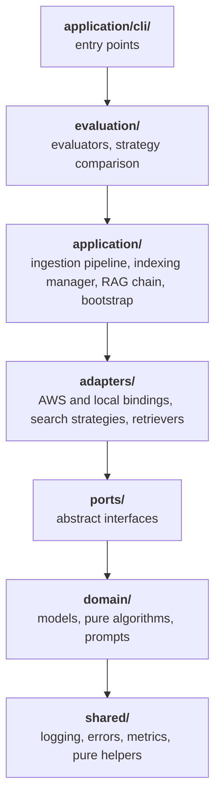

# Design: architecture, domain model, configuration, testing and CI

Part of the [design reference](../design.md), which lists every section. Code cites
the section numbers: they never change.

## 2. Hexagonal Architecture (Ports & Adapters)

### 2.1 Dependency Rule and Layer Map

Imports point **inward**. The layers, outermost first; a module imports its
own layer and the layers after it, never one before it:

| Layer | Package | Role |
|---|---|---|
| Entry points | `application/cli/` | the console scripts: parse flags, load config, wire, run |
| Evaluation | `evaluation/` | drives the RAG chain over a dataset; of the application it imports only the chain (`application/retrieval/`) and the composition root (`application/bootstrap.py`) |
| Application | `application/` | orchestration: ingestion pipeline, indexing manager, RAG chain, prompt tuner, config loading, composition root |
| Adapters | `adapters/` | technology bindings and port implementations |
| Ports | `ports/` | the interfaces the application wires and the adapters implement |
| Domain | `domain/` | models, pure algorithms, prompts |
| Shared kernel | `shared/` | logging, errors, metrics, tracing hooks, write fence, pure helpers |

The rule holds for every import: at module level, inside a function, and
under `TYPE_CHECKING` (a type-only import is still a dependency). Inside the
package the root facade is imported only for `__version__`.



An arrow reads "may import"; a layer may also import every layer further
down (the application imports the domain directly, every layer the kernel).

- **Ports sit outside the domain.** A port is written in terms of the domain
  models (`DocStatusPort.diff` returns a `DocumentDelta`), so the domain
  cannot import it back. Domain code that reads a store declares the subset
  it reads as its own `Protocol` (`domain.ingestion.delta_detector.
  DocStatusReader`, the read half of `DocStatusPort`); every port
  implementation satisfies it structurally, mypy checks each caller, and
  `tests/unit/test_fake_port_signatures.py` pins the two shapes together.
  The application hands the port in.
- **`shared/` is a leaf kernel.** It imports no other layer, so every layer,
  the domain included, uses it without a cycle. Code that needs the domain
  models lives in the layer it belongs to: config loading in
  `application/config.py`, the stage cache and resume managers in
  `application/ingestion/`, stage cache keys and document identity in
  `domain/ingestion/`, store names in `domain/retrieval/`, the LangChain
  helpers in `adapters/llm/langchain.py` and
  `adapters/ingestion/document_converter.py`, the rich console helpers in
  `application/cli/display.py`. `setup_logging` takes the configuration
  structurally (`shared.logging.HasLoggingSettings`).
- **Evaluation reaches the stores through the chain** (its retrievers,
  `GraphRAGChain.check_filter_values` / `check_filter_keys`) and imports no
  store adapter.
- **Backends are injected.** Vendor bindings (`adapters/aws/`,
  `adapters/local/`) and port implementations (the `storage/` indexers,
  `retrievers/`, `doc_status/`, `guardrail/`) are built by the provider
  builders and the composition roots: `application/bootstrap.py`
  (`build_providers`, `build_query_guard`, `build_checkpoint_sync`) and the
  CLIs. The orchestrators receive them (`Providers`, those builders, or a
  constructor argument).
- **Plugins through their registry.** Outside its package, a renderer,
  search strategy, evaluator, schema source or seed source is reached
  through the package root only, or, for renderers and evaluators, also
  their `base` module (§2.4); `tests/unit/test_layering.py` (`_PLUGINS`)
  lists the importable modules. The search-strategy registry lives with the
  strategy bases it stores (`adapters/retrieval/strategy_registry.py`), as
  the provider and renderer registries live with what they register.

No `domain/` module may load LangChain, LangSmith, boto3/botocore, lxml,
opensearch-py or gremlin-python, even transitively, so `shared/utils/`
holds only dependency-light helpers; `tests/unit/test_domain_purity.py`
checks this in a clean interpreter.


```
unified_kg_rag/
├─ __init__.py         # public API facade: lazy re-exports of the supported names
├─ domain/              # technology-agnostic core (no boto3/LangChain/backend imports)
│  ├─ models/           #   Pydantic domain models
│  ├─ ingestion/        #   pure algorithms: delta_detector, graph_builder/resolver/analyzer,
│  │  │                 #   claim_resolver, contributions, derivation, cache_keys,
│  │  │                 #   document_identity, seed_graph, visualization_data (+ layout helpers),
│  │  │                 #   community_clustering (Leiden hierarchy, content-named communities),
│  │  │                 #   methodologies (methodology -> stages), summary_tree (RAPTOR clustering)
│  │  └─ merge/         #   cross-run merger
│  ├─ retrieval/        #   store_names, index_prefixes, hybrid_normalization,
│  │                    #   ppr (HippoRAG 2 Personalized PageRank, §6.4), abstention
│  └─ prompts/          #   version-controlled prompt templates
├─ ports/               # interfaces the application wires, adapters implement (DocStatusPort,
│                       #   BaseIndexer/GraphIndexer/VectorIndexer, ModelFactoryPort,
│                       #   ContentGuardPort — ports/__init__ is the port catalog)
├─ adapters/            # concrete technology bindings
│  ├─ aws/              #   Bedrock model factories, Neptune/OpenSearch clients, S3 transfer and caches
│  ├─ local/            #   Ollama/OpenAI-compatible models, cross-encoder, embedded SQLite graph/search stores
│  ├─ llm/              #   provider-neutral chain assembly, transient retry, token estimate,
│  │                    #   LangChain batch/XML helpers (langchain.py)
│  ├─ observability/    #   OpenTelemetry tracer, exporters, LangChain callback
│  ├─ storage/          #   Neptune/OpenSearch/SQLite-graph indexers (write-side port implementations)
│  ├─ retrievers/       #   Neptune/OpenSearch/SQLite-graph retrievers
│  ├─ graph_query/      #   structured-query compilers (Gremlin, SQL) and their static checkers
│  ├─ doc_status/       #   DynamoDB/SQLite document-status registries (DocStatusPort)
│  ├─ guardrail/        #   Bedrock ApplyGuardrail (ContentGuardPort)
│  ├─ search_strategies/#   simple/local/global/drift + lightrag(mix/hybrid/naive) + ppr
│  │                    #   + tree + structured + iterative (wraps mix or local)
│  ├─ retrieval/        #   abstract retriever/strategy bases, strategy_registry, hybrid scorer,
│  │                    #   token/memory managers, ppr_ranking (PageRank over the stores)
│  ├─ ingestion/        #   LLM/IO coupled: chunker, *_extractor, loader, parser,
│  │                    #   translator, gleaner, community_detector, document_converter,
│  │                    #   tree_summarizer (RAPTOR summaries)
│  ├─ renderers/        #   graph visualization renderers
│  ├─ schema_sources/   #   @register_schema_source: extraction-schema loaders (file, owl)
│  ├─ seed_sources/     #   @register_seed_source: seed graph loaders (jsonl, csv, rdf)
│  ├─ source_files/     #   shared readers of a source's files: local/S3 locations, RDF files, checks, parse
│  ├─ evaluators/       #   evaluator bases + the ragas evaluator
│  ├─ store_errors.py   #   is_fatal_retrieval_error: the fatal-vs-degraded policy (§8.1)
│  ├─ providers.py      #   Providers: the per-run bundle of model and store providers
│  └─ provider_registry.py # @register_provider: builders keyed by role and kind
├─ application/         # orchestration + entry points
│  ├─ cli/              #   run-ingestion/rag/eval/visualization/prompt-tuning/describe,
│  │                    #   prepare-benchmark, run-mcp-server (mcp_tools, mcp_server: §8.4),
│  │                    #   run-console + console/ (the web console's server, jobs, APIs: §10.1),
│  │                    #   display (rich console helpers)
│  ├─ ingestion/        #   DataIngestionPipeline + pipeline_stages, IncrementalIndexer,
│  │                    #   namespace lease, extraction-record store, stage cache
│  │                    #   (cache_manager), resume (pipeline_manager; the resume
│  │                    #   point and rewinds in resume) and run metrics
│  │                    #   (pipeline_metrics), the summary-tree stage (summary_tree_stage)
│  ├─ storage/          #   IndexingManager (indexer fan-out) and its collaborators:
│  │                    #   cross_run_merge, removal, reannotation, stored_items;
│  │                    #   inspection (describe_namespace, export_graph: run-describe)
│  ├─ retrieval/        #   rag_chain (GraphRAGChain, RAGInput/Output), its query
│  │                    #   processing (query_processing) and filter-key checks
│  │                    #   (filter_validation), methodology_check (what a namespace holds),
│  │                    #   graph_lookup (the MCP tools' read-only store reads)
│  ├─ prompts/          #   PromptTuner (LLM-based corpus profiling)
│  ├─ bootstrap.py      #   the composition root: build_providers, build_query_guard,
│  │                    #   build_checkpoint_sync, resolve_extraction_schema,
│  │                    #   load_seed_graphs
│  ├─ config.py         #   get_config / ConfigLoader: file + environment -> Config
│  └─ observability.py  #   configure_observability: installs the tracing backend
├─ shared/              # leaf kernel (logging, exceptions, metrics, observability hooks,
│                       #   write fence, utils/: hashing, ids, concurrency, scripts)
└─ evaluation/          # real logic package: evaluation_manager / graph_aware /
                        #   retrieval / answer_match / assertion, strategy comparison +
                        #   pairwise judge, closed_book, benchmarks/ (MuSiQue, autoq)
```

- **Real logic package.** `evaluation/` (the manager and the LLM-free
  evaluators) is a layer of its own (above). Everything else is imported
  from its real location (`application.*`, `adapters.*`, `domain.*`).
- **Vendor and role packages.** Vendor packages (`adapters/aws/`,
  `adapters/local/`) hold technology bindings (clients, embedded engines and
  stores, model factories, token counters, caches); role packages
  (`storage/`, `retrievers/`, `doc_status/`, `guardrail/`) hold the port
  implementations the application wires. A role package imports a vendor
  package, never the reverse: `SQLiteGraphIndexer` writes to
  `SQLiteGraphStore` as `NeptuneIndexer` writes through `NeptuneClient`. Of
  the adapters, a vendor package imports only the other vendor package and
  the vendor-neutral kernel (`adapters/llm/`, `adapters/observability/`),
  which imports no other adapter package.

### 2.2 Ports (Abstract Interfaces)

| Port | Location | Adapters | Notes |
|---|---|---|---|
| `DocStatusPort` | `ports/doc_status.py` | `adapters/doc_status/dynamodb.py`, `sqlite.py`; `FakeDocStatusStore` for tests | Document status and each document's text units, partitioned by index namespace; the domain's delta reads its `DocStatusReader` subset |
| `ContentGuardPort` | `ports/guardrail.py` (with `GuardVerdict`) | `adapters/guardrail/bedrock.py` (Bedrock `ApplyGuardrail`) | Screens the raw query and the final answer (§14) |
| `GraphIndexer` (write) | `ports/indexer.py` | `adapters/storage/neptune_indexer.py`; local `sqlite_graph_indexer.py` | One contract for full builds and deltas (`upsert_*` / `delete_by_id`) |
| `VectorIndexer` (write) | `ports/indexer.py` | `adapters/storage/opensearch_indexer.py` (on OpenSearch, or on the embedded engine through `SearchEngineClient`) | Same |
| `BaseGraphRAGRetriever` (read) | `adapters/retrieval/base.py` | `adapters/retrievers/{neptune,opensearch,sqlite_graph}_retriever.py` | Retrieval adapters |
| `GraphQueryPort` (read) | `ports/graph_query.py` (`Protocol`) | `adapters/retrievers/{neptune,sqlite_graph}_retriever.py`; `FakeGraphQueryRetriever` for tests | Structured queries over one suffix's graph (§6.6) |
| Model factories, token counter | `ports/model_factory.py` (`ModelFactoryPort`, `TokenCounterPort`, the `*ModelInfo` records) | `adapters/aws/bedrock.py`, `bedrock_models.py`, `token_counter.py`; local `adapters/local/{models,embeddings,rerank,token_counter}.py` | Carried by one `Providers` bundle (§15) |

The read-side bases (`BaseGraphRAGRetriever`, `BaseSearchStrategy`) and
`BaseGraphRAGEvaluator` are *adapter bases*: they build infrastructure
(scorer, token manager) in `__init__`, so they live in `adapters/` and
`ports/__init__` only names them.

### 2.3 Role-Based Retriever Injection

Strategies receive retrievers **by role, not by backend**:
`RetrieverRole.GRAPH` (graph expansion) and `RetrieverRole.DOCUMENT`
(vector and lexical lookup). They reach them only through
`self.graph_retriever` / `self.document_retriever`, and the chain's role →
builder map binds the implementation, so swapping the graph backend changes
no strategy code.

```python
# adapters/retrieval/strategy_registry.py
@register_strategy(SearchStrategy.LOCAL, required_roles=(RetrieverRole.DOCUMENT, RetrieverRole.GRAPH))
class LocalSearchStrategy(BaseSearchStrategy): ...
```

The write path has two fixed store roles: `IndexingManager` always writes a
graph store and a vector store, because the fan-out (entities to both stores,
entities before edges, the orphan-edge cascade) is domain knowledge; which
backend fills each role is open (`providers.graph.kind` /
`providers.vector.kind`, or an injected indexer).

Caller filters are one backend-neutral form for every role and backend
(`domain/retrieval/filters.py`): a field catalog says which keys each
store's items hold (`ITEM_FILTER_FIELDS` per index kind,
`GRAPH_ENTITY_FILTER_FIELDS` for entity vertices) and how a filter on each
matches (`FieldKind`: keyword, exact name, typed, `source_kinds`, a
document's metadata, an item's own attribute; analyzed text and unindexed
paths are refused), and `parse_filters` turns `SearchQuery.filters` into
clauses (`Term`, `Range`, `KindsRule`, `AnyOf`). Three compilers render
them, each refusing a clause its store cannot apply: the OpenSearch query
DSL (`opensearch_filter_clauses`, OpenSearch and the embedded engine),
Gremlin steps (`gremlin_vertex_filters`, `gremlin_kinds` for vertices and
edges) and the SQLite graph's predicate (`vertex_filter`). Each retriever
first drops the keys its stores do not declare; the strategies check a
graph walk against the entities index for the keys a graph does not hold
(`_graph_unapplied_filters`). `tests/integration/test_filter_conformance.py`
states each filter's answer once and runs it on all four store families.

### 2.4 Registries

- **Search strategies**: `@register_strategy(...)`
  (`adapters/retrieval/strategy_registry.py`): a class, its required roles and
  query inputs, keyed by `SearchStrategy`; a wrapper (`iterative`) names the
  strategy it runs under a config (`wraps`, §6.3), and a strategy that reads
  less than its methodology requires names the index artifacts it reads
  (`required_artifacts`, §4.6).
- **Providers**: `@register_provider(ProviderRole.X, "kind")`
  (`adapters/provider_registry.py`): the builder `providers.<role>.kind`
  selects, for every model, store and registry role.
- **Renderers**: `@register_renderer("name")` (`adapters/renderers/base.py`);
  **parsers**: `ParserFactory.register_loader(".ext", Loader)`.
- **Schema sources**: `@register_schema_source("kind")`
  (`adapters/schema_sources/registry.py`): the loader
  `processing.graph_extraction.schema_source.kind` selects (§12).
- **Seed sources**: `@register_seed_source("kind")`
  (`adapters/seed_sources/registry.py`): the loader each
  `processing.seed_graphs[].kind` selects (§4.5).
- **Evaluators**: one lazy-import branch per `EvaluatorType` in
  `EvaluationManager._resolve_evaluator_class`.

### 2.5 Dependency Rule Verification and Public API

`tests/unit/test_layering.py` enforces §2.1 on every import of every
module (lazy and `TYPE_CHECKING` ones included, relative ones resolved):
the layer order, evaluation's reach into the application, injected
backends (also inside the adapters: the search strategies, the retrieval
kernel and the ingestion adapters import none), store-free evaluation,
vendor packages as leaves, plugins through their registries,
and the root facade imported only for `__version__`. Importing `pkg.mod`
runs `pkg/__init__.py`, so the imports a package's `__init__` makes count
for every module that imports from the package; outside the facade and the
console-script launcher, a package module is never imported by a name
string (`importlib.import_module`, `__import__`, `pkgutil.resolve_name`,
`importlib.util.find_spec`, also under an alias, through `getattr` or with
`name=`), and a dynamic import of a name the scan cannot read (a variable,
a concatenation, a relative name), `exec` or
`importlib.util.spec_from_file_location` needs an entry saying what it
imports. Its list of allowed exceptions is empty, and each rule has
a synthetic case it must catch. A clean-interpreter check pins the runtime
side, which the scan of edges cannot see (an allowed adapter module passing
a backend on): importing any module of the application (the CLIs and the
composition root aside), evaluation, the search strategies, the retrieval
kernel or the ingestion adapters loads no vendor binding, port
implementation, gremlin-python or opensearch-py.
`tests/unit/test_domain_purity.py` checks the third-party side: no domain
module loads an infrastructure package, even transitively.

**Public API.** Callers outside the package import from `unified_kg_rag`,
whose `__all__` is the supported surface: the names for using the framework
(`Config`, `get_config`, `DataIngestionPipeline`, `GraphRAGChain`, `RAGInput`
/ `RAGOutput` / `SearchOutput`, `EvaluationManager`, ...) and for extending it
(the ports, `Providers` / `build_providers`, the registries). Other module
paths are internal; only a change to the exported names, configuration keys,
CLI flags and exit codes, or stored formats is breaking. Names resolve on
first access (`import unified_kg_rag` loads nothing), and
`tests/unit/test_public_api.py` pins the list.

---

## 3. Domain Model

`domain/models/` holds pure Pydantic models with no infrastructure
dependency:

- `Entity` (`name`, `description`, `type`, `text_unit_ids`, `community_ids`,
  `rank`, `confidence`, embedding fields, the schema annotations
  `in_schema` / `type_iri`, the stated `iri` and the derived
  `source_kinds`), `Relationship` (`source_id` / `target_id`,
  `description`, `weight`, `text_unit_ids`, `in_schema` / `predicate_iri`,
  `source_kinds`; §4.2, §4.5),
  `Community` / `CommunityReport`, `TextUnit`, `Covariate` (claim);
- `DocStatus` (a `PENDING` write-ahead record, then `PROCESSED` / `FAILED` /
  `QUARANTINED`), `DocStatusRecord` (content hash, the document's text units,
  suffix), `DocumentDelta` (new / changed / unchanged / deleted, plus failed,
  quarantined, quarantined-unchanged, deferred and settings-changed ids),
  `DocumentLineage` (the text units one document produced);
- `SearchQuery` / `SearchResult` / `RetrievalResult`, `SearchStrategy` /
  `SearchType` / `RetrieverRole`;
- `SeedGraph` / `SeedNode` / `SeedEdge` (`seed_graph.py`): what a seed source
  reads, before conversion (§4.5).

**Lineage is the core data.** Entities and relationships record the
`text_unit_ids` they were stated in. This lineage, not a token-overlap
heuristic, decides whether an entity relates to a text unit, in any
language, and incremental removal follows it (§5).

**Rank (MS GraphRAG parity).** An entity's `rank` is its degree, a
relationship's the sum of its endpoints' degrees (`domain/ingestion/graph_rank.py`).
A full build sets them; an incremental merge recomputes them for what it
writes over the stored graph's neighbours. Only document-backed edges
count: an edge every text unit of which is a seed graph's adds to no
degree (§4.5), so with no seed graph the rank is the plain degree.

**Index suffix.** Every OpenSearch index and Neptune label is named
`<prefix>-<suffix>[-<additional_suffix>]`: ingestion writes
`processing.document_parsing.index_value`, queries select `RAGInput.suffix`
(`run-rag` / `run-eval`: `--suffix`, else the config's `index_value`), all
`default` when unset; one suffix per tenant or corpus version.

**Display names and identity keys.**

- `Entity.name` keeps the display form the source used, only trimmed and
  whitespace-collapsed (`clean_display_name`), so context and reports quote
  "$1,000 penalty" or "C++" verbatim.
- Ids hash `entity_key(name)` (`shared/utils/common.py`): NFKC, casefold, `_`
  and `-` as spaces, quote marks and commas dropped, whitespace collapsed,
  trailing sentence punctuation stripped, **every other symbol and the
  letters and digits of all scripts kept**. "ACME  Corp." and "Acme Corp"
  share an id; "C++" and "C#" do not; a non-empty name never yields an empty
  key. Every exact-name match (extraction, gleaning, claim resolution,
  incremental merges) and the fuzzy matcher's shingles use the same key.
- **Changing the key changes every id**, so it requires a full re-index.

---

## 12. Configuration System

The configuration is one nested Pydantic tree (`domain/models/config/`, one
module per section, root `Config`) loaded by `application/config.py`
(`get_config`).
[docs/reference/configuration.md](../reference/configuration.md) is generated from it by
`scripts/gen_config_reference.py`, and `tests/unit/test_config_reference.py`
fails when it is stale; `config-template.yaml` is a short starting file with
the keys most deployments set (`tests/unit/test_config_template_defaults.py`
checks that its values are the defaults and each key is in the reference).
[docs/reference/cli.md](../reference/cli.md) is generated the same way from the CLI parsers
(`scripts/gen_cli_reference.py`, `tests/unit/test_cli_reference.py`).

- **Loading** (`Config.as_input`). The config is validated once from its
  layers: defaults < `backend` preset < file < environment. `UKR__<SECTION>__<KEY>`
  sets any key, resolved against the model tree (no variable table to keep in
  step); `AWS_PROFILE` / `AWS_REGION` fill only keys the file leaves unset. Unknown keys fail the
  load unless `allow_unknown_keys`, a moved key (`MOVED_KEYS`) fails
  naming its replacement, and a removed key (`REMOVED_KEYS`) logs a warning
  and is ignored. `Config` keeps the input it was validated from, so
  `with_provider_overrides` (the CLI provider flags) rebuilds from it plus
  every later change, and switching `--backend` drops only what the old preset
  filled in.
- **Model selection** (`ModelsConfig`). One `models` section names every
  model: the two tiers, per-role overrides (`ModelRole`), the embedding model
  with its dimension and the rerank model. Each family's provider stays
  `providers.<family>.kind`, and `Config._check_models` validates the ids
  against it. Values stay as written and resolve on read (`Config.model_id`,
  `embedding_model_id`, `rerank_model_id`); a setting of a provider the config
  does not select is reported at load.
- **Stage cache keys** (`domain/ingestion/cache_keys.py`). `CONFIG_KEYING`
  classifies every field: keyed from the first stage whose output it shapes,
  or unkeyed with the reason. A stage's key hashes the keyed fields in effect
  for it and every upstream stage (a disabled block contributes its switch
  alone), the package version and the corpus manifest. An unclassified field
  keys every stage (a miss, never a stale hit), and
  `tests/unit/test_cache_key_coverage.py` fails until it is classified. The
  same table decides what the `run-eval` manifest's `retrieval_config_sha256`
  hashes (`answer_settings`): every field except the unkeyed ones marked
  `shapes_answers=False` (call routing, throughput, telemetry, provisioning,
  cache storage) and a few location fields (corpus and registry paths, the
  table name, the guardrail id).
- **Extraction settings.** The keyed fields marked `per_document` form a
  document's extraction settings: their fingerprint is recorded on each
  committed document and the settings once per registry scope, compared field
  by field on the next run (a setting a release adds is no change while it
  holds its default). A field added to a keyed section whose default keeps
  the earlier behaviour is listed in `_KEYED_ONCE_SET`: it counts for no key
  until set otherwise, so an upgrade re-keys no stage cache or extraction
  record. The description summary settings key graph resolution and are
  no extraction setting (`per_document=False`: they summarize merged
  descriptions, in no unit's record, and a summary records them in
  `summarized_with`). A unit record's key holds them as the default
  configuration has them (`_summary_key`, the same whatever the run's
  `models` tiers), and a unit without a record under it is looked up under
  the keys earlier `main` builds stored it under too (no release stored
  the extraction store; `legacy_unit_record_fingerprints`: them at their
  defaults resolved through the run's tiers, and at the run's values, the
  key of a record stored while they keyed graph extraction):
  `ExtractionStore.load` stores a record found there under the current
  key, the one its unit names. `changed_settings` ignores them in a
  scope's earlier record. So stored records are found, documents read as
  unchanged, and a summary change asks no unit again. The lookup is
  kept until the first release after 0.2.3 and removed in it.
  The schema keys count as extraction sees them
  (`cache_keys._as_extracted`): a type by its label and description (a
  string item as written, a mapping as the string that reads back the
  same), a pattern by its relation and ends, `schema_mode` only where
  `SchemaConformance.applies` would differ, never an IRI. What only
  indexing reads of the schema (the IRIs, `off` against `align` with entity
  types alone) is the annotation digest (`SchemaAnnotator.digest`), keyed
  into the indexing stage. The registry records it once per index
  namespace (`DocStatusPort.get/put_annotation_digest`), not per scope:
  a pass rewrites every scope's items, so a per-scope record misses a
  schema reverted on one scope after another scope's pass. Before its
  first store write, an incremental run whose digest differs from the
  record sets it to `REANNOTATING_DIGEST` (`incremental.annotations_due`),
  rewrites the namespace's annotations without extracting
  (`reannotate_on_schema_change` → `IndexingManager.reannotate`) and
  records its digest only once the pass completed, so a pass that stopped
  is made again by the next run under any schema. A namespace without a
  record is unknown (one pass), unless the registry held none of its
  documents before the run and neither store holds an item of the suffix
  (`holds_any_item`, one bounded read each; recorded without reading): a
  lost or replaced registry is no proof the stores are empty. A reset marks its
  namespaces before the rebuild and records its digest when every item
  was written (`record_rebuilt_annotations`). Adding a section: §15.
- **Extraction schema** (`domain/models/schema.py`). The entity and
  relationship types and the allowed patterns live inline in
  `processing.graph_extraction` (`entity_types`, `relationship_types`,
  `relationship_patterns`, `schema_mode`), read as one frozen
  `ExtractionSchema` (types with an optional ontology `iri`, patterns, mode,
  a content `digest`). Labels compare by `schema_key` (NFKC, each run of
  whitespace and `_` one `_`, case-folded and normalized again, so a key is
  its own key) and nothing looser: no synonyms, plurals or edit distance. `schema_source` names where the schema comes
  from: `inline`, or a registered source (`file`, `owl`) that
  `application/bootstrap.resolve_extraction_schema` loads once at start-up
  (`DataIngestionPipeline`, `EvaluationManager`, `PromptTuner`) into the
  inline keys of a config copy, whose source is then `inline`.
  `GraphExtractionConfig.extraction_schema()` raises `ConfigurationError`
  on a config whose source is not loaded yet, so a component built straight
  from one (an `IndexingManager`, an extractor) fails instead of reading
  the default schema. The extractor, the prompts
  and the cache keys read only the inline keys, so the loaded content is
  keyed and its location (`schema_source.path`) is not: a moved file
  re-extracts nothing, an edited one re-extracts. The extractor and the
  gleaner apply it through `domain/ingestion/schema_conformance.py`
  (`SchemaConformance`, built by `BaseProcessor`): it applies in `strict`,
  and in `align` once relationship types are declared (entity types alone
  only shape the prompt, so configs from before the schema keys keep their
  records). An in-schema label is written as declared when parsed, before
  the ids are built; `conform` then checks each unit's statements after
  grounding and the confidence threshold, where `strict` drops off-schema
  entities (rejection `off_schema`, lifted by an in-schema statement of the
  same entity) with their relationships, off-schema relationship types, and
  relationships a pattern of their type disallows between two endpoints the
  unit types with declared types. The check is per unit and order-free, so
  incremental runs converge with a full build; its drops are not failures.
  Indexing then stores, from the same schema, whether each merged item's
  type is declared (where the schema applies) and its type's IRI (whenever
  one is declared and the mode is not `off`; §4.2, "Schema annotations"); the
  filter catalog (`domain/retrieval/filters.py`) declares `in_schema`
  and `type_iri` on entities and Neptune entity vertices and `in_schema` and
  `predicate_iri` on relationships, but no `type` on relationships, which
  would empty that index under `mix` and `hybrid`. `GraphRAGChain` refuses a
  filter on an annotation the configured schema writes on no item
  (`SchemaAnnotator.fields`), which could only empty the streams reading it,
  and the OpenSearch retriever probes the annotation keys as it probes
  `attr_*` keys, so an index that does not map them matches no value of
  them instead of failing the kNN filter.

---

## 13. Testing Strategy

Tests (`tests/{unit,integration,property,fixtures/fakes}/`) run **without AWS
by default**.

- **Port-based fakes** (`tests/fixtures/fakes/`) implement the stores and the
  registry in memory; `moto` covers the DynamoDB and S3 adapters.
- **Property tests** (hypothesis) cover merge laws, incremental-versus-full
  convergence (under a `strict` extraction schema too, on the fakes and on
  the embedded SQLite stores, and for two namespaces sharing one store),
  interrupted runs,
  fusion monotonicity, MinHash and token-estimate equivalence, and the
  extraction schema (`strict` keeps a subset of `align`, the per-unit check
  is idempotent and order-free, `schema_key` is its own key); `tests/integration/test_doc_status_conformance.py` checks the
  `DocStatusPort.diff` partition against every registry.
- **Store conformance suites**
  (`tests/integration/test_{graph_store,vector_store,retrieval}_conformance.py`)
  write each store contract once and run it on every backend through the
  `StoreHarness` (`tests/fixtures/store_backends.py`): the fakes, the embedded
  SQLite stores, the `docker/compose.local.yaml` containers (`LOCAL_STORES=1`)
  and Neptune and OpenSearch Service (`-m aws`); `test_store_parity.py`
  checks that SQLite and an OpenSearch container rank a synthetic corpus alike
  (same lexical and hybrid top 10, kNN recall@10 ≥ 0.98).
- **End to end**: `test_embedded_e2e.py` ingests, updates incrementally and
  asks every strategy on each store backend (SQLite; the containers in the
  CI `local-stores` job); `test_ingestion_crash.py` SIGKILLs an ingestion
  process mid-indexing and checks the lease takeover and the converged
  rerun; `test_local_quickstart.py` runs the bash blocks of
  `docs/getting-started/local.md` as written against a fake Ollama.
- **Markers**: `unit`, `integration`, `property`, `aws` (real AWS, excluded in
  CI), `slow`, `perf` and `weekly` (both deselected by default and run by the
  weekly workflows). Run `uv run pytest --cov=unified_kg_rag`.

---

## 14. CI/CD and Security

- **CI** (`.github/workflows/`): `quality` gates pull requests and pushes to
  `main` (lint, types, tests with the coverage floor, the image build, the IaC
  synth with cdk-nag), `licenses` checks dependency licenses, `security` runs
  an ASH scan that fails on an unsuppressed finding at MEDIUM or above
  (configuration and path-scoped suppressions in `.ash/.ash.yaml`), and the
  weekly `fidelity` runs the parity tests against the original HippoRAG 2,
  RAPTOR and BenchmarkQED at pinned commits and versions; the local
  checks are in [CONTRIBUTING.md](../../CONTRIBUTING.md#checks-to-run-before-pushing).
- **Dependabot** updates the `uv` locks (root and `iac/`) and the SHA-pinned
  Actions weekly, 7 days after a release at the earliest (security updates
  at once); known-breaking bumps are held back with a recorded reason.
- **Hardening.** Content hashes use SHA-256 only; credentials come from the
  environment, never from code.
- **Guardrail at the query's edges** (`ports/guardrail.py`,
  `adapters/guardrail/bedrock.py`). `GraphRAGChain` screens the raw query
  (source `INPUT`) before memory, routing and retrieval, and the final answer
  (`OUTPUT`) after generation; a block short-circuits, a mask replaces the
  text, and a guardrail error fails the query closed. The model calls in
  between run unguarded: an attached guardrail judges the whole prompt, so on
  Converse it treats the retrieved corpus and the instructions as user input
  (false prompt-attack blocks, cost of context times calls), and on
  InvokeModel its prompt-attack filter is inert without input tags. Ingestion
  and evaluation models are never guarded. The opt-in contextual grounding
  check rides on the answer's check: the chain hands the guard a
  `GroundingContext` (the standalone question and the context string the
  answer prompt carried, plus its sections by priority) and the adapter
  sends it as `grounding_source` / `query` blocks, cut to Bedrock's limits
  by rank, with the answer first so a masked reply's first output is the
  answer.

---
