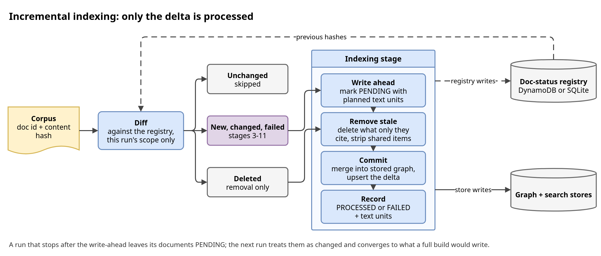

# Design: incremental indexing

Part of the [design reference](../design.md), which lists every section. Code cites
the section numbers: they never change.

## 5. Incremental Indexing

With the doc-status registry on, a run diffs the corpus against the registry
by content hash and processes only new, changed and failed documents. The
registry lists each document's text units, and removal asks the stores what
cites them. A write-ahead protocol lets the next run repair any
interruption, and the result converges to a full build of the current corpus.
How to use it: [Incremental indexing](../guides/incremental.md).

### 5.1 The steps

Names are `IncrementalIndexer` methods (`application/ingestion/incremental.py`)
unless noted.

1. **Delta detection** (`domain/ingestion/delta_detector.py`).
   `DocStatusPort.diff(incoming, scope)` classifies documents as new, changed,
   unchanged or deleted by content hash. A `doc_id` is
   `<namespace>#<hash of namespace, source scope and relative path>`, and the
   namespace is the registry partition, so a run reads only its namespace (one
   projected DynamoDB `Query`) and two corpora or tenants never share a record.
   Only records of the run's scope are deletion candidates; files that failed
   to parse or load are reported `failed`, not deleted. A moved corpus's old
   records are never adopted (a move cannot be told from another host's corpus
   on the same path) until a run retires the old scope
   (`indexing.retire_source_scopes`). Documents whose processing keeps killing
   the run are quarantined or deferred (§5.3). A seed graph's shards are
   documents of the run's scope; one only an extraction setting changed
   for reads unchanged (§4.5). A record also holds its file's *source
   digest* (the file's bytes and the parser that read them:
   `application/ingestion/source_parsing.py`), so the parsing stage parses
   only the files whose digest is not their PROCESSED record's; for the
   others an unparsed document carries the record's content hash into the
   diff, and one the run processes after all (other extraction settings) is
   parsed before its attempt opens. A reset, deduplication or an export of
   the parsed documents parses every file. Files parse in-process until the
   rest is expected to take longer than starting a process pool (timed per
   file type), then in one.
2. **Write-ahead** (`write_ahead`). Before any store write, every new and
   changed document is recorded `PENDING` (content hash `"pending"`, which no
   document hashes to) with the union of its stored text units and the ones
   this run will write, in one batched write. A record over the registry's
   item limit (DynamoDB 400 KB, about 10,000 text units) fails the run here,
   before anything is written.
3. **Stale cleanup** (`remove_changed_and_deleted`). The text units of changed
   and deleted documents are removed in one pass per suffix (step 5), so an
   artifact only they state goes too. Deleted documents are first recorded
   `PENDING`, so one restored before its removal finished reads changed.
4. **Delta upsert** (`commit`). The stored entities and relationships the
   delta touches (found by compact name key, every stored name with fuzzy
   matching on) and the stored edges of its entities are read back, the delta
   is merged into them and their content derived from the extraction records
   (§5.4); delta claims merge with the stored claims of the same id. Neptune
   writes with an idempotent `coalesce(unfold, addV)` upsert, OpenSearch by id
   into the live alias index; old ids of re-keyed items are deleted only after
   the writes succeeded. A stored edge rewritten for its rank alone (an
   endpoint's degree changed) has its rank set in place, in batches of one
   rank (`GraphIndexer.update_relationship_ranks`), as its vector copy is. Before the first write the commit notes the
   entities it splits, re-keys or rewires in one record of the suffix's
   extraction store (`pending-commit`), deleted once the old ids are: those
   decisions live in memory only, and the next commit of the suffix derives
   the noted entities, their stored edges and the claims about them again,
   so a killed commit's half-written split is finished. It also retires
   the noted entities' copies only the vector store holds, with the vector
   edges at them (the killed commit got to its vector writes only), and a
   run that only removes in the suffix reads the note all the same.
   The note also lists the old ids the commit retires (an item re-keyed to
   follow the spelling that now names it, an edge dropped). A commit whose
   write fails deletes only the old ids no failed write touches (neither
   the old id nor its new one failed, nor an edge at either; a dropped edge
   only in a suffix without a failure) and keeps the others (deleting one
   could lose its item), so a write that keeps failing holds back only the
   re-keys at it. The next commit reads the items still stored under the
   noted old ids with the noted entities and derives them again: the
   derivation re-keys or drops what a full build does not have, and those
   ids are deleted with its own.
   The stored edges a derivation reads at the entities it touches (a
   commit's or a removal's strip) are compared with both copies: their
   vector copies are read with the graph's (`read_vector_copies`, the
   `rank` too), and an edge whose vector rank differs from the derived one
   has its rank set in place in both stores (by a strip as by a commit:
   `update_relationship_ranks` in the graph). A commit writes the vector
   copies in its first phase and the graph copies in its second, a strip
   the graph copies first, so a run killed in between, or a commit whose
   graph write of an endpoint is rejected (its edges are held back), leaves
   the vector rank ahead or behind; compared with the graph copy alone, a
   later derivation that gave the graph copy's rank did not write the edge
   again, and the vector copy kept a rank no full build has. The next run
   derives those endpoints again: the killed commit's documents are not
   recorded, a killed strip's removal resumes, and a commit's rejected
   write is noted (`pending-writes`, below). A strip (item 5) is all or
   retry: it writes in phases, each after those it depends on (the claims
   under new ids, the stored claims; the new vertices, the stored entities
   gaining a unit, the graph edges, the vector edges, the vector entities
   and, last, the graph copies of the kept entities, by which a retry finds
   it), and the first phase with a rejected write stops it (the removal
   fails, retried by the next run). What it did not write keeps its stored
   copy, which cites the removed text units or is in the `pending-strip`
   note, so the retry derives it again, as after a run killed between two
   phases. Writing on past a rejection lost kept documents' items: a split's
   origin, or the claim a claim was split off, was overwritten while it held
   the rejected new item's lines, and a copy written stripped no longer led
   the retry to what the rejected write left. While a store keeps rejecting
   a write, the strip so strips nothing: the kept items state the removed
   text until the write succeeds.
   A stored edge a derivation would rewrite for its rank alone whose vector
   copy cites a text unit its graph copy does not (written to one store
   only) is left to the removal or the documents retried, which derive it
   from the records: rewritten from the copies, it kept the vector copy's
   description, removed text included, where the graph caps it.
   An item write a store rejects (an entity, relationship, claim, community
   or report; an edge held back for a rejected endpoint) does not fail the
   documents owning it: the commit notes the rejected items as written in
   the suffix's extraction store (`pending-writes`,
   `unified_kg_rag/application/storage/pending_writes.py`), and the next commit of the
   suffix, every run's, adds them to its delta, cut to the text units still
   stored that the delta does not write again (a retried document's own
   units: the delta states them itself). They merge with what is stored and are derived from their records
   like any delta item (summarized from their lines, not by extending a
   stored summary), and the endpoints of a noted edge are written with it, so
   their edges' ranks follow; an endpoint the graph no longer holds (a later
   removal re-keyed it to another spelling) is the stored entity of its
   name's key that the edge's text units state (the one citing most of
   them; one citing none, a spelling of another type, is not it, as a full
   build cites each endpoint's edges' units). The noted entities are held as
   stored ones are: a removal before the commit resolves the claims it
   derives against them too, and the commit derives the stored claims about
   them again (it may merge one into another spelling). The note is replaced
   by what still fails, or deleted. A commit over `max_failure_rate` notes
   its rejected items too, though it records no document: it wrote items of
   documents outside its delta (what its merge derived again), which retrying
   its own does not write again: removing an unrecorded document deleted a
   kept document's edge whose rejected write left it at an endpoint only the
   removed document states, and no run wrote it again. Recording the owners `FAILED` instead re-extracted every document
   a hub entity cites, on every run its write kept failing. A note that cannot
   be written falls back to that.
5. **Deletion propagation** (`IndexingManager.remove_text_units`). The stores
   are asked what cites the removed text units (`GraphIndexer.find_ids_citing`
   for entities, `VectorIndexer.find_documents`); edges are found among the
   cited entities' incident edges, and only a resumed removal (some removed
   text units already gone from the vector store, or a vector store that
   cannot tell) looks them up by text unit with
   `find_relationship_ids_citing`, on Neptune a scan of the suffix's edges.
   An item citing only removed text units is
   deleted from both stores, the vector copy first (a retry finds what to
   delete through the graph, so an interrupted run leaves a graph copy, not
   an orphaned vector copy); one citing others too is stripped of them, its
   weight recomputed and its content derived again from the text units left.
   A strip that merges or re-keys items (another spelling of a stripped
   entity's name, which need not cite the removed text units), or derives
   claims under new ids, notes before its first write the entities on both
   sides of the merge, the edges it re-keyed, re-pointed or dropped, the
   edges and claims under new ids (no copy of one cites a removed text unit:
   a strip stopped after an edge's graph copy left no vector copy to complete
   a description the graph caps) and the claims about a split's entities, in
   one record of the
   suffix's extraction store (`pending-strip`, with those of a note a retry
   finishes) and deletes it once their old ids are gone; every removal reads
   it, so a resumed one strips them again. The claims about the other stored
   spellings of a re-keyed, renamed or split entity's name are derived again
   too: one may resolve to it now.
   Before writing them, a strip also notes the items it summarized or wrote
   unsummarized (`stripped-summaries`, with those of a note a resumed run
   reads), whose stored summary the commit summarizes again from the lines
   rather than extending it; the note is deleted once a commit's writes
   succeed, so a run that dies between its removal and its commit still
   converges with a full build.
   A community or report goes once none of its text units is stored. A failed
   removal keeps the deleted documents' records for a retry and fails the
   stage before the commit: committed, the delta would overwrite a changed
   document's lineage, and merge into the kept items the failed strip left
   citing the removed text units (their stale counts dropped a new edge
   that no later run wrote again). The delta stays `PENDING` for the retry,
   so a deleted document whose removal keeps failing holds back new
   documents too.
6. **Registry update** (`commit`). The `PENDING` records are replaced, in one
   batched write, by `PROCESSED` or `FAILED` records with each document's text
   units, scope and relative path (the five causes of `FAILED`:
   [runbook](../operations.md#failed-documents)). The suffix's build record is
   written just before, so a run killed after the registry write leaves the
   record of what it built (the next run finds nothing to index and writes
   none). A record the store rejected (on any index) is written again after
   the registry write, and a run with nothing to index writes the record
   when the configured suffix has none: a full record of the build the
   stores hold, naming the artifacts they show (a non-empty index, a graph
   item, the tree's record; claims and relationship vectors with held text
   units and graph, which a corpus stating none leaves empty, but not the
   relationship vectors beside a stored edge, which a build that made them
   indexes) that the config builds, the documents the
   registry records and community counters started from the stored
   reports; later incremental records carry it as their `full_build`.
   `failure_count` counts
   consecutive failures of the same content; after
   `indexing.max_document_failures` the document reads unchanged. A run that
   stops before this step at a stage that failed on all of its units still
   records FAILED the documents whose units failed for an error of their own,
   so a document that always fails cannot block every later run. Only such
   errors count, here and at this commit: unparseable or cut-off output, and
   a request the model rejects for its content (the factory's
   `is_item_error`: a Bedrock `ValidationException`, HTTP 400/413/422, minus
   rejections of the model or a setting). Any other error (an outage,
   credentials, a quota, a setting, a bug) counts for none. When every unit
   sent fails and its own errors are of one cause (alike in type, code and
   HTTP status, not message; or all unparseable or cut-off output; a unit
   that failed otherwise, throttled say, is left out), output errors on the
   units of more than one document count as each document's own, once a
   run, with no known-good request: a server-side output cap cuts them all
   and a short request cannot tell, but a batch that always fails must not
   stop every run with its deletions (the trade-off: a cap that persists
   `indexing.max_document_failures` runs excludes them, until their content
   or the extraction settings change). Otherwise the stage sends one
   known-good request through the same chain, bypassing the LLM response
   cache: failed too (for output errors, unparseable counts as failed), the
   cause is the model or a setting and none counts; answered, the errors are
   the documents' own. Claim extraction's errors of a unit's own count for
   none: claims are optional, so a document whose other stages succeeded is
   indexed without those claims and recorded `FAILED` once, for the next run
   to extract them again from the stored records, then `PROCESSED` without
   them (`incremental.run_failures`). A failure that counts for none
   adds one to the record's `retry_count` instead (new content, a success
   or an error of its own resets it; a stop or death during extraction
   leaves it, one during indexing resets it once the `PENDING` records are
   written), and from the second the run warns (`documents_retrying`).
   What counts as unparseable or cut-off output: graph extraction output
   naming no entity with a section left unclosed (cut off without a stop
   reason) is cut off, not retried; with every section closed it is
   malformed and retried like unparseable output. Output cut later keeps
   the entities before the cut (WARNING `XML output ends with <entities>
   unclosed`). An answer the model corrects is parsed by its last complete
   answer, each section by its last closed occurrence (INFO `XML output
   repeats <entities>, ...`), and a JSON answer by its last object that
   parses. An OpenAI-compatible server's context-length rejection that
   counts the requested `max_tokens` is a setting. The response behind a
   failed graph or claim extraction check is logged at DEBUG. Extraction
   records only removed text units named are then deleted (best effort).

**Limitation:** shared communities and reports keep what a changed or deleted
document contributed, and a community a re-keyed entity's old id, until a
full rebuild (§5.5); descriptions, names, ids, types, filters, ranks and
claims are derived again on every run. A kept report's findings cite the
ids of records: a re-key points them at the new id before it deletes the
old one (the stored reports citing it are found by their flat
`findings_record_ids` keyword list, `VectorIndexer.repoint_report_findings`;
a report stored before that list keeps the old id), but a removal does not
strip them, so they may name records no longer stored. They are filtered where they are read: global and DRIFT
search read the cited records by id (§7.1) and a removed one names no text
unit, and a reported source of the report lists only each finding's ids,
not its text, which the report's content renders already.

### 5.2 Full rebuild (`indexing.reset`)

`indexing.reset` skips the diff and rebuilds the whole corpus with the
full-index path, without taking the suffix offline. Quarantined documents
(§5.3) are skipped and keep their records; every other document, and every
indexed one the corpus dropped, is recorded `PENDING`; the vector indices are written into new timestamped indices whose
aliases swap when each is built; the graph is rebuilt in place
(`GraphIndexer.begin_rebuild` tags every vertex and edge the build writes, and
`end_rebuild` drops the suffix's entities, communities and edges without the
tag). The writes upsert in place, so graph queries see previous and rebuilt
items mixed until that final drop. Only after every
document is recorded again are the namespace's other records deleted, so a
failed rebuild drops nothing. A rebuild whose graph writes partly failed
(within `indexing.max_failure_rate`) skips the drop, so a retry still finds the
previous copies, and is reported failed (`graph_sweep`) rather than recorded:
clearing the replaced documents' records would orphan their vertices and edges.

The corpus a reset rebuilds includes the run's configured seed graphs;
when another scope of the namespace holds seed graph shards, the run asks
before its first write (§4.5).

A generation switch (new labels plus a pointer) was rejected: Neptune labels
cannot be renamed, so every retriever would resolve the current generation on
each query and the graph would be stored twice during the rebuild.

**Unchanged text is not embedded again**, by a rebuild or a delta run. Each
vector field stores the digest of the text it embeds next to the vector
(`embedding_digests.<field>`), with the embedding provider, model, dimension
and (outside Bedrock) input cap hashed in. A write reads the stored digests
of its items, one search per write slice of 800 ids, from the alias's live
index: the one an upsert writes, or the one a rebuild is about to replace
(still the alias's target until the swap). It then reads only the vectors
whose digest is that of a text it writes, only those fields, 100 ids per
search and four searches in flight, and embeds the texts whose digest it
does not find. Reading every stored vector of a slice whose texts changed
held over 60 MB of response and parsed floats per search for vectors no
write took: rebuilding 2,000 reports at 1,024 dimensions with a third of the
texts changed peaked at 388 MiB, and peaks at 165 MiB this way. Reusing across a reset is safe because
the digest names the embedding settings: a reset after a model or dimension
change finds no matching digest (nor reads at all: the live index's `_meta`
records its model) and embeds everything. A vector an upsert replaced is
read as well (up to 2,048) and kept for a later write of its text (a
removal rewrites items the commit writes back); the commit, the run's last
write, and a rebuild read none (an upsert of 2,000 changed descriptions
reads 2,000 vector fields instead of 4,000). An index without the digest
field gets it with the other missing ones (§5.1) and its items are embedded
once more.
`--force-rebuild` embeds every text again.

### 5.3 Crash recovery (write-ahead protocol)

The registry is not updated atomically with the stores, so a run can stop
between any two writes. One invariant holds: **before the stores hold
anything the registry cannot account for, the registry already lists it.**
Write-ahead records precede every removal and upsert, deleted documents' rows
go only after their artifacts, and a `PENDING` record is replaced only after
the document's writes landed. The next run repairs an interrupted one:

- `PENDING` never equals a content hash, so a document still in the corpus
  reads changed, even if its file went back to the indexed version; one no
  longer in the corpus reads deleted, and its text units cover everything the
  interrupted run may have written.
- The removal plans from the record stored before the current run's own
  `PENDING` record, so a recovery run removes the partial writes first.
- An interruption is not counted toward `indexing.max_document_failures`
  (a `PENDING` record has `failure_count` 0).
- Old ids of re-keyed items are deleted only after their new copies are
  written, so an interruption leaves at worst both copies, which the retry
  derives together.

**Attempts and quarantine** (`domain/ingestion/attempts.py`). A document
whose processing kills the task would stop every later run the same way.

- **Open and close.** After the diff (and when a run resumes past
  document_loading) the run opens an attempt on every document it processes
  (`incremental.open_attempts`: `attempt_batch` = documents processed
  together, `attempted_hash`; a new document gets a `PENDING` record without
  text units) and closes them however the process ends: finished, failed,
  SIGTERM or Ctrl-C (`close_attempts`). An attempt still open on the next run
  is one more death of that content (`attempt_count`) in a batch of
  `attempt_batch` (`crash_batch`). A reset opens none (the write-ahead record
  keeps the stored attempt fields); a document that produces no text units in
  a committing run counts as a death alone.
- **Plan** (`plan_attempts`, at the diff). A changed document whose deaths
  reach `indexing.max_document_attempts` is a suspect; one whose last death
  was alone (`crash_batch` 1) is `quarantined`. Otherwise the run processes
  the first half (by doc id) of the suspects that died in the smallest batch
  and classifies every other new or changed document `deferred` (neither
  processed nor deleted). A death narrows the suspects to that half and a run
  that ends commits it, so one culprit among `n` is isolated in about
  `log2(n) + 1` runs and no document is quarantined for dying with it.
- **Quarantined record**: `QUARANTINED` with the attempted content hash, its
  deaths and the reason in `error_info`. When the attempts reached indexing
  (the record is the write-ahead `PENDING` one), the removal pass removes what
  they wrote and no text units are kept; otherwise the indexed version and its
  text units stay. It reads unchanged (`diff` lists it in
  `DocumentDelta.quarantined_unchanged`) until the content changes or the
  limit is raised above its deaths (`release_quarantined` then classifies it
  changed); deaths count per content, so new extraction settings quarantine
  it again, and a reset skips it too.
- **Resume check** (`delta_still_applies`). A resumed run whose restored
  delta names a document whose record is gone, holds other content, reached
  the limit or was written by another pipeline id since (`written_by`; a
  record without the field counts as another pipeline
  id's unless it is `PROCESSED` at the delta's content without an open
  attempt, and even then when
  it was committed under other extraction settings for a document the delta
  re-extracts for a settings change), or deletes a document another
  pipeline id (or a record without a writer) has recorded in another scope
  since, resumes from document_loading instead. So does one for whose
  scope another pipeline id has since added, changed or deleted a document
  outside the delta, and one whose `document_loading` inputs changed since
  the delta was computed (a reset, retry or corpus setting; WARNING
  `Rewinding resume point from ... to 'document_loading'`). A finished
  pipeline id run again counts as resumed; a run resumed after its own kill
  or stop keeps its delta. A resume past
  a stage that recorded failed text units starts at that stage, so the units
  are retried rather than recorded `FAILED` again; a reset resumed past the
  stages that store extraction records starts at the first whose records
  another run deleted. Metrics:
  `total_documents_quarantined` (CDK `DocumentsQuarantined` alarm) and
  `total_documents_deferred`.
- **Unread files and mass deletions.** The diff never deletes a file the
  run could not read: `failed_doc_ids` holds the files that failed to
  parse or load and those the parsing stage skipped because no loader
  reads their type (`PipelineContext.skipped_source_files`; otherwise an
  optional extra dropped from an image would read as the deletion of every
  such file). Skipped files are kept apart from failed ones only for the empty
  corpus rule: a seed-only scope with a stray unsupported file is still a
  seed-only run. Before its first write (`open_attempts`),
  `incremental._confirm_mass_deletion` asks the pipeline's
  `confirm_deletions` when the run's own deletions exceed
  `indexing.max_deletion_share` of `DocumentDelta.scope_documents` (the
  scope's records the diff read, counted by `detect_delta` before any
  document moves between the lists) in a scope of at least 10 documents.
  The retired scopes' records (`DocumentDelta.retired`) are left out: the
  run was told to delete them. So are seed graph shards, from both counts
  (`DocumentDelta.seed_deleted`, by the records' `is_seed_path`): the
  configuration removes them (a seed graph dropped or resharded), and a
  seed graph of many shards would dilute the share until a partial sync of
  most documents passed unasked. Its own input (`--confirm-deletions` /
  `UKR_CONFIRM_DELETIONS`) for the same reason as the reset's. A run with
  the registry off is not checked: the stores hold no per-document count
  to compare the corpus with (a port method on every backend for one
  check), and its empty-corpus case, the likeliest mistake, is already
  asked (`_confirm_seeds_alone` with seeds; without them an empty corpus
  fails the parsing stage). Metrics: `total_files_failed`,
  `total_files_skipped`, `total_documents_excluded`,
  `total_documents_deleted`.

The cost is one extra batched registry write per run (two more writes and
reads for the attempts) and a few batched store lookups per suffix.
`tests/unit/test_incremental_write_ahead.py` and
`tests/property/test_incremental_interruption_properties.py` interrupt a run at
every write and check that the next run converges to a fresh full build.

### 5.4 Identity, derived content and merge rules

- **Document identity** (`domain/ingestion/document_identity.py`). A document
  version's id hashes its path relative to the corpus root and its full text,
  so without the registry a corpus yields the same ids wherever it is checked
  out; an incremental run keys text units by the registry `doc_id`, which
  also holds the source scope (`document_parsing.source_scope`, else the
  resolved source directory), so each belongs to one record and the ids hold
  only from the same directory or with a fixed scope. Changing either rule
  requires a re-index.
- **Derived content** (`domain/ingestion/derivation.py`). The merge and the
  strip keep each touched item's structure (id, text units, per-unit
  weights); its content is then derived from the records of the text units it
  cites now, by the full build's own code (`merge_contributions`,
  `GraphResolver`, `ClaimResolver`), so the item gets what a full build of the
  current corpus gives it: a deleted document's text leaves shared
  descriptions and claims, names and types follow the current votes, and an
  entity whose derived name has another id takes that id
  (`Derived.id_remap`), its edges and claims following. An item citing a text
  unit without a stored record keeps its stored content (a WARNING and the
  indexing stage's `underived_items` metric).
- **Merges a full build undoes.** A stored entity may hold what a full build
  keeps apart (two spellings merged while their types agreed): every resolved
  entity sharing a name key and a text unit with it is derived, the best
  match under its id and each other as its own entity (`Derived.split_from`).
  The stored edges of a split or re-keyed entity are derived with it
  (`Derived.rewired`), so each follows the part that states it and a
  re-pointed edge merges with the derived edge it now equals. An edge a full
  build draws that no stored edge is (an earlier merge dropped it as a
  self-loop) is added; a stored edge whose endpoints now resolve to one
  entity is deleted with the retired ids (`Derived.dropped`), as is a delta
  id the cross-run merge folded into another (an interrupted run may have
  left its vector copy). Edges take the resolution's per-unit strengths, and
  claim statements merge in text-unit id order, as in a full build.
- **Cost.** Derivation runs only where something is stored (a first build
  writes the delta as graph resolution made it) and matches through a key
  index. A stored summary that only grew (the item still cites every text unit
  it did) is summarized from itself and the new description, as LightRAG
  merges into the stored one, and a stored description that is no summary is
  extended with the delta's summary when graph resolution made one (which
  would otherwise go unused). An item that lost a text unit is summarized from
  its derived description, so removed text goes, and so is an item this
  run's removal summarized; the removal leaves the summary of an item the
  delta derives again under its id to the commit (`expect_delta`), so an
  edited document's shared entity is summarized once, from its lines, as in a
  full build. A stored edge rewritten for its rank only is updated in place,
  not embedded again.
- **Merge rules** (`domain/ingestion/merge/merger.py`, ported from MS GraphRAG
  `update/*`), all idempotent:

| Artifact | Matched by | Merged as |
|---|---|---|
| Entity | id, else identity key | description lines unioned; `text_unit_ids` and `community_ids` unioned; max confidence and rank; attributes unioned (delta wins) except `filters`, whose values are unioned per key; the stored name and type are kept (the derivation then sets what a full build would) |
| Relationship | id, else (source, target, type) | as entities; weight = sum of the strengths per supporting text unit (`attributes.text_unit_weights`), so the result equals a full build over the union; endpoint names re-derived from the merged entities |
| Claim | id | full-build `ClaimResolver` rules: descriptions and source texts unioned, `text_unit_ids` unioned, the status both state or `disputed` when they disagree (`unknown` adds nothing) |
| Community | content-derived id | appended (§5.5) |

### 5.5 Communities on delta runs

A delta run clusters only the delta subgraph, as MS GraphRAG's update path
appends rather than re-clusters. Community ids are therefore content-derived
(a hash of the level and the sorted member ids), so a delta's communities and
reports are appended next to the corpus's instead of overwriting them. The
display name (`Level {level} Community {id[:8]}`, short id `L{level}_C{id[:8]}`)
derives from that id too: a positional `C{i}` would rename every community
sorted after an added one, and the name is part of a report's record key and
of its parent's roll-up text, so a reset would re-ask the model for
unchanged communities. A corpus community goes once none of
its text units is stored; shared ones keep their report until a full rebuild,
the only path that re-partitions the whole graph
(`indexing.community_drift_threshold` reports when one is due). Each delta's
root communities join every cut of the hierarchy, so global search's cut
grows until a rebuild; the cap and the shallower-cut fallback (§6.1.1) bound
it, and the drift metrics report it (`added_roots`). Rejected alternatives:
leaving delta communities of already clustered entities out of the cuts
(their reports are the only ones describing the delta, and stored community
ids still name removed communities), and re-detecting the full graph on every
delta run (it would regenerate every report, an LLM call each).
Across runs, the suffix's build record carries community counters
(`IndexBuildRecord.communities`): a full build starts them with the
communities it wrote, and `IndexBuildRecord.over` adds each delta commit's
appended communities minus those its removals deleted, keyed by a commit
identity (pipeline id and delta, `community_drift.commit_identity`) so a
resumed commit is counted once. `indexing.community_compaction` recommends a
rebuild from them (`community_drift.reset_reasons`); it never resets on its
own.
A seed graph added by a delta run is clustered on its own shards' entities
the same way, until a rebuild; a delta community only seed units evidence
gets no report (§4.5).

### 5.6 Concurrency

With the registry, a run takes its namespace's write lease before its first
stage and holds it to its end (`application/ingestion/namespace_lease.py`):
one conditional registry write, renewed by a heartbeat every sixth of
`indexing.lease_seconds` (lease requests: short timeouts, 3 attempts). A
second run fails with `NamespaceLeaseError` before it reads or writes.

- **Write fence** (`shared/write_fence.py`). Every incremental registry
  write, indexing phase, rebuild sweep, Neptune write batch or drop and
  OpenSearch indexing request other than a GET or HEAD checks the lease
  first. The check fails once the lease was released, and once less than a
  third of the term is left since the last successful renewal was sent (the
  store's expiry runs from then), so a run that lost the lease stops while
  it still holds it, provided no single write request outlasts a third of
  the term. A second fence fails the worker threads' writes once a stop
  (SIGTERM or Ctrl-C) was requested; the thread running the pipeline still
  writes while it unwinds.
- **No conditional writes.** `BatchWriteItem` takes no condition and store
  writes cannot be conditioned on the registry, so the margin is the fence.
  The DynamoDB registry checks it before every attempt of a write request
  (a botocore before-send hook), not once per call, so its re-sends and
  retries stop with the lease too; an embedded (SQLite) write transaction
  checks it before it waits for the database's write lock and again once it
  holds it.
- **Takeover wait.** A write past the fence lands by the holder's expiry plus
  the longest request (its attempts are bounded by the request timeout), so
  a run that takes over an expired, unreleased lease holds its first write
  (not its reads) until then; a frozen process that sends a built request
  later than that is the one case the margin cannot cover.
- **Giving the lease up.** A run that ended or failed released it (its pools
  waited for their writes), and the next run writes at once. A stopped run
  (SIGTERM or Ctrl-C) leaves it expired, owner kept, since its pools do not
  wait for the requests in flight: the next run waits as after a crash, and
  the stop message says until when. With every store embedded (SQLite; told
  by the adapters the run builds, so an injected remote store counts as
  remote) the lease is released: a worker the stop left running fails at its next write
  transaction, and one already holding the database's lock commits before
  the next run can write that store; a takeover waits at most one store
  write (`search.store_timeout_seconds`). A
  run that ends during its own takeover wait hands the wait on: the lease
  goes back expired at the previous holder's expiry.
- **Checkpoint.** The lease is taken before the S3 checkpoint is downloaded
  and given up only after a stopped run uploaded it; the upload checks the
  lease is held (`check_fences_held`), not the takeover wait, so a run
  stopped during the wait still keeps its checkpoint.

Without the registry nothing locks, and concurrent runs on one suffix race on
its aliases and labels ([runbook](../operations.md#concurrent-runs)).

**Lookups read once per run** (`shared/store_lookups.py`). Only a run's own
writes move its namespace's aliases and mappings while it holds the lease,
so the pipeline installs a run-scoped cache of which index each alias points
at and of each index's mappings, shared by the run's vector indexers (and
their worker threads). An alias swap or removal, an index deletion or a
mapping or `_meta` update through any of them drops the entries it changes
before its request is sent. A run that indexes nothing (an empty delta)
writes no build record and no extraction settings, so it writes nothing but
its lease.

### 5.7 Document changes from memory

`DataIngestionPipeline.insert_documents(documents)` and
`delete_documents(ids)` run named changes of one source scope (`"api"` by
default) through the incremental path above, so a service can keep a
namespace current without a corpus directory. Each call stages its
documents as pre-parsed `Document` JSON in a temporary directory, with
`file_path` `<root>/<id>` so the id is the document's relative path and
registry key (`compute_doc_id(id, namespace, scope)`), sets
`document_parsing.source_scope` for the call and runs the pipeline without
the parsing stage (the loading stage reads the staged JSON). The loading
stage hands `filter_to_delta` the ids to delete (none for an insert):
`detect_delta` then moves the scope's stored documents the call does not
hold from `deleted` to `kept` (and `unchanged`: downstream, a kept document
is an unchanged one, so the graph stages treat the run as an incremental
delta, never as a full build), deletes only the named ones and refuses one
the scope does not hold (`DocumentNotFoundError`; a retry under the
`pipeline_id` of an interrupted deletion takes an id its saved delta deletes
as deleted); no mass-deletion
question is asked, since the caller named them. A call needs the registry
(without it every run is a full build of its documents) and refuses
`indexing.reset`, or a run the pipeline would rebuild to add a methodology
(read from the build record before the lease, `missing_artifacts`):
either would rebuild the namespace from the call's documents alone. A
rebuild of an API scope from its stored text units is not offered: the
units are chunks, not the documents, and their boundaries depend on the
chunker; the refusal names the methodologies held and the directory run
that adds one. The
staged document's `file_path` becomes its id after identity is assigned,
so its text units name the id, not the temporary directory.

### 5.8 Inspection and export

`application/storage/inspection.py` reads a namespace through two
`VectorIndexer` methods with "cannot" defaults: `describe_indices(suffix)`
(each index's live index, item count and `_meta`) and
`scan_items(kind, suffix, page_size=)`, a generator of pages in id order
without vector fields (search-after on `id`, one page read per page
consumed). `describe_namespace` joins them with the build record's
artifacts (`held_artifacts`), the strategies they serve
(`methodology_check.servable_strategies`, `routable_strategies`) and the
registry's records; `export_graph` writes text units first, keeping a map
of text unit id to document `file_path`, then entities, relationships,
community reports and claims, each with the documents of the text units it
cites, as JSON Lines or GraphML, so memory holds one page and that map.
`run-describe` is the CLI. It only reads: the embedded engine and the
SQLite registry create their files on the first write, so describing where nothing was ingested leaves no
file behind; an unreadable registry is reported with the `reason` of its
`DocStatusRegistryError` (or `DocStatusFormatError`, a table of an earlier
release), the error without its hint for an indexing run; a missing extra and a namespace that holds no index are usage errors
(exit 2, on stderr, and in the JSON status).

---
