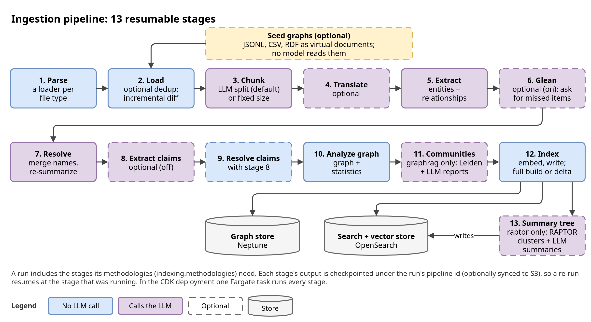

# Design: ingestion pipeline

Part of the [design reference](../design.md), which lists every section. Code cites
the section numbers: they never change.

## 4. Ingestion Pipeline

`DataIngestionPipeline` (`application/ingestion/pipeline.py`) runs 13
checkpointed stages, so a re-run resumes after the last valid one. Extraction
works per text unit and the graph is resolved from the merged per-unit
records, so a full build does not depend on batching and an incremental run
can re-derive what it touches (§5).

| # | Stage | Module | Notes |
|---|---|---|---|
| 1 | Document parsing | `parser.py` (`ParserFactory`) | PDF/TXT/CSV/JSON/MD/HTML (the `unstructured` extra, when installed, reads MD/HTML in place of the core readers; DOCX with the `docx` extra) |
| 2 | Document loading | `loader.py` | optional MinHash deduplication; the incremental diff |
| 3 | Chunking | `chunker.py` | intelligent (LLM boundaries, default) or simple |
| 4 | Translation | `translator.py` | optional; skipped when source = target language |
| 5 | Graph extraction | `graph_extractor.py` | entities and relationships per text unit |
| 6 | Gleaning | `gleaner.py` | optional; re-asks a unit while its last answer added something |
| 7 | Graph resolution | `graph_resolver.py`, `description_summarizer.py` | merges name variants, re-summarizes long descriptions (calls the LLM) |
| 8-9 | Claim extraction and resolution | `claim_extractor.py`, `claim_resolver.py` | optional (off by default) |
| 10 | Graph analysis | `graph_analyzer.py` | graph build and statistics |
| 11 | Community detection | `community_detector.py`, `domain/ingestion/community_clustering.py` | hierarchical Leiden (the clustering is pure, in the domain) and structured reports |
| 12 | Indexing | `application/storage/indexing_manager.py` (+ `cross_run_merge.py`, `removal.py`, `reannotation.py`) | graph and vector stores; full build or delta |
| 13 | Summary tree | `application/ingestion/summary_tree_stage.py`, `domain/ingestion/summary_tree.py` | only with `raptor` in `indexing.methodologies`: RAPTOR's tree over the stored text units, after indexing (§6.5) |

The stage order lives in `DataIngestionPipeline.STAGE_CLASSES`; every stage
gets its models and stores from the run's `Providers` bundle.

### 4.1 Extraction records and the extraction store (stages 5-8)

- **One record per text unit.** Extraction and gleaning write one
  `TextUnitExtraction` per unit (`domain/models/extraction.py`): the
  entities and relationships that unit states, in its own words, plus the
  entity keys rejected for it. Gleaning edits one record at a time: its
  prompt lists the unit's own items, and a correction never reaches what
  another unit says (MS GraphRAG and LightRAG likewise glean each chunk's own
  extraction). It lists the entities with their types and gives the
  extraction prompt's entity and relationship type blocks and its 1-10
  confidence and strength scales, so a gleaned item is typed and scored as
  an extracted one (a missing score takes extraction's default too).
- **Output format and gleaning (deliberate divergences).** Extraction asks
  for XML records (`GraphExtractionPrompt`): each entity with its type,
  description, a 1-10 `<confidence>` and a verbatim `<source_text>` span,
  each relationship with a strength and its span, where MS GraphRAG and
  LightRAG parse delimited tuples. The span is what entity grounding checks
  an item against its chunk with, and the confidence what
  `entity_confidence_threshold` filters on. Gleaning is a refinement prompt
  of its own (`GraphRefinementPrompt`), sent without the extraction's
  conversation: it lists the unit's text and current items and asks for
  missing items and corrections. Upstream continues the extraction
  conversation ("MANY entities were missed ...") with its history. A round
  here costs one prompt of the unit's text and items rather than a growing
  conversation, and it can correct an item (`ENTITY_CORRECTION`,
  `RELATIONSHIP_CORRECTION`), not only add one.
- **Resolution starts from the merge of all records**
  (`domain/ingestion/contributions.merge_contributions`: items merged by id,
  weights kept per unit), so the merged graph does not depend on which units
  shared a batch. Claim prompts list the unit's own entities, so a unit's
  claims depend on the unit alone. A claim's subject and object resolve
  only against the entities its own text units stated (`ClaimResolver`, in
  a full build as incrementally): a claim whose subject its units' entity
  extraction did not list is dropped (the prompt says so, and a unit whose
  record lists no entity is not asked), and an object not listed there is
  kept as the literal name the claim states (`object_id` empty), though
  another document states that entity. Statements of one claim (one
  statement restated: its id holds the statement, see below) merge their
  statuses (`merge_claim_statuses`): `disputed` when one says so or they
  state it both `true` and `false`, else `true` or `false` when one states
  it (which settles a `suspected` restatement of it), else `suspected`, and
  `unknown` only when nothing else is stated; a reworded statement of the
  same fact ("must pay $50,000 by 2024-06-30", "owes a $50,000 payment due
  30 June 2024") is another claim, neither settling nor disputing it; the merge is order-free and
  associative, so an incremental merge agrees with a full build. A model's
  status is read into the prompt's five (`claim_status`: `true`, `false`,
  `suspected`, `disputed`, `unknown`, as stored) at extraction and in each
  merge: the prompt's words and a few plain synonyms, each in English,
  Korean, Japanese and Chinese: `confirmed` and `verified` are `true` and
  `denied` and `refuted` `false` (MS GraphRAG's TRUE is "the claim is
  confirmed"), `uncertain` and `unverified` (`불확실`, `未確認`) `suspected`
  (MS GraphRAG's SUSPECTED is "not verified"; the prompt's DISPUTED is
  "conflicting information"); any other word is `unknown`, counted in
  `total_unrecognised_claim_statuses`. Each unit's statement is resolved
  on its own, and resolution merges the statements that resolve to one
  claim id: the subject and object entities, the type, the known dates and
  the statement (the description's entity key without the spacing a dense
  script leaves optional, `compact_text_key`), so two claims of one type
  about one subject with no object or date stay two claims, as MS GraphRAG
  keeps one row per statement, and only a restatement (the same statement
  up to case, spacing and a closing stop) merges its status, described by
  the spelling most of its statements write (the smallest on a tie). As MS GraphRAG's `extract_claims` prompt, built around the
  allegations a text reports ("Person C was suspected of ..."), the claim
  prompt asks for the facts a text states and the allegations and
  suspicions it reports (as `SUSPECTED`, saying who alleges them), and
  leaves out only the author's own opinions.
- **The extraction store** keeps each record, keyed by
  `<fingerprint>:<SHA-256 of the processed text>`, in the vector store's
  extraction-records index. The fingerprint
  (`cache_keys.unit_record_fingerprint`) covers the models, the extraction,
  gleaning or claim settings, the target language and the prompt templates in
  effect. A unit whose text and settings have a stored record takes it
  instead of an LLM call, so an edited document re-extracts only its changed
  chunks, and identical chunks elsewhere or in a rebuild reuse theirs. A
  record holds what the unit states: its entity and relationship ids are
  minted again from the names when it is read
  (`contributions.record_from_payload`), so a record stored under an earlier
  `entity_key` gives the ids a fresh extraction gives.
  `--force-rebuild` re-extracts and refreshes every record; an unreadable
  store is logged and the run re-extracts. A record that cannot be written
  fails its unit (`records_not_stored`), so its document is recorded `FAILED`
  and extracted again: incremental runs derive from the records (§5.4).
- **A text unit names its stored records** in `attributes.extraction_records`,
  computed from the run's records when the unit is indexed (not set on the
  cached units), so a resumed run writes them too.
- **A record stays while a stored text unit names it.** A full build or
  reset whose text units were all written keeps only the records they name
  (`VectorIndexer.retain_extraction_records` copies them into a new index and
  swaps the alias). It prunes only the kinds of record it produces: a
  rebuild without community reports or without claims also keeps the
  records under the report-answer and claim fingerprints this config would
  store them with (`VectorIndexer.extraction_record_keys` lists them by key
  prefix; a store that cannot keeps every record), however many such
  rebuilds come between, and one that builds nothing from the records
  (`raptor` alone) keeps every record, so adding the methodology (or claims)
  back asks no model for them again; an incremental run deletes the records
  only removed text units named.
- **Chunk boundaries are records too.** The intelligent chunker stores each
  pre-chunk's boundary answer in the same index, keyed by
  `<cache_keys.chunk_boundary_fingerprint>:<SHA-256 of the pre-chunk>` (the
  every-call and chunking settings, the chunking model and the boundary
  prompt), and the text units cut from it name the record (`chunks` in
  `attributes.extraction_records`), so it is kept and removed like the
  others. A pre-chunk with a stored answer takes it instead of a model call:
  a reset of an unchanged corpus asks the boundary model nothing, and a
  model that answers otherwise each time (no temperature control) cannot
  move the boundaries, and with them every downstream cache key, of
  unchanged text. The stage cache could not hold them: it is per pipeline
  id and keyed by the whole corpus. Only an answer that cuts its pre-chunk
  is stored: one it falls back from (lines that do not exist, a miss rate
  over the limit) would split it by size on every later run, so it is asked
  again, and a stored one of that kind is replaced. `--force-rebuild` asks
  again.
- **Translations are records too.** The translation stage stores a text
  unit's translations (every language it translates into) under
  `<cache_keys.translation_fingerprint>:<SHA-256 of the unit's text>` (the
  every-call and translation settings, the translation model, the source
  language, the translated languages and the translation prompt), and the
  unit names the record (`translation`). A unit with a stored record takes
  it instead of a model call, so a reset or an edit translates only text
  that changed, and extraction, which reads the translation and is keyed by
  it, reuses its records too: a model that translates otherwise each time
  would re-key every downstream record of unchanged text. A unit whose
  translation failed in any language stores none; `--force-rebuild`
  translates again.
- **A full build reuses the corpus-wide answers of unchanged input.** The
  LLM response cache keys a call by its prompt and model, which are stable
  (community ids are content ids), but it lives in the run's cache
  directory: a reset under a new pipeline id starts it empty, so before
  this every reset summarized every long description and reported every
  community again. When the run's graph is the corpus's (no registry, a
  reset, or no unchanged document), graph resolution reads the stored
  graph copies of the items over the summarization threshold (one read
  per suffix) and keeps a summary whose `summarized_from` is the hash of
  the item's description and whose `summarized_with` is
  `cache_keys.description_summary_fingerprint` (every-call settings, the
  summary model, the summarization section, the prompt), so a reset after
  a summarization setting change summarizes again; a copy the graph capped
  is not reused. The report answers are extraction-store records keyed by
  `<cache_keys.community_report_fingerprint>:<SHA-256 of the report input>`
  (the chain input as packed, with the community's name, which titles the
  report), stored with their generation time and named by the report
  (`attributes.report_record`), so the rebuild's retention keeps the ones
  its reports name. A stored answer gives the same report a call would
  (rank and lineage are recomputed), and its vectors are reused by digest.
  An incremental run that leaves documents unchanged neither reads nor
  writes them: its communities cluster the delta, which a full build
  clusters otherwise, so the first reset after incremental runs asks for
  those reports. `--force-rebuild` asks
  again and refreshes the records.
- **Gleaning stops on observed output**: a unit is re-sent (up to
  `max_rounds`) only while its previous answer added something new. An empty
  answer is the "nothing missing" signal MS GraphRAG asks for with a separate
  yes/no prompt, so no call is spent on it. `max_rounds` stays 3, against
  MS GraphRAG's 1, for the measured graph recall (§9.1).

### 4.2 Graph identity and merging (stages 5-7)

- **Entity identity (deliberate divergence).** An entity id hashes
  `entity:{entity_key(name)}`: the type is not part of it, so a name stated
  with two types is one entity, typed by the most frequent of its statements
  (document statements first, the smallest type on a tie;
  `contributions.merge_entity_contributions`). MS GraphRAG groups extracted
  entities by name and type; LightRAG keys them by name, as here.
- **Relationship identity (deliberate divergence).** A relationship id hashes
  `relationship:{entity_key(source)}:{entity_key(target)}:{type}`, lowercased,
  so the model-written `type` is part of the identity and the edge is
  directed: two types between one pair are two edges here and one in MS
  GraphRAG and LightRAG (the community graph still joins them, §4.3). The
  parts are joined with `:` unescaped, so a `:` in a name or type can collide;
  the format is kept because fixing it would re-key every stored relationship.
- **Endpoints cite their relationships' text units (deliberate
  divergence).** An entity also cites the text units of each relationship it
  is an endpoint of, and an endpoint no unit listed becomes a stub entity
  citing them (`relationship_endpoints.cite_relationship_endpoints`). Upstream, an
  entity's text units depend on which chunks were extracted together; here
  they depend only on the chunks that name it, so an incremental run cites
  what a full build cites and a removed document strips an entity to exactly
  the surviving text units that name it. The cost: local search and
  community lineage also reach chunks that mention an entity only through a
  relationship. With entity grounding on, gleaning drops a relationship naming
  an entity rejected as ungrounded for its chunk, so no stub brings it back.
- **Entity merging.** Two names merge when their `compact_name_key` is equal:
  `entity_key` without the legal-form designators of the language profiles
  (`domain/languages/legal_forms.py`: `(주)`, `주식회사`, `株式会社`,
  `有限公司`, a trailing `Inc` / `Ltd` / `LLC` / `Co` / `Corp` / `GmbH & Co.
  KG` / `S.A. de C.V.`, a leading `ООО` or `Công ty TNHH`, ...) and without
  spaces next to Han, Hangul or Kana, so "(주)가나다", "가나다 상사" /
  "가나다상사", "Acme Inc" / "Acme" and "ООО «Ромашка»" / "Ромашка" merge. A
  form is read as written or without all its accents, never a word without
  its own ("Marcelo Sá" keeps "Sá"), and one that is also a unit symbol
  (`LanguageProfile.unit_like_legal_forms`: "kg") not after a number. A
  merged group takes the name cited by the most text units (ties: the one
  its key folds least, then the smallest: `display_name_order`), so the
  result does not depend on input order. The list is
  applied whatever the entity's type: entity types are the user's
  vocabulary, so no type rule tells a company from a place, and a place
  written with a region code that is also a designator ("Springfield, CO")
  merges with its bare name ("Springfield").
- **Fuzzy matching is opt-in** (`processing.fuzzy_entity_resolution`), because
  name similarity also joins different organizations that share most of their
  name ("Northfield University" / "Northfield University Hospital"). When it is
  on, names link above `processing.similarity_threshold` only when their
  *discriminator tokens* (tokens with a numeral of any script, Han numerals
  included, single letters, Roman numerals) are identical, their types are compatible, and, for names ending in Han,
  Hangul or Kana, their final (head) characters are equal ("가나다연구원" and
  "가나다연구소" stay apart). The tokens are the compact key's words, cut
  where they pass between a dense-script letter and another character
  ("제3조" and "제 3 조" both 제, 3, 조), so both guards are functions of the
  compact key and never keep two spellings of one compact key apart: "the
  same entity" is that key's equality in resolution, the incremental merge,
  claim resolution and the stores' lookups by name key alike. A type-aware
  union-find never groups two differently typed names. Without fuzzy matching, full and incremental
  builds group the same names (both merge by compact name key). With it, the
  incremental merge uses the same matcher but folds each delta entity into
  its one best-matching stored entity and does not join stored entities with
  each other: a delta name that links two stored names a full build chains
  into one group ("Northfield Medical Centre" between "... Center" and
  "... Centre Annex") merges with one of them only, until
  `indexing.reset: true` regroups the corpus.
- **Schema annotations are written, not extracted.** `IndexingManager`
  sets `in_schema` and `type_iri` on each entity and `in_schema` and
  `predicate_iri` on each relationship it writes, on every write path (full
  build, delta, the strip of a removal, the stored edges it rewrites for
  their names or rank), from the item's stored type and the schema
  (`domain/ingestion/schema_annotation.SchemaAnnotator`, matched by
  `schema_key`, so the lowercased type vote still matches). A pure function
  of the merged type, it gives a full build and an incremental run the same
  values; pattern conformance is not stored, since it depends on endpoint
  types other documents can change. Where the schema does not apply
  (`SchemaConformance.applies`: `off`, `align` with entity types alone),
  `in_schema` is `None`; where it applies, both kinds get it, and every item
  of a kind with no declared type is in schema (nothing of it is off schema,
  so `in_schema: true` never empties a kind); an IRI is written
  whenever the stored type names a declared type with an `iri` and the mode
  is not `off` (so `align` with entity types alone still links them), and is
  `None` otherwise. `None` is never written: models drop it from their dumps
  (`SchemaAnnotated`), extraction records never hold annotations, the
  Neptune codec and the OpenSearch documents omit it. A default config (no
  `iri` anywhere) therefore writes no annotation field on its items; only the index mappings gain
  `in_schema` (boolean) and the IRI keyword fields, added to live indices
  by the incremental preflight (`check_index_settings` →
  `_add_missing_fields`). Ids are unchanged; the IRIs are the seam for
  linking items to an external ontology. A schema edit that changes only
  the annotations (the digest, §12 "Extraction settings") is applied by
  `IndexingManager.reannotate`: each store lists its items' annotations
  with their types (`read_schema_annotations`; a relationship's vector copy,
  which holds no type, takes its edge's), and only those that differ are
  rewritten in place (`write_schema_annotations`: Neptune and the SQLite
  graph drop and set the two properties, OpenSearch a partial update with
  null for an unset one), so the stores end as a full build leaves them.
  Neptune lists the ids in one traversal and reads the annotations in
  `batch_size` batches; OpenSearch pages by id. A store that inherits the
  port's defaults (`rewrites_schema_annotations`, which compares the
  functions its methods are bound to, so a forwarding wrapper answers for
  the store it wraps) makes the pass read nothing; a store error ends the
  pass with a warning, not the run.
- **Merged descriptions** are concatenated, so `DescriptionSummarizer`
  re-summarizes those over a token budget with a cheap model (map-reduce when
  one exceeds a call's input); a failed call keeps the concatenation. The
  trigger is a cost variant of upstream, not parity: MS GraphRAG
  `summarize_descriptions` summarizes every item with more than one
  description and LightRAG also at `force_llm_summary_on_merge` (8)
  fragments; here only the token budget triggers it. The prompt follows
  upstream's: the summary is written in the third person, names the entity
  (both ends of a relationship) so it reads on its own, and resolves
  contradictions; one the descriptions do not settle is stated rather than
  decided (upstream asks to resolve every one), since the summary is the
  stored description and a choice the inputs do not support is a fact
  invented.

### 4.3 Communities (stages 10-11)

- **Community graph.** `GraphBuilder` builds an undirected graph with one edge
  per entity pair; relationships of other types or directions between the pair
  share it, with the summed weight, so Leiden sees the pair's total strength.
- **Hierarchy (MS GraphRAG parity below, deliberate divergence above).**
  One Leiden pass partitions the whole entity graph. Because modularity's
  resolution limit grows its communities with the corpus beyond what one
  report can describe, a community over `max_cluster_size` (default 20)
  members is partitioned again on its own subgraph, recursively, and stays
  the parent of its pieces, as graspologic's `hierarchical_leiden` (MS
  GraphRAG's `cluster_graph`) keeps it; the pass over the whole graph is
  the best partition at its scale, and regrouping the pieces afresh with
  one pass over their cluster graph recovered planted and LFR benchmark
  partitions worse (level purity 0.55-0.92 against 0.85-1.00 before the
  split; `tests/unit/test_community_hierarchy_quality.py`, which also checks
  the first pass against `graspologic_native.hierarchical_leiden`). Leaves
  are level 0 and a split community sits at its height above them. Where
  MS GraphRAG stops at the first pass, coarser levels above the highest of
  these communities partition the graph of the current top communities the
  same way (a group over `max_cluster_size` communities split and kept as
  the parent of its pieces), up to `max_levels`; a partition that puts
  every linked community under one root is no level. Leaf communities
  under `min_community_size` merge into their strongest neighbour, and a
  split community is the union of the pieces it keeps.
  A connected component smaller than `min_community_size` (an isolated
  entity, a pair) gets no community or report; only these are skipped, unlike
  MS GraphRAG's `use_lcc`, which drops every component but the largest. On an
  incremental run, whose graph is only the delta, a small component is
  clustered when it reaches `min_community_size` in the whole graph a full
  build would cluster: walking the stored relationships that cite text units
  of documents the run neither processes nor removes, at most
  `min_community_size` batched reads. Stored entities without a community it
  links to stay without one until a rebuild (`community_drift`
  `unclustered_entities`). A
  parent identical to its only child is never created, so each distinct
  community is reported once. A Leiden failure fails the stage instead of
  truncating the hierarchy.
- **Leiden runs (deviation).** `trials` 3 and `extra_forced_iterations` 2
  (the best of three seeded runs, two more refinement passes) where MS
  GraphRAG runs one trial of one iteration (`graphs/hierarchical_leiden.py`).
  Not measured against upstream's; it costs Leiden time only (no model
  call).
- **Determinism.** Leiden's partition depends on insertion order and
  `graspologic_native` returns labels in a per-process order, so the clustering
  (`domain/ingestion/community_clustering.py`) sorts nodes and edges and
  renumbers each level by its smallest member id:
  the same graph and `random_state` always yield the same communities and ids.
- **Leiden runs (deviation, unmeasured).** Each partition is the best of
  `trials` (3) seeded Leiden runs, each with `extra_forced_iterations` (2)
  passes after the first (`iterations: 3` to `graspologic_native`); MS
  GraphRAG's `hierarchical_leiden` runs once with `iterations=1`
  (`graphs/hierarchical_leiden.py`). The extra runs and passes cost Leiden
  time, not model calls, and keep the partition of highest modularity;
  whether that changes the reports or the answers was not measured.
- **Reports (MS GraphRAG parity, two deliberate deviations below).** A report's input takes the community's
  entities by degree (document-backed, §4.5), capped at
  `max_entities_per_report`, and packs them into `max_report_context_tokens`
  edge by edge, as MS GraphRAG's `sort_context`: the relationships among them
  by combined endpoint degree (then weight and id), each with its endpoints
  and, with claim extraction on, the claims about them; one that does not fit
  is left out and the next tried; the entities with no relationship among
  them come last; the top entity always fits. Packing the entities first left
  the relationships whatever budget remained (with 200-token descriptions, 2
  of 40 edges). MS GraphRAG's 8000-token budget with `max_cluster_size` 10 is
  the tuning point for larger reports: the defaults (4000, 20) are kept for
  cost. Reports are generated bottom-up. The prompt returns a structured
  report (summary, 0-10 rating with explanation, findings); `full_content`
  for embedding and search is rendered from it, with no second call. As MS
  GraphRAG's prompt (`prompts/index/community_report.py`), it allows only
  what the data supports ("Do not include information where the supporting
  evidence for it is not provided") and asks each finding for its
  references, `[Data: Entities (1, 3); Relationships (2, +more)]`, at most 5
  numbers a list; the entities and relationships are numbered in packing
  order, from 1, in place of GraphRAG's `human_readable_id`. The syntax
  stays ASCII in every report language (full-width and lenticular
  brackets and the commas a CJK answer may use are read too, and a range
  `1-4` is each number in it). The numbers name records only within that
  input, so `report_references.split_data_references` takes them out of
  the prose and the finding keeps the record ids
  (`CommunityFinding.entity_ids` / `relationship_ids`). Rolled-up
  sub-community reports are numbered too and cited as `Reports (n)`, as MS
  GraphRAG's parent reports cite theirs: a cited sub-report stands for the
  records its own findings cite, added after the finding's own, so a
  parent's roll-up findings rest on the records of its children rather
  than on the minority of its members packed raw. Claims are not
  numbered. The stored report keeps its
  findings, ids included, in an unindexed field (`findings`, mapped
  `enabled: false`; an earlier index gets it in the preflight's additive
  mapping update), so a retrieved report and its reported source name the
  records each finding rests on (`report_references.report_cited_ids`).
  An incremental commit points them at the ids the cross-run merge kept,
  as it does a community's members, and the stored reports citing an id it
  re-keys at the new id (§5.1). A report stored before cites none.
- **Sub-community roll-up (deviation).** When a parent's own context was
  cut, its children's report summaries (biggest child first, each with its
  rating) are added to that context under a second budget of
  `max_report_context_tokens` (`enable_sub_community_rollup`), so the
  prompt stays within about twice the raw budget. MS GraphRAG substitutes
  sub-community reports for the raw context that does not fit; adding them
  keeps the parent's best-connected entities and relationships verbatim, at
  up to twice the input tokens of a parent that overflows.
- **Report rank (deviation).** A report's `rank` is the sum of its members'
  document-backed degrees (`_compute_report_rank`, no model call; the member
  count without a graph), where MS GraphRAG's is the model's rating. The
  model's rating is kept as `rating` (in the report text, and a filter key
  of the reports index); global search's map step rates each report against
  the query instead. `rank` orders a search of the reports index without
  query text.
- **Report lineage.** Each report carries `text_unit_ids` and `document_ids`
  (the union over its members: provenance, not citation support) and its
  place in the hierarchy, which global search selects by (§6.1.1).

### 4.4 Pipeline infrastructure

- **Resume.** Each stage's output is checkpointed under the run's pipeline id
  (`application/ingestion/pipeline_manager.py`, `application/ingestion/cache_manager.py`); the stage cache
  key is described in §12. Where a resumed run starts, and the rewinds that
  move it back, are in `application/ingestion/resume.py`.
- **S3 sync** (`adapters/aws/s3_cache.py`) uploads the changed files after
  every stage, data before the metadata that refers to it. On SIGTERM,
  `run-ingestion` stops the running stage (`request_stop`: deferred while a
  checkpoint is written, no I/O in the handler) and uploads its checkpoint.
- **Reuse across runs.** Within what a run writes, a text embedded before
  with the same embedding provider, model and dimension keeps its stored
  vector (each vector stores a digest of its text, §5.2), so a changed
  document re-embeds only the chunks, descriptions and reports whose text
  changed, and a reset of an unchanged corpus embeds again only what it
  regenerates. The intelligent chunker's boundary answers are kept per
  pre-chunk in the extraction store (§4.1), so a reset or an edit asks the
  model only for pre-chunks whose text or chunking settings changed, and an
  unchanged pre-chunk keeps its boundaries even with a model that answers
  otherwise each time. Only an answer the chunker used is kept: a pre-chunk
  split by size instead (the answer named lines that do not exist) asks the
  model again on the next run. A full build (a reset, a first run, or a run
  without the registry) does the same for the corpus-wide answers: a
  description over the summarization threshold whose stored copy was
  summarized from the same text with the same summarization settings keeps
  that summary, and a community whose report input (its members,
  descriptions, edges and claims as packed, its roll-up text and name) and
  report settings are unchanged takes the stored answer (the extraction
  store keeps it, and the report names it in `attributes.report_record`). A
  community's name (`Level 0 Community 1a2b3c4d`) derives from its members,
  so a document that adds a community leaves the others' names, and their
  stored answers, as they were.
- **LLM response cache** (`adapters/llm/response_cache.py`): a LangChain
  `BaseCache` on every ingestion model, keyed by the rendered messages and the
  model and generation settings, stored with the stage cache. An earlier
  run's entry is served at most once per run and truncated responses are not
  kept, so a retry after a bad response asks the model again. A
  `BatchProcessor` item that failed every attempt drops the responses its
  calls were served or stored (`discard_if_item_fails`), so a re-run asks
  again for that item only instead of replaying them; so does an item whose
  answer the stage rejects afterwards (a graph or claims record that fails
  to build), through the `discards` the batch hands back. A call abandoned on
  its call timeout (`call_timeout_seconds`) is neither served nor stored: its late answer
  is not its item's, which was retried or failed meanwhile.
- **Output fixing.** Structured outputs are parsed with an output-fixing
  parser (the model of `models.roles.fixing`, always on). Every chain first
  drops a leading `<think>`/`<thinking>`/`<reasoning>` block
  (`ReasoningStripper` in `setup_chain`). The XML parser unwraps one
  element wrapping the expected sections and reads a section that lists
  elements (`container_tags`: entities, relationships, claims, the
  refinement plan, findings, chunk boundaries) but holds text and no
  element as empty when the text is a short "nothing here" marker (one line
  of at most three estimated tokens: "None.", "없음", "なし"; counted, so no
  word list is needed). Longer text may be the list written as prose: it
  goes to the fixer once (told that an empty section is the empty
  element), and a repair that still holds text only is read as empty,
  counted (`sections_read_empty_from_text` in the extraction stats) and
  logged at WARNING with the section's name and length, never its text. The
  extraction, claims and gleaning parsers raise `OutputParserException`
  for any other answer that parses but is not the prompt's shape (no
  section, nameless entities in a complete answer), so the fixer repairs
  it as it repairs output that does not parse. A JSON answer, at
  ingestion, query and evaluation alike, is read by one parser
  (`parse_model_object`: fences and prose around it, trailing commas,
  comments, typographic quotes, invalid escapes, a Python literal, a
  self-correction ending on the answer) and gets one repair by the same
  fixing model (`create_json_output_parser`) before its caller degrades.
- **Resources.** The pipeline releases indexer and client resources in
  `close()`, which `run-ingestion` calls in `finally` (§8.2).

### 4.5 Seed graphs as virtual documents

A seed graph (`processing.seed_graphs`,
[Seed graphs](../guides/seed-graphs.md))
is a knowledge graph the user brings. It is imported as virtual documents
of the run's own corpus rather than through a second write path, so
lineage, removal, derivation, the extraction store and the write-ahead
protocol apply unchanged, and an incremental run converges to a full build
of the documents plus the configured seeds. No model reads a seed.

- **Load and convert.** `DataIngestionPipeline.__init__` calls
  `bootstrap.load_seed_graphs` right after `resolve_extraction_schema`,
  before any model is built: each item's registered loader returns a
  `SeedGraph`, and `convert_seed(graph, SeedConversionSettings, schema)`
  (`domain/ingestion/seed_graph.py`, pure) turns it into shard documents.
  It checks (duplicate ids, dangling edges, the caps, which fail instead
  of truncating), maps types (a `type_iri` / `predicate_iri` a schema type
  declares, the last-declared winning, else the label through
  `SchemaConformance`), conforms the whole seed at once (both endpoint
  types are known, so patterns always apply; under `qualify` each
  identity of a shared name, its IRI else its id, is checked by its own
  type, as the distinct entity it becomes), applies
  `on_name_collision`, shards nodes by `int(sha256(id)[:8], 16) % shards`
  (an edge goes with its source node), packs node cards (a node and its
  outgoing edges, by `(entity_key(name), id)`) into units of at most
  `max_items_per_unit` statements (a hub card is split; a shard over 2,000
  units fails naming its largest card's node, keeping a shard's registry
  record small) and renders
  `seed_graphs/<name>/<k>-of-<n>.jsonl`: a header line (name,
  `SEED_FORMAT_VERSION`, filters), then the units' canonical JSON lines,
  a blank line before each unit. The content hash therefore covers the
  name, the filters, the format, the schema's effect and every statement,
  and the output does not depend on the input's order. Every check is
  linear in the seed (an edge's endpoints are dict lookups). The models
  refuse what a store cannot write: a lone surrogate in any text, a name
  over 1,000 characters, an IRI over 4,000 or a type over 256, so each
  stays far under an indexed keyword's 32,766 bytes.
- **Keying.** `processing.seed_graphs` is neutral in `CONFIG_KEYING`: the
  conversions' digests are folded into the corpus fingerprint
  (`cache_keys.seed_corpus_fingerprint`), which keys every stage, and
  nothing enters `extraction_settings`, so where a seed is read from keys
  nothing and a seed edit re-extracts no document. Without seeds the
  fingerprint is the one it was.
- **Stages.** Loading appends the shards after deduplication
  (`assign_document_identity` keeps their path), so the registry diffs
  them like files. Chunking cuts them with `seed_text_units` into `sg-`
  units (the chunker's stable id, prefixed: they sort after every hex
  document unit id, and `is_seed_unit` is the one test anywhere).
  Translation, extraction, gleaning and claims leave them out; a seed
  unit's record is `parse_seed_unit(unit)`, a pure function of its text,
  stored under `SEED_RECORD_FINGERPRINT` (the format only, never a model
  setting), and its text unit names only that graph record. A failed
  report never fails a seed unit. With seeds configured an empty corpus
  is a valid run.
- **Document-first merge.** Every merge path (the records' merge, graph
  resolution, the incremental merge, derivation) applies one rule keyed
  on `is_seed_unit` (`document_first`): the type vote counts document
  statements and falls back to seed votes only when none gives a type;
  a resolved group's name is keyed `(-document units, -seed units,
  name)`, and its type is the named member's unless that is unknown
  (none, blank, `unknown`), then the known type the most units cite; confidence is the maximum over document statements when any
  exist. Descriptions stay a union, document lines first because records
  merge in unit-id order. `Entity.iri` is a stated field, kept in
  records, merged as the smallest non-null value (groups with several
  are counted). Seed properties live in `attributes.seed_properties`,
  merged per key, never over an extracted attribute; the OpenSearch
  entities index leaves them unmapped (`enabled: false`), so no key or
  value fails a write and none is filterable, and an incremental strip
  compares them (`_vector_content`), as a lineage update leaves stored
  attributes as written. The rules hold per
  name key: names that only resolve together (a legal-form variant, or
  fuzzy matching) let seed units break a tie between document spellings,
  and a document entity named only as a relationship endpoint (no type)
  takes the seed's type and confidence, as a gap filled.
- **Source kinds.** `annotate_sources` sets `source_kinds` where indexing
  sets the schema annotations: `None` for an item no seed unit cites,
  else the sorted kinds (`["document", "seed_graph"]` or
  `["seed_graph"]`). It is derived, left out of records, and written only
  when set, so an item no seed states is stored byte for byte as before
  and nothing is embedded again. Seed text units carry a `source_kind`
  keyword (no filter key). Graph edges store the list as a sorted JSON
  string (`encoded_source_kinds`); `SEED_ONLY_SOURCE_KINDS` is the one
  encoding of a seed-only edge.
- **Ranks.** `with_graph_ranks(counts=is_document_backed)` counts an edge
  unless every text unit it cites is a seed unit, in the full build,
  derivation and both incremental rank paths, which read stored
  neighbours through `GraphIndexer.read_neighbor_ids(document_backed=True)`
  (Neptune `bothE().not(has("source_kinds", '["seed_graph"]')).otherV()`;
  the SQLite graph and the fakes apply the same predicate; an edge
  without the property is document-backed). `count_neighbors` keeps every
  edge: it sizes the community walk, which clusters seeds too. The
  community detector ranks and selects report entities by
  document-backed degree, while Leiden sees every edge at its full
  weight. A large catalog seed therefore enriches the corpus's entities
  without turning its hubs into the top-ranked entities. Query-time
  `entity_importance_source: degree` counts the live edges, seeds
  included.
- **Communities.** A community whose text units are all seed units is
  stored without a report and counts as neither generated nor failed
  (`communities_seed_only`); a parent with one evidenced child is
  evidenced, and a child without a report leaves the parent its raw
  context. An incremental run's graph holds its delta only, so a
  community seed units alone state there is checked against the stored
  members (`_evidenced_by_stored_members`, one `read_entities` batch per
  suffix): a member citing a document unit the run does not replace, or
  stored without lineage and without seed-only `source_kinds`, evidences
  it. A seed added beside unchanged documents thus reports their
  communities as a full build does: the report reads each such member's
  stored description followed by the run's lines, and a member citing a
  unit the run replaces (an edited seed's earlier shard) has its stored
  description derived again from the records of its other units first,
  as the indexing's strip does (`stripped_descriptions`, one read of
  those units' records). The report then reads what the run indexes:
  that derived description, and the merge with the run's lines, are
  each summarized when over the threshold (`needs_summary`), as the
  strip and the merge summarize them, and the summaries go to the
  indexing through `PipelineContext.member_summaries`, marked
  `summarized_from`, so `reuse_summaries` takes them and the model is
  asked once (a resumed indexing summarizes again; the context does not
  persist them). A summary the indexing reuses, or an item already holds,
  is not summarized again even when it is over the threshold itself, so
  the run stores the description its report read. Without that, a hub's report entry was every line its
  documents state and could crowd it out of its own report. A full build
  summarizes the member's lines in one pass, so the two summaries are
  equivalent, not equal; with summarization off both read the lines
  whole (no cap: a cap would make the incremental input differ from the
  full build's). A member the run states with neither a type nor a
  description (the endpoint of a seed edge into a kept shard) reads its
  stored copy's type and description; an unread member store counts the
  communities in `reports_failed`, not `communities_seed_only`. The
  relationship lines are the run's graph's
  only (the delta's seed edges; a stored document edge between members
  is not read): clustering the delta only, the community itself can
  differ from a full build's. Global search answers from the
  reports, so content only seeds state is in none, while a mixed
  community's report describes its seed members too.
- **Scope (decided).** The shards belong to the source scope of the run
  that configures them. A separate `seed:<name>` scope per seed was
  rejected: every run-level registry path (the diff, attempts,
  write-ahead, commit, the per-scope extraction-settings record) assumes
  one scope per run, a reset clears every scope of the namespace, and a
  registry-off build has no scope at all. A seed-only scope is still a
  run whose corpus is only seeds, with a fixed `source_scope`. The
  trade-off: one seed configured on two scopes of a namespace is imported
  twice (the same ids, seed edge weights counted twice).
- **Model settings never re-import a seed**
  (`delta_detector.keep_seed_settings_unchanged`, in `detect_delta` and
  `delta_still_applies`): a shard the diff lists only as
  `settings_changed` is unchanged, since no model setting changes what it
  states; re-importing would only delete and re-embed its items. Its
  record keeps the earlier fingerprint, so later runs exempt it again. A
  schema change that changes the converted statements changes the content
  hash and re-imports the shard.
- **Reset.** A reset (or a registry-off full build) processes the whole
  corpus, configured seeds included, so the sweep keeps them. Before any
  write, `incremental._confirm_reset_of_seed_scopes` lists the namespace
  once (the quarantine check reads the same listing), counts as the run's
  own every record of a spelling of its source scope
  (`normalize_source_scope`, as the incremental diff's `_stored_spelling`
  does) and, when another scope holds seed paths (`is_seed_path`), or the
  corpus is seeds alone, the scope holds seed records of its own and
  another scope holds documents, asks the
  pipeline's `confirm` (the CLI's terminal prompt, `--confirm-reset` /
  `UKR_CONFIRM_RESET`, or `--yes`); a no, or no `confirm`, raises
  `ConfirmationDeclinedError`, which the stage and the pipeline pass on
  untouched (a cancellation, not a failed stage). Refusing every such
  reset was rejected: it would make the common case, a seed on the
  corpus, impossible to rebuild. The answer has its own input because
  `--yes` also accepts a resume's integrity issues, which an ECS task
  answering a reset must not accept blindly.
- **Empty corpus.** A corpus of seeds alone is a seed-only run only for a
  scope the registry holds no document of
  (`incremental._refuse_seeds_over_documents`, before any write, also
  under a reset): otherwise an unmounted volume or an empty S3 sync would
  delete the scope's documents with exit 0. An incremental run reads the
  scope's records from its delta (every record of the scope a seeds-only
  corpus does not match is `deleted` or `failed`), not the namespace. A
  reset from seeds alone of a scope with no record at all, beside other
  scopes' documents, fails too (`_refuse_seeds_over_other_scopes`): a
  seed-only scope's earlier runs recorded its seeds, so this is a new,
  moved or mistyped prefix, and the reset would rebuild the namespace
  from the seeds. Keyed on the registry, not on a flag: a seed-only scope
  needs no extra setting, and the mistake it guards against carries none.
  A scope's first run warns when another scope already holds a seed of
  the same name (its weights would count twice). A registry-off build
  cannot tell a seed-only corpus from a missing one, so
  `DocumentLoadingStage._confirm_seeds_alone` asks `confirm` before seeds
  alone replace an index that holds items (`holds_any_item`, one bounded
  read per store, and the vector store's `holds_any_text_unit`, so a
  corpus that stated no item counts; unknown or unreadable counts as
  holding). An index that
  holds none builds unasked: a first seed-only build loses nothing, and
  asking there would demand a flag for nothing.
- **Not in v1.** IRI-based identity and aliases, `owl:sameAs`, a
  retrievable fact card (seed units as TEXT context), and federation
  (§15, *New seed source*).

### 4.6 Methodology profiles

One ingestion builds what the selected methodologies read, and a query
fails fast when its strategy's methodology is not in the namespace, so a
LightRAG-only corpus never pays for GraphRAG's communities and reports.

- **Catalogue (domain, pure).** `domain/models/methodology.py` names the
  methodologies (`Methodology`: `graphrag`, `lightrag`, `hipporag`,
  `raptor`) and the index artifacts (`IndexArtifact`) each needs
  (`METHODOLOGY_PROFILES`, required and optional):

  | Methodology | Required | Optional (used when built) |
  |---|---|---|
  | `graphrag` | text units, entities, relationships, graph, communities | community reports (`global` and `drift` require them), relationship vectors, claims |
  | `lightrag` | text units, entities, relationships, relationship vectors, graph | — |
  | `hipporag` | text units, entities, relationships, relationship vectors, graph | — |
  | `raptor` | text units, summary tree | — (`tree` also reads the entities index where another methodology built it) |

  `domain/ingestion/methodologies.py` maps each artifact to the stages that
  build it and each stage to the stages it reads
  (`ARTIFACT_STAGES`, `STAGE_DEPENDENCIES`): `stages_for(artifacts)` is
  their closure. The summary tree is built by the `summary_tree` stage
  after indexing (§6.5), from the stored text units, so `raptor` alone runs
  no graph stage; `hipporag` needs nothing `lightrag` does not build, so
  every default index holds it, and so does a `[graphrag]` one while its
  optional relationship vectors are built
  (`indexing.opensearch.build_relationship_vector_index`, on by default):
  it holds `lightrag` too.
- **Selection.** `indexing.methodologies` (default `[graphrag, lightrag]`:
  what one ingestion built before profiles, every stage but `summary_tree`)
  selects what a run builds. The effective
  methodologies (`effective_methodologies`) leave out those whose required
  artifacts a switch turns off: `graph.community_detection.enabled: false`
  drops `graphrag`, `indexing.opensearch.build_relationship_vector_index:
  false` drops `lightrag` and `hipporag`, so a pre-existing light config
  reads as the profile it builds; none left is a config error.
  `graph.community_detection.report_generation.enabled: false` deselects
  nothing (`ArtifactSwitch.deselects`: the communities are still detected)
  but builds no community reports, so the namespace does not hold them:
  `local` answers without its report section, and `global` and `drift`,
  which read the reports, are refused before any model call with a message
  naming the switch. A stage
  runs when `stages_enabled` and its config section allow it and it is in
  `stages_for` the effective methodologies' artifacts, plus claims when
  `processing.claim_extraction.enabled` (claims are per-document extraction
  output, recorded in each document's extraction settings, so their switch
  alone governs them; with no selected methodology reading them a WARNING
  says so). For the default union every stage but `summary_tree` is selected
  (claims as their switch says), and
  `indexing.methodologies` keys no stage cache and, at its default, no
  evaluation manifest (`cache_keys._KEYED_ONCE_SET`), so default users see
  no change. An explicit `--enabled-stages` list wins in both directions
  (a listed stage runs, an unlisted one does not); a run that writes the
  index (lists `indexing`) and leaves out a stage a selected methodology
  needs logs a WARNING naming both (not for `OPTIONAL_STAGES`: parsing,
  translation, gleaning). A stage `--enabled-stages` names that no selected
  methodology needs (and its config section allows) is refused by
  `run-ingestion` before any model call (exit 2,
  `pipeline.unneeded_stage_error`): it would pay for an artifact
  the build record does not list. A library `stages_enabled` map, where
  switching one stage off leaves every other listed, runs it with a WARNING.
- **Build record.** `IndexBuildRecord` gains `artifacts` (what the namespace
  holds and the runs maintain) and `methodologies` (those whose required
  artifacts it holds, for manifests and readers). A run's artifacts
  (`built_artifacts`) are those whose producing stage completed in its
  context (a phased run's earlier phases count) and whose switch is on
  (relationship vectors, report generation). A full build records them; an
  incremental record keeps those both it and the stored record hold
  (`IndexBuildRecord.over`), so an artifact a run stopped maintaining leaves
  the record. An incremental run that writes nothing writes no record:
  what it left out is still current.
- **Adding a methodology** that needs an artifact the namespace does not
  hold (communities and reports for `graphrag`, relationship vectors for
  `lightrag`), and claim extraction turned on for a namespace without
  claims (`CORPUS_WIDE_ARTIFACTS`: a delta extracts claims from its own
  units only, and its record, which keeps what both name, would never name
  them, so `local` would not read them), needs the whole corpus, not a delta (the summary tree is the
  exception: it is built from the stored text units, §6.5): a run with the registry
  on that finds one (the stored record against the effective
  methodologies, `missing_artifacts`) rebuilds the namespace for that run
  (`indexing.reset`, WARNING), before any cache key is computed. A rebuild
  from one corpus deletes the namespace's other source scopes, so when the
  registry holds any (`incremental.other_source_scopes`) the run is refused
  instead (`ConfigurationError`, exit 2, nothing written). The rebuild
  reuses what the stores keep
  (§4.1, §4.4): chunk boundaries, translations, extraction records, description
  summaries and vectors, so its new model calls are the added
  methodology's (one report per community). Without the registry every run
  is a full build and reuses the same. A record written before profiles
  existed has no `artifacts`: it is read as holding what a run of the config
  builds (`held_artifacts`, from `artifacts_to_build`), so nothing is missing
  and an upgrade promotes no run.
- **Removing a methodology** stops maintaining its artifacts: the next run
  of the namespace records them gone (one with nothing to index narrows the
  stored record to what it builds, `_record_removed_artifacts`), and its
  strategies fail fast. The record is the namespace's, not a source
  scope's: a run that would drop a methodology (`dropped_methodologies`)
  while the registry holds other source scopes' documents in the namespace
  (`other_source_scopes`, less those the run retires) is refused before any
  model call (`ConfigurationError`, exit 2), for corpus runs and
  `insert_documents`/`delete_documents` alike, since adding it back needs
  the rebuild that is refused there; so is one whose switches stop building
  a corpus-wide artifact the record holds beside the methodologies it keeps
  (`dropped_artifacts`: reports with `report_generation.enabled: false`,
  which leaves `graphrag` for `local`, and claims with claim extraction
  off), naming the switch. For `raptor` alone (its summary tree is not
  corpus-wide) the refusal stays, since the record would stop naming the
  tree for every scope, but says adding it back needs no rebuild: the next
  run that selects it builds the tree from every stored text unit of the
  namespace. An incremental run keeps the stored records of the kinds it
  does not produce, as a reset does (`collect_extraction_records` skips the
  keys under `unbuilt_record_prefixes`): the claim records of the units a
  claims-off run extracts again stay for the rebuild that turns claims back
  on. The record names the source scopes it
  holds (`source_scopes`: the run's and the others its diff read, a
  reset's alone; None without the registry or in an earlier version's
  record), so a query's refusal advises a re-run over the one scope's
  corpus, or a namespace of its own or a reset for several.
  Nothing is deleted: a reset with the remaining methodologies replaces the
  community-reports index with an empty one and drops the graph's community
  vertices (the rebuild sweep, §5.2). A run creates no vector index of an
  artifact it does not build (`artifacts_to_build`; a `raptor`-only run has
  no entities index): a full build only empties a live one, and the
  index-creation probe counts the same indices.
- **Query time.** Every strategy class declares `methodology`
  (`BaseSearchStrategy.methodology`): `graphrag` for `local`, `global`,
  `drift` and `simple`, `lightrag` for `mix`, `hybrid` and `naive`,
  `hipporag` for `ppr`, `raptor` for `tree`; a
  wrapper strategy (`iterative`) sets it per instance from the strategy it
  wraps. A strategy that reads other than its methodology requires declares
  its artifacts at registration (`StrategySpec.required_artifacts`):
  `naive` reads the text units alone, and `simple` sweeps the indexes the
  namespace holds (the text units at least), so any namespace holding the
  text units serves both, a `raptor`-only or `lightrag`-only one included.
  `global` and `drift`, which answer from the community reports, declare
  `graphrag`'s required artifacts and the reports
  (`REPORT_READER_ARTIFACTS`): with
  `graph.community_detection.report_generation.enabled: false` a namespace
  holds `graphrag` for `local` (as before profiles), the two are refused
  naming that switch, and a WARNING at load says so.
  `GraphRAGChain` reads the namespace's build record through the document
  retriever (`GraphRAGChain.aread_build_record`, cached per suffix for
  `methodology_check.HELD_TTL_SECONDS`, read again before a refusal; a
  failed read falls back to the config for that query only, uncached) and derives what it
  holds (`held_artifacts`, and the methodologies whose required artifacts
  they are, `methodologies_holding`; when there is no record or it predates
  profiles, every methodology whose required artifacts a run of the config
  builds, `artifacts_to_build`: a store the default run built before records
  holds `hipporag` too, as it holds the relationship vectors `ppr` reads),
  and passes the held artifacts to the strategy
  (`SearchQuery.metadata["held_artifacts"]`), which reads only the optional
  indexes the namespace holds and a run of the config builds
  (`index_prefixes.readable_artifacts`: `simple`'s sweep, `tree`'s graph
  buckets, `local`'s claims, relationship and report sections, `ppr`'s
  facts). After the methodology check, a query's filter keys are checked
  against the same indexes (`readable_index_prefixes`), so a key only an
  index the namespace lacks declares is refused, not dropped.
  An explicit strategy whose
  methodology (or declared artifacts) is not held raises `MethodologyNotIndexedError` (a
  `ConfigurationError`; `run-rag` and `run-eval` exit 2) before any model call, naming
  what the namespace holds, the strategies that serve it and how to add the
  methodology. `auto` routes only among the strategies
  of `search.auto_routable_strategies` the held artifacts serve, falling back to `local`, else `mix`,
  else the first registered strategy of a held methodology (`tree` on a
  `raptor`-only namespace).
  `local` counts as GraphRAG's: it reserves part of its
  context for the community-report section, so on a LightRAG-only index it
  would answer with that share unused; `mix`/`hybrid` serve the same entity
  questions there. When `auto` falls back, it warns once per
  configuration and held methodologies, not on every query.
- **Failure modes.** An unreadable record (store error, a backend without
  index metadata) reads as holding what a run of the config builds
  (`artifacts_to_build`), and so the methodologies whose required artifacts
  that holds (`methodologies_holding`); a
  record that over-claims cannot arise from a run (an artifact enters it
  only through a completed stage), and one that under-claims refuses
  queries until the next run that writes the namespace.

---
