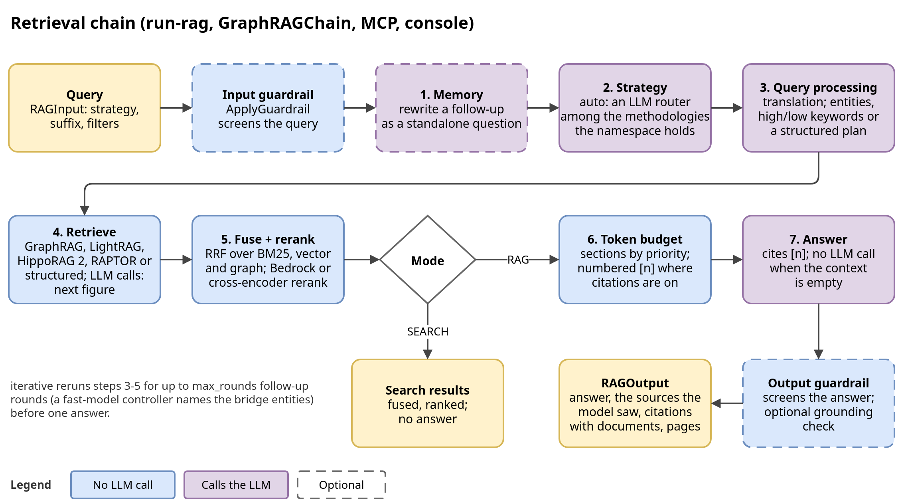

# Design: retrieval, GraphRAG and LightRAG

Part of the [design reference](../design.md), which lists every section. Code cites
the section numbers: they never change.

## 6. Retrieval: Methodologies

`GraphRAGChain` (`application/retrieval/rag_chain.py`, an LCEL Runnable) runs
one chain for every strategy: conversation memory (a follow-up is rewritten as
a standalone question) → strategy resolution → query processing (translation,
entity or keyword extraction) → retrieval → fusion and rerank → (RAG) context
budget and answer. `RAGInput.search_strategy` picks the strategy, and so
the methodology: GraphRAG's (§6.1) and LightRAG's (§6.2), the wrapper
`iterative` (§6.3), HippoRAG 2's `ppr` (§6.4) and RAPTOR's `tree` (§6.5).

- **Where the chain stops.** `search` / `asearch` return the fused, ranked
  results (a `SearchOutput`); `invoke` / `ainvoke` / `stream` run the same
  steps, pack the results into the token budget (§7) and return a `RAGOutput`
  whose sources are exactly the sections the answer model saw. An empty
  budgeted context is answered "cannot answer" without calling the LLM.
- **Graph expansion** is part of `local`, `drift` and `ppr` (§6.4), and
  opt-in for `mix` / `hybrid` (`search.lightrag_search.enable_graph_expansion`). Strategies find
  the seed entities in the vector store and pass their ids to the graph
  retriever, which expands from those ids only.
- **Under a document filter, expansion runs on the search store.** A graph
  holds no document attribute, so the walk goes over the relationships
  index instead (`BaseSearchStrategy._expand_over_passing_relationships`):
  each hop asks for the passing edges incident to the frontier vertices
  whose seed is short of its share, two requests (source and target side;
  plus one text-unit check under two or more keys), cached per query, and
  one entities-index read at the end (and, under two or more keys, a
  second text-unit check of the entities it reached). It keeps the graph walk's bounds
  (`max_hops`, `max_results_per_hop`, the budget split per seed, each seed
  at most its share) and scoring, but `degree` importance reads as `rank`
  (the index holds no degree). A side returns at most `min(max_query_size,
  live max_result_window)` edges, best first (a frontier past
  `max_terms_count` is asked in batches, each with its own page); when a
  side's page is full, the vertices still open are asked together once
  more at that side, and when that page is full too, each on its own, in
  waves of `search.max_concurrency`: each asks for what its wave may still
  take, and a wave leaves out what the waves before it reached. A hop costs
  one request per side, one more per full side, then one per open vertex
  and full side; under two or more keys each page adds a text-unit check.
  Under a caller `id` list the walk stops once it has reached every listed
  id (the results keep only those, and a reached vertex's path is fixed).
  Edges back to a vertex already reached are left out by the store (a
  `must_not` on the other endpoint), so they cannot fill a page; past
  `max_terms_count` the exclusion keeps the vertices reached last, so edges
  back to the others can. Without the relationships index the graph walk
  runs, checked against the entities index. So is a graph walk
  under an entity key entity vertices do not store (`name.keyword`, a
  nested `attributes.<path>`): the graph drops it, the entities index applies it
  (`_graph_unapplied_filters`), to LightRAG's seeds too (its relationship
  endpoints were found under no entity key; `local`'s and `drift`'s seeds
  were found under the filters).
- **Seed graph facts are entities and relationships, never text.** A
  seed graph's text units are stored (removal and derivation read
  them) but never retrieved as chunks: the
  OpenSearch retriever (OpenSearch and the embedded engine) adds one
  `must_not` on their `source_kind` to every text-units search, a fetch
  by id included, inside the kNN filter (efficient filtering on lucene
  and faiss, so seed units take none of the k). OpenSearch 2.13 refuses a
  kNN filter on an unmapped field, so unless the alias's mappings show
  `source_kind`, a kNN search first probes once per query for a unit
  holding it; an index that holds none gets no clause. An ids-only
  filter check keeps them: it returns no text. Local search ranks and
  fetches document units only and its `entity_frequency_threshold` counts
  document units; the LightRAG chunk follow drops seed units. The
  `source_kinds` and `iri` filter keys are probed like the schema
  annotations (`LATE_MAPPED_FIELDS`); `source_kinds: document` means
  document evidence, items without the field included (OpenSearch
  `should[term, must_not exists]`, Gremlin `or(has, hasNot)`, the SQLite
  vertex filter alike), and is dropped on an index none of whose
  documents holds the field, where it filters nothing. Community reports
  carry no source kind (a report summarizes its members, seed-only ones
  included; deriving one from the members would go stale whenever a seed
  edit changes a member's kinds without regenerating the report), so a
  `source_kinds` filter keeping one kind skips them in `local`, the DRIFT
  primer and `simple`'s sweep
  (`BaseSearchStrategy._source_kinds_skip_reports`), and `global`
  refuses the key (no index it reads declares it). A reported source
  with seed evidence gets `provenance` (`rag_chain.seed_provenance`:
  kind, the seed graphs its document filters name, the entity IRI);
  graph expansion projects a vertex's `iri` and `source_kinds` (kept a
  list, `graph_expansion._LIST_PROPERTIES`, where a value map's
  one-element list is otherwise read as its value), but vertices hold no
  document filters: `local` copies a candidate entity hit's
  `attributes.filters` onto the graph's copy of it
  (`LocalSearchStrategy._with_hit_filters`), and a source a graph walk
  alone reached names no seed graph.
- **One index, several methodologies (deliberate extension).** Ingestion builds
  the union of what the selected methodologies need: GraphRAG's and
  LightRAG's by default, which hold HippoRAG 2's too (MS GraphRAG builds no
  relationship vector index, LightRAG no communities). A
  LightRAG-only deployment selects `indexing.methodologies: [lightrag]` to
  skip Leiden and every report call; the namespace then holds no `graphrag`
  and its strategies are refused (§4.6).

### 6.1 GraphRAG Methodology (`adapters/search_strategies/`)

- **simple** — vector and lexical search over every built index, no graph; the
  claims index joins the sweep only when claim extraction is on.
- **local** — candidate entities → graph expansion → frequency filter → their
  text units, plus a community-report section and a relationship section
  (MS GraphRAG local search). Each query entity is looked up in the entities
  index on its own, concurrently: the entities of its name
  (`compact_name_key`) seed the expansion, else its top hit when that scores
  at least `search.local_search.seed_score_ratio` (0.6) of the best hit of
  any query entity (`seed_floor`: on a hybrid search the ratio is read at
  equal weights, where a hit only the kNN side found scores at most 0.5 of
  one both found, and rescaled piecewise linearly so 0.5 lands on
  `search.hybrid.vector_weight`, that hit's cap at any weights; a vector or
  lexical search compares raw scores, where the floor separates less); the seeds share the expansion budget in proportion to
  their scores (`seed_shares`; Neptune walks the seeds of each share in a
  request of its own). One lookup of the joined names seeded a wrong
  neighbour beside every right seed on a synthetic multi-hop corpus. With
  `search.local_search.include_bridge_relationships` (default on), the
  relationships incident to the expanded entities are fetched too (one
  request naming both endpoint fields, `SearchQuery.any_of`, of at most
  twice `max_query_size` edges best first), edges between two retrieved
  entities first: they carry the hops of a multi-hop
  chain the relationship vector query rarely matches. The others follow MS
  GraphRAG local's `_filter_relationships` order: by how many retrieved
  entities their outside endpoint links ("links"), then by rank (here rank,
  weight, then id); upstream's budget of `top_k_relationships` per selected
  entity is the relationship quota here. With claims on,
  matching claims are injected (MS GraphRAG covariates). The section lookups
  run concurrently with the entity chain. The community reports are, by
  default (`search.local_search.report_selection: similarity`), those most
  similar to the joined query entities, at every level, which always fill
  the report slots (`top_k / 2`). `membership` follows MS GraphRAG local's
  (`mixed_context._build_community_context`) with one difference: it takes
  the reports of the level-0 (leaf) communities the expanded entities name,
  where upstream takes each entity's community at the `community_level` cut
  (default 2, the entity's deepest level not past it; upstream numbers
  levels from the root), so the measurement below compares leaf reports,
  not upstream's cut, with similarity. The communities come from
  `community_ids`, which graph
  expansion projects from the vertex (the entities index holds none), most
  matched entities first, then by report rank, cut to the report slots and
  fetched alongside the text units. A community without a report (a seed
  graph's alone has none) adds nothing; when no expanded entity names a
  community (the walk under a document filter, which reads the entities
  index, or a failed expansion), or a `community_id` or `level` filter
  admits none of those communities, the similar reports stand in (under the
  filter). The search metadata's `report_selection` says which ran; DRIFT
  counts its follow-ups by each. On the
  synthetic 12-query multi-hop harness, membership put 3.8 reports a query
  in the context instead of 5.0, 42% of them naming an entity of the
  query's chain instead of 38% (19 such reports instead of 23), for 5%
  fewer report tokens (about 1,450 against 1,530); every query kept a
  relevant report and its gold text units. A real-model run then measured
  the answers: on 200 MuSiQue questions, two repeats each, membership
  scored exact match 4.0 points lower (95% CI -7.75 to -0.25) and token F1
  4.1 points lower (-7.7 to -0.6) than similarity, for about 0.5% fewer
  tokens. So similarity stays the default.
- **global** — MS GraphRAG global search over one cut of the community
  hierarchy (below), map-reduced into scored key points.
- **drift** — MS GraphRAG DRIFT search (`drift_search.py`).
  *Primer:* a hypothetical answer shaped like the most important report
  (`DriftHydePrompt`) selects the `k_followups` most similar reports, split
  into `primer_folds` folds, each returning an intermediate answer, a score
  and follow-up queries. *Actions:* for `n_depth` rounds the best-scored open
  follow-ups each run the local search (without rerank) and are answered with
  a score and new follow-ups. *Reduce:* the intermediate answers (one
  synthesized section each, citable by the lineage of what it read, never a
  reported source; §7.1) and the evidence (each
  primer fold's reports, each action's local search results), reranked
  once, go to the answer model. Without reports or primer follow-ups,
  the question itself is the one follow-up.
  - Defaults `k_followups` 10, `n_depth` 2: at most 27 LLM calls a query (MS
    GraphRAG's 20 and 3: 67). Primer calls and actions run
    `search.max_concurrency` at a time.
  - The action local searches pack their context by the local type shares
    (`search.token_manager.type_budgets`, renormalized over the types
    present: about 0.60 text, 0.24 entities, 0.16 relationships), not MS GraphRAG's DRIFT
    `local_search_text_unit_prop` 0.9 / `local_search_community_prop` 0.1.
  - The primer searches reports of every depth, not MS GraphRAG's one
    `community_level`, so similarity picks the granularity (on a synthetic
    six-hop corpus a depth-2 cut answered 16 of 21 sub-questions, every depth
    21).
  - A fatal error fails the query and cancels the calls in flight; any other
    failure leaves only its own answer out (`degraded_error`). The query fails
    only when a whole step failed and `processing.ignore_errors` is off; a
    round whose actions all failed ends the rounds.
- **auto** — an LLM router (`StrategySelectionPrompt`) picks among
  `search.auto_routable_strategies` minus those the pipeline cannot serve
  (`global` and `drift` need community reports) and, with filters, those
  that do not apply every filter key (none left: `InvalidFilterError`,
  before any LLM call, so a filter never fails by route); the prompt
  describes exactly these candidates, and unrecognized output falls back to
  `local` (else the first candidate). The default set is `local`, `mix`,
  `global`, `iterative` (`drift` costs up to 27 LLM calls; `iterative`'s
  guide entry keeps it to questions that chain facts through an unnamed
  bridge entity, §6.3); with one candidate no router
  call is made. The query processing the candidates may read (entities for
  `local`, keywords for `mix`/`hybrid` and a wrapper what it wraps reads,
  the translation) starts alongside
  the router (`search.auto_speculative_extraction`), so `auto`'s critical
  path is the router or the extraction, whichever is slower, then the
  strategy: two model round trips before retrieval became one. A routed
  strategy never waits for an extraction it does not read, nor does the
  query: it keeps running in the background (`_BackgroundExtractions`),
  uncancelled, so its result is cached, and its call counts in the query's
  usage from its start (`estimated_calls` until it answers; cancelling it
  saved nothing, since a cancelled task does not stop a request already
  sent). It is cancelled at the query's deadline or when the chain closes.
  We chose this over one router
  prompt that also returns entities and keywords because the router prompt
  and its decision stay byte-identical (no re-validation of the routing),
  `custom_prompts.strategy_selection_*` keeps working, and the router's
  output stays one word, at the price of one or two short fast-model
  calls a query. The extractions are cached per question, target language,
  model and prompt text (`search.query_extraction_cache_size`), so the
  repeats and arms of a comparison read the same ones. The
  prompt sends questions that chain from a named entity to `local` (synthetic
  multi-hop harness: `local` 0.925, `mix` 0.40 exact match).

#### 6.1.1 Global search (`global_search.py`)

**Which reports.** Each report carries its place in the hierarchy (`level`
bottom-up, `depth` from the root, parent and children, `max_cut_depth`). The
cut at depth `D` is every community at depth `D` plus the leaves that stop
above it (`depth <= D <= max_cut_depth`), MS GraphRAG's roll-up that covers
every entity once; MS GraphRAG counts `community_level` from the root, so the
depth selects the cut.

- **Fixed cut (default)** — every report of the cut is mapped, up to a cap:
  the cut is browsed by rank, one report more than the cap
  (`max_reports_per_level`, at most `max_query_size` - 1, and the live
  `max_result_window` - 1, so the probe fits one request; 99 by default) so a
  cut of exactly the cap is complete. A larger cut gives way to the deepest
  shallower cut that fits (`global_cut_depth`), covering the same entities in
  broader reports; MS GraphRAG has no cap and maps the whole cut. Only when even the root cut does not fit, or at once under a filter on a report key (`community_id`, `level`, `rating`: a shallower report passes it on its own, not through its members), does a hybrid search,
  restricted to the configured cut, pick that many most similar reports
  (`global_level_capped`): the only place similarity enters global search.
  The cap counts reports, which bounds the map calls.
- **Dynamic selection** (`use_dynamic_selection`) — MS GraphRAG's
  `DynamicCommunitySelection`: rate the root reports for relevance, follow
  the children of the relevant ones to the leaves, and rate the whole next
  depth when a depth yields none, down to `community_depth` (MS GraphRAG's
  `max_level`, which bounds only this fallback). The walk starts at the roots
  as upstream's does but follows relevant reports to the leaves, where
  upstream's stops at `community_level`. Ratings run
  `search.max_concurrency` at a time. A rating is the first number of the
  model's answer, clamped to the prompt's 1-10; an answer without one, like
  a failed call, keeps its report unrated (MS GraphRAG keeps a report it
  could not rate), recorded in `degraded_error` and
  `global_unrated_report_count`.

**Map-reduce.** At least `map_reduce_min_results` reports are packed, in the
order the selection gives them (rank for the fixed cut, rating for dynamic
selection, similarity for the similarity fallback; MS GraphRAG shuffles
them), into batches of `map_context_tokens` (MS
GraphRAG's `data_max_tokens`); each map
call (`search.max_concurrency` at a time, awaited on the event loop, so the
query deadline cancels them and starts no queued one) extracts key points scored 0-100,
each naming its `report_ids` (MS GraphRAG's `[Data: Reports (ids)]`; a
report's id in the prompt is its ordinal in the batch, mapped back). Points
at or below `map_relevance_threshold` are dropped, the rest ranked, packed
into `max_map_reduce_tokens` and handed to the answer model as synthesized
sections, one per point with the lineage of the reports it credits (§7.1;
no separate reduce call: it only added a rewrite that could drop facts),
followed by the reports they cite; a
point citing none of its batch's reports credits the whole batch.
`evidence_tokens` caps the cited report text (whole reports, best point
first) at 4000 tokens by default; null keeps the reports the answer's
context budget holds, the largest part of a global query's input, while MS
GraphRAG's reduce reads the key points only (`0`). Global answers with the
comprehensive prompt by default, modelled on MS GraphRAG's reduce prompt
(multiple paragraphs, markdown); every other strategy with the concise one
(`search.answer_prompt_style`, merged over that default). Both defaults are
measured choices (§9.1).

**Degradation.** A map output that `json.loads` refuses is repaired as MS
GraphRAG's `try_parse_json_object` repairs it with `json_repair`, for the
defects models write (`_repaired_map_payload`: a raw line break or an invalid
escape in a string, a trailing comma, the points as a bare list, a quote left
unescaped inside a description, then read point by point); one still not map
JSON (an object with a `points` list) is asked for once more, its shape
logged, never its text (a deviation: MS GraphRAG scores such a batch as one
empty point). A batch whose map call failed or returned unparseable output
twice is *unrated*; when no point passed but some reports were never rated, those
reports pass through, so global search still answers, and the search
metadata records it (`degraded_error`). When every map call failed (other than
on a prompt longer than the model's context) and `processing.ignore_errors` is
off, the query fails with the first error, as DRIFT does; a fatal error (no
model access) fails it even under `ignore_errors`. When every batch was
rated and every point rejected, it returns nothing
(`map_reduce_no_relevant_points`) and the chain says it cannot answer, as MS
GraphRAG does.

### 6.2 LightRAG Methodology (`lightrag_search.py`)

Dual-level keyword retrieval (`KeywordsExtractionPrompt` extracts high- and
low-level keywords) on the shared hybrid infrastructure:

- **naive** — chunks only, no graph, under the request's `search_type`
  (`hybrid`: BM25 + vector by default; `vector` approximates upstream's
  baseline and MS GraphRAG's `basic` search).
- **hybrid** — low-level keywords → entity index, high-level keywords →
  relationship index (LightRAG's `relationships_vdb`), one-hop expansion
  (entity hits → incident relationships, relationship hits → endpoint
  entities), and the source chunks the matched entities and relationships
  cite (LightRAG's `_find_related_text_unit_from_entities` /
  `_from_relations`).
- **mix** — hybrid plus a naive chunk retrieval.

The cited chunks are picked per side, entities first, as upstream does: the
relationship side drops only the chunks the entity side picked
(`entity_chunks`), and each side is cut to `chunk_stream_top_k`. The two
sides are separate fusion streams (`lightrag_linked_chunks`,
`lightrag_relation_chunks`) beside mix's naive chunks, so RRF interleaves
them as upstream's round robin does, and the text quota cuts the merged
chunks after the rerank (upstream's `chunk_top_k` cut). The cited chunks
follow the entity and relationship *search hits*; upstream follows its
merged lists instead, the hits plus the one-hop expansion (the relationships
incident to the matched entities, the endpoints of the matched
relationships), truncated to their token budgets (`operate.py`
`_build_query_context`, `_merge_all_chunks`). Following the merged lists measured no different
on the answers or retrieval of `mix` and `hybrid` ([evidence](../concepts/defaults-and-evidence.md#retrieval-switches)), so the hits alone
stay. `kg_chunk_pick_method`
picks within a side: `weight` (the default) is upstream's `WEIGHT` method,
weighted polling with every matched item at least one chunk, without
upstream's per-item sort by how many matched items cite a chunk, and both
sides fetched by id in one request; `vector` is its `VECTOR` method (upstream's
default), one search per side of the cited chunks for the query, under the
request's `search_type`, keeping `related_chunk_number * hits / 2`. A lineage
is read in chunk-id order, the order a full build stores; an incremental
merge appends the delta's chunks in arrival order, so reading the stored
order made the weighted pick depend on how the graph was built. `weight`
stays the default because the two measured no significant difference
(§9.1).

Two deliberate differences in which chunks are followed, both in the
measured setup (§9.1, "LightRAG chunk picking"):

- *What cites them.* Upstream follows the chunks of its merged, truncated
  lists: the entities include the relationship hits' endpoints (its global
  side) and the relationships the entity hits' incident edges (its local
  side). Here only the entity hits and the relationship hits cite chunks;
  the endpoints and incident edges reach the context as entities and
  relationships of their own, not as more chunk lineages, which keeps the
  cited chunks to the items the keywords matched.
- *Duplicates.* Upstream's polling keeps an item whose chunks all went to an
  earlier item (an empty list still takes a position, lowering the
  positions after it) and drops the chunks mix's naive search also found
  only at its round-robin merge, so their slots are lost. Here an item left
  without chunks takes no position, and the naive stream's chunks are left
  out before the polling, so the slots go to chunks the context does not
  already hold.

The independent queries run concurrently, then the expansions, then the cited
chunks. Short queries without keywords use the raw query as low-level
keywords (`raw_query_fallback_max_len`). Upstream LightRAG has no multi-hop
traversal, hence graph expansion is opt-in.

One deviation in what the high-level side searches: upstream's extraction
asks each relationship for its own high-level keywords and embeds the
relationship as keywords, endpoints and description; here extraction is
shared with GraphRAG, whose relationships carry no keywords, so a
relationship is embedded by its description alone (its endpoints and type
when it has none), and BM25-indexed over its description and its endpoint
names (`source_name`, `target_name`). Embedding the endpoints with the
description, as upstream does, measured no different on `hybrid` ([evidence](../concepts/defaults-and-evidence.md#retrieval-switches)). The high-level keywords of the query
then meet the description's words rather than a keyword list; asking
extraction for keywords would add output tokens to every unit of every
methodology and re-extract every stored corpus, so it waits for a measured
benefit.

### 6.3 Iterative bridge follow-up (`iterative_search.py`, opt-in)

No default selects `iterative` explicitly, but `auto` routes multi-hop
questions to it by default: it is in `search.auto_routable_strategies`,
and its router guide entry describes questions that chain facts through a
bridge entity the question does not name. An operator who leaves it out of
that list keeps `auto` off it. Real-model runs decided this: they measured
its answers against its base and the routing (multi-hop questions routed
to it, sensemaking and single-hop ones left to the other strategies), and
its latency cost ([Defaults and
evidence](../concepts/defaults-and-evidence.md#iterative-follow-up-rounds)). It
targets one failure: on 200 MuSiQue questions (an earlier index of the same
benchmark) about 53 of `mix`'s 96 failures lacked a supporting passage, and the missing one was a later
hop's far more often than the first's (the last hop's 14-16% against the
first's 0-5%): round 0 finds the passage that names the bridge entity, not
the passage about it.

**Data flow.** The strategy wraps a base strategy by composition
(`search.iterative_search.base`: `local` or `mix`, default `mix`), built
through the strategy registry, so there is no dispatch on the base:

1. *Round 0* is the base's own search, unchanged (its fusion, rerank and
   quotas). A round 0 the controller calls sufficient returns the base's
   results as they are, so `iterative` then answers as the base does.
2. *Control.* A fast-model call (`models.roles.query_controller`,
   `IterativeControllerPrompt`) reads the question and the candidates packed
   as the answer's context is (the base's `spare_context_budget_first`),
   within `controller_context_tokens` (null: the answer's own budget, so
   the controller judges what the answer will read; a smaller cap leaves
   it only the first passages of a context of long chunks), plus what was already
   searched. It returns JSON (`parse_llm_json` with answer keys):
   `sufficient`, `known_facts`, `bridge_entities` (as the context writes
   them) and at most `max_next_queries` (2) `next_queries` naming them.
3. *Follow-up round.* The base search reruns seeded with the new bridge
   entities (local's `entity_focus`, so each is looked up by name and seeds
   the graph walk; mix's `ll_keywords`; the first follow-up query is the
   search text) without its own rerank, and each new follow-up query
   searches the text units (`round_top_k`, 5) under the request's
   `search_type`. A round whose verdict names no new bridge entity (only
   new queries) reruns `local`, which then looks its entities up by the
   search text, but not `mix`: mix seeds its entity and relationship
   searches from keywords alone, and without a bridge those would be the
   question's, which round 0 already searched, so the round is its text
   searches (mix rerun with no keyword would fall back to the search text
   as a keyword, or search no entity past `raw_query_fallback_max_len`). A
   query already searched (case-folded) or
   a bridge already followed (`compact_name_key`, so `동부 창고` and `동부창고` are one) is
   not searched again, a round follows at most five bridge entities
   (`search.iterative_search.max_bridge_entities`, the most follow-up
   queries a round may ask for), and the controller is shown the searched list: the
   redundant searches ReaRAG (arXiv 2503.21729) reports for open-ended
   search agents, which run on until their iteration limit, are what the
   caps and the dedupe prevent.
4. *Fusion.* Every round's candidates are fused once more by RRF, one
   bucket per round: `iterative_round_<n>` (round n's base search, round 0
   the first) and `iterative_round_<n>_text` (its follow-up queries' text
   units, interleaved), each weighable through `search.fusion.fusion_weights`
   (the base's own buckets were fused, with their weights, inside each
   round). The first follow-up query is the base rerun's search text, so
   its text units are searched twice, by mix's chunk stream (or local's
   PageRank passage seeds) and by the round's own text search, at different
   `top_k` and min-max normalization: the round bucket's own RRF credit is
   part of the measured ranking, so the two concurrent searches are kept. The base's rerank types (`text` for both bases) are reranked
   against the question and the follow-up queries joined, and each section
   type keeps the larger of round 0's count of it and the type quota
   (`search.local_search.type_quota`), so a round-0 item leaves only when a new one outranks
   it. Back to 2 while rounds remain (`max_rounds`, 2); the last round is
   judged too, so the final verdict is known.
5. *Answer.* The chain packs the final candidates into the usual token
   budget and the answer model answers once (the chain's answer step,
   output guardrail, grounding check and sources, unchanged).

**Layers.** The strategy is an adapter (`adapters/search_strategies/`),
registered with `@register_strategy(SearchStrategy.ITERATIVE,
wraps=...)`. `StrategySpec.wraps` names, per config, the strategy a wrapper
runs; `wrapped_strategy()` resolves it, and the chain reads the wrapped
strategy's query inputs (`query_processing.needs_query_entities` /
`needs_dual_keywords` with the config) and context packing
(`spare_context_budget_first`) through it, so `iterative` extracts and
packs exactly what its base does, and needs no index, store or community
report the base does not (same retriever roles; the base's methodology,
read through `strategy_methodology`). Whatever else is declared per
strategy should be read through `wrapped_strategy()` too. Its
filter checks delegate to the base (`filtered_index_prefixes`,
`filtered_retrievers`, `reserved_filter_keys`). The prompts are in
`domain/prompts/retrieval.py` (overridable as `custom_prompts.
iterative_controller_*`), the settings in `search.iterative_search`.

**Languages.** The chain passes the query's language in
`SearchQuery.metadata["query_language"]` (`query_processing.query_language`:
the index language, which is the source language when translation is off
and the target language when it is on, whatever language the query
requested); the controller prompt writes its queries and bridge names in
it, names as the context writes them. Nothing in the strategy parses text
but JSON; dedupe uses case folding and `compact_name_key`, which drops
spaces next to Han, Hangul and Kana. The text searches go through the
configured analyzers (the embedded engine's bigrams for dense scripts).

**Filters, scopes and provenance.** Every round's base search is the
caller's query with seeds added (`model_copy`, so its filters, suffix and
`search_type` are kept), and every text search uses `_scoped_filters`, so
a document filter or tenant scope applies in every round with the same
code-injected predicates as the base's. Fusion copies results, so a cited
follow-up passage keeps the provenance the base reports (`text_unit_ids`,
document attributes, `iri`, `source_kinds`, `attributes.filters`); no
synthesized item is added, so every source is retrieved evidence and the
retrieval evaluator scores it as any other.

**Deadline.** A follow-up round starts only while the query deadline
(`search.query_timeout_seconds`) leaves `search.model_timeout_seconds` for
the answer, and the rounds run in one `asyncio.timeout` that ends there:
past it the round in flight (its controller call, base search and text
searches) is cancelled and the answer reads what the rounds before it
found (`stop_reason: deadline`). When the controller had already judged
those candidates insufficient (the deadline cancels the round its verdict
started), the run reports it (`context_sufficient: false`,
`insufficiency_reason: deadline`); a deadline that cuts the controller's
own call leaves the verdict unknown. Without a deadline the round cap alone
bounds it.

**Failure modes.**

| Event | Outcome |
|---|---|
| Controller call raises a fatal error (no model access) | The query fails, as in every strategy |
| Any other failed call (throttled past its retries) | The rounds stop; the answer reads the earlier rounds' candidates; `degraded` names the step and `degraded_error` the error type |
| Unreadable controller JSON (no `sufficient`) | As above, without `degraded_error` (`controller_unparsed`) |
| A store request of a round fails | Degrades that sub-search to nothing (`_safe_aretrieve`), as in the base; fatal store errors fail the query |
| Deadline reached | The round in flight is cancelled (`deadline`); after an insufficient verdict on what is returned, `context_sufficient = False` |
| Insufficient after the round cap, or nothing new to search | `SearchResult.metadata["context_sufficient"] = False`, `insufficiency_reason` = the stop reason |

**Contract: `context_sufficient`** (`domain/retrieval/abstention.py`). Set (to `False`, absent otherwise)
only on a positive verdict: the controller's last verdict was insufficient
and no further round could run (`max_rounds` reached, no new lead, or the
deadline cancelling the round that verdict started). A degraded run, or one whose deadline came
before the controller judged what it returns, never sets it, its verdict
being unknown. The strategy does not abstain;
`search.abstention.on_insufficient` (§9.2) reads the flag in the answer
step. `metadata["iterative"]` records the base,
rounds, `stop_reason`, round 0's own rerank outcome (`rerank` is the
last fusion's), the searched queries, each verdict (sufficient,
bridge entities, queries, the number of known facts), the
results added over round 0, and the rounds' own model calls and tokens
(`usage`, by model, rerank requests included; the query's
`metadata["usage"]` counts them too). The follow-up queries and bridge
entities there are model-written: with
`check_output` the chain screens them as it screens synthesized results
(one check over them all; only when it intervenes each on its own,
masked or left out).

**Cost.** Per query at most `max_rounds + 1` controller calls (3) on the fast tier;
`max_rounds` reruns of the base search without rerank, up to
`max_rounds * max_next_queries` text searches, and one rerank call per
round. At the 2026-11 list prices ([Defaults and
evidence](../concepts/defaults-and-evidence.md#list-prices-used)), a controller call
reading 8,000 context tokens costs about $0.001 (one reading the
answer's whole 30,000-token budget, the default, about $0.003 when the
chunks fill it) and a rerank $0.002, so the worst case adds about $0.007
a query to `mix`'s (about $0.013 at a full 30,000-token budget); latency adds one
fast-model call per round plus a base search and a rerank. The answer is
generated once. How often the controller stops early (KAG reports 84-98%
stopping after its first round), and the measured cost and latency per
query, are in [Defaults and
evidence](../concepts/defaults-and-evidence.md#iterative-follow-up-rounds); a
query's usage counts its rerank requests (`rerank_search_units`).

**Fidelity: what the papers do and what we changed.** Neither IRCoT nor
KAG is ported as a library (there is nothing to diff against algorithm by
algorithm; their published settings are compared instead):

| | IRCoT (Trivedi et al., ACL 2023, arXiv 2212.10509) | KAG (Liang et al., arXiv 2409.13731) | `iterative` |
|---|---|---|---|
| Loop | Interleaves one chain-of-thought sentence with one retrieval: the first query is the question, each later one the last generated sentence (code: `query_source="question_or_last_generated_sentence"`) | Logical-form planner splits the question into sub-queries with operators (Retrieval, Sort, Math, Deduce, Output) linked by variables; each answered by graph retrieval, falling back to hybrid chunk and subgraph retrieval below a threshold; a Judge decides answerability, SupplyQuery writes a supplementary question (reflection, adopted from ReSP) | Controller loop: a sufficiency verdict, then follow-up queries and bridge entities; no planner (a KAG-style natural-language decomposition was measured no better than the loop, n.s., and removed) |
| Query per step | Last CoT sentence | Sub-query or supplementary question | Controller-written queries naming the bridge entities, plus the bridge entities as graph seeds |
| Retrieval per step | BM25 (Elasticsearch), K paragraphs, K tuned over {2, 4, 6, 8} (configs default 6) | Graph, then hybrid | The full base search (BM25 + kNN + graph walk for local; mix's dual-level streams) plus `round_top_k` (5) text units, fused by RRF and reranked |
| Collection cap | 15 paragraphs (`global_max_num_paras`) | — | The answer's token budget, each section type at round 0's share |
| Steps cap | 8 in the paper (footnote 4), 10 in the code default (`max_num_sentences`) | Reflection n = 3 rounds (`ref3`; benchmark configs `max_iteration: 3`) | `max_rounds` 2 follow-up rounds (3 retrieval rounds, as `ref3`) |
| Stop | The sentence says "answer is", or the cap | Judge says answered, or the cap | Controller says sufficient, nothing new to search, the cap, or the deadline |
| Final answer | A separate reader always (reading the CoT's own answer scored lower: MuSiQue F1 30.8 vs 24.9, Flan-T5-XXL) | Generator over the sub-answers | The answer model once, from retrieved evidence only |
| Models | Flan-T5 (base to XXL), GPT-3 code-davinci-002 | DeepSeek-V2 (baselines mixed backbones) | Controller on the fast tier (Haiku 5.5), answer on the default tier |

Why the changes: an LLM call per sentence (IRCoT) or per logical form (KAG)
costs more per query than a bounded number of fast-model verdicts, and
Adaptive-RAG measured IRCoT-style multi-step retrieval at 2.1-4.7 times the
steps and 3.3-8.8 times the time of single-step retrieval; the graph and
dense signals we already have make the bridge entity a better next query
than the last CoT sentence, whose text is a statement rather than a
question; the logical-form operators target numeric and comparative
questions our benchmarks do not exercise. The reported effects that
motivate it are modest and setting-dependent: IRCoT's QA F1 gain on
MuSiQue was +5.0 (Flan-T5-XXL) and +7.1 (GPT-3), retrieval recall +3.5 and
+12.5; KAG's reflection (ref1 to ref3) gained +4.4 F1 on MuSiQue for its
hybrid variant (44.3 to 48.7) but +0.2 and +1.2 on HotpotQA and 2Wiki. KAG's
current code re-plans the original question on a retry rather than writing
a supplementary question as the paper describes; ours follows the paper's
supplementary-question form.
