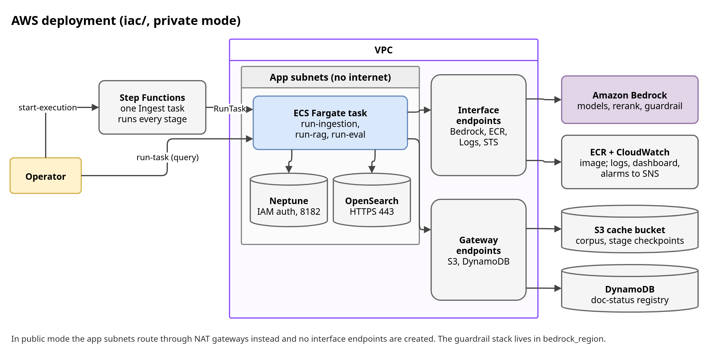

# unified-kg-rag-on-aws — Infrastructure (AWS CDK, Python)

A modular CDK app that provisions the AWS stack the library targets: Neptune,
OpenSearch, a DynamoDB doc-status table and an S3 cache bucket in a VPC, an
ECS Fargate data plane, a Step Functions ingestion pipeline, CloudWatch
alarms and a dashboard, and an optional Bedrock Guardrail.

- [Quick start](#quick-start): synthesize and deploy.
- [After deploy](#after-deploy): push the image, ingest, query, evaluate.
- [Configuration](#configuration-cdkjson-context---c-keyvalue): every
  `-c key=value` option.
- [Cost drivers](#cost-drivers) and [CloudWatch tracing](#cloudwatch-tracing-optional).

Operating a deployment (re-ingesting, failed documents, alarms, backups) is in
the [Operator Runbook](../docs/operations.md).

## Quick start

Prerequisites:

- [uv](https://docs.astral.sh/uv/) and Python 3.12+. `iac/` is a uv project of
  its own: `iac/uv.lock` pins the CDK libraries.
- Node.js 22 or 24 (CI uses 24) and the AWS CDK CLI v2.1143.0 or later
  (`npm install -g aws-cdk@2.1143.0`, the version CI pins); an older CLI can
  reject the cloud assembly the locked `aws-cdk-lib` produces.
- AWS credentials for the target account and region to bootstrap and deploy,
  and Docker to push the app image.

```bash
cd iac
uv sync --locked          # installs exactly what iac/uv.lock pins
. .venv/bin/activate      # or prefix each command below with `uv run`

cdk synth                                          # preview, no AWS changes
cdk synth -c vpc_id=vpc-0abc... -c cache_bucket_name=my-cache   # reuse a VPC and bucket
cdk synth -c network_mode=public                   # NAT egress instead of VPC endpoints

cdk bootstrap            # once per account and region (and for bedrock_region
                         # when it differs from the deploy region)
cdk deploy --all         # creates billable resources
```

Pass every `-c key=value` as its own argument: collapsing them into one shell
variable corrupts context parsing (`vpc_id` is silently dropped and
`Vpc.from_lookup` falls back to a dummy VPC).

> **Cost and teardown.** Neptune, OpenSearch, interface endpoints and (in
> `public` mode) NAT gateways bill while the stack exists, whether or not
> anything runs ([Cost drivers](#cost-drivers)). In the default `dev`
> environment `cdk destroy --all` removes everything; other environments
> default to `removal_destroy=false` and `deletion_protection=true`.

## Deployment topology



- **One VPC holds the data plane.** The Fargate task, the Neptune cluster and
  the OpenSearch domain share the `app` subnets and one security group that
  allows Neptune (8182) and OpenSearch (443) between its members, so both
  stores are reachable only from inside the VPC.
- **`private` mode (default).** The `app` subnets have no internet route, and
  a created VPC has no public subnet or internet gateway. The task reaches AWS
  only through interface endpoints and the S3/DynamoDB gateway endpoints, so
  Bedrock must be in the deploy region. In `public` mode the subnets route
  through one NAT gateway per AZ and Bedrock may be elsewhere.
- **Tasks.** Step Functions runs ingestion as one Fargate task; a re-run
  execution resumes from the S3 stage checkpoints. Queries (`run-rag`,
  `run-eval`) run as one-off tasks of a second, read-only task definition.
- The optional guardrail stack lives in `bedrock_region`.

## Stacks

Stack ids are PascalCase with a `GraphRag` prefix. The default `dev`
environment keeps the bare ids (`GraphRagNetwork`, ...); any other `env_name`
adds a segment (`-c env_name=prod` gives `GraphRagProdNetwork`, ...) so
several environments coexist in one account and region.

| Stack | Resources |
|---|---|
| `GraphRagNetwork` | VPC (reused or created), subnets, the data-plane security group; for a created VPC the S3/DynamoDB gateway endpoints and, in `private` mode, interface endpoints for Bedrock (`bedrock`, `bedrock-runtime`, `bedrock-agent-runtime`), ECR, CloudWatch Logs and STS, each with an endpoint policy that admits only this account's principals |
| `GraphRagStorage` | Neptune cluster (IAM auth), OpenSearch domain (in the VPC, encrypted), DynamoDB doc-status table (TTL on `lease_expires_at`, so an abandoned write lease expires), S3 cache bucket |
| `GraphRagCompute` | ECR repository, ECS cluster, the ingestion task definition with a least-privilege role (cache read and put, no delete), and the query task definition (`run-rag` / `run-eval`) whose role only reads the stores and has no DynamoDB access |
| `GraphRagOrchestration` | Step Functions state machine: one resumable ingestion task (the task-definition revision deployed with it), retried only when ECS cannot start it, with a JSON failure notification to the SNS alarm topic (encrypted with its own customer-managed key, since CloudWatch alarms cannot publish to a topic under `alias/aws/sns`) |
| `GraphRagObservability` | CloudWatch dashboard and alarms on pipeline runs, store health and capacity, reading this deployment's `Environment` series only ([Alarms](../docs/operations.md#alarms)); synth warns when `alarm_email` is unset |
| `GraphRagSecurity` | The shared customer-managed KMS key (`use_cmk`) |
| `GraphRagGuardrail` | A baseline Bedrock Guardrail in `bedrock_region` ([Guardrail](#guardrail)) |

**Resource naming.** Physical resources are named `<prefix>-<purpose>`, the
prefix being `graphrag` in `dev` and `<env>-graphrag` otherwise. For `dev`:

| Resource | Name |
|---|---|
| S3 cache bucket | `graphrag-cache-<account>-<region>` |
| DynamoDB doc-status | `graphrag-doc-status-v2` |
| ECR repository | `graphrag-app` |
| ECS cluster | `graphrag-cluster` |
| Step Functions | `graphrag-ingestion` |
| SNS alarm topic | `graphrag-pipeline-alarms` |
| CloudWatch dashboard | `graphrag-dashboard` |
| KMS alias | `alias/graphrag-data` |
| Bedrock guardrail | `graphrag-guardrail-<region>` |
| Log groups | `/graphrag/tasks`, `/graphrag/pipeline` |

Neptune, OpenSearch and task-definition names are generated by
CloudFormation, to avoid replace-on-rename conflicts. Every resource is tagged
`project=unified-kg-rag-on-aws`, `env=<env_name>`, `managed-by=cdk`, `owner`
and `cost-center`.

## Configuration (cdk.json context / `-c key=value`)

Boolean keys take `true`/`false` (also `yes`/`no`, `on`/`off`, `1`/`0`); any
other value fails synth. Counts and sizes must be positive integers; synth
names a key whose value is out of range. An unknown key fails synth with a
did-you-mean hint.

**Environment and network**

| Key | Default | Meaning |
|---|---|---|
| `env_name` | `dev` | Name prefix: `dev` keeps the bare names, any other value scopes them (`GraphRagProd*`, `prod-graphrag-*`) |
| `network_mode` | `private` | `private`: isolated subnets and VPC endpoints, no NAT; `public`: subnets with NAT egress |
| `vpc_id` | — | Reuse a VPC. The stack adds no endpoints or subnets to it (synth lists what it needs): `private` needs `PRIVATE_ISOLATED` subnets, the S3/DynamoDB gateway endpoints and private-DNS interface endpoints for `bedrock`, `bedrock-runtime`, `bedrock-agent-runtime`, `ecr.api`, `ecr.dkr`, `logs`, `sts` (and `xray` with tracing); `public` needs `PRIVATE_WITH_EGRESS` subnets |
| `max_azs` | `2` | AZs of a created VPC; at least 2 (Neptune needs two) |
| `bedrock_region` | deploy region | Bedrock runtime region (`UKR__AWS__BEDROCK__REGION_NAME`) and the guardrail stack's region. In `private` mode it must equal the deploy region |
| `vpc_flow_logs` | `false` (dev) / `true` | VPC flow logs (created VPC only), kept `flow_log_retention_days` (default `731`) |

**Stores**

| Key | Default | Meaning |
|---|---|---|
| `neptune_instance` | `db.r6g.large` | Provisioned Neptune instance class; setting it with `neptune_serverless_ncu` fails synth |
| `neptune_serverless_ncu` | — | `MIN-MAX` capacity units (e.g. `1-16`; one NCU is about 2 GiB, a `db.r6g.large` about 8). Set, every instance runs as Neptune Serverless; switching a deployed cluster changes each instance in place, so do it between runs |
| `neptune_instances` | `1` (dev) / `2` | Neptune instances; 2 or more is Multi-AZ |
| `backup_retention_days` | `7` | Neptune automated backups, 1-35 days ([Backup and restore](../docs/operations.md#backup-and-restore)) |
| `opensearch_instance` | `r6g.large.search` | OpenSearch data node type |
| `opensearch_count` | `1` (dev) / `2` | Data nodes. Above 1: three dedicated masters (`opensearch_master_instance`, default `m6g.large.search`) and zone awareness over as many AZs as data nodes, up to 3 and the VPC's AZs; a domain in 2 AZs needs an even count. Moving a deployed domain to more AZs (e.g. to 3) is a blue/green deployment (every shard copied, slower for hours on a large domain): deploy it with no ingestion running |
| `opensearch_volume_gib` | `50` | gp3 volume per data node; the free-storage alarm fires at 40% free |
| `opensearch_korean_analyzer` | `cjk` | Analyzer of Korean text (`UKR__INDEXING__OPENSEARCH__LANGUAGE_ANALYZERS__KO`). The domain has `nori` only once its Nori package is associated; to use it, associate the package (a blue/green deployment), deploy with `nori` and re-run once with `indexing.reset: true` |
| `doc_status_table` | `graphrag-doc-status-v2` (dev) / `<env>-graphrag-doc-status-v2` | Doc-status table (`UKR__AWS__DYNAMODB__TABLE_NAME`); changing it creates a new, empty registry |
| `cache_bucket_name` | — | Reuse an S3 cache bucket |
| `corpus_bucket_name` | — | A bucket the corpus (or an evaluation dataset) is read from: both task roles get read access and, in `private` mode, the S3 endpoint allows it |

**Compute**

| Key | Default | Meaning |
|---|---|---|
| `fargate_cpu` | `2048` | Task vCPU units (`256` to `16384`) |
| `fargate_memory` | `8192` | Task memory (MiB), a size Fargate offers for `fargate_cpu` |
| `ingestion_ephemeral_storage_gib` | `40` | Ingestion task disk (21-200 GiB): about twice the corpus plus the stage cache |
| `image_tag` | `latest` | Image tag the tasks pull; any other tag makes the repository's tags immutable (the ECR lifecycle keeps it and the 10 newest images) |
| `sfn_timeout_hours` | `6` | State machine timeout for a whole run |

**Security**

| Key | Default | Meaning |
|---|---|---|
| `use_cmk` | `false` | Customer-managed KMS key for S3, Neptune, OpenSearch, DynamoDB, ECR and every log group. Choose it before the first deploy: ECR sets a repository's encryption only at creation, so switching it on a deployed environment fails until the compute stack is destroyed and redeployed |
| `deletion_protection` | `false` (dev) / `true` | Deletion protection on the Neptune cluster and the doc-status table (OpenSearch has none; outside dev the domain is kept on stack deletion by `removal_destroy=false`, which does not stop a direct `DeleteDomain` call) |
| `removal_destroy` | `true` (dev) / `false` | `DESTROY` or `RETAIN` on stack deletion for the stores, keys, guardrail, ECR repository and fixed-name log groups. Retained fixed-name resources fail the next deploy on the duplicate name, so delete them by hand after a `cdk destroy` |
| `bedrock_model_arns` | — | Scope Bedrock `InvokeModel` to these ARNs (a list, or a comma-separated string). Foundation-model ARNs keep the `inference-profile/*` grants (models offered only through a profile, Claude 4.5 and later, are called by profile id and still authorized against the listed models); list them with a `*` region, since profiles route across regions. Any inference-profile ARN in the list makes it exact. `Rerank` and `ListInferenceProfiles` stay on `*` |
| `create_guardrail` | `true` | Create and keep a baseline guardrail in `bedrock_region`; `false` brings your own ([Guardrail](#guardrail)) |
| `guardrail_identifier` | — | Guardrail id the task uses (`UKR__AWS__BEDROCK__GUARDRAIL__IDENTIFIER`); the task role gets `bedrock:ApplyGuardrail` on it only |
| `guardrail_version` | — | Published version the task applies (`UKR__AWS__BEDROCK__GUARDRAIL__VERSION`); unset applies the mutable `DRAFT` (synth warns) |

**Observability and tags**

| Key | Default | Meaning |
|---|---|---|
| `alarm_email` | — | Subscribe an email to the alarm topic |
| `enable_cloudwatch_tracing` | `false` | Send traces to CloudWatch through an ADOT collector sidecar ([CloudWatch tracing](#cloudwatch-tracing-optional)); `env_name` may then be at most 10 characters |
| `enable_cdk_nag` | `false` | Run the cdk-nag AwsSolutions checks at synth |
| `owner`, `cost_center` | `aws-proserve`, `unified-kg-rag-on-aws` | Tags applied to every resource |

**The Neptune engine version is not pinned.** A new cluster starts on
Neptune's default engine version at creation; pinning one now would change the
engine of every deployed cluster not on it. The client is pinned instead
(`gremlinpython` below 3.8 until Neptune supports TinkerPop 3.8). To fix a
version for a new deployment, set `engine_version` in `storage_stack.py` before
its first deploy.

### Guardrail

The guardrail must live in the Bedrock runtime region (`bedrock_region`),
which can differ from the deploy region, so it is its own stack, and a
two-step flow avoids cross-region CloudFormation references. The baseline
guardrail anonymizes email, phone and card numbers but not `NAME`: names are
corpus content, and anonymizing them in the screened query and answer removes
the name a question retrieves by and puts `{NAME}` in answers.

```bash
# 0) once, when bedrock_region differs from the deploy region (needs network_mode=public)
cdk bootstrap aws://<account>/us-west-2
# 1) create the guardrail; note the GuardrailIdentifier and GuardrailVersion outputs
cdk deploy GraphRagGuardrail -c network_mode=public -c bedrock_region=us-west-2 …
# 2) pass both so compute injects them into the task
cdk deploy --all -c network_mode=public -c bedrock_region=us-west-2 \
  -c guardrail_identifier=<id> -c guardrail_version=<version> …
```

- In `private` mode leave `bedrock_region` unset: the same two steps create
  the guardrail in the deploy region, and step 0 is not needed.
- **Pass both flags on every later deploy**, or compute stops injecting them
  (without a version the task applies `DRAFT`, which every edit changes at
  once). To change the baseline policy, edit `iac/stacks/guardrail_stack.py`
  and deploy `GraphRagGuardrail`: a new version is published and the previous
  one kept, which the tasks apply until you redeploy with the new
  `-c guardrail_version`.
- **An external guardrail:** `-c create_guardrail=false
  -c guardrail_identifier=<id>` (and a version you published with
  `aws bedrock create-guardrail-version`); the stack then creates nothing.
  Setting only `guardrail_identifier` still creates the baseline guardrail
  (`create_guardrail` defaults to `true`), and synth warns.
- The created guardrail follows `removal_destroy`: deleted in dev, retained
  otherwise; delete a retained one by hand
  (`aws bedrock delete-guardrail --guardrail-identifier <id> --region <bedrock_region>`)
  or the next deploy fails on the duplicate name.

### Well-Architected

The stacks apply least-privilege IAM (Bedrock model and inference-profile
ARNs, `neptune-db:connect`, domain-scoped `es:ESHttp*`), encryption in transit
and at rest, Graviton instances, a lifecycle on the checkpoint prefixes, S3
access logs, Step Functions tracing and execution logs, and an SSL-only alarm
topic; production hardening is opt-in through the flags above. Validate with:

```bash
cdk synth -c enable_cdk_nag=true                       # dev
cdk synth -c enable_cdk_nag=true -c use_cmk=true \
  -c vpc_flow_logs=true -c neptune_instances=2 -c opensearch_count=2 \
  -c deletion_protection=true -c removal_destroy=false  # prod-hardened
```

Both report zero AwsSolutions findings and run in CI
(`iac/tests/test_app_nag.py` repeats them with a concrete account). Accepted
findings are documented in `iac/nag_suppressions.py`: `AwsSolutions-IAM5` is
suppressed per role for the listed wildcards only, so a new wildcard fails
synth. `bedrock:Rerank` and `bedrock:ListInferenceProfiles` use
`Resource: "*"` by necessity (the Rerank API authorizes against another
resource shape than `InvokeModel`; the profile list has no resource scoping);
`InvokeModel` stays scoped.

## Cost drivers

No prices are listed; use the [AWS Pricing Calculator](https://calculator.aws/)
for your region and sizes. What scales each service's cost:

| Service | Cost grows with | Levers |
|---|---|---|
| Bedrock models | Tokens per ingestion (extraction per chunk, up to `max_rounds` gleaning calls, a report per community, optional claims) and per query | Fast tier for light roles, `aws.bedrock.ingestion_effort`, `processing.gleaning.max_rounds`, claims off, incremental indexing |
| Bedrock embeddings and rerank | Embedded text units, entities, relationships and reports; one rerank call per query | `indexing.opensearch.persist_embedding_cache`, `search.reranking.top_k` |
| Neptune | Provisioned instance-hours × `neptune_instances`, or Serverless NCU-hours (never below `MIN` per instance, so an idle cluster still bills `MIN`); storage, I/O, backups | `neptune_instance` or `neptune_serverless_ncu` (a low `MIN` for an environment idle most of the day), `neptune_instances`, `backup_retention_days`, tear down dev |
| OpenSearch | Data node-hours × `opensearch_count`, three masters when above 1, gp3 storage per node | `opensearch_instance`, `opensearch_master_instance`, `opensearch_count` |
| Fargate | vCPU, memory and disk above 20 GiB for the time tasks run | `fargate_cpu`, `fargate_memory`, `ingestion_ephemeral_storage_gib` |
| Interface endpoints (`private`) | Seven endpoints (eight with tracing) × `max_azs` per AZ-hour, plus data | `max_azs`, or a reused VPC's endpoints |
| NAT gateways (`public`) | One per AZ per hour, plus data | `max_azs`, or `private` mode |
| S3 | Checkpoints, embedding cache, corpus, access logs | 30-day expiry on `pipeline-runs/` and `embedding-cache/` |
| DynamoDB | On-demand: one projected query of the namespace per run and one record per processed document; point-in-time recovery | Fewer, larger runs |
| CloudWatch | Log ingestion and retention, alarms, dashboard; Container Insights metrics and performance logs (always on: per-task CPU and memory, which the `IngestionTaskMemory` alarm reads) | `vpc_flow_logs`, `flow_log_retention_days` |
| KMS | Keys per month and requests: the alarm-topic key always, the data key with `use_cmk` | `use_cmk` |
| Step Functions | A few state transitions per run | — |
| CloudWatch traces (`enable_cloudwatch_tracing`) | Spans ingested by Transaction Search and indexed beyond the free 1% | `observability.sample_rate` in the image config, the indexing percentage |

## After deploy

The commands assume the default `dev` environment, a shell in the repository
root, and the AWS CLI v2, Docker and `jq`. For another `env_name`, use its
stack names (`GraphRagProdStorage`) and prefix (`prod-graphrag`).

### 1. Read the stack outputs

```bash
REGION=<deploy region>
output() {
  aws cloudformation describe-stacks --region "$REGION" --stack-name "$1" \
    --query "Stacks[0].Outputs[?OutputKey=='$2'].OutputValue" --output text
}
STATE_MACHINE_ARN=$(output GraphRagOrchestration StateMachineArn)
CACHE_BUCKET=$(output GraphRagStorage CacheBucketName)
UKR__AWS__NEPTUNE__ENDPOINT=$(output GraphRagStorage NeptuneEndpoint)
UKR__AWS__OPENSEARCH__ENDPOINT=$(output GraphRagStorage OpenSearchEndpoint)
```

| Stack | Output | Value |
|---|---|---|
| `GraphRagStorage` | `NeptuneEndpoint`, `OpenSearchEndpoint` | Bare hostnames, the form `aws.neptune.endpoint` / `aws.opensearch.endpoint` expect |
| `GraphRagStorage` | `CacheBucketName`, `DocStatusTableName` | Cache bucket and doc-status table |
| `GraphRagOrchestration` | `StateMachineArn` | Ingestion state machine |
| `GraphRagSecurity` | `KmsKeyArn` | Shared CMK (`use_cmk=true` only) |
| `GraphRagGuardrail` | `GuardrailIdentifier`, `GuardrailVersion` | Created guardrail, in `bedrock_region` |
| `GraphRagCompute` | `QueryTaskDefinitionArn`, `QueryTaskRoleArn` | Read-only query task definition and its role |
| `GraphRagCompute` | `CollectorImageUri` | Collector image to pull once (tracing only) |

The tasks already receive the endpoints, bucket, table and regions as
environment variables; the outputs are for tools that run elsewhere in the VPC.

### 2. Build and push the app image

```bash
ACCOUNT=$(aws sts get-caller-identity --query Account --output text)
REGISTRY="$ACCOUNT.dkr.ecr.$REGION.amazonaws.com"
aws ecr get-login-password --region "$REGION" \
  | docker login --username AWS --password-stdin "$REGISTRY"
docker build --platform linux/amd64 -f docker/Dockerfile -t "$REGISTRY/graphrag-app:latest" .
docker push "$REGISTRY/graphrag-app:latest"
```

- Outside dev, push a unique version tag and deploy with `-c image_tag=<tag>`,
  so a pushed image cannot be swapped under the running task definition.
- Extras: `--build-arg UV_EXTRAS="--extra unstructured"` to parse `.md` /
  `.html` files, `--extra otel` with `enable_cloudwatch_tracing` (both:
  `"--extra otel --extra unstructured"`).
- The image bakes in the endpoint-free `docker/config.yaml` (it turns on
  `providers.doc_status.enabled`, so ingestion is incremental). The task
  injects the deployed values: `UKR__AWS__NEPTUNE__ENDPOINT`,
  `UKR__AWS__OPENSEARCH__ENDPOINT`, `UKR__AWS__S3__BUCKET_NAME`, `AWS_REGION`,
  `UKR__AWS__BEDROCK__REGION_NAME`, `UKR__LOGGING__LOG_FORMAT`,
  `UKR__INDEXING__OPENSEARCH__INDEX_SETTINGS__NUMBER_OF_REPLICAS` (1 on a
  multi-node domain, 0 on one node),
  `UKR__INDEXING__OPENSEARCH__LANGUAGE_ANALYZERS__KO`,
  `UKR__AWS__DYNAMODB__TABLE_NAME`,
  `UKR__AWS__DYNAMODB__CREATE_TABLE_IF_MISSING=false`,
  `UKR_METRICS_ENVIRONMENT` (`env_name`, the dimension the alarms watch) and,
  when set, `UKR__AWS__BEDROCK__GUARDRAIL__IDENTIFIER` and `__VERSION`.
- Cache uploads use the bucket's default encryption, so with `use_cmk=true`
  objects are encrypted with the CMK.

### 3. Upload the corpus and start an ingestion run

```bash
aws s3 sync ./source "s3://$CACHE_BUCKET/corpus/" --region "$REGION"

# Run one ingestion at a time: check that none is in progress first.
aws stepfunctions list-executions --region "$REGION" \
  --state-machine-arn "$STATE_MACHINE_ARN" --status-filter RUNNING

EXECUTION_ARN=$(aws stepfunctions start-execution --region "$REGION" \
  --state-machine-arn "$STATE_MACHINE_ARN" \
  --input "{\"source_directory\":\"s3://$CACHE_BUCKET/corpus/\",\"pipeline_id\":\"run-001\"}" \
  --query executionArn --output text)

aws stepfunctions describe-execution --region "$REGION" \
  --execution-arn "$EXECUTION_ARN" --query status --output text
aws logs tail /graphrag/tasks --region "$REGION" --follow
```

- **Input.** Exactly two keys, passed as `UKR_SOURCE_DIRECTORY` /
  `UKR_PIPELINE_ID`. `source_directory` must be an `s3://` URI: the entrypoint
  (`docker/entrypoint.sh`) syncs it to the task's disk first. `pipeline_id`
  takes letters, digits, `.`, `_` and `-`, starting with a letter or digit,
  without `..`, up to 128 characters.
- **Resume.** Start a new execution with the same input: the task skips the
  stages that completed. Checkpoints are uploaded after every stage and on
  SIGTERM (the container's stop timeout is 120 s; the stage's store writes
  stop at their next request), so a timed-out execution resumes at the stage
  that was running. Of the uploads, only the final one fails the run; a
  failed per-stage or on-stop upload only warns, and a stop after a lost
  lease skips it. If the corpus changed in between,
  the task fails its integrity check; use a new `pipeline_id` to rebuild.
- **Buckets.** The task role reads and writes the cache bucket only
  (`-c corpus_bucket_name=<bucket>` for another corpus bucket). In `private`
  mode the gateway endpoints allow only this deployment's buckets, table and
  the ECR layer bucket. The 30-day expiry applies only to `pipeline-runs/`
  and `embedding-cache/`: do not put the corpus under them, since an expired
  source file looks deleted to the next incremental run.
- **One run at a time.** The state machine does not stop a second execution;
  the doc-status registry's write lease stops the second run with
  `NamespaceLeaseError` once it has synced the corpus, before it downloads its
  checkpoint, reads the stores or writes anything
  ([Concurrent runs](../docs/operations.md#concurrent-runs)).

### 4. Query from inside the VPC

Both stores accept connections only from inside the VPC, so run `run-rag` as a
one-off task of the read-only query task definition, in the subnets and
security group the state machine uses:

```bash
DEFINITION=$(aws stepfunctions describe-state-machine --region "$REGION" \
  --state-machine-arn "$STATE_MACHINE_ARN" --query definition --output text)
INGEST=$(echo "$DEFINITION" | jq '.States.Ingest.Parameters')
CLUSTER=$(echo "$INGEST" | jq -r '.Cluster')
TASK_DEFINITION=$(output GraphRagCompute QueryTaskDefinitionArn)
SUBNETS=$(echo "$INGEST" | jq -r '.NetworkConfiguration.AwsvpcConfiguration.Subnets | join(",")')
SECURITY_GROUPS=$(echo "$INGEST" | jq -r '.NetworkConfiguration.AwsvpcConfiguration.SecurityGroups | join(",")')

TASK_ARN=$(aws ecs run-task --region "$REGION" --cluster "$CLUSTER" \
  --launch-type FARGATE --task-definition "$TASK_DEFINITION" \
  --network-configuration "awsvpcConfiguration={subnets=[$SUBNETS],securityGroups=[$SECURITY_GROUPS],assignPublicIp=DISABLED}" \
  --overrides '{"containerOverrides":[{"name":"app","command":["run-rag","--config-path","/app/config.yaml","--query","What are the main themes?","--search-strategy","global"]}]}' \
  --query 'tasks[0].taskArn' --output text)

aws ecs wait tasks-stopped --region "$REGION" --cluster "$CLUSTER" --tasks "$TASK_ARN"
aws logs tail /graphrag/tasks --region "$REGION" --since 30m
```

The override must name the CLI (`run-rag ...`); the answer is in the task's
log stream (`app/app/<task id>`). The query role cannot write or delete in
either store and has no DynamoDB access; do not run queries with the
ingestion task definition. `--suffix` selects a corpus by name only, so a
serving layer must set it from the authenticated caller
([Query access and tenant isolation](../docs/operations.md#query-access-and-tenant-isolation)).

### 5. Evaluate from inside the VPC

`run-eval` runs the same way. The task's disk is discarded on exit, so pass
`s3://` paths for the dataset and the results, under the cache bucket's
`eval/` prefix (the only prefix the query role reads and writes). Reuse the
variables from step 4:

```bash
aws s3 cp ./eval_data.json "s3://$CACHE_BUCKET/eval/eval_data.json" --region "$REGION"

OVERRIDES=$(jq -nc \
  --arg data "s3://$CACHE_BUCKET/eval/eval_data.json" \
  --arg out "s3://$CACHE_BUCKET/eval/results/run-001/" \
  '{containerOverrides:[{name:"app",command:["run-eval","--config-path","/app/config.yaml","--data-path",$data,"--output-directory",$out,"--search-strategy","auto"]}]}')

TASK_ARN=$(aws ecs run-task --region "$REGION" --cluster "$CLUSTER" \
  --launch-type FARGATE --task-definition "$TASK_DEFINITION" \
  --network-configuration "awsvpcConfiguration={subnets=[$SUBNETS],securityGroups=[$SECURITY_GROUPS],assignPublicIp=DISABLED}" \
  --overrides "$OVERRIDES" \
  --query 'tasks[0].taskArn' --output text)

aws ecs wait tasks-stopped --region "$REGION" --cluster "$CLUSTER" --tasks "$TASK_ARN"
aws ecs describe-tasks --region "$REGION" --cluster "$CLUSTER" --tasks "$TASK_ARN" \
  --query "tasks[0].containers[?name=='app'].exitCode | [0]" --output text
aws s3 ls "s3://$CACHE_BUCKET/eval/results/run-001/" --region "$REGION"
```

The container's exit code is `run-eval`'s: `1` when the failure budget is
exceeded, the dataset cannot be downloaded or a result fails to upload; `2`
for a usage or configuration error; `143` when the task is stopped (the
finished runs' results are still uploaded). See
[exit codes](../docs/user-guide.md#cli-exit-codes-and-json-output).

## CloudWatch tracing (optional)

CloudWatch accepts OTLP traces at `https://xray.<region>.amazonaws.com/v1/traces`
signed with SigV4. The app's exporter does not sign requests, so
`-c enable_cloudwatch_tracing=true` adds an AWS Distro for OpenTelemetry (ADOT)
collector sidecar that signs them with the task role and forwards them. The
app exports its spans (stages, queries, retrieval, rerank, model calls with
token usage) to the collector on `127.0.0.1:4318`; prompt and completion text
is not recorded (`observability.capture_content` stays `false`).

1. **Turn on Transaction Search** once per account and region; the traces
   endpoint rejects spans until it is on. It is an account-wide setting that
   moves all X-Ray span ingestion in the region to CloudWatch Logs (the
   `aws/spans` log group, billed as log ingestion) and indexes 1% of spans as
   trace summaries for free, so check it first; another workload may rely on
   the current destination:

   ```bash
   aws xray get-trace-segment-destination --region "$REGION"
   ```

   `"Destination": "CloudWatchLogs", "Status": "ACTIVE"` means it is on.
   Otherwise turn it on in the CloudWatch console (**Application Signals,
   Transaction Search, Enable Transaction Search**), which also sets up the
   log-group resource policy X-Ray needs, or follow the
   [Transaction Search guide](https://docs.aws.amazon.com/AmazonCloudWatch/latest/monitoring/Enable-TransactionSearch.html).
   Spans can take 10 minutes to become searchable. To turn it off, run
   `aws xray update-trace-segment-destination --destination XRay`, then delete
   the resource policy and the `aws/spans` and `/aws/application-signals/data`
   log groups yourself if nothing else uses them.
2. **Build the image with the `otel` extra** (step 2 of
   [After deploy](#2-build-and-push-the-app-image)); without it the run fails
   at start-up with `observability.enabled is true but OpenTelemetry is not installed`.
3. **Deploy** with `cdk deploy --all -c enable_cloudwatch_tracing=true`, and
   keep the flag on every later deploy (or in `cdk.json`), or the next deploy
   removes the sidecar.
4. **Pull the collector image once** from a workstation before the first run.
   The image comes through an ECR pull-through cache whose first pull may need
   an internet route (the `private` data plane reaches ECR only through an
   interface endpoint), and ECS fails a task that cannot pull any of its
   images. Repeat after an upgrade that changes the pinned digest; outside
   `dev`, use the environment's stack name.

   ```bash
   REGION=<deploy region>
   COLLECTOR_IMAGE=$(aws cloudformation describe-stacks --region "$REGION" \
     --stack-name GraphRagCompute \
     --query "Stacks[0].Outputs[?OutputKey=='CollectorImageUri'].OutputValue" \
     --output text)
   aws ecr get-login-password --region "$REGION" \
     | docker login --username AWS --password-stdin "${COLLECTOR_IMAGE%%/*}"
   docker pull --platform linux/amd64 "$COLLECTOR_IMAGE"
   ```

What the option changes:

- **Task definition**: a non-essential `otel-collector` container (ADOT
  collector `v0.50.0`, pinned by digest in `compute_stack.py`), so a collector
  that crashes or cannot export loses traces but never stops a run (an image
  ECS cannot pull does). The `app` container starts after it with
  `UKR__OBSERVABILITY__ENABLED=true`, `UKR__OBSERVABILITY__BACKEND=otlp`,
  `OTEL_EXPORTER_OTLP_ENDPOINT=http://127.0.0.1:4318` and
  `OTEL_RESOURCE_ATTRIBUTES=deployment.environment=<env_name>`. The collector
  logs under the `otel-collector/` stream prefix.
- **Image source**: an ECR pull-through cache rule for ECR Public (prefix
  `<prefix>-ecr-public`), because the `private` data plane cannot reach
  `public.ecr.aws`; `cdk destroy` removes the rule but not the cached
  repository.
- **IAM**: `xray:PutTraceSegments` on the task role, the one action the OTLP
  traces endpoint authorizes (`xray:PutSpans` alone gets a 403), and pull and
  import rights on the cached repository for the execution role.
- **Network**: in `private` mode an `xray` interface endpoint; a reused
  private VPC must provide it.

**Where to look.** Run an ingestion or a query, then open the CloudWatch
console, **Application Signals, Transaction Search**, and filter on the
service `unified-kg-rag`. Each ingestion run is one `kg_rag.ingestion.run`
trace and each `run-rag` query one `kg_rag.query` trace, with the children
listed in the [runbook's trace shape](../docs/operations.md#trace-shape). A `run-eval` run is one
`kg_rag.batch` trace: its queries are `kg_rag.query` children of that root, so
the list shows the batch, not each query; each evaluator (and
`--pairwise-judge`) adds one `kg_rag.evaluate` trace holding its judge model
calls. The spans are also in the `aws/spans` log
group, for Logs Insights (if a field comes back empty, run
`fields @message | limit 5` first to see the exact field paths):

```text
fields @timestamp, name, durationNano, attributes.gen_ai.usage.input_tokens, traceId
| filter resource.attributes.service.name = "unified-kg-rag"
| sort @timestamp desc
| limit 50
```

If no trace arrives, read the `otel-collector/` log streams of the task log
group (`/<prefix>/tasks`): a `403` means a missing X-Ray permission or the
wrong SigV4 service, a rejection naming the destination means Transaction
Search is off, and a connection timeout in `private` mode means the `xray`
interface endpoint is missing (a reused VPC must provide it). A collector
that crashes or cannot export never fails the run, since its container is not
essential; a collector image ECS cannot pull does (`CannotPullContainerError`
in the stopped task's reason), so pull it once as in step 4.

**Cost.** Transaction Search bills spans as CloudWatch Logs ingestion and
storage in `aws/spans`, and charges for indexed spans above the free 1%. An
ingestion run emits a span per stage, batch and model call, so a large corpus
produces many spans: lower `observability.sample_rate` in the image config to
sample root traces, and keep the indexing percentage at 1% unless you search
trace summaries. The `xray` interface endpoint (private mode) bills per
AZ-hour like the others.

### Without the CDK stacks

Run the same collector configuration yourself; the
one the stack renders (`compute_stack.py`, after the CloudWatch OTLP guide) is,
for `us-east-1`. The memory limit fits a 512 MiB container, and the exporter
has no queue and no retry so a shutdown flush ends inside ECS's 30 s stop
timeout:

```yaml
extensions:
  health_check:
    endpoint: 127.0.0.1:13133
  sigv4auth/traces:
    region: us-east-1
    service: xray
receivers:
  otlp:
    protocols:
      http:
        endpoint: 127.0.0.1:4318
processors:
  memory_limiter:
    check_interval: 1s
    limit_mib: 400
    spike_limit_mib: 100
  batch:
    send_batch_size: 512
    send_batch_max_size: 1000
    timeout: 5s
exporters:
  otlp_http/traces:
    traces_endpoint: https://xray.us-east-1.amazonaws.com/v1/traces
    compression: gzip
    auth:
      authenticator: sigv4auth/traces
    timeout: 10s
    sending_queue:
      enabled: false
    retry_on_failure:
      enabled: false
service:
  extensions: [health_check, sigv4auth/traces]
  pipelines:
    traces:
      receivers: [otlp]
      processors: [memory_limiter, batch]
      exporters: [otlp_http/traces]
  telemetry:
    metrics:
      level: none
```

The collector's role needs `xray:PutTraceSegments`, the one action the OTLP
traces endpoint authorizes (`xray:PutSpans` alone gets a 403). The
`AWSXrayWriteOnlyAccess` managed policy the CloudWatch guide names includes
it.

### Account-level backstop: Bedrock model invocation logging

It records
every `InvokeModel` / `Converse` request and response in a region, embeddings
included, to CloudWatch Logs or S3, whatever this package's tracing does:
use it as the audit record and traces for the per-query breakdown. It does not
cover the Rerank call (`bedrock-agent-runtime`), and it holds full prompt and
response text, so protect its destination like captured content (restricted
readers, the CMK, a retention period). It is one setting per account and
region, shared by every workload there, so the CDK stacks do not manage it:
turning it on or off from a stack would change logging for everything else in
the account. Set it in the Bedrock runtime region (`bedrock_region`):

```bash
# Check first: an existing configuration is replaced by the put below.
aws bedrock get-model-invocation-logging-configuration --region "$UKR__AWS__BEDROCK__REGION_NAME"

aws bedrock put-model-invocation-logging-configuration --region "$UKR__AWS__BEDROCK__REGION_NAME" \
  --logging-config '{
    "cloudWatchConfig": {
      "logGroupName": "/aws/bedrock/model-invocation-logs",
      "roleArn": "arn:aws:iam::<account>:role/<bedrock-logging-role>"
    },
    "textDataDeliveryEnabled": true,
    "embeddingDataDeliveryEnabled": false
  }'
```

The log group must exist, and the role must trust `bedrock.amazonaws.com` and
allow `logs:CreateLogStream` and `logs:PutLogEvents` on it; the console
(**Amazon Bedrock, Settings, Model invocation logging**) can create both. See
[Monitor model invocation using CloudWatch Logs and Amazon S3](https://docs.aws.amazon.com/bedrock/latest/userguide/model-invocation-logging.html).
`aws bedrock delete-model-invocation-logging-configuration` turns it off.
In the CloudWatch console, **GenAI Observability, Model Invocations** lists
these logs next to Bedrock's own invocation, token and latency metrics.
